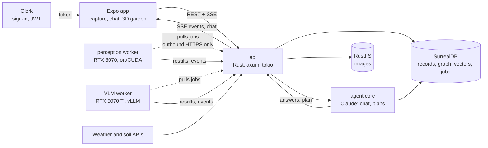

# GreenLens

Photograph a plant. Get a diagnosis, an action plan and a chat that knows your garden.

**[▶ See the interactive overview](https://claude.ai/artifact/DXjGy277KX26YQKZ6bdX3v)**: one scan walked through the app's screens, with each technology shown at the moment it powers. Its source is [docs/site/index.html](docs/site/index.html).

GreenLens (called PDM in the code and the docs) is a plant, crop and garden health app for the iPhone. It was built for [Build North: Ship Something Real](https://luma.com/build-north).

## What it does

A user photographs a plant. Computer vision on a home GPU rig assesses the plant, the soil and the surroundings. The results are combined with weather, soil data and the plant's history to produce a diagnosis and an action plan. The user can then chat about it, and the answers cite their sources.

### The demo story

Tomato 1 was diagnosed with early blight on Oct 11 and is recovering under its plan. One step of that plan is a weekly check of Tomato 2, 40 cm away. Today's check is the live scan: it catches early blight on Tomato 2 early. The story is told screen by screen in [docs/design/design.md](docs/design/design.md#5-the-demo-screen-by-screen).

## Features

"Mock" means the app runs the feature on built-in demo data. "Backend built" means the API side exists and its checks ran, as the roadmaps record. Status is as of Oct 24, 2026.

| Feature | What it does | Status |
|---|---|---|
| Capture | A camera-style capture with a mode bar, a coverage dial and guidance cards | App built, mock data; scan upload runs live against the deployed API |
| Live analysis | The pipeline's stages stream to the app over SSE as the scan runs | App built, mock data; the backend streams events (S1) |
| Diagnosis and action plan | A diagnosis with citations and a step-by-step plan, tinted from the photo | Backend built (S4); a scan ran end to end on the rig on Oct 24, ending in a cited plan from Claude. Diagnosis accuracy is not measured yet. App on mock data |
| Chat with answer blocks | Streaming chat with tools, memories and interactive blocks such as the frost cover planner | Backend built (S5); app on mock data, waiting on the block contract in the app |
| LiDAR and the 3D garden | Depth capture, plant measurement, a garden map and a 3D view | Native code compiles; waits on the iPhone for its checks. The 3D screen runs on mock data |
| Insights | Charts of a plant's health, spot cover, height and weather before the diagnosis | App built, mock data |
| Forecast alerts | A frost alert and cover planning from the weather forecast | Weather and soil are live on the API; alerts are part of S6 and S7, not yet checked |
| Farm connectors | A garden's Slack channels and Google Drive folder, searched by the chat and the plan writer | Backend built (S9), tested on Era by Eon's simulators; app screen on mock data |

Sources: [frontend roadmap](docs/frontend/roadmap.md#5-the-slices-at-a-glance), [backend roadmap](docs/backend/roadmap.md#3-the-slices-at-a-glance) and the "Current state" section of [AGENTS.md](AGENTS.md).

## How it works



1. The app uploads the photo to `api`, which stores it in RustFS and queues jobs in SurrealDB.
2. Workers on the GPU rig have no open ports. They pull jobs, run the models and post results and events back.
3. The perception worker finds the plant, the leaf and the lesions, and names the species. The VLM worker looks for organisms, soil and damage.
4. `api` joins the results with weather, soil data, the knowledge base and the plant's history, then the agent writes the diagnosis and the plan with Claude.
5. The app follows along over SSE, and the chat uses the same tools and records.

The full design is in [architecture §2](docs/architecture/README.md#2-system-overview) and [§6](docs/architecture/README.md#6-analysis-pipeline); the server-side sequences are in [backend flows](docs/backend/flows.md).

## Built with

| Technology | What we use it for | Pin | Docs |
|---|---|---|---|
| Anthropic Claude | Chat, the agent core and the plan writer (`claude-opus-5-5`); summaries, memory extraction and the cheap calls (`claude-haiku-5-5`); the vision fallback | Models as named | [architecture §7, §15](docs/architecture/README.md#7-chat-and-agent-core) |
| Claude Code | Builds the project with the repo's skills: Apple's HIG for the app and the Rust backend skills | Project skills in `.claude/skills/` | [CLAUDE.md](CLAUDE.md) |
| Clerk | Sign-in, MFA, JWTs checked by the API, account webhooks | `@clerk/expo` 4.x | [frontend §8](docs/frontend/README.md) |
| SurrealDB | Records, graph, vectors, geo, jobs and memory in one database | 3.3.4 | [docs/database](docs/database/README.md) |
| SurrealDB Agent Memory | Shared memories mirrored as beliefs that supersede by topic | Hosted service | [agent-memory.md](docs/database/agent-memory.md) |
| Era by Eon | Slack and Google Drive simulators that test the farm connectors, the agent evaluation and the demo | Images pinned by digest | [docs/connectors](docs/connectors/README.md), [docs/EON](docs/EON/README.md) |
| Expo | The iPhone app, with a Swift LiDAR module, the 3D garden view and a Live Activity | SDK 57, React Native 0.86 | [docs/frontend](docs/frontend/README.md) |
| Rust (axum, tokio) | The `api` and `worker` binaries and eight library crates | Rust 1.99.1, axum 0.8, tokio 1.53 | [docs/backend](docs/backend/README.md) |
| RustFS | Private image storage, served through signed API URLs | 1.0.1 | [docs/storage](docs/storage/README.md) |
| ort / CUDA and the VLM | Perception models on the RTX 3070 (ONNX Runtime); a vLLM sidecar serving Qwen3.5-9B AWQ on the RTX 5070 Ti (the RX 9070 XT is planned as a second VLM worker) | ONNX Runtime 1.31.0 | [docs/vision](docs/vision/README.md) |
| Python | Model training, ONNX export, evaluation and knowledge ingestion | Python 3.12 | [ml/README.md](ml/README.md) |

The pins are checked against the documents; the exact versions and image digests are in [docs/setup](docs/setup/README.md) and [docs/infra](docs/infra/README.md).

## Repository layout

```
PDM/
├─ app/        Expo app; app/modules/lidar is the Swift LiDAR module
├─ backend/
│  ├─ crates/  domain, store, blob, integrations, agent, vision, knowledge, pipeline
│  ├─ bins/    api, worker
│  └─ migrations/*.surql
├─ ml/         training, ONNX export, evaluation, knowledge ingestion
├─ infra/      compose files, Caddyfile, tunnel config
└─ docs/       architecture, backend, vision, frontend, design, database,
               storage, connectors, EON, setup, infra
```

## Getting started

Full tool lists by role and operating system are in [docs/setup](docs/setup/README.md). You need Git, Node.js 24 or newer and Docker; the iOS simulator needs a Mac.

### The app, in mock mode

Mock mode needs no backend and no Clerk key. It runs the demo story with a demo sign-in.

```sh
cd app
cp .env.example .env      # the example already sets EXPO_PUBLIC_API_MODE=mock
npm install
npm start                 # Expo Go; press i for the iOS simulator
```

Other commands: `npm run typecheck`, `npm run lint`, `npm test`. The LiDAR module, the 3D garden and the Live Activity need a development build (`npx expo run:ios --device`). Details are in [app/AGENTS.md](app/AGENTS.md).

### The backend with the dev services

```sh
docker compose -f infra/dev.compose.yml up -d    # SurrealDB and RustFS on a laptop
cd backend
set -a; . ../infra/dev/.env; set +a              # copy infra/dev/.env.example first
cargo run -p api                                 # listens on 127.0.0.1:8080
```

The API loads ONNX Runtime and the CPU models at start-up, so install them first. The steps, and how to point the app at your local API, are in the [frontend roadmap, "A local backend"](docs/frontend/roadmap.md#a-local-backend). The compose file is described in [docs/infra §4](docs/infra/README.md#infradevcomposeyml).

## Documentation

Every document has a status line, a changelog and a table of contents. [AGENTS.md](AGENTS.md) has the full map.

| Document | What it covers |
|---|---|
| [Architecture](docs/architecture/README.md) | Goals, system diagram, pipeline, chat and agent, flows, deployment |
| [Contracts](docs/architecture/contracts.md) | Every shape that crosses a boundary: endpoints, events, jobs, errors |
| [Backend](docs/backend/README.md) | The Rust workspace, crate by crate, and the [roadmap](docs/backend/roadmap.md) |
| [Frontend](docs/frontend/README.md) | App architecture, [flows](docs/frontend/flows.md), [screens](docs/frontend/screens.md), [roadmap](docs/frontend/roadmap.md) |
| [Design](docs/design/design.md) | The Conservatory direction and the [mockups](docs/design/mockups/index.html) |
| [Vision](docs/vision/README.md) | Models, the VLM, training, evaluation |
| [Database](docs/database/README.md) | SurrealDB notes and [Agent Memory](docs/database/agent-memory.md) |
| [Storage](docs/storage/README.md) | RustFS and signed image URLs |
| [Connectors](docs/connectors/README.md) | Slack and Google Drive connectors; [Era by Eon](docs/EON/README.md) |
| [Setup](docs/setup/README.md) | What to install, by role |
| [Infra](docs/infra/README.md) | CI, images, compose files, deploys |

## The hackathon

GreenLens is our entry in [Build North: Ship Something Real](https://luma.com/build-north).

- Build week: Oct 16–25, 2026.
- Submissions are due Oct 25 at 11:59 PM ET.
- Demo Day: Oct 29, 2026, in Toronto.
