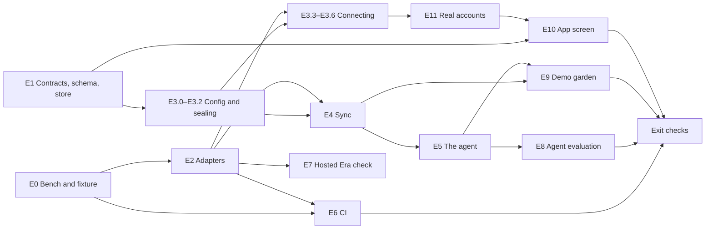

# Era by Eon: Development Roadmap

> **Status:** Draft v0.6.12, 2026-10-20. v0.6.12: gap G10 is closed: in a garden with farm records the router's classifier is also asked for a `farm_records` label, which counts as a care question, so Q02, Q10 and Q19 now reach the chat model; a garden without farm records is classified as before, and off-topic messages stay off-topic either way; the re-run left Q10 (answered from a scan memory) and Q19 (the search missed the message) to follow up. v0.6.11: E8.1 and E8.2 are in progress: `backend/tools/era-eval` runs the evaluation on the Slack half of the fixture and checks the first sync's journal, the Drive questions join when E4.3 returns its adapter from `era-eval`'s `bench::drive_source`, and the first runs found gaps G10 (farm questions routed off-topic) and G11 (a call's final output count dropped, fixed). v0.6.10: E6.3 is done: `era` is in `ci`'s `needs` after five green pushes to `main` (#69, #79, #78, #71, #76), so a failing Era test blocks a merge. v0.6.9: the E3 and E4 branches are merged, so T-E4.1's Sync-now `429` and T-E4.10's route half are covered by the connect routes' tests, and the sync reads tokens through `StoredTokens` like the routes; E3.3–E3.6 are done: the OAuth state is signed and claimed once before the code exchange, the connect routes and the source picker call the vendors through `api`'s `ConnectVendors` seam (decision 8; T-E3.8 is a route and an embedded-store test, not an Era one), pending connectors are cleaned up after 10 minutes, and deleting a garden or an owner's demotion, removal, leaving or account deletion revokes and deletes that owner's connectors through one path. v0.6.8: rounds no longer gate who is read: each round gives every chosen source a turn, a failed turn included, the budget left goes to passes in progress, and `synced_at` waits until no source has pages left or a failed last turn, so a channel that always fails, a long first pass or a re-read holds up the others for one turn at most; the older-thread checks need 140 s left, and a page can still overrun the budget by several paced calls. A third audit's fixes are in: a connector's sources rotate per run, so a channel mid-pass keeps the round open, a new channel joins the round and a failing one doesn't stop the others; a page is offered only the older-thread checks its budget covers; the record limit reads the garden's count before each page. A second audit's fixes are in: a run reads a connector's sources in rounds, older-thread checks are two per connector run, and the Era tests count checks and full reads exactly. E4.1, E4.2, E4.4, E4.5 and E4.6 are done (E4.3, the Drive sync, is not) and gaps G4 and G5 closed: the Slack sync and its stops are built and audited (shutdown interrupts a page in flight, a `429`'s wait is kept between a minute and an hour, a deleted reply and a reply to an older thread are read, a dropped source's records are not written back), and start-up seeding repairs an existing demo connector; T-E4.1's Sync-now `429` and T-E4.10's route half wait for E3.4's routes. v0.6.7: the `era` job runs on the rig's self-hosted runners, and its three simulator pairs take ephemeral loopback ports instead of 18091–18292. v0.6.6: E6.1, E6.2 and E6.4 are done: the `era` CI job runs the Era tests on three simulator pairs (open, faults, strict OAuth) and isn't required yet (E6.3); a bad OAuth code from either vendor is `auth_refused` and our own misconfiguration `Refused`. v0.6.5: E5.2, E5.3 and E5.5 are done and gap G6 closed: `search_farm_records` is offered when the garden has a record or an `active` or `reauth_needed` connector, returns at most 8 hits framed as `farm_records`, and its hits become the message's `farm_citations` (the records checked); the chat prompt says what was applied and when, never the rate. v0.6.4: E1.6 is done and gap G7 closed: every `FarmRecordStore` method is built; a garden's connector limit holds under racing creates through a `connector_rev` counter; each record keeps its source, so dropping one Drive folder keeps another's; Sync now refuses a stopped connector, and one arriving during a sync survives it; the 180-day cleanup deletes Slack messages only. v0.6.3: E10 waits on the app roadmap's F0 and F7 instead of a pull request, and E10.3 depends on E1.1 and F0, not on E10.1, since the farm citations are built in F4 (plans) and F6 (chat). v0.6.2: E3.0–E3.2 are done and gap G2 closed: the connector settings, connectors off without `CONNECTOR_KEY`, and tokens sealed with AES-256-GCM under the connector id and a purpose; the OAuth-state key is derived for E3.3, which is next. v0.6.1: E5.1 is done and gap G1 closed: every successful tool result reaches the model inside `<data>`, escaped before serialising, and `DataKind::FarmRecords` waits for E5.2. v0.6: E2 is done: the Slack and Google Drive clients, their wiremock tests and the Era harness, with every `era_` test in one serial nextest group because faults are global. Under `throttle` both simulators answer `429` with `retry-after: 1` on every call until the retries run out; under `quota_limit: 1`, the second call gets `retry-after: 60` (ran). v0.5.1: E1.6 reads the new plan and message fields with a default, since rows written before them read as `NONE`. v0.5: E1.1–E1.5 are done (the types, ports, schema, declared routes and documents; the routes answer `409 invalid_state` until E3) and E1.6, the store repositories, is next; [connectors](../connectors/README.md) v0.3 follows the types. v0.4: E0 is done: the `era` compose profile, connectors 10 corrected, and the Maple Row Farm fixture with its garden and 19 evaluation questions; injecting `team` doesn't rename the workspace, `users.info` returns injected emails and a Sheet's CSV is its first tab only (section 3). v0.3: the hosted company is built (Holling Holdings, B2B small, Slack and Google Drive), and five REST calls against it passed and cost five of the account's 2,000 monthly calls (section 3); E0.2 and E7.1 are done. v0.2: an independent audit's findings are folded in. The sync waits on the configuration and sealing tasks (E3.0–E3.2). Era tests run on the embedded store with `api`'s clock pinned to the simulator's day. The OAuth exchanges are tested at the client level, so vendor hosts stay constants. New tasks cover the store repositories (E1.6), configuration (E3.0) and the demo garden (E9.0). The schema task adds the plan's and message's new fields. Owners can't change `era` connectors, and Sync now is limited per connector in the store. Privacy tests cover `users.info` emails and removed sources. The `era` job joins `ci` after four green pushes to `main`, and `ERA_TENANT_TOKEN` lives in a GitHub environment limited to `main`. Two more gaps (G8, G9) are listed. v0.1: first version. The farm connectors (Slack and Google Drive) and their Era by Eon test bench, as twelve phases (E0–E11) in build order, each with its tasks, what it needs, the tests that prove it and its state; a test catalogue; the design gaps found on `main`; and what Era's simulators and the vendors' documents showed when they were checked on Oct 19.
> **How to use it:** find your next task in section 5 and check its "Needs" column. When it is done, change its state and add the pull request that proves it, in the same pull request as the work. Bump this status line when you do. The design is [docs/connectors](../connectors/README.md); this file says in what order to build it, what to test and when it is done. It expands [backend roadmap S9](../backend/roadmap.md#12-s9-farm-connectors-and-era) and doesn't replace it: S9's exit checks are this roadmap's exit checks.
> **Checked:** "ran" marks a request made on 2026-10-19 against Era's simulator images at the pinned digests, or against our hosted Era company (section 3). "docs" marks a fact read in a vendor's or Era's documentation on 2026-10-19. Neither has run against a real Slack workspace or Google account yet.

## Contents

1. [What we are building](#1-what-we-are-building)
2. [Before you start](#2-before-you-start)
3. [Era: what we checked on Oct 19](#3-era-what-we-checked-on-oct-19)
4. [How the phases fit](#4-how-the-phases-fit)
5. [Roadmap by phase](#5-roadmap-by-phase)
6. [Test catalogue](#6-test-catalogue)
7. [Milestones](#7-milestones)
8. [Design gaps found on main](#8-design-gaps-found-on-main)
9. [Vendor facts checked on Oct 19](#9-vendor-facts-checked-on-oct-19)
10. [Decisions, blockers and waiting items](#10-decisions-blockers-and-waiting-items)
11. [Documents each phase updates](#11-documents-each-phase-updates)

---

## 1. What we are building

A garden owner connects the farm's Slack and Google Drive. PDM syncs the chosen channels and folder into the garden, and the chat and the plan writer search them and cite them. Every part is tested against Era by Eon's simulators, which answer Slack's and Google's real REST APIs with our own farm records injected. An agent evaluation scores the chat on that synthetic farm ([connectors 1–2](../connectors/README.md#1-why)).

Era plays four parts, and each has its own phase:

| Era's part | Which Era | Phase |
|---|---|---|
| Development bench on a laptop | The simulator images, run locally with `docker compose --profile era` | E0, E2–E5 |
| Required CI check on every push | The same images as GitHub Actions service containers | E6 |
| A nightly check against Era's hosted systems, and the "Best Use of Eon" story | A hosted company built with the `era` CLI | E7 |
| The demo garden on the live link | The images on the control plane's private network | E9 |

The sponsor prize, **Best Use of Eon**, is judged on how well we use Era. Our answer is in E6–E9: the client we ship is tested against Era in every pull request, with faults and a quarter's worth of changes. The agent is scored on an Era farm, including a prompt-injection attack. And the demo runs on Era data, labelled as such.

**Owners.** Every task below says "To assign" until someone takes it. The app tasks (E10) belong to the app track. The real-account tasks (E11) belong to whoever holds the team's Slack and Google accounts.

---

## 2. Before you start

Nothing blocks phases E0 to E2. The later phases wait on the items in [section 10](#10-decisions-blockers-and-waiting-items).

**Branch from `main`.** Each phase is one or more pull requests. E1.1–E1.5 are a single pull request because they change a contract ([AGENTS.md, sources of truth](../../AGENTS.md#sources-of-truth)).

**Read first:** [connectors 4–9](../connectors/README.md#4-data) for the design, sections 3 and 8 here for what changed since it was written, and [`/rust`](../../.claude/skills/rust/SKILL.md) before writing Rust.

**Run the simulators locally.** `docker compose -f infra/dev.compose.yml --profile era up -d --wait era-slack era-drive` starts both with the settings below (E0.1). To run them by hand instead, the env variables must reach Docker as separate `-e` arguments. Joined into one string, the simulator silently falls back to `legacy` fidelity (ran).

```bash
SLACK=erabyeon/slack@sha256:33382931f381da5dca51c45ad4ad7c7bfc07644d3240465bfd41e7b7ea2cb75f
DRIVE=erabyeon/google-drive@sha256:2b9cd2a79def5cac0c325bf0a325a83842eb41edf766b2b9a362e0ee33fa9424
ENV=(-e SIMCORE_SEED=42 -e SIMCORE_TODAY=2026-10-15 -e SIMCORE_FIDELITY=high -e AUTH_MODE=open)
docker run -d --name era-slack "${ENV[@]}" -p 127.0.0.1:8091:8080 "$SLACK"
docker run -d --name era-drive "${ENV[@]}" -p 127.0.0.1:8092:8080 "$DRIVE"
curl -s http://127.0.0.1:8091/_meta | jq '.build.fidelity'   # "high"
```

**The simulators' day is fixed.** `SIMCORE_TODAY=2026-10-15` doesn't move. PDM's 180-day window, 7-day re-read and cleanup read `api`'s clock. Era tests therefore pin that clock (`domain`'s `Clock` port, `ports/system.rs`) to 2026-10-15T12:00:00Z, and to 91 days later after a move to `day2`. Fixture timestamps fall in the 180 days before 2026-10-15.

**Sign in to the hosted console** (E7 needs it): `era init` opens the browser; `era doctor` checks the result; `era usage` shows the account's calls. The CLI is `era` 0.1.5 from `curl -fsSL https://console.era.eon.io/install.sh | sh`. `era new` writes the company's token to `./.env` by default. Pass `--env infra/env/.env.era`, which git ignores, and never commit it.

**Optional:** Era's Claude Code plugin (`claude plugin marketplace add eon-io/claude-code-era-plugin`, then `claude plugin install era@era-eon-io`) lets an agent create and manage hosted companies from a chat. Nothing here depends on it.

---

## 3. Era: what we checked on Oct 19

Ran against the pinned digests above, with `SIMCORE_SEED=42`, `SIMCORE_TODAY=2026-10-15`, `SIMCORE_FIDELITY=high` and `AUTH_MODE=open`, unless marked. Docker Hub's `latest` is still the pinned digest on both images; only `canary` tags are newer. Where this differs from [connectors 10](../connectors/README.md#10-measured-behaviour-of-the-simulators), E0.3 corrects that section.

### Injecting the farm

- **Slack's inject** takes `team`, `users`, `channels`, `messages`, `bots`, `oauth_apps`, `files` and `pins`; any other key is an error. A thread reply is a `reply` array on its parent message, not a `thread_ts` on a message of its own. A message without a `ts` gets the current time.
- **Drive's inject** takes `files`, `sheets` and `comments`. A file with no `mimeType` is a Google Doc, and a folder is `application/vnd.google-apps.folder`. A Sheet is a `sheets` entry with `tabs: [{ title, values }]`. A PDF injected by name only has no bytes: downloading it gives `403 fileNotDownloadable`.
- **Inject adds to the generated company.** The tenant keeps Era's generated company (Northwind Robotics, 180 days of its channels and files) beside the farm. The sync reads only the chosen channels and folder, so this matters only for the source picker, which lists Northwind's channels too, for `auth.test`'s team name, and for `changes.list` (below). Injecting `team` doesn't rename the workspace: it is accepted, but `auth.test` and `team.info` still give Northwind Robotics (ran, E0.4). The demo's workspace name therefore comes from PDM's seeded connector, not from `auth.test`.
- **The bot is a member of an injected channel** when its user id (`user-bot`, from `auth.test`) is in `members`: `conversations.list` then reports `is_member: true` (ran, E0.4).
- **`users.info` returns an injected user's `profile.email`** (ran, E0.4), so the fixture's users carry emails for the privacy test (T-E4.11).
- **A Sheet's CSV export gives only its first tab.** Later tabs read through `/v4/spreadsheets/<id>/values/<range>` (ran, E0.4), which the sync doesn't call ([connectors 6](../connectors/README.md#6-sync)).

```bash
# ts 1791792000 is 2026-10-12T08:00:00Z, inside the 180 days before SIMCORE_TODAY
curl -XPOST http://127.0.0.1:8091/_admin/tenants/farm/inject -H 'content-type: application/json' -d '{
  "users": [{"id": "U_MARIA", "name": "maria", "real_name": "Maria Lopez"}],
  "channels": [{"id": "C_FIELD", "name": "field-reports", "members": ["U_MARIA", "user-bot"]}],
  "messages": [{"channel": "C_FIELD", "user": "U_MARIA", "ts": "1791792000.000100", "text": "Bed 3: rings on the lower leaves",
                "reply": [{"user": "U_MARIA", "ts": "1791792100.000200", "text": "Sprayed copper this morning"}]}]}'

curl -XPOST http://127.0.0.1:8092/_admin/tenants/farm/inject -H 'content-type: application/json' -d '{
  "files": [{"id": "F_FARM", "name": "Farm records", "mimeType": "application/vnd.google-apps.folder"},
            {"id": "D_SPRAY", "name": "Spray log 2026", "parents": ["F_FARM"], "text": "2026-10-12 bed 3 copper hydroxide"}],
  "sheets": [{"id": "S_PLAN", "name": "Planting plan 2026", "parents": ["F_FARM"],
              "tabs": [{"title": "Beds", "values": [["bed", "crop"], ["3", "tomato"]]}]}]}'
```

### Reading it back

| Call | What came back (ran) |
|---|---|
| Slack `conversations.history` | Newest first. A thread parent carries `reply_count`, `reply_users` and `latest_reply`, which the sync needs to find new replies |
| Slack `conversations.replies` | The parent, then the replies |
| Slack `users.info` | `real_name`, and `profile.email`, which the sync must never read into a type, store or log ([connectors 8](../connectors/README.md#8-privacy-and-security)) |
| Slack `auth.test` | `team`, `team_id` and `url`. The `url` is always `http://127.0.0.1:8080/`, whatever host was called, so permalinks built from it lead nowhere (E9.3) |
| Drive `files.list` with `'F_FARM' in parents` | `webViewLink` (`https://docs.google.com/document/d/<id>/edit` and the like, which don't exist outside the simulator) and `modifiedTime` (`SIMCORE_TODAY` at 12:00) |
| Drive `files.export` | `text/plain` for a Doc, `text/csv` for a Sheet |
| Drive `changes/startPageToken`, `changes` | Pages with `nextPageToken`, then `newStartPageToken` on the last page |

### Tenants, faults and time

- **Tenants** are created on first use. Isolation held: an injected channel is `channel_not_found` in any other tenant. `POST /_admin/tenants/<t>/reset` returns a tenant to the generated company, and `DELETE /_admin/tenants/<t>` drops it.
- **A tenant-bound credential** comes from `POST /_admin/tenants/<t>/credentials -d '{}'`. It is a JWT valid for 1 hour, so a run longer than that mints a new one. Used as the bearer token, it selects the tenant with no `X-Sim-Tenant` header. It is also the only way we found to turn on the request journal (`GET /_admin/tenants/<t>/requests`, which records `method`, `route`, `status` and `latency_ms` per call, up to 500 entries for 24 hours). Tests use it (E2.3), and that answers [connectors open question 4](../connectors/README.md#12-open-questions).
- **Faults are global to a simulator,** not per tenant. `POST /_admin/faults` takes `fail_next`, `retry_after_seconds`, `throttle`, `error_rate` (0 to 1), `latency_ms` and `quota_limit`. `POST /_admin/faults/reset` clears them. They apply to REST as well as MCP.

| Fault | Slack answers | Drive answers |
|---|---|---|
| `fail_next`, `throttle` | `429`, `retry-after: <retry_after_seconds>` (default 1), `{"ok":false,"error":"ratelimited"}` | `429` with `retry-after`, Google's `RESOURCE_EXHAUSTED` / `userRateLimitExceeded` body |
| `error_rate: 1` | `500`, `{"ok":false,"error":"internal_error"}` | `500`, Google's `INTERNAL` body |
| `quota_limit: 1` | The first call passes, then `429` with `retry-after: 60` | not tried |

- **`/_admin/*` is never faulted, but `/_meta` is.** A health check on `/_meta` fails while a fault is set, so a container used for fault tests needs its health check somewhere else, such as `GET /_admin/tenants`.
- **Points in time.** `POST /_admin/tenants/<t>/state/{day0,day1,day2}` moves a tenant, forwards or back; `GET .../state` reads it. `day2` is 91 days later.
  - Slack kept the injected channel and messages, with the same `ts`, on every day.
  - Drive kept the injected files on `day1` and `day2`, and `day2` moved their `modifiedTime` by 91 days. On `day0` Drive's listing is empty, injected files included.
  - A `changes.list` from a token taken on `day1` returned 2,039 changes after the move to `day2`. The four injected files were among them, and the first page wasn't ordered by time, so a sync must read every page.
  - `day0` isn't usable for Slack: `auth.test` answers `user_not_found` there.
  - Era's documents say a move drops the tenant's injections. We saw them kept, except Drive on `day0`. The tests inject again after each move, so they pass either way.

### Read-only and sign-in

- **Writes:** Slack's `chat.postMessage` gets `403 {"error":"writes_disabled"}`. Drive's `files.create` gets `403` in Google's shape (`PERMISSION_DENIED`, reason `insufficientPermissions`), not `writes_disabled`. The read-only test (T-E6.4) checks the reason, not only the status.
- **Slack refuses with HTTP 200.** No token: `200 {"ok":false,"error":"not_authed"}`. A wrong token: `200 {"ok":false,"error":"invalid_auth"}`. In open mode, any token starting `xoxb-` passes. Drive with no token gives a real `401` in Google's `UNAUTHENTICATED` shape.
- **`AUTH_MODE=strict` answers our OAuth paths,** which settles [connectors open question 5](../connectors/README.md#12-open-questions) for the clients (E3.4 says how far the tests go):
  - **Slack:** `GET /oauth/v2/authorize` redirects straight back with a code, with no login screen. `POST /api/oauth.v2.access` exchanges it (`code`, `redirect_uri`, `client_id`, `client_secret`, optional `code_verifier`) for `{"ok":true,"access_token":"xoxb-…"}`.
  - **Google:** the consent path is `/o/oauth2/v2/auth`, and the token endpoint answers at `/token`, `/oauth2/token`, `/o/oauth2/token`, `/oauth2/v3/token` and `/oauth2/v4/token`. `authorization_code` with PKCE (`S256`) and `refresh_token` both work, and a reused code gets `400 invalid_grant`.
  - **Drive checks scopes in strict mode:** a token minted for another scope gets `403` "insufficient authentication scopes", and one minted for `drive.readonly` lists files.
  - **`/_admin` stays open in strict mode** unless `SIMCORE_ADMIN_TOKEN` is set.
- **`SIMCORE_ADMIN_TOKEN`:**
  - **Admin calls:** with no header they get `401 admin_unauthorized`, and with a wrong token `403 admin_forbidden`. They take `Authorization: Bearer <token>` or `X-Sim-Admin-Token: <token>`. `/_meta` stays open.
  - **Tenant selection:** `X-Sim-Tenant` is ignored unless the admin token comes with it, so the demo can't select a tenant with that header (E9.1).

### The hosted console

**Our company (ran, Oct 19).** Built with `era` 0.1.5, signed in as the team's Era account:

- **The account:** `era usage` gives an allowance of **2,000 calls a month**. `era systems` lists 13 systems, `slack` and `google-drive` among them; `era options` lists the industries, sizes, models and scenarios below.
- **Size matters more than it looks.** `era plan` for a small company: B2C has 250 employees and 50,000 documents; B2B has 50 employees, 60 documents and 361 Slack rows (about 160 KB). We built the B2B one, so a folder listing is a page or two, not hundreds.
- **The company:** `era new --industry ecommerce --model b2b --size small --systems slack,google-drive --env infra/env/.env.era --strict` built **Holling Holdings** in seconds. Its tenant id is `ERA_TENANT` in the env file, and `era ls` shows it.
- **The env file** holds `ERA_TENANT`, `ERA_TENANT_TOKEN`, `ERA_TENANT_TOKEN_EXPIRES_AT`, `SLACK_BASE_URL` (`https://slack-mcp.era.eon.io`), `GOOGLE_DRIVE_BASE_URL` (`https://google-drive-mcp.era.eon.io`), and each system's MCP URL and `*_MCP_HEADER`. The header is `Authorization`, and the same value works on the REST routes. `infra/env/.env.era` is ignored by git.
- **The token expires on 2026-10-26 at 20:51 UTC,** 7 days after it was issued.
- **Five REST calls, five calls metered** (`era usage` went from 0 to 5):

| Call | Result |
|---|---|
| Slack `auth.test` | `ok`, team `Holling Holdings`, `url` `https://hollingholdings.slack.com/` (a real-looking workspace URL, unlike the local images' `127.0.0.1`), bot user `user-bot` |
| Slack `conversations.list` | 99 channels, the bot a member of 82 |
| Slack `conversations.history`, 15 messages | `has_more: true`; a thread parent carries `latest_reply` |
| Drive `files.list`, 20 files | Folders, Google Docs, one `.docx`, one JSON file and one JPEG; `nextPageToken` set |
| Drive `files.export`, a Doc as `text/plain` | `200`, 1,058 bytes of text |

**From the docs and the console's tutorial:**

- **A company** is built with `era new --industry <ecommerce|fintech|healthcare> --size <small|mid|hyperscale> --model <b2b|b2c> --systems slack,google-drive --json`. Its systems are read-only, and it has three points in time: day0 (Inception, empty), day1 (Today) and day2 (Next quarter, +91 days). The console moves it with **Advance to Next quarter**; tokens keep working across a move.
- **One token opens every system of a company.** Issuing a new one retires the old (`era token <tenant>`).
- **In CI,** the CLI's own credential is `ERA_TOKEN`, used once and never saved.
- **`era client <tenant>`** issues OAuth client credentials for a company. E7.3 checks whether that lets the clients' OAuth exchanges run against the hosted systems.
- **The hosted console documents no inject, fault or point-in-time commands,** so our farm can't be loaded into it. The hosted company holds Era's own generated data.
- **Era's official CI example** ([`eon-io/era/examples/ci`](https://github.com/eon-io/era/tree/main/examples/ci)) runs tests against a hosted company whose connection values are repository secrets. That is our nightly `era-hosted` job (E6.5). It adds to the required `era` job on the local images and doesn't replace it.
- **Era's docs index** is `https://console.era.eon.io/docs.md`; each article is also served as Markdown.

---

## 4. How the phases fit



- **E0, E1 and E2 start now and run in parallel.** E1 is the contracts pull request, then the store; E2 is the adapters, which need only the simulators.
- **E3.0–E3.2 come next:** the configuration and the sealing. The sync unseals tokens and seeding stores sealed ones, so E4 can't start without them.
- **Then E3.3–E3.6 and E4 run in parallel.** The sync doesn't need the OAuth flow, because start-up seeding (E4.6) creates connectors against the simulators directly.
- **E5 needs synced records to search.** E8 and E9 need E5.
- **The app's connect flow is tested against a real vendor** (T-E10.2), so it waits on E11's Slack app and Google client. No route can create a connector that points at a simulator (decision 8).
- **Outside this track:**
  - **The demo profile (E9)** needs the control-plane compose file from S1 ([PR #40](https://github.com/aacruzgon/GreenLens/pull/40)).
  - **The app screen (E10)** needs the app's project (F0) and its connectors screen and connect flow (F7) from the [app roadmap](../frontend/roadmap.md); the farm citations come with its plans (F4) and chat (F6).
  - **The plan-writer part of E5 and the demo's bed-3 scan** need S4's plan step on real models ([backend roadmap S4](../backend/roadmap.md#8-s4-the-diagnosis-loop)).

---

## 5. Roadmap by phase

States: **Done**, **In progress**, **Next** (start now), **Not started**, **Waiting** (on a person, a decision or another task). "S9 n" is the matching work item in [backend roadmap S9](../backend/roadmap.md#12-s9-farm-connectors-and-era). Test ids (T-…) point into section 6.

### E0. The bench and the farm fixture

| ID | Task | Needs | Tests | State | Owner |
|---|---|---|---|---|---|
| E0.1 | **`era` compose profile** in `infra/dev.compose.yml`: `era-slack` and `era-drive` pinned by tag and digest, on `127.0.0.1:8091` and `:8092`, with the four `SIMCORE_*`/`AUTH_MODE` settings. Add the images to [setup](../setup/README.md) and the profile to [infra 4](../infra/README.md#4-compose-files) (S9 6) | nothing | T-E0.1 | Done (Oct 19) | Alan |
| E0.2 | **Sign in to the hosted console** (`era init`), then record `era systems`, `era options` and `era usage` in section 3 | the invite link | none | Done (Oct 19, section 3) | Alan |
| E0.3 | **Correct [connectors 10](../connectors/README.md#10-measured-behaviour-of-the-simulators)** with section 3's results: the inject formats, the request journal, strict mode, the admin token, `day0`, the fault keys, Drive's `403` shape. Answer connectors open questions 4 and 5. Change `validation_failed` in connectors 5 to the contract's `invalid_request` (gap G8) | nothing | none | Done (Oct 19) | Alan |
| E0.4 | **Maple Row Farm fixture** in `backend/tests/fixtures/era/maple-row/`, in the inject formats of section 3 ([connectors 9.1](../connectors/README.md#91-the-farm-fixture)): `slack.json` (the `team` named Maple Row Farm, users, `#field-reports` and `#crew` with the bot as a member, about 120 messages dated in the 180 days before 2026-10-15, threads as `reply` arrays, the three planted cases), `google-drive.json` (the `Farm records` folder, the spray log, the bed map and the SOP as Docs, the planting plan as a Sheet, one PDF by name) | nothing | T-E0.2 | Done (Oct 19, T-E0.2 by hand, then as the `era_fixture` test in E2.3) | Alan |
| E0.5 | **`garden.json` and `answers.toml`** for the same farm: plants named after the beds, two scans, the memories the evaluation needs, and every question with its answer and the record it must cite ([connectors 9.3](../connectors/README.md#93-the-agent-evaluation)) | E0.4 | T-E8.1 | Done (Oct 19; 19 questions) | Alan |

### E1. Contracts, schema and store

E1.1–E1.5 are one pull request. E1.6 can follow in a second.

| ID | Task | Needs | Tests | State | Owner |
|---|---|---|---|---|---|
| E1.1 | **`domain` types:** `Connector`, `ConnectorKind`, `ConnectorStatus`, `ConnectorSource`, `FarmCitation`; `PlanStep.farm_citations`, `ActionPlan.farm_records`, `Message.farm_citations` as optional fields; `ToolName::SearchFarmRecords` ([connectors 7](../connectors/README.md#7-the-agent), [11](../connectors/README.md#11-changes-to-other-documents)) (S9 1) | nothing | T-E1.1 | Done (Oct 19) | Alan |
| E1.2 | **Ports:** `FarmSource` (the adapters) and `FarmRecordStore` (connectors and farm records, as the design names it) in `domain/src/ports/store/`, added to the `Store` supertrait; `GardenResource::Connector` so `/connectors/{id}` routes resolve the garden. Regenerate `api`'s fake store with `backend/tools/apigen/gen_fake_store.py` | E1.1 | T-E1.2 | Done (Oct 19) | Alan |
| E1.3 | **Schema** in `backend/migrations/schema.surql`, checked on the embedded engine at 3.3.4: the `connector` and `farm_record` tables ([connectors 4](../connectors/README.md#4-data)) plus `sync_requested_at` on `connector` (decision 12); `farm_records` on `action_plan` and `farm_citations` on `message`, which are `SCHEMAFULL` (gap G9); their place in `CascadeStep::ORDER` and `step_statements` | E1.1 | T-E1.3 | Done (Oct 19) | Alan |
| E1.4 | **Routes declared** with `utoipa` (handlers may answer `409 invalid_state` until E3), `backend/openapi.json` regenerated | E1.2 | T-E1.4 | Done (Oct 19) | Alan |
| E1.5 | **Documents:** contracts §8–9, the roles table in §1, a row in §11; the architecture sections it lists; database §3–4; the crate documents through `backend/tools/docgen` | E1.1–E1.4 | `docs` CI job | Done (Oct 19) | Alan |
| E1.6 | **Store repositories:** connector create, read, list by garden and status changes; the due query (`status, next_sync_at`), leaving out `pending` and `deleting`; the Sync-now compare-and-set on `sync_requested_at`; farm-record upsert by `(connector, vendor_id, n)` that keeps the vector when `text_hash` is unchanged; record counts for the 10,000 limit; delete by connector and by source; the exact search within a garden (gap G7); the plan's and message's new fields read and written, with `#[serde(default)]` on the row structs because `DEFAULT []` applies only on write and older rows read as `NONE`, and `farm_citations` added to the chat repository's message `SELECT` | E1.3 | T-E1.6 | Done (Oct 19; 14 store tests, including the create and Sync-now races) | Alan |

### E2. The adapters

| ID | Task | Needs | Tests | State | Owner |
|---|---|---|---|---|---|
| E2.1 | **`SlackClient`** in `integrations`, on `http.rs`'s shared client, `RetryPolicy` and `Pacer`, with the base URL in its config like `open_meteo.rs`: `auth.test`, `conversations.list` (filtered on `is_member`), `conversations.history`, `conversations.replies`, `users.info` (into a type with no email field), `auth.revoke`, `oauth.v2.access`. Errors: `ok: false` at HTTP 200 is an error (`not_authed`, `invalid_auth`, `token_revoked` become `auth_refused`); `429` carries `Retry-After`; the vendor's body is never logged (S9 2) | E0.1 | T-E2.1, T-E2.3, T-E2.5 | Done (Oct 19) | Alan |
| E2.2 | **`DriveClient`**: the authorization-code exchange with PKCE and the refresh at Google's token endpoint; `about.get` for the account's email (with only `drive.readonly`, the token response has no `id_token`); `files.list` with `'<folder>' in parents` (recursive, at most 500 files, `supportsAllDrives` and `includeItemsFromAllDrives`); `files.export` (`text/plain`, `text/csv`); `alt=media` for plain text; `changes.getStartPageToken`; `changes.list` to the last page; the revoke. Errors in Google's shape. A `403` is treated as a rate limit only when its reason is `userRateLimitExceeded` or `rateLimitExceeded`; any other `403` is an error and is never retried | E0.1 | T-E2.2, T-E2.4, T-E2.5 | Done (Oct 19) | Alan |
| E2.3 | **The test harness:** a helper that creates a tenant, mints a tenant-bound credential (again after an hour), injects the fixture and drops the tenant when the test ends. The client gets the credential as its token, so it needs no `X-Sim-Tenant` header and no test-only constructor (gap G3). Era tests are `#[ignore]` and run with `--run-ignored only`, like `live`'s; they fail, not skip, when `ERA_SLACK_BASE` or `ERA_GOOGLE_BASE` is missing. Every Era test runs in one nextest test group with one thread, in a new `backend/.config/nextest.toml`, because a fault applies to the whole simulator and reaches every test calling it | E0.1, E0.4 | all T-E2 | Done (Oct 19; T-E0.2 runs as `era_fixture`) | Alan |
| E2.4 | **wiremock unit tests** for every error shape, in the style of `clerk.rs` and `expo_push.rs`, so `test` covers the mapping without Docker | E2.1, E2.2 | T-E2.6 | Done (Oct 19; 27 Slack and 31 Drive tests) | Alan |

### E3. Configuration, tokens and connecting

| ID | Task | Needs | Tests | State | Owner |
|---|---|---|---|---|---|
| E3.0 | **Configuration** in `bins/api/src/config.rs`, `infra/env/.env.example` and [infra 6](../infra/README.md#6-secrets-and-configuration): `CONNECTOR_KEY` (a secret); `SLACK_CLIENT_ID`, `SLACK_CLIENT_SECRET`, `GOOGLE_CLIENT_ID`, `GOOGLE_CLIENT_SECRET` (secrets); the app's return URL for the callback's `302`; `ERA_SLACK_BASE`, `ERA_GOOGLE_BASE`; the `era-seed` service's `SIMCORE_ADMIN_TOKEN` in its own env file | E1 | T-E3.1 | Done (Oct 19) | Alan |
| E3.1 | **Connectors off without `CONNECTOR_KEY`,** following `fn agent_memory()` and its wiring: `GET /gardens/{id}/connectors` answers `200` with `available: false` and no connectors, as the beliefs endpoint does with Agent Memory off; owner writes answer `409 invalid_state`, which isn't retryable; the sync task does nothing (decision 9) | E3.0 | T-E3.1 | Done (Oct 19) | Alan |
| E3.2 | **Sealing:** a new AEAD dependency (`aes-gcm`), checked by `cargo deny` (gap G2); AES-256-GCM with the connector id as associated data ([connectors 4](../connectors/README.md#4-data)) (S9 3) | E3.0 | T-E3.2 | Done (Oct 19; `aes-gcm` 0.11.1) | Alan |
| E3.3 | **The OAuth state:** HMAC (the workspace's `hmac` crate) over the connector id, the nonce and the expiry, with a key derived from `CONNECTOR_KEY`; the pending connector's `oauth` field; Google's PKCE verifier sealed. A bad, expired or reused state gets `400 invalid_request` ([connectors 5](../connectors/README.md#5-connecting-and-tokens)) | E3.2 | T-E3.3 | Done (Oct 19) | Alan |
| E3.4 | **Routes:** `GET` and `POST /gardens/{id}/connectors`, the public callback, `POST /connectors/{id}/complete` with the device check, `GET available-sources`, `PUT sources` (10 channels, 1 folder; a removed source's records are deleted), `DELETE` (revoke, then delete the records). Owner-only through `Access<Owner, …>`, idempotent `POST` with `IdemJson`. An `era` connector refuses every owner change with `409 invalid_state` (decision 11). The routes always use the vendors' constant hosts; their tests use a mock of `ConnectVendors`, `api`'s seam over the clients, and the real exchanges are tested in the clients (decision 8) | E3.3, E2 | T-E3.4, T-E3.5, T-E3.8 | Done (Oct 19) | Alan |
| E3.5 | **The `cleanup` task** deletes pending connectors older than 10 minutes | E3.4 | T-E3.6 | Done (Oct 19) | Alan |
| E3.6 | **Deletion:** the garden cascade deletes connectors and farm records. An owner's demotion (`change_role`), removal or leaving (`remove_member`) and account deletion (`transfer_ownership`) delete the connectors that owner created ([connectors 8](../connectors/README.md#8-privacy-and-security)). The revoke is an HTTP call, so `api` makes it after the store's step commits, never inside its transaction | E1.6 | T-E3.7 | Done (Oct 19) | Alan |

### E4. The sync

| ID | Task | Needs | Tests | State | Owner |
|---|---|---|---|---|---|
| E4.1 | **The `connectors` scheduler task**, every minute, at most 4 due connectors a run, after the `soil` task's pattern; `next_sync_at` 15 minutes after a sync that finished. `POST /connectors/{id}/sync` sets `next_sync_at` to now through a compare-and-set on `sync_requested_at`, so the 5-minute limit holds per connector and across restarts; within it, `429 rate_limited` with `retry_after_s` (decision 12) (S9 4). The sources rotate per run, in rounds of turns: a turn is the run asking a source for at least one page, whatever then happens (its pass ends, the budget runs out, a vendor error); a run first gives their turns to the sources that haven't had one in the round, from after the last source the previous run asked, then gives the budget left to the sources with pages left. When every chosen source has had its turn, the round ends and the next sync is 15 minutes later; `synced_at` is set only if no source has pages left or a failed last turn, and the connector keeps its `last_error` while one has. A source mid-pass resumes from its cursor, a new source joins the round in progress, and a source that always fails, a long first pass or a re-read holds up the others for one turn a round at most. A connector with no source reads nothing and waits 15 minutes. T-E4.1's Sync-now `429` half is the route test in `api`'s `tests/connect.rs` (with `retry_after_s`), over the store's compare-and-set (E1.6), tested there. | E1.6, E2, E3.1, E3.2 | T-E4.1 | Done (Oct 19) | Alan |
| E4.2 | **Slack sync:** the first sync reads 180 days; later syncs read from the newest `ts`; replies are re-read only when the parent's `latest_reply`, `reply_count` or text changed; a daily re-read of 7 days deletes what is gone; one pacer per team per method, with no base delay for `endpoint: "era"`, though `Retry-After` is still honoured; a `users.info` cache per team for a day, keeping the display name only; permalinks built from `auth.test`'s `url`. Older threads are checked for replies through `conversations.replies` with `limit=1`, round-robin (a failed check moves past its thread), at most two per connector run over all its channels, none on a first pass, and on each page only as many as the run's budget covers at 70 s a paced call, so only with 140 s or more left (connectors 6); the budget is checked between pages, and a page can still overrun it by several paced calls (a `conversations.replies` per changed thread, a `users.info` per new author); the rotation of E4.1 keeps every chosen channel moving under Tier 1 pacing. | E4.1 | T-E4.2, T-E4.4, T-E4.6, T-E4.11 | Done (Oct 19) | Alan |
| E4.3 | **Drive sync:** the folder listed recursively and the start token saved; later syncs read `changes.list` to the last page and keep only files under the folder (a file moved out counts as removed); Docs as text, Sheets as CSV of the first tab, plain text downloaded, everything else by name; text cut at 1 MB | E4.1 | T-E4.3, T-E4.5 | Not started | To assign |
| E4.4 | **Chunks and vectors:** at most 2,000 characters, a thread's replies joined to the parent; `text_hash` computed in Rust (gap G5); a changed chunk embedded in `Document` mode; an unchanged one keeps its vector | E4.2, E4.3 | T-E4.7 | Done (Oct 19) | Alan |
| E4.5 | **Limits and errors:** 2 connectors and 10,000 records per garden (`too_large`, the garden's count read before each page); `last_error` as a fixed code; `reauth_needed` on a refused token; a retry 15 minutes after an outage; the `cleanup` task deletes Slack messages older than 180 days (Drive files stay while they are under the folder) | E4.2, E4.3 | T-E4.8, T-E4.9 | Done (Oct 19) | Alan |
| E4.6 | **Start-up seeding:** with `ERA_SLACK_BASE` and `ERA_GOOGLE_BASE` set, `api` creates the demo garden's two `endpoint: "era"` connectors, safely on every start, after `deletions.resume()` (gap G4). Their tokens are the fixed strings `xoxb-era-demo` and `ya29.era-demo`, which the simulators accept in open mode, sealed under `CONNECTOR_KEY` like any token. Each start also repairs an existing demo connector (token sealed under the current key, `status` and `last_error` reset), and leaves a garden or a connector being deleted to its deletion. T-E4.10's route half is `every_owner_route_refuses_an_era_connector` (E3.4), and `POST /gardens/{id}/connectors` creates only `vendor` connectors; the seeding half is tested. | E1.6, E3.0, E3.2 | T-E4.10 | Done (Oct 19) | Alan |

### E5. The agent

| ID | Task | Needs | Tests | State | Owner |
|---|---|---|---|---|---|
| E5.1 | **Frame tool results as data.** Tool results reach the model as raw JSON today (gap G1). Farm records are the first tool output written by people outside PDM, so wrap their text in `<data>` with a new `DataKind::FarmRecords`, or wrap every tool result | nothing | T-E5.4 | Done (Oct 19; every successful tool result is framed, refusals are not) | Alan |
| E5.2 | **`search_farm_records`**, a `Read` tool offered to every role: `query`, `kind?`, `since?`; an exact cosine search within the garden (E1.6); at most 8 hits. Offered whenever the garden has farm records or a connector that isn't `pending`, so records stay searchable under `reauth_needed` as the design says. That needs a new offering rule (gap G6) (S9 5) | E4, E5.1 | T-E5.1, T-E5.2 | Done (Oct 19) | Alan |
| E5.3 | **`Message.farm_citations`** filled from the tool's hits | E5.2 | T-E5.3 | Done (Oct 19; the records the turn checked, deduped) | Alan |
| E5.4 | **The plan writer:** one search for the plant and the leading candidate; the top 4 hits in a `DataKind::FarmRecords` block; `PlanStep.farm_citations` and `ActionPlan.farm_records`, with the validation rule that every cited id is in `farm_records`. Farm records are never `SourceId`s, and a step still needs one knowledge source | E5.2, S4's plan step | T-E5.5 | Not started | To assign |
| E5.5 | **Doses:** the prompt tells the model to say what was applied and when, never the rate; the dose check already blocks the sentence if it does | E5.2 | T-E5.6 | Done (Oct 19; prompt `chat/2026-10-19.2`) | Alan |

### E6. CI

| ID | Task | Needs | Tests | State | Owner |
|---|---|---|---|---|---|
| E6.1 | **The `era` job** in `.github/workflows/ci.yml`: both images as service containers by digest, then `cargo nextest run -p integrations -p api --run-ignored only` with `ERA_SLACK_BASE` and `ERA_GOOGLE_BASE` set. `api`'s era tests use the embedded store, a counting fake embedder and the pinned clock, not the mocked fake store (S9 6) | E2.3 | all T-E2, T-E4 | Done (Oct 19; one job, three simulator pairs; not yet required) | Alan |
| E6.2 | **Fault containers:** a second pair of simulators only for fault tests, health-checked on `/_admin/tenants`, which faults never touch | E6.1 | T-E2.5, T-E4.8 | Done (Oct 19; the fault pair, `era-slack-fault` and `era-drive-fault`) | Alan |
| E6.3 | **Add `era` to `ci`'s `needs`** (the `changes` filter already sends it `backend/**`, E6.1) after it passes on four consecutive pushes to `main`, as `live` did ([infra 2](../infra/README.md#2-ci)) | four green `era` runs on `main` | none | Done (Oct 20; five green pushes to `main`: #69, #79, #78, #71, #76) | Alan |
| E6.4 | **The strict-mode pair:** a third pair with `AUTH_MODE=strict` for the clients' OAuth tests (T-E3.5) | E2.1, E2.2 | T-E3.5 | Done (Oct 19; the strict pair, `era-slack-strict` and `era-drive-strict`, 5 `era_strict_` tests) | Alan |
| E6.5 | **The `era-hosted` job**, nightly and on `workflow_dispatch`, **not** in `ci`'s `needs`: the same clients against a hosted company (E7). `SLACK_BASE_URL`, `GOOGLE_DRIVE_BASE_URL` and `ERA_TENANT_TOKEN` live in a GitHub environment, `era-hosted`, limited to `main`, so a run from another branch can't read them. A hosted outage or an expired token never blocks a merge | E7.1 | T-E7.1 | Not started | To assign |

### E7. A hosted Era company

| ID | Task | Needs | Tests | State | Owner |
|---|---|---|---|---|---|
| E7.1 | **Build the company:** `era new --industry ecommerce --model b2b --size small --systems slack,google-drive --env infra/env/.env.era --strict`. Only the systems matter; B2B small keeps the data, and so the calls, small. Put its values in the `era-hosted` environment when E6.5 is built | E0.2 | none | Done (Oct 19, Holling Holdings, section 3); the secrets wait on E6.5 | Alan |
| E7.2 | **Run the REST clients against it,** first by hand with `curl`, then the Rust clients in `era-hosted`. Record the calls with `era usage <tenant>` so the nightly job's cost is known | E2, E7.1 | T-E7.1 | In progress (the `curl` check passed Oct 19: 5 calls, 5 metered; the Rust clients wait on E2) | To assign |
| E7.3 | **Try `era client <tenant>`:** if the OAuth client credentials it issues work with the clients' Slack and Google exchanges on the hosted systems, add them to `era-hosted` | E2, E7.1 | T-E7.2 | Not started | To assign |
| E7.4 | **Token rotation:** a hosted token lasts 7 days (the first expires 2026-10-26 at 20:51 UTC), so whoever owns the secret re-issues it weekly (`era token <tenant> --env infra/env/.env.era`) and updates `ERA_TENANT_TOKEN`. Write the step in [infra 6](../infra/README.md#6-secrets-and-configuration), whose "CI needs only `GITHUB_TOKEN`" no longer holds | E7.1 | none | Not started | Alan |

### E8. The agent evaluation

| ID | Task | Needs | Tests | State | Owner |
|---|---|---|---|---|---|
| E8.1 | **`backend/tools/era-eval`:** inject the fixture, sync it, load `garden.json`, run the real `ChatAgent` with a hosted chat model, and score each question of `answers.toml` on answer, citation, cross-source, safety, injection, and tools and cost; 3 runs a question ([connectors 9.3](../connectors/README.md#93-the-agent-evaluation)). It mints a new tenant credential for each run (S9 7) | E5, E0.5, a chat model's API key | T-E8.1 | In progress (Oct 20: the harness runs the 11 Slack questions; one run each on `claude-sonnet-5-5` passed 8 of the 10 scored answers (Q02 and Q10 were routed off-topic, gap G10; Q19 goes to review), and Q01, Q05 and Q16 on `claude-opus-5-5` passed every measure. After G10 closed, one run each on `claude-sonnet-5-5` routed Q01, Q02, Q10, Q16 and Q19 as care questions and passed Q01, Q02 and Q16 on answer and citation; Q10 answered from the bed 1 scan's memory (June 18) instead of `#field-reports` (June 17), and Q19's search didn't return the Aug 31 message (G10's row). Left: the Drive questions once E4.3 returns its adapter from `bench::drive_source` (the Drive tenant, connector and journal check are already wired), Q18 with E5.4, the scans of `garden.json` (they need the knowledge base), and the Q10 and Q19 follow-ups) | Alan |
| E8.2 | **Assert the sync's vendor calls** from the request journal, with the minted credential (section 3) | E8.1 | T-E8.2 | In progress (Oct 20: Slack passes: only `GET` reads, all 200, 7 `conversations.history` pages, 20 `conversations.replies`, 5 `users.info`; Drive's reads-only check runs once E4.3 lands) | Alan |
| E8.3 | **Run it on at least two candidate models**, put the table in connectors 9.3, and record the choice in [architecture open decision 6](../architecture/README.md#15-open-decisions) | E8.1 | T-E8.1 | Not started | To assign |

### E9. The demo garden

| ID | Task | Needs | Tests | State | Owner |
|---|---|---|---|---|---|
| E9.0 | **The demo garden itself:** a demo owner account in the deployed Clerk instance, the Maple Row Farm garden, a plant for each bed, and a bed 3 photo that gives early blight on real models. Created by a script through the API, like the smoke script, and run once per deploy | S4 on real models, [PR #40](https://github.com/aacruzgon/GreenLens/pull/40) | T-E9.2 | Waiting (S4, PR #40) | To assign |
| E9.1 | **The `demo` profile** on the control plane: both simulators on a private network with no published port and with `SIMCORE_ADMIN_TOKEN` set. Inject the fixture into the **default tenant**, because `X-Sim-Tenant` is ignored without the admin token and `api` must never hold it (section 3). A one-shot `era-seed` service holds the admin token and does the inject (S9 8) | E0.4, E3.0, [PR #40](https://github.com/aacruzgon/GreenLens/pull/40) | T-E9.1 | Waiting (PR #40) | To assign |
| E9.2 | **The demo connectors** seeded by E4.6 into the E9.0 garden; no route can create an `era` connector, and owners can't change one | E4.6, E9.0, E9.1 | T-E4.10 | Not started | To assign |
| E9.3 | **The exit-check scan:** bed 3 gives a plan that cites the spray log; a chat question about the crew's reports cites a `#field-reports` message and repeats no rate. An `era` record's link points at the simulator and opens nothing, so the app shows the cited record's text in a sheet instead of opening the link, labelled as Era's synthetic data. The exit check's "links to it" is that citation (decision 10) | E5, E9.2, E10.3 | T-E9.2 | Not started | To assign |
| E9.4 | **The demo video's Era part:** the scan, the plan's citation, a chat answer from `#field-reports`, the `era` job and the evaluation table | E8.3, E9.3 | none | Not started | To assign |

### E10. The app

| ID | Task | Needs | Tests | State | Owner |
|---|---|---|---|---|---|
| E10.1 | **Farm connectors screen** in the garden's settings ([screens 3.9](../frontend/screens.md#39-settings-members-and-invites) gains it): status, account, sources, last sync, record counts; **Connect**, **Sync now**, **Reconnect**, **Disconnect** for owners, hidden on an `era` connector; the consent text of [connectors 2](../connectors/README.md#2-what-the-user-sees); an `era` connector labelled "Demo data from Era by Eon (synthetic)" | E1.4, app roadmap F0 and F7 | T-E10.1 | Waiting (F0, F7) | App track |
| E10.2 | **The connect flow** with `openAuthSessionAsync` and the `device_verifier` kept on the device ([flows](../frontend/flows.md)) | E10.1, E3.4 | T-E10.2 | Not started | App track |
| E10.3 | **Farm citations** in chat answers and plan steps: a vendor record opens Slack or Drive; an `era` record opens its text in a sheet (decision 10) | E1.1, app roadmap F0 | T-E10.1 | Not started | App track |

### E11. Real accounts

| ID | Task | Needs | Tests | State | Owner |
|---|---|---|---|---|---|
| E11.1 | **The Slack app:** the five bot scopes; the redirect URL `https://<api host>/connectors/oauth/callback`; no PKCE and no token rotation (a confidential client, with the secret on the server; open question 1) (S9 9) | the team's Slack account | none | Waiting (accounts) | To assign |
| E11.2 | **The Google OAuth client:** type **Web application** (Google no longer supports custom-scheme redirects for iOS clients, and the callback is on our API anyway); publishing status **Testing**, the team as test users; scope `drive.readonly`. In Testing, refresh tokens expire after 7 days, so the demo account reconnects weekly | the team's Google Cloud project | none | Waiting (accounts) | To assign |
| E11.3 | **Live checks** the simulators can't make: Slack's `latest_reply` and `reply_count` on a real thread parent (section 9), the permalink format against `chat.getPermalink`, and a real `429` from `conversations.history` | E11.1, E4.2 | T-E11.1 | Not started | To assign |
| E11.4 | **One real connect, sync and disconnect** for each vendor: after disconnecting, the token is revoked and no `farm_record` of the connector remains | E11.1–E11.3, E10.2 | T-E11.2 | Not started | To assign |

---

## 6. Test catalogue

Where a test runs: **test** is the `test` job (nextest, no Docker); **embedded** is the store's tests on the embedded engine; **era** is the `era` job against the local images, with the embedded store, a counting fake embedder and the pinned clock; **era-hosted** is the nightly job; **eval** is `era-eval`; **manual** is by hand, recorded in the pull request.

| ID | What it proves | Runs in | Task |
|---|---|---|---|
| T-E0.1 | `docker compose --profile era up` starts both simulators healthy, and `/_meta` reports `build.fidelity: high` | manual | E0.1 |
| T-E0.2 | The fixture injects into a fresh tenant with no error, and reading it back gives the expected counts: channels, messages, replies, files, one Sheet, one PDF. `conversations.list` reports `is_member: true` for both farm channels. By hand on Oct 19: 2 farm channels, 94 messages and 29 replies in 20 threads, 5 files under the folder (3 Docs, the Sheet, the PDF) | era | E0.4 |
| T-E1.1 | Exact-JSON tests for each new type, inline in the domain module (`serde_json::to_value(x) == json!({…})`). The optional fields are absent, not `null`, when empty. Old plans and messages still deserialize | test | E1.1 |
| T-E1.2 | The regenerated fake store compiles against the new trait | test | E1.2 |
| T-E1.3 | The schema applies twice on the embedded engine; a `farm_record` with a dotted Slack `ts` in its id round-trips; a plan with `farm_records` and a message with `farm_citations` are stored; deleting a garden in the cascade order leaves no connector and no farm record | embedded | E1.3 |
| T-E1.4 | `the_committed_openapi_document_matches_the_types` passes with the regenerated `backend/openapi.json`; a handler test reaches each new route | test | E1.4 |
| T-E1.6 | Each repository method: the due query skips `pending` and `deleting`; the Sync-now compare-and-set allows one request in 5 minutes; an upsert with an unchanged `text_hash` keeps the vector; delete by source leaves the other sources' records; the search returns only its garden's records | embedded | E1.6 |
| T-E2.1 | Slack: `auth.test` gives the team and URL; `conversations.list` returns only `is_member` channels across pages; `conversations.history` pages by cursor; `conversations.replies` returns a `reply` thread; `users.info` gives the display name | era | E2.1 |
| T-E2.2 | Drive: the folder lists recursively across pages; a Doc exports as text and a Sheet as CSV; the PDF is listed with no text; `changes.list` is read to `newStartPageToken` | era | E2.2 |
| T-E2.3 | Slack's `ok: false` at HTTP 200 (`not_authed`, `invalid_auth`) maps to `auth_refused`, never success | era, test | E2.1 |
| T-E2.4 | Drive with no token gives `401` in Google's shape, mapped to `auth_refused`; a `403` whose reason isn't a rate limit is an error and isn't retried | era, test | E2.2 |
| T-E2.5 | Faults: `fail_next` and `throttle` give `429` with `Retry-After`, honoured; `error_rate: 1` gives `500`, mapped to `vendor_unavailable`; `quota_limit: 1` paces to 60 s | era (fault pair) | E2.1, E2.2 |
| T-E2.6 | wiremock: every error shape above, plus a malformed body and a timeout, without Docker | test | E2.4 |
| T-E3.1 | With `CONNECTOR_KEY` unset, `GET` answers `200` with `available: false`, owner writes answer `409 invalid_state`, and the sync task does nothing; with it set, all run. A partial set of the Slack or Google variables fails at start, naming the first one missing | test | E3.0, E3.1 |
| T-E3.2 | Sealing round-trips; unsealing with another connector's id fails; the sealed bytes never appear in a response or a log line | test | E3.2 |
| T-E3.3 | A tampered, expired or reused state gets `400 invalid_request` at the callback and at `complete` | test | E3.3 |
| T-E3.4 | `complete` from another user, or with the wrong `device_verifier`, gets `404 not_found` and deletes the pending connector; non-owners get `403 forbidden` on every owner route; `PUT sources` refuses an 11th channel or a 2nd folder; every owner route refuses an `era` connector with `409 invalid_state` | test | E3.4 |
| T-E3.5 | The clients' OAuth exchanges on the strict pair: Slack `GET /oauth/v2/authorize` then `oauth.v2.access`; Google `/o/oauth2/v2/auth` with PKCE then `/token`; a refresh; a reused code refused; a `drive.readonly` token lists the folder and another scope gets `403` | era (strict pair) | E2.1, E2.2, E6.4 |
| T-E3.6 | A pending connector older than 10 minutes is gone after `cleanup` | embedded | E3.5 |
| T-E3.7 | Deleting the garden, demoting the creating owner, removing them, their leaving and deleting their account each delete that owner's connectors and their records; the revoke is called once, after the store's step; a failed revoke still deletes the records | test, embedded | E3.6 |
| T-E3.8 | `PUT sources` without a channel deletes that channel's records and keeps the others | test, embedded | E3.4 |
| T-E4.1 | The task picks at most 4 due connectors; a second Sync now within 5 minutes gets `429 rate_limited` with `retry_after_s`, also after an `api` restart | test, embedded | E4.1 |
| T-E4.2 | Slack first sync: every fixture message in the chosen channels becomes a record, with author and permalink; nothing from unchosen channels | era | E4.2 |
| T-E4.3 | Drive first sync: every file under the folder becomes records; nothing outside it; the Sheet's text is its first tab | era | E4.3 |
| T-E4.4 | Slack later sync: a message injected after the first sync arrives; a new reply arrives through its parent's `latest_reply`; an unchanged channel costs one `conversations.history` call (counted from the request journal); a new reply to a thread older than 7 days arrives through a check; the checks (`limit=1`) and full thread reads are counted exactly through a forwarding proxy, since the journal keeps a query's keys but not their values | era | E4.2 |
| T-E4.5 | Change over time: sync on `day1`, move to `day2` and the clock 91 days on, inject again, sync. Drive's changed files arrive through `changes.list`, read to the last page; Slack's trailing window picks up the new messages | era | E4.3 |
| T-E4.6 | The daily 7-day re-read deletes a record whose message is gone (reset the tenant and inject the fixture without one message) | era | E4.2 |
| T-E4.7 | A second sync of unchanged text calls the embedder zero times; a changed chunk is re-embedded | era | E4.4 |
| T-E4.8 | A throttled first sync (`fail_next`) saves its cursor and finishes on a later run with no duplicate records; an outage (`error_rate: 1`) sets `vendor_unavailable` and the next attempt 15 minutes later | era (fault pair) | E4.5 |
| T-E4.9 | A refused token sets `reauth_needed` and stops the sync, and records stay searchable; the 10,001st record stops the sync with `too_large`; Slack messages older than 180 days are deleted by `cleanup`, and an old Drive file under the folder is kept | test, embedded | E4.5 |
| T-E4.10 | Start-up seeding twice gives one pair of `era` connectors with sealed tokens; no route can create one or change one | test | E4.6, E9.2 |
| T-E4.11 | Privacy: after a sync and a fault run with logs captured, no stored record or log line holds an email (the fixture's users have them) or a vendor response body | era | E2.1, E4.2 |
| T-E5.1 | `search_farm_records` returns at most 8 hits from its own garden only, filtered by `kind` and `since`; `tools/tests.rs`'s total goes from 19 to 20, and its per-role counts from 16 to 17 | test | E5.2 |
| T-E5.2 | The tool isn't offered to a garden with no records and no connector, or only a `pending` one; it is offered under `reauth_needed` | test | E5.2 |
| T-E5.3 | A chat answer citing a record carries a `FarmCitation` with the record's title, author, time and link | test | E5.3 |
| T-E5.4 | Framing: the planted injection message reaches the model inside `<data>`, with any `<data` in its text escaped. Whether the model follows it is T-E8.1's injection measure | test | E5.1 |
| T-E5.5 | Plan validation refuses a step citing a farm id missing from `farm_records`, and a step citing only farm records; a valid plan round-trips | test | E5.4 |
| T-E5.6 | A sentence repeating the spray log's rate is blocked by the dose check | test | E5.5 |
| T-E6.4 | Read-only: every route in the request journal of a full era run is in an allowlist of read methods; a write would also show as Slack's `writes_disabled` or Drive's `insufficientPermissions`, which fail the test whatever the code did with them | era | E6.1 |
| T-E7.1 | The clients list channels, read history, list and export Drive files on the hosted company; the run's call count is logged | era-hosted | E7.2 |
| T-E7.2 | The clients' OAuth exchanges with `era client` credentials, if E7.3 shows they work | era-hosted | E7.3 |
| T-E8.1 | The evaluation's table: answer, citation, cross-source, safety, injection, tools and cost, per model, 3 runs a question | eval | E8.1, E8.3 |
| T-E8.2 | A first sync of the fixture makes the vendor calls expected, and no write | eval | E8.2 |
| T-E9.1 | On the control plane, the simulators answer only on the private network; `/_admin` without the admin token gets `401` | manual | E9.1 |
| T-E9.2 | S9's first exit check: the bed 3 plan cites the spray log, and the chat answer cites `#field-reports`, opens the record and repeats no rate | manual | E9.0, E9.3 |
| T-E10.1 | Component tests for the screen's states (no connector, pending, active, `reauth_needed`, `era`) and for both kinds of citation, on the mock backend | app tests | E10.1, E10.3 |
| T-E10.2 | The connect flow on an iPhone against the real Slack and Google, returning to the app | manual | E10.2 |
| T-E11.1 | `latest_reply` and `reply_count` on a real thread; the built permalink equals `chat.getPermalink`'s | manual | E11.3 |
| T-E11.2 | S9's last exit check: a real connect, sync and disconnect each; the token is revoked; no record remains | manual | E11.4 |

---

## 7. Milestones

Dates follow [backend roadmap S9](../backend/roadmap.md#3-the-slices-at-a-glance) (Oct 21–23), starting two days early because nothing blocks E0–E2.

| Date | Milestone | Phases |
|---|---|---|
| Oct 19 | The bench runs locally; the hosted console is signed in; connectors 10 corrected | E0.1–E0.3 |
| Oct 20 | The contracts pull request is open; the fixture exists; the adapters pass their Era tests locally | E0.4, E1.1–E1.5, E2 |
| Oct 21 | The store repositories, configuration and sealing merged; the `era` job green on branches | E1.6, E3.0–E3.2, E6.1, E6.2, E6.4 |
| Oct 22 | The sync runs on the bench, with faults and `day2`; the connect routes; the tool and the chat citations; the hosted company and `era-hosted` | E3.3–E3.6, E4, E5.1–E5.3, E5.5, E6.5, E7 |
| Oct 23 | The plan writer's farm records; the evaluation on two models; the demo garden on the control plane; the app screen; real accounts | E5.4, E8, E9, E10, E11 |
| Oct 24 | S7: the connectors pass the security review (tokens, scopes, the callback, injection); the evaluation table is final (`era` joined `ci` early, on Oct 20, E6.3) | [S7](../backend/roadmap.md#11-s7-hardening-and-s8-ship), E6.3 |
| Oct 25 | Ship; the demo video has the Era part | E9.4 |

**Exit checks** (from S9):

- On the deployed control plane, a scan of bed 3 in the demo garden gives a plan that cites the spray log. A chat question about the crew's reports cites a `#field-reports` message, links to it, and repeats no rate (T-E9.2, with decision 10's reading of "links to it").
- The `era` CI job passes, including a throttled sync that finishes on a later run and a `day2` sync that picks up the quarter's changes (T-E4.5, T-E4.8).
- The evaluation has run on at least two models, and its table is in connectors 9.3 (T-E8.1).
- A real Slack workspace and a real Drive folder connect, sync and disconnect. After disconnecting, the vendor's token is revoked and no `farm_record` of the connector remains (T-E11.2).

---

## 8. Design gaps found on main

Found by reading `main` at `a5b273d` against the design on Oct 19. Each has a task above.

| # | Gap | Where | Proposed | Task |
|---|---|---|---|---|
| G1 | Tool results reach the model as raw JSON, outside the `<data>` framing that marks retrieved text as data | `agent/src/turn.rs` (tool results into `ContentPart::ToolResult`); `agent/src/prompt.rs` (`DATA_RULE`, `data()`, `DataKind`) | Wrap farm-record text in `<data>` with `DataKind::FarmRecords`. Consider wrapping every tool result | E5.1 (closed Oct 19) |
| G2 | No AEAD crate in the workspace (only `sha2`, `hmac` and `chacha20` with `rng`) | `backend/Cargo.toml` | Add `aes-gcm`, as the design says; review it in `deny.toml` | E3.2 (closed Oct 19) |
| G3 | The design gives tests a constructor that adds `X-Sim-Tenant`. A `#[cfg(test)]` constructor can't be reached from `api`'s tests, and `X-Sim-Tenant` is ignored when the admin token is set | connectors 9.2 | Tests mint a tenant-bound credential and pass it as the token, so no test-only code exists in release builds | E2.3 |
| G4 | Nothing seeds data at start | `bins/api/src/main.rs` | A step after `deletions.resume()`, creating the `era` connectors only when both `ERA_*` variables are set, idempotent by a fixed id | E4.6 (closed Oct 19: `farm_sync::seed::at_start` runs after `deletions.resume()`; `seed_connector` creates by fixed id and repairs on later starts) |
| G5 | `text_hash` is computed only in Python (`ml/knowledge/embed.py`) | store | Compute it in Rust for farm records; it needs only to agree with itself, not with Python | E4.4 (closed Oct 19: `farm_sync::chunk::text_hash`, a SHA-256 of the chunk, compared before any embedding) |
| G6 | Tools are offered by role only, not by whether the garden has something to search | `agent/src/tools.rs` (`offered`) | Pass "the garden has records or a non-pending connector" in the turn's context and filter `search_farm_records` on it | E5.2 (closed Oct 19) |
| G7 | `farm_record`'s exact search needs its own query; the memory search's has a sharing filter that doesn't apply | `store/src/repo/memory.rs` (`SEARCH`) | Copy the query without the `shared OR author` filter, keeping `WHERE garden = $garden` | E1.6 (closed Oct 19) |
| G8 | The design's `400 validation_failed` isn't a contract error code | connectors 5; contracts §2 | `400 invalid_request` | E0.3, E3.3 (closed Oct 19) |
| G9 | `action_plan` and `message` are `SCHEMAFULL`, so the new optional fields need `DEFINE FIELD` and store changes; connectors 11 lists only the two new tables | `backend/migrations/schema.surql` | Add `farm_records` and `farm_citations` in E1.3 | E1.3, E1.6 |
| G10 | The router sends questions about the farm's records off-topic before the chat model sees them: on Oct 20, "How many times did the crew report rings on bed 3 in #field-reports this season?", "When did someone see ladybirds on the bed 1 aphids?" and "What did Riley post in #field-reports on August 31?" got the off-topic reply (Q02, Q10, Q19) | `agent/src/safety/routes.rs` (`decide`, the calibration); the classifier's route labels | Count a question about the garden's own records as on-topic when the garden has farm records, in the labels or the calibration examples, and re-run E8.1 | **Closed Oct 20.** The turn reads whether the garden has farm records (`context::has_farm_records`, G6's condition) once, before routing, and asks the classifier `ClassifierTask::Route { farm_records }`. With farm records the labels gain `farm_records` (a question about what the crew saw, reported, did or posted in the channels or documents) and `off_topic` excludes the records (`classify/2026-10-20.1`); `decide` counts `farm_records` as `care_question`. Without farm records the classifier is asked exactly as before, and a `farm_records` score counts as `off_topic`. Haiku 5.5 (ignored live test) scored Q02, Q10 and Q19 `farm_records` 0.95–1.0 with farm records and `off_topic` 0.6–0.9 without, and "Write me a poem about football", "What's the bitcoin price?", a World Cup question and a cover letter `off_topic` 1.0 either way. Re-run with `era-eval` (one run on `claude-sonnet-5-5`, US$0.25, which now reports each run's route): Q01, Q02, Q10, Q16 and Q19 routed `care_question`; Q01, Q02 and Q16 passed answer and citation; Q10 failed both, answered from `search_memory` with the bed 1 scan's June 18 instead of searching `#field-reports` (June 17); Q19 called `search_farm_records`, whose 8 hits missed the Aug 31 message, so it said there was none (citation failed, the rubric not met, no rate). Two off-topic questions added for the run only got the redirect (`off_topic`, US$0.0003). Q10's tool choice and Q19's retrieval are left to follow up |
| G11 | A streamed call's final output count was never sent: the `message_delta` with the stop reason carries it, and the accumulator merged it without emitting it, so a reply's `tokens_out`, the daily budget and the evaluation's cost kept an earlier count | `agent/src/model/anthropic.rs` (`stream`) | Send the accumulated usage just before `Done` | E8.1 (closed Oct 20) |

---

## 9. Vendor facts checked on Oct 19

Read in the vendors' own documents (docs). These replace the matching *unverified* marks in [connectors 3, 5 and 6](../connectors/README.md#3-decisions) in E0.3.

| Fact in the design | Finding | Effect |
|---|---|---|
| Tier 1 (1 request a minute, 15 messages) for `conversations.history` and `.replies` in non-Marketplace apps | Holds for **new** installs of unlisted apps; existing installs, Marketplace apps and internal apps are exempt ([Slack changelog](https://docs.slack.dev/changelog/2025/05/29/rate-limit-changes-for-non-marketplace-apps/)) | PDM's installs are new, so the pacing stays |
| `users.info` is Tier 4 | Holds; `email` needs `users:read.email`, which we don't ask for ([users.info](https://docs.slack.dev/reference/methods/users.info)). The simulator returns it anyway (section 3) | The client's type has no email field (E2.1) |
| The five bot scopes suffice | Holds; `auth.test` needs no scope ([conversations.list](https://docs.slack.dev/reference/methods/conversations.list)) | none |
| Bot tokens don't expire without rotation | Holds. Slack's PKCE is generally available since 2026-03-30, makes the app a public client, and can't be turned off without Slack's support ([PKCE](https://docs.slack.dev/authentication/using-pkce)) | Don't turn on PKCE for the Slack app; the secret stays on the server (E11.1) |
| `auth.test` returns the workspace URL | Holds (`url`) | none |
| Permalinks can be built by hand | The format matches what `chat.getPermalink` returns, but building it isn't documented as supported ([chat.getPermalink](https://docs.slack.dev/reference/methods/chat.getPermalink)) | Compare once on a real workspace (E11.3) |
| A thread parent has `latest_reply` | Not on Slack's method page; the simulator returns it (section 3) | Check on a real workspace (E11.3) |
| `429` carries `Retry-After` | Holds, per method and workspace ([rate limits](https://docs.slack.dev/apis/web-api/rate-limits)) | none |
| `drive.readonly` is restricted | Holds; publishing needs verification and a yearly security assessment. The Picker allows only `drive.file` on desktop and mobile ([Drive scopes](https://developers.google.com/workspace/drive/api/guides/api-specific-auth)) | Open question 2 |
| Testing-mode refresh tokens expire after 7 days | Holds for any scope beyond `openid`, `email` and `profile` ([OAuth 2.0](https://developers.google.com/identity/protocols/oauth2#expiration)) | The demo account reconnects weekly (E11.2) |
| Google's mobile redirect | Custom URI schemes are no longer supported for iOS clients ([native apps](https://developers.google.com/identity/protocols/oauth2/native-app)) | A **Web application** client with the callback on our API (E11.2) |
| The account's email from the token response's `id_token` | There is an `id_token` only when `openid` is requested, and the design asks for `drive.readonly` alone | `about.get` (E2.2) |
| A Sheet's CSV export holds the first tab | Holds; `files.export` is limited to 10 MB ([export formats](https://developers.google.com/workspace/drive/api/guides/ref-export-formats)) | none |
| Drive quotas | 1,000,000 units a minute per project; quota errors are `403 userRateLimitExceeded` or `429` ([limits](https://developers.google.com/workspace/drive/api/guides/limits)) | Treat that `403` reason like `429`, and no other (E2.2) |
| The Google Picker in a web view | It can no longer be shown in an embedded web view; mobile apps use the system browser ([Picker](https://developers.google.com/workspace/drive/picker/guides/overview)) | Open question 2 |
| `openAuthSessionAsync` returns the redirect to the app | On iOS it uses `ASWebAuthenticationSession` and returns `success` with the URL for the app's scheme ([WebBrowser](https://docs.expo.dev/versions/latest/sdk/webbrowser/)) | none |
| Clerk can hold a Google token with extra scopes | Needs custom credentials; extra scopes after sign-in are documented only for the web components, not for Expo ([Clerk, Google](https://clerk.com/docs/guides/configure/auth-strategies/social-connections/google)) | Open question 3 leans to our own OAuth, as designed |

---

## 10. Decisions, blockers and waiting items

**Waiting on people or other work**

| Item | Waits on | Blocks |
|---|---|---|
| The Slack app and the Google OAuth client | Whoever holds the team's accounts | E11, T-E10.2 |
| A hosted chat model's API key for the evaluation | The team's provider account | E8 |
| The control-plane compose file | [PR #40](https://github.com/aacruzgon/GreenLens/pull/40) (S1) | E9 |
| The app's project (F0), connectors screen and connect flow (F7) | [App roadmap](../frontend/roadmap.md) | E10 |
| The plan writer's inputs and a real-model diagnosis | S4's plan step | E5.4, E9.0 |

**Decisions this roadmap proposes.** Each changes or fills in the design; the pull request that builds it records the decision in connectors.

| # | Decision | Proposed | Closes |
|---|---|---|---|
| 1 | Slack token rotation | Off for build week | Connectors open question 1 |
| 2 | Testing OAuth in CI | Yes, at the client level: the strict-mode pair answers both vendors' paths (section 3) | Connectors open question 5 |
| 3 | Era's request journal | Use it through minted tenant credentials | Connectors open question 4 |
| 4 | Tenants in tests | Minted credentials, not `X-Sim-Tenant` | Gap G3 |
| 5 | The demo's tenant | The default tenant, injected by a one-shot service that alone holds the admin token | E9.1 |
| 6 | Hosted Era in CI | Nightly and by hand, not required, its secrets in a GitHub environment limited to `main` | E6.5 |
| 7 | The Google client type | Web application, callback on the API | E11.2 |
| 8 | Vendor hosts | Stay constants in `api`, as connectors 8 requires: no route can make a connector point at a simulator. The clients take a base URL, so their OAuth exchanges are tested against the strict pair; the routes are tested with a mock of `ConnectVendors`, `api`'s seam over the clients; the app's flow is tested against the real vendors | E3.4 |
| 9 | Connectors off | `GET` answers `200` with `available: false`, as beliefs do; owner writes answer `409 invalid_state`, not `503 upstream_unavailable`, which clients retry | E3.1 |
| 10 | Links in the demo | An `era` record's link points at the simulator. The app shows the cited record's text instead of opening it, labelled as synthetic | E9.3, E10.3 |
| 11 | Owners and `era` connectors | Owners can't disconnect, reconnect or change the sources of an `era` connector (`409 invalid_state`); only server configuration manages them | E3.4 |
| 12 | The Sync-now limit | Per connector, in the store through `sync_requested_at`, not `limits.rs`'s in-memory limiters, which are keyed by user | E4.1 |

**Left open:** connectors open question 2 (`drive.readonly` beyond Testing, after the demo) and 3 (Clerk for Google, which section 9 weakens), and architecture open decision 6 (the chat model, decided by E8.3).

---

## 11. Documents each phase updates

Each change goes in the same pull request as its code ([AGENTS.md, sources of truth](../../AGENTS.md#sources-of-truth)).

| Phase | Documents |
|---|---|
| E0 | [connectors 5, 9.1, 10, 12](../connectors/README.md#9-era-as-the-test-bench); [infra 4](../infra/README.md#4-compose-files); [setup](../setup/README.md) |
| E1 | [contracts §1, §8, §9, §11](../architecture/contracts.md#8-chat-and-memory); the [architecture](../architecture/README.md) sections contracts §11 lists; [database 3–4](../database/README.md#3-tables); `docs/backend` through `backend/tools/docgen` (`domain`, `store`, `api`); `backend/openapi.json` |
| E2 | `integrations` through its docgen template; [infra 2](../infra/README.md#2-ci) for `backend/.config/nextest.toml` |
| E3 | `api` through its template; [infra 6](../infra/README.md#6-secrets-and-configuration) (the new variables and secrets); connectors 5 and 8 (decisions 8, 9 and 11) |
| E4 | `api` (the scheduler, start-up seeding), `store`; [backend flows](../backend/flows.md) |
| E5 | `agent` (tools, prompts, plan writer, validation); contracts §8's tool table |
| E6 | [infra 2](../infra/README.md#2-ci) (the `era` and `era-hosted` jobs, required checks); [infra 6](../infra/README.md#6-secrets-and-configuration) (the `era-hosted` environment) |
| E7 | [infra 6](../infra/README.md#6-secrets-and-configuration) (rotating `ERA_TENANT_TOKEN`) |
| E8 | [connectors 9.3](../connectors/README.md#93-the-agent-evaluation) (the table); [architecture 15](../architecture/README.md#15-open-decisions) |
| E9 | [infra 4](../infra/README.md#4-compose-files) (the `demo` profile); [connectors 9.4](../connectors/README.md#94-the-demo) (decision 10) |
| E10 | [frontend screens](../frontend/screens.md), [flows](../frontend/flows.md) |
| E11 | [connectors 5](../connectors/README.md#5-connecting-and-tokens) (the client settings) |
| Every phase | This file's states and status line; [backend roadmap S9](../backend/roadmap.md#12-s9-farm-connectors-and-era) when a slice item finishes |
