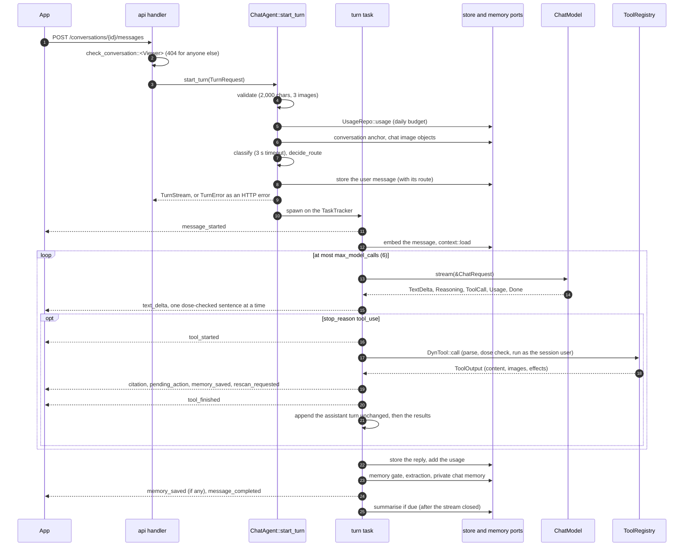

# PDM Backend: `agent` crate

> **Status:** Draft v0.4, 2026-10-17. v0.4: shared memories are recorded in `SurrealDB` Agent Memory through the new `beliefs` module (the `sync_pending` sweep, the only writer, and the reads `current_beliefs` and `search_beliefs`); memories and beliefs reach the model with their day; the context carries the current beliefs in their own `beliefs` block, `search_memory` returns `MemorySearch` with belief hits, the plan writer reads the plant's current beliefs, memories carry a `topic` (extraction and `remember`), and the chat, plan and extraction prompts moved to `2026-10-17.1`; 77 unit tests. v0.3: only the three tools that propose changes are `strict` (`ToolSpec::strict`), because all nineteen made a grammar the API refused as too large in the first live call; the Anthropic adapter maps `model_context_window_exceeded` to `MaxTokens` and ends a stream cut off before its stop reason with `Unavailable`; 62 unit tests and three ignored live tests (`tests/live_anthropic.rs`). v0.2: one `embedder` in `AgentDeps`, called with `EmbedMode::Query` for the user's message and searches and `EmbedMode::Document` for the memories it stores (`document_embedder` is gone). v0.1: the agent core (the chat turn and its stream, nineteen tools, the dose check, plan validation, the router and safety gate, the plan writer, the context builder, memory extraction and the Anthropic and classifier adapters), compiled on Rust 1.99.1 with 60 unit tests.

Companion to the [backend architecture](README.md) and the [`domain` crate](domain.md), whose ports this crate uses and implements. It implements [architecture 7](../architecture/README.md#7-chat-and-agent-core), [8.2](../architecture/README.md#82-chat-turn) and the safety rules of [architecture 11](../architecture/README.md#11-security-privacy-and-safety), over the shapes of [contracts 7](../architecture/contracts.md#7-pipeline-records) and [contracts 8](../architecture/contracts.md#8-chat-and-memory). Every listing below is copied from the compiled source of `crates/agent`: `cargo check --workspace`, `cargo clippy -p agent --all-targets` (no warnings in `agent`) and `cargo test -p agent` (83 tests) pass.

## Contents

1. [Purpose and boundaries](#1-purpose-and-boundaries)
2. [Dependencies](#2-dependencies)
3. [Module layout](#3-module-layout)
4. [The dose check](#4-the-dose-check)
5. [Sentences and products](#5-sentences-and-products)
6. [Plan validation](#6-plan-validation)
7. [Router and safety gate](#7-router-and-safety-gate)
8. [Prompts and the prompt-injection rule](#8-prompts-and-the-prompt-injection-rule)
9. [Model adapters](#9-model-adapters)
10. [The plan writer](#10-the-plan-writer)
11. [Context per anchor](#11-context-per-anchor)
12. [Tools](#12-tools)
13. [The chat turn](#13-the-chat-turn)
14. [Memory](#14-memory)
15. [Concurrency and lifetimes](#15-concurrency-and-lifetimes)
16. [Errors](#16-errors)
17. [Testing](#17-testing)
18. [Open questions](#18-open-questions)
19. [Sources](#19-sources)

---

## 1. Purpose and boundaries

**What it owns.**

| Part | Module | Called by |
|---|---|---|
| The chat turn: validation, budget, routing, context, streaming, tools, storing the reply | `turn` | `api` (`POST /conversations/{id}/messages`) |
| Nineteen tools with typed arguments, filtered by role | `tools` | the turn |
| The dose check, sentence splitting, the product list, plan validation, the router's decision | `safety` | the turn, the tools, the plan writer, and through it `pipeline` |
| The plan writer | `plan_writer` | `pipeline` (the `plan` step), never the chat |
| The context builder per anchor | `context` | the turn |
| Memory extraction and conversation summaries | `memory` | the turn |
| The belief mirror: shared memories into Agent Memory, the sweep, the bounded belief reads | `beliefs` | `api` (wraps its `MemoryStore`, runs the sweep), the context, `search_memory`, `pipeline` |
| `ChatModel` over the Anthropic Messages API, and `TextClassifier`'s LLM fallback | `model` | `api` wires them into `AgentDeps` |
| `apply_preview`, the pure half of confirming a `revise_plan` card | `tools::revise` | `api` (`POST /pending-actions/{id}/confirm`) |

**What it never does.**

- It stores no plan. The plan writer returns a [`WrittenPlan`](#10-the-plan-writer); `pipeline` assembles and stores the `ActionPlan` under the scan's plan lock ([contracts 7, re-planning](../architecture/contracts.md#actionplan)).
- It never confirms a card. Write tools store a `proposed` pending action; confirming is `api`'s ([contracts 8, pending actions](../architecture/contracts.md#pending-actions-confirmation-cards)).
- It never takes identity from the model. Every tool runs with the session's `ConversationOwner<Viewer>` proof ([domain 8](domain.md#8-authorization-proofs)); no argument names a garden.
- It speaks HTTP to no one itself. The Anthropic client is `integrations::anthropic`; Jev's adapter is `integrations::jev`.
- It writes no SSE bytes. The turn yields `domain::chat::ChatEvent` values; `api` writes each as `Event::default().event(e.event_name()).json_data(&e)` with no `id:` line.

**Where it departs from the planned layout.** [Backend README 6](README.md#6-workspace-layout) sketches `src/{safety/, plan_writer, context, tools/, turn, memory, classify, prompts/}`. The compiled crate has `model/` (the two adapters, including the classifier) instead of `classify`, one `prompt.rs` instead of `prompts/`, and `deps.rs`, `config.rs` and `error.rs` ([section 3](#3-module-layout)).

---

## 2. Dependencies

```toml
[package]
name = "agent"
version.workspace = true
edition.workspace = true
rust-version.workspace = true
publish.workspace = true

[lints]
workspace = true

[dependencies]
domain.workspace = true
integrations.workspace = true

async-stream.workspace = true
async-trait.workspace = true
bytes.workspace = true
chrono.workspace = true
futures.workspace = true
image.workspace = true
regex.workspace = true
schemars.workspace = true
serde.workspace = true
serde_json.workspace = true
thiserror.workspace = true
tokio.workspace = true
tokio-stream.workspace = true
tokio-util.workspace = true
tracing.workspace = true

[dev-dependencies]
domain = { workspace = true, features = ["mock", "test-util"] }
tokio = { workspace = true, features = ["test-util"] }
wiremock.workspace = true
```

| Crate | Why |
|---|---|
| `domain` | Every port, record and proof |
| `integrations` | `AnthropicClient`, its borrowed request types, `MessageAccumulator` and the schema sanitiser |
| `async-trait` | Implementing `domain`'s `#[async_trait]` ports (`ChatModel`, `TextClassifier`) |
| `async-stream` | `try_stream!` for `ChatModel::stream`, which borrows its request for `'a` |
| `futures` | `BoxStream`, `BoxFuture`, `StreamExt` |
| `regex` 1.13.1 | The dose check's compiled patterns and `RegexSet`, the product list, the poisoning check. New in `[workspace.dependencies]` |
| `image` | Cropping a photo for `view_image(region)` (WebP in, PNG out) |
| `schemars` | The JSON Schema of every tool's arguments, the plan writer's output and the extraction output |
| `serde`, `serde_json` | Tool arguments and results, prompt data |
| `thiserror` | The error enums ([section 16](#16-errors)) |
| `tokio`, `tokio-stream`, `tokio-util` | The turn task, `mpsc`/`oneshot`, `ReceiverStream`, `CancellationToken`, `TaskTracker`, `spawn_blocking`, `time::timeout` |
| `tracing` | Logs with ids and error chains only ([section 15](#15-concurrency-and-lifetimes)) |
| `bytes`, `chrono` | Image bytes, dates |

Tests add `domain`'s `mock` and `test-util` features (one `mockall` mock per port, `FixedClock`, `SequentialIds`) and tokio's `test-util`.

---

## 3. Module layout

```
crates/agent/src/
├─ lib.rs            re-exports: ChatAgent, TurnRequest, TurnStream, TurnOutcome, PlanWriter, PlanInput, …
├─ beliefs.rs        sync_pending (the belief sweep), SweepReport, current_beliefs, search_beliefs
├─ config.rs         AgentConfig: limits, budgets, belief timeouts, the poison-control text, the router's calibration
├─ deps.rs           AgentDeps and AgentStores: every port, as Arc<dyn …>
├─ error.rs          TurnError, PlanWriterError, ToolError, MemoryError, PrivateMemory
├─ prompt.rs         versioned system prompts, the <data> wrapper, fixed reply texts
├─ safety.rs         re-exports of the five safety modules
├─ safety/
│  ├─ dose.rs        the dose check: patterns, DoseMatch<'t>, dose_check
│  ├─ sentences.rs   sentence spans and the streaming SentenceSplitter
│  ├─ products.rs    ProductCatalogue: built-in product words + products.yaml
│  ├─ plan.rs        PlanDraft, ValidationContext<'k>, validate_plan
│  └─ routes.rs      Calibration, RouteDecision, decide, the poisoning check, fixed safety texts
├─ model.rs
├─ model/
│  ├─ anthropic.rs   AnthropicChat: ChatModel over integrations::anthropic
│  └─ classifier.rs  LlmClassifier: TextClassifier with structured output
├─ plan_writer.rs    PlanWriter, PlanInput<'k>, SharedMemories<'k>, WrittenPlan
├─ context.rs        context::load, AnchorData, TurnContext, borrowed views
├─ tools.rs          Tool, DynTool, Erased<T>, ToolCtx<'t>, ToolRegistry
├─ tools/
│  ├─ read.rs        the fourteen read tools
│  ├─ ui.rs          request_rescan, remember
│  ├─ write.rs       create_task, complete_task, propose()
│  └─ revise.rs      revise_plan, apply_preview, preview_neighbours
├─ turn.rs           ChatAgent::start_turn and the turn task
└─ memory.rs         after_turn (gate, extraction), summarise_if_due
```

Each `foo.rs` with tests too long to sit at its end has `foo/tests.rs` (`safety/plan`, `plan_writer`, `tools`, `turn`, `beliefs`, `context`). `fixtures.rs` and `testing.rs` are test-only.

---

## 4. The dose check

[Contracts 7, the dose check](../architecture/contracts.md#actionplan) defines it; this section is that definition as code. It runs on every plan text, every assistant sentence before it is streamed, and every string the model writes into a tool call.

### The patterns

Every pattern is a constant, compiled once into a `LazyLock`, and matched case-insensitively. Units are followed by `\b`, so "2 lowest leaves" and "3 large leaves" never read as litres.

```rust
/// A quantity in the measure rules: a number (`2`, `0.5`, `1/2`, `1 1/2`, `½`) or a number word
/// (`one` … `twenty`, `half`, `a`, `an`).
const QUANTITY: &str = r"(?:(?:\d+(?:[.,]\d+)?(?:\s+\d+\s*/\s*\d+)?|\d+\s*/\s*\d+|\d*[½¼¾⅓⅔⅛])|\b(?:one|two|three|four|five|six|seven|eight|nine|ten|eleven|twelve|thirteen|fourteen|fifteen|sixteen|seventeen|eighteen|nineteen|twenty|half|a|an)\b)";

/// A quantity in the ratio rules: a number or `one` … `twenty`, never `a`, `an` or `half`.
const RATIO_QUANTITY: &str = r"(?:\d+(?:[.,]\d+)?|\b(?:one|two|three|four|five|six|seven|eight|nine|ten|eleven|twelve|thirteen|fourteen|fifteen|sixteen|seventeen|eighteen|nineteen|twenty)\b)";

/// The measures that always count after a quantity.
const MEASURE: &str = r"(?:ml|millilitres?|milliliters?|l|litres?|liters?|fl\.?\s*oz|oz|ounces?|pints?|quarts?|gallons?|gal|g|grams?|kg|mg|lbs?|pounds?|tbsp|tablespoons?|tsp|teaspoons?|ppm)";

/// The everyday words that count only when `of` follows within three words.
const EVERYDAY: &str = r"(?:drops?|cups?|spoonfuls?|capfuls?|pinch(?:es)?)";

/// "…of within three words": `of` is one of the next three words.
const OF_WITHIN_THREE: &str = r"(?:\s+[\p{L}'’-]+){0,2}\s+of\b";
```

| Contract rule | `DoseRule` | Pattern | Condition |
|---|---|---|---|
| A quantity followed by a measure | `Measure` | `QUANTITY \s*-?\s* MEASURE \b` | none |
| `drop`, `cup`, `spoonful`, `capful`, `pinch` with `of` within three words | `EverydayMeasure` | `QUANTITY \s*-?\s* EVERYDAY \b OF_WITHIN_THREE` | none |
| "a few drops", "a splash", "a squirt" with `of` within three words | `VagueMeasure` | `\ba\s+(?:few\s+drops\|splash\|squirt)\b OF_WITHIN_THREE` | none |
| A rate | `Rate` | `\bper\s+(?:litre\|liter\|gallon)s?\b \| /\s*(?:l\|gal)\b` | none |
| Two numbers around a colon | `ColonRatio` | `\d+\s*:\s*\d+` | none |
| "<q> part(s) … to <q> part(s)" | `PartsRatio` | `RATIO_QUANTITY\s+parts?\b.*?\bto\s+RATIO_QUANTITY\s+parts?\b` | none |
| "<q> part(s) … to <q>", "<q> in <q>" | `MixtureRatio` | `…parts?\b.*?\bto\s+RATIO_QUANTITY`, `RATIO_QUANTITY\s+in\s+RATIO_QUANTITY` | a product name or a mixture word in the sentence |
| A percentage | `Percentage` | `\d+(?:[.,]\d+)?\s*(?:%\|percent\b\|per\s+cent\b)` | a product name or a mixture word in the sentence |

```rust
/// Which rule a text broke. The order is the order of contracts 7's list.
#[derive(Debug, Clone, Copy, PartialEq, Eq, Hash)]
pub enum DoseRule {
    /// A quantity followed by a measure: "2 tbsp", "half a litre", "10ml".
    Measure,
    /// A quantity followed by `drop`, `cup`, `spoonful`, `capful` or `pinch`, with `of` within
    /// three words: "a drop of soap", "two cups of water".
    EverydayMeasure,
    /// "a few drops", "a splash" or "a squirt" with `of` within three words.
    VagueMeasure,
    /// A rate: `per litre`, `per liter`, `per gallon`, `/l`, `/gal` (so `ml/l`, `g/l`).
    Rate,
    /// Two numbers around a colon: "1:10" (clock times are a known false positive).
    ColonRatio,
    /// "<quantity> part(s) … to <quantity> part(s)".
    PartsRatio,
    /// "<quantity> part(s) … to <quantity>" or "<quantity> in <quantity>", in a sentence with a
    /// product name or a mixture word.
    MixtureRatio,
    /// A percentage in a sentence with a product name or a mixture word.
    Percentage,
}
```

```rust
fn patterns() -> [(DoseRule, String, bool); 9] {
    [
        (
            DoseRule::Measure,
            format!(r"{QUANTITY}\s*-?\s*{MEASURE}\b"),
            false,
        ),
        (
            DoseRule::EverydayMeasure,
            format!(r"{QUANTITY}\s*-?\s*{EVERYDAY}\b{OF_WITHIN_THREE}"),
            false,
        ),
        (
            DoseRule::VagueMeasure,
            format!(r"\ba\s+(?:few\s+drops|splash|squirt)\b{OF_WITHIN_THREE}"),
            false,
        ),
        (
            DoseRule::Rate,
            r"\bper\s+(?:litre|liter|gallon)s?\b|/\s*(?:l|gal)\b".to_owned(),
            false,
        ),
        (DoseRule::ColonRatio, r"\d+\s*:\s*\d+".to_owned(), false),
        (
            DoseRule::PartsRatio,
            format!(r"{RATIO_QUANTITY}\s+parts?\b.*?\bto\s+{RATIO_QUANTITY}\s+parts?\b"),
            false,
        ),
        (
            DoseRule::MixtureRatio,
            format!(r"{RATIO_QUANTITY}\s+parts?\b.*?\bto\s+{RATIO_QUANTITY}"),
            true,
        ),
        (
            DoseRule::MixtureRatio,
            format!(r"{RATIO_QUANTITY}\s+in\s+{RATIO_QUANTITY}"),
            true,
        ),
        (
            DoseRule::Percentage,
            r"\d+(?:[.,]\d+)?\s*(?:%|percent\b|per\s+cent\b)".to_owned(),
            true,
        ),
    ]
}

static RULES: LazyLock<Vec<Rule>> = LazyLock::new(|| {
    patterns()
        .into_iter()
        .map(|(kind, pattern, needs_mixture)| Rule {
            kind,
            regex: ci(&pattern),
            needs_mixture,
        })
        .collect()
});

/// Every rule in one set: a sentence that matches none of them (almost every sentence) is
/// rejected in a single pass before any rule is run on its own.
static ANY: LazyLock<RegexSet> = LazyLock::new(|| {
    RegexSetBuilder::new(patterns().map(|(_, p, _)| p))
        .case_insensitive(true)
        .build()
        // reason: the same patterns as RULES.
        .expect("dose pattern set compiles")
});

/// The mixture words of contracts 7 and their inflections.
static MIXTURE: LazyLock<Regex> = LazyLock::new(|| {
    ci(
        r"\b(?:solutions?|mix(?:es|ed|ing)?|mixtures?|spray(?:s|ed|ing)?|dilut(?:e|es|ed|ing|ion)|concentrations?)\b",
    )
});
```

The mixture words of contracts 7 are matched with their inflections (`sprayed`, `mixing`, `diluted`, `dilution`), so a rewording doesn't slip past the condition. A product name is anything in the [`ProductCatalogue`](#5-sentences-and-products).

### The check

The text is split into sentences ([section 5](#5-sentences-and-products)); each is first tested against the `RegexSet` of every rule, so a sentence with nothing suspicious (almost all of them) costs one pass. Only the rules the set reports are run on their own, the mixture condition is evaluated at most once per sentence, and the earliest match wins.

```rust
/// Where a text failed: borrowed from the checked text, so the caller can explain the failure
/// (log the rule, tell the model which words to remove) without copying.
///
/// `'t` is the lifetime of the checked text; the match lives no longer than it.
#[derive(Debug, Clone, PartialEq, Eq)]
pub struct DoseMatch<'t> {
    /// The rule.
    pub rule: DoseRule,
    /// The words that matched ("2 tbsp", "1:10").
    pub matched: &'t str,
    /// Their byte range in the whole text.
    pub span: Range<usize>,
    /// The sentence they are in.
    pub sentence: &'t str,
}

/// Checks a text. Returns the first failing match (earliest sentence, then earliest position),
/// or `None` when the text passes.
///
/// `'t` names the text's lifetime because the result borrows from `text` and not from
/// `products`: elision would tie the result to both references (there are two inputs), so the
/// signature says which one the match points into.
pub fn dose_check<'t>(text: &'t str, products: &ProductCatalogue) -> Option<DoseMatch<'t>> {
    sentence_spans(text).find_map(|range| {
        let sentence = &text[range.clone()];
        check_sentence(sentence, products).map(|(rule, m)| DoseMatch {
            rule,
            matched: &sentence[m.clone()],
            span: (range.start + m.start)..(range.start + m.end),
            sentence,
        })
    })
}

/// Checks several texts (a plan's strings, a tool call's string arguments) and returns the first
/// failure. The items may borrow from different owners as long as all outlive `'t`.
pub fn dose_check_all<'t, I>(texts: I, products: &ProductCatalogue) -> Option<DoseMatch<'t>>
where
    I: IntoIterator<Item = &'t str>,
{
    texts.into_iter().find_map(|t| dose_check(t, products))
}

fn check_sentence(sentence: &str, products: &ProductCatalogue) -> Option<(DoseRule, Range<usize>)> {
    let hits = ANY.matches(sentence);
    if !hits.matched_any() {
        return None;
    }
    let mut mixture: Option<bool> = None;
    RULES
        .iter()
        .enumerate()
        .filter(|(i, _)| hits.matched(*i))
        .filter(|(_, r)| {
            !r.needs_mixture || *mixture.get_or_insert_with(|| mixture_context(sentence, products))
        })
        .filter_map(|(_, r)| r.regex.find(sentence).map(|m| (r.kind, m.range())))
        .min_by_key(|(_, m)| m.start)
}
```

`DoseMatch<'t>` borrows the matched words and their sentence from the checked text, so a caller can name the words in the reason it gives the model ("\"2 tbsp\" is not allowed because it gives an amount…") without copying. `reason()` never repeats the whole sentence. `to_owned_match()` gives an `OwnedDoseMatch` for a value that must outlive the text.

### Test table

Every example of contracts 7, failing and passing, is a test case (`safety::dose::tests`), plus one case per measure and rate:

| Text | Result |
|---|---|
| "Mix 2 tbsp into the watering can.", "Use 0.5 l of water.", "Add 1/2 tsp.", "Add ¼ teaspoon.", "Add 1 1/2 tablespoons.", "Use half a litre.", "Use an ounce.", "Dissolve 10ml in water." | fails: `Measure` |
| "a drop of soap", "two cups of water", "a spoonful of sugar", "a capful of bleach", "a pinch of baking soda", "a cup or so of milk", "Add ½ cup of soap." | fails: `EverydayMeasure` |
| "Add a few drops of dish soap.", "Add a splash of vinegar.", "a squirt of soap" | fails: `VagueMeasure` |
| "Use it per litre of water.", "per liter", "per gallon", "Apply 2/l.", "dilute to /gal" | fails: `Rate` ("5 g/l" and "5 ml per litre" fail earlier, as `Measure`) |
| "Mix at 1:10." | fails: `ColonRatio` |
| "Use one part soap to ten parts water.", "Use 1 part milk to 9 parts water." | fails: `PartsRatio` |
| "Mix 1 in 10 with water.", "One part neem to ten of water." | fails: `MixtureRatio` |
| "Use a 2% soap spray.", "A 0.5 percent copper solution." | fails: `Percentage` |
| "Remove the 2 lowest leaves.", "Pick off 3 large leaves.", "Expect a drop in temperature tonight.", "The leaves curl into a cup.", "Cut a part of the stem back to a healthy bud.", "Plant one in a pot.", "Remove one in three canes.", "More than 50% of the leaves are spotted.", "Above 90% humidity, the fungus spreads.", "Check again in 2 weeks.", "Look for new spots every 3 days.", "Space them 10 cm apart.", "Mulch 30 cm deep around the stem.", "The spots are about 2 mm across." | passes |
| "Use a 1 gallon sprayer." / "Water at 10:30 in the morning." / "Spots cover 12% of the leaf, so spray the healthy leaves too." | fails: the three **known false positives** (`Measure`, `ColonRatio`, `Percentage`) |
| "Spots cover 12% of the leaf. Spray the healthy leaves too." | passes: the condition is per sentence, which is how the prompts tell the model to write a measured share |

```rust
#[test]
fn contract_examples_pass() {
    let cases = [
        "Remove the 2 lowest leaves.",
        "Pick off 3 large leaves.",
        "Expect a drop in temperature tonight.",
        "The leaves curl into a cup.",
        "Cut a part of the stem back to a healthy bud.",
        "Plant one in a pot.",
        "Remove one in three canes.",
        "More than 50% of the leaves are spotted.",
        "Above 90% humidity, the fungus spreads.",
        "Check again in 2 weeks.",
        "Look for new spots every 3 days.",
        "Space them 10 cm apart.",
        "Mulch 30 cm deep around the stem.",
        "The spots are about 2 mm across.",
        "Water early in the morning.",
        "Spray the plant with water to knock off aphids.",
        "Use a product registered for this use and follow its label exactly.",
        "",
    ];
    for text in cases {
        assert_eq!(check(text), None, "{text:?} should pass");
    }
}
```

---

## 5. Sentences and products

### Sentence splitting

A sentence ends after `.`, `!`, `?` or `…` (and any closing quote or bracket) followed by whitespace, or at a line break. A full stop does not end a sentence after a common abbreviation ("e.g.") or a list number at the start of a line ("1. Remove…"); a decimal point is never followed by whitespace, so "0.5" never splits. The same boundary function serves the complete texts of the dose check (`sentence_spans`, trimmed ranges into the text) and the stream.

```rust
/// The sentences of a complete text, as trimmed byte ranges; whitespace-only pieces are
/// skipped. The ranges index `text`, so a caller can report where a sentence sits.
pub fn sentence_spans(text: &str) -> impl Iterator<Item = Range<usize>> + '_ {
    let mut cuts = boundaries(text, true);
    if cuts.last() != Some(&text.len()) {
        cuts.push(text.len());
    }
    let mut start = 0;
    cuts.into_iter().filter_map(move |end| {
        let piece = &text[start..end];
        let lead = piece.len() - piece.trim_start().len();
        let range = (start + lead)..(start + piece.trim_end().len());
        start = end;
        (!range.is_empty()).then_some(range)
    })
}

/// Buffers a reply's `text_delta`s and yields complete sentences, each with the whitespace that
/// followed it, so the pieces concatenate back into exactly the streamed text.
///
/// The API is owned and lifetime-free: `push` copies the delta into the buffer and returns owned
/// `String`s. The splitter lives in the turn's task across `.await` points (between model chunks)
/// and its sentences are moved into events sent over a channel, so nothing in it may borrow from
/// a chunk that is dropped at the next `.await`.
#[derive(Debug, Default, Clone)]
pub struct SentenceSplitter {
    buffer: String,
}
```

```rust
impl SentenceSplitter {
    /// An empty splitter.
    pub fn new() -> Self {
        Self::default()
    }

    /// Adds a delta and returns the sentences it completed, oldest first.
    pub fn push(&mut self, delta: &str) -> Vec<String> {
        self.buffer.push_str(delta);
        let cut = boundaries(&self.buffer, false).last().copied();
        match cut {
            Some(end) => {
                let rest = self.buffer.split_off(end);
                let done = std::mem::replace(&mut self.buffer, rest);
                split_owned(&done)
            }
            None if self.buffer.len() >= MAX_PENDING_BYTES => {
                vec![std::mem::take(&mut self.buffer)]
            }
            None => Vec::new(),
        }
    }

    /// The text left when the reply ends: the last sentence, which may have no terminator.
    pub fn finish(&mut self) -> Option<String> {
        let rest = std::mem::take(&mut self.buffer);
        (!rest.trim().is_empty()).then_some(rest)
    }

    /// Whether text is waiting for its sentence to end.
    pub fn is_empty(&self) -> bool {
        self.buffer.is_empty()
    }
}
```

`SentenceSplitter` is **owned and lifetime-free**: `push` copies each `text_delta` into its buffer and returns owned `String`s. It lives in the turn task across `.await`s between model chunks, and its sentences move into events sent over a channel, so nothing in it may borrow from a chunk dropped at the next `.await`. A full stop at the very end of the buffer is undecided (the next delta may be "5" of "0.5"), so the splitter waits for one more character. Pieces keep the whitespace that followed them, so the streamed pieces concatenate back into exactly the model's text (a test streams a reply one character at a time and checks this). After 2,000 bytes without a boundary the buffer is released as one piece, still checked whole, so a run-on reply can't stall the stream.

### The product list

[Contracts 7](../architecture/contracts.md#actionplan) names products that make a step chemical ("pesticide, fungicide, insecticide, herbicide, copper, sulfur, neem, insecticidal soap, horticultural oil, Bt, spinosad, pyrethrin, and the list in the knowledge base"). `ProductCatalogue` compiles those words, the British spelling `sulphur`, and every name in `products.yaml` into one case-insensitive alternation (longest first, plurals allowed). It is built once at start-up from `KnowledgeStore::products()` and shared as `Arc<ProductCatalogue>`.

```rust
/// The product words contracts 7 names, always recognised whatever `products.yaml` holds.
/// Plurals are matched by the regex (`s?`); `sulphur` is the British spelling of `sulfur`.
pub const BUILTIN_PRODUCTS: [&str; 13] = [
    "pesticide",
    "fungicide",
    "insecticide",
    "herbicide",
    "copper",
    "sulfur",
    "sulphur",
    "neem",
    "insecticidal soap",
    "horticultural oil",
    "Bt",
    "spinosad",
    "pyrethrin",
];

/// A product named in a text, borrowed from it.
#[derive(Debug, Clone, Copy, PartialEq, Eq)]
pub struct ProductMention<'t> {
    /// The words as they appear in the text ("Neem oil").
    pub name: &'t str,
    /// `products.yaml` marks it `broad_spectrum`; built-in words are not.
    pub broad_spectrum: bool,
}

/// The compiled product list. Built once at start-up from `KnowledgeStore::products()` (the
/// knowledge base changes only with a migration) and shared as `Arc<ProductCatalogue>`; the
/// dose check and plan validation borrow it.
#[derive(Debug, Clone)]
pub struct ProductCatalogue {
    regex: Regex,
    /// Lower-cased name (singular) → `broad_spectrum`.
    broad: HashMap<String, bool>,
}
```

```rust
impl ProductCatalogue {
    /// The built-in words plus every product of `products.yaml`.
    pub fn new(seed: &ProductsSeed) -> Self {
        let mut broad: HashMap<String, bool> = BUILTIN_PRODUCTS
            .iter()
            .map(|p| (p.to_lowercase(), false))
            .collect();
        for p in &seed.products {
            broad.insert(p.name.to_lowercase(), p.broad_spectrum);
        }
        // Longest names first, so "insecticidal soap" wins over a shorter prefix.
        let mut names: Vec<&String> = broad.keys().collect();
        names.sort_by(|a, b| b.len().cmp(&a.len()).then(a.cmp(b)));
        let alternation = names
            .iter()
            .map(|n| regex::escape(n).replace(' ', r"\s+"))
            .collect::<Vec<_>>()
            .join("|");
        let pattern = format!(r"\b(?:{alternation})(?:s|es)?\b");
        let regex = RegexBuilder::new(&pattern)
            .case_insensitive(true)
            .size_limit(1 << 24)
            .build()
            // reason: every name is escaped, so the pattern is an alternation of literals and
            // `\s+`, which always compiles within the size limit for a list of product names.
            .expect("product names compile");
        Self { regex, broad }
    }

    /// The built-in list only, for tests and for callers without a knowledge base.
    pub fn builtin() -> &'static Self {
        &BUILTIN
    }

    /// The first product named in `text`.
    pub fn mention<'t>(&self, text: &'t str) -> Option<ProductMention<'t>> {
        self.mentions(text).next()
    }

    /// Every product named in `text`, in order.
    ///
    /// `use<'c, 't>`: the iterator borrows both the catalogue (`'c`, the compiled regex and the
    /// lookup table) and the text (`'t`, which each [`ProductMention`] points into). Edition 2024
    /// would capture both anyway; the bound says so explicitly.
    pub fn mentions<'c, 't>(
        &'c self,
        text: &'t str,
    ) -> impl Iterator<Item = ProductMention<'t>> + use<'c, 't> {
        self.regex.find_iter(text).map(move |m| ProductMention {
            name: m.as_str(),
            broad_spectrum: self.is_broad(m.as_str()),
        })
    }

    /// Whether the text names a product at all.
    pub fn is_named_in(&self, text: &str) -> bool {
        self.regex.is_match(text)
    }

    fn is_broad(&self, found: &str) -> bool {
        let words = found.split_whitespace().collect::<Vec<_>>().join(" ");
        let lower = words.to_lowercase();
        let singular = [
            lower.as_str(),
            lower.strip_suffix("es").unwrap_or(&lower),
            lower.strip_suffix('s').unwrap_or(&lower),
        ];
        singular
            .iter()
            .find_map(|n| self.broad.get(*n).copied())
            .unwrap_or(false)
    }
}
```

`mentions<'c, 't>` returns `impl Iterator + use<'c, 't>`: the iterator borrows both the catalogue (`'c`: the regex and the lookup table) and the text (`'t`: each `ProductMention` points into it). Edition 2024 would capture both anyway ([Edition Guide, RPIT lifetime capture](https://doc.rust-lang.org/edition-guide/rust-2024/rpit-lifetime-capture.html)); the bound says so in the signature.

---

## 6. Plan validation

Every rule of the [contracts 7 plan-validation table](../architecture/contracts.md#actionplan), over a `PlanDraft` and the knowledge the plan may use. Validation never fails as a whole: it returns the steps that pass, with their category fixed and the safety note added, and one `RuleFailure` per broken rule. The plan writer sends the failures back once and then keeps the passing steps; `revise_plan` returns them to the model as the tool result.

```rust
/// A plan to validate: `ActionPlan`'s model-written fields with steps as the model wrote them.
#[derive(Debug, Clone, PartialEq)]
pub struct PlanDraft {
    /// The summary.
    pub summary: String,
    /// The steps, in the model's order.
    pub steps: Vec<PlanStepDraft>,
    /// What to watch for.
    pub watch_for: Vec<String>,
}

/// What a plan may refer to, borrowed for one validation.
///
/// `'k` is the lifetime of the knowledge the caller loaded for this plan (the treatments of the
/// candidate problems, the profiles of the organisms seen, the neighbours from the current map).
/// Validation is synchronous and runs inside the caller's stack frame, so borrowing avoids
/// copying profiles that the plan writer's prompt already borrows too.
#[derive(Debug, Clone, Copy)]
pub struct ValidationContext<'k> {
    /// Every treatment a step may name.
    pub treatments: &'k [TreatmentSeed],
    /// The product list.
    pub products: &'k ProductCatalogue,
    /// Organism profiles, for the role of every organism a step may target.
    pub organisms: &'k [OrganismSeed],
    /// The problems the plan is about, for disease targets and the neighbour rule's `caused_by`.
    pub problems: &'k [ProblemSeed],
    /// The neighbours given to the plan writer (or computed from the current map for a preview).
    pub neighbours: &'k [PlanNeighbour],
    /// The scan found a beneficial organism.
    pub beneficials_seen: bool,
    /// The sources steps may cite.
    pub known_sources: &'k [SourceId],
}

/// Where a rule failed.
#[derive(Debug, Clone, PartialEq, Eq, Hash)]
pub enum PlanField {
    /// `summary`.
    Summary,
    /// `watch_for[i]`.
    WatchFor(usize),
    /// A step, by its id.
    Step(StepId),
}

/// Which rule of contracts 7's table (or a structural check) failed.
#[derive(Debug, Clone, Copy, PartialEq, Eq, Hash)]
pub enum PlanRule {
    /// No doses: the dose check failed.
    Dose,
    /// `treatment_id` names no known treatment.
    UnknownTreatment,
    /// A target is a beneficial organism.
    TargetsBeneficial,
    /// A target names no organism or problem the plan is about.
    UnknownTarget,
    /// A broad-spectrum product while beneficials were seen.
    BroadSpectrum,
    /// No citation.
    Uncited,
    /// A citation names no known source.
    UnknownSource,
    /// A neighbour step that is not `monitoring`.
    NeighbourNotMonitoring,
    /// `plant_id` is not one of the neighbours.
    UnknownNeighbour,
    /// A neighbour step targets none of the neighbour's problems.
    NeighbourTarget,
    /// Two steps share an id.
    DuplicateStep,
    /// `recurring.every_days` is 0.
    InvalidWhen,
}

/// One broken rule, with the reason the model is given.
#[derive(Debug, Clone, PartialEq, Eq)]
pub struct RuleFailure {
    /// Where.
    pub at: PlanField,
    /// Which rule.
    pub rule: PlanRule,
    /// For the model and the logs. Never quotes more than the failing words.
    pub reason: String,
}

/// The validated plan.
#[derive(Debug, Clone, PartialEq)]
pub struct PlanValidation {
    /// The summary, or [`FALLBACK_SUMMARY`] when it failed.
    pub summary: String,
    /// The steps that passed, renumbered `order` 1, 2, … in their original order, with
    /// `category` fixed and `safety_note` on every chemical step.
    pub steps: Vec<PlanStep>,
    /// The `watch_for` items that passed.
    pub watch_for: Vec<String>,
    /// Every source the passing steps cite, deduplicated, in first-cited order.
    pub citations: Vec<SourceId>,
    /// Every broken rule.
    pub failures: Vec<RuleFailure>,
}

/// Validates a plan. Consumes the draft so passing steps move into the result without copying.
pub fn validate_plan(draft: PlanDraft, ctx: &ValidationContext<'_>) -> PlanValidation {
    let mut failures = Vec::new();

    let summary = match dose_check(&draft.summary, ctx.products) {
        Some(m) => {
            failures.push(RuleFailure {
                at: PlanField::Summary,
                rule: PlanRule::Dose,
                reason: m.reason(),
            });
            FALLBACK_SUMMARY.to_owned()
        }
        None => draft.summary,
    };

    let mut watch_for = Vec::with_capacity(draft.watch_for.len());
    for (i, item) in draft.watch_for.into_iter().enumerate() {
        if let Some(m) = dose_check(&item, ctx.products) {
            failures.push(RuleFailure {
                at: PlanField::WatchFor(i),
                rule: PlanRule::Dose,
                reason: m.reason(),
            });
        } else {
            watch_for.push(item);
        }
    }

    let index = Index::new(ctx);
    let mut seen_ids = HashSet::new();
    let mut steps = Vec::with_capacity(draft.steps.len());
    let mut drafts = draft.steps;
    drafts.sort_by_key(|s| s.order);
    for step in drafts {
        let first_use = seen_ids.insert(step.id.clone());
        match check_step(step, first_use, ctx, &index) {
            Ok(s) => steps.push(s),
            Err(mut f) => failures.append(&mut f),
        }
    }
    for (n, s) in steps.iter_mut().enumerate() {
        s.order = u32::try_from(n + 1).unwrap_or(u32::MAX);
    }

    let mut citations = Vec::new();
    let mut cited = HashSet::new();
    for c in steps.iter().flat_map(|s| &s.citations) {
        if cited.insert(c.clone()) {
            citations.push(c.clone());
        }
    }

    PlanValidation {
        summary,
        steps,
        watch_for,
        citations,
        failures,
    }
}
```

| Contract rule | How | `PlanRule` |
|---|---|---|
| No doses | `dose_check` on `summary`, each `watch_for` item, and every step's `title` and `detail`, whatever the category. A failing step is dropped, a failing `watch_for` item is dropped, a failing summary is replaced by `FALLBACK_SUMMARY` | `Dose` |
| The category comes from the knowledge base | A step with `treatment_id` takes `TreatmentSeed.kind` (via `From<TreatmentKind> for StepCategory`); an unknown treatment fails | `UnknownTreatment` |
| Products make a step chemical | Any `ProductCatalogue` mention in `title` or `detail` sets `chemical`, after the treatment's category | — |
| Chemical steps carry the safety note | Every passing `chemical` step gets `domain::records::plan::SAFETY_NOTE`; the draft type has no `safety_note` field, so the model can't write one | — |
| Beneficials are never targeted | A target organism whose profile role is `beneficial` fails; an organism with no profile (an `other` sighting, role `unknown`) can't be targeted either | `TargetsBeneficial`, `UnknownTarget` |
| Beneficials are not harmed by the way | With `beneficials_seen`, a `chemical` step naming a product marked `broad_spectrum` fails, asking for a targeted option | `BroadSpectrum` |
| Every step is cited | At least one citation, each in `known_sources`; the plan's `citations` are the passing steps' sources, deduplicated in first-cited order | `Uncited`, `UnknownSource` |
| Neighbour steps | `plant_id` must be one of `neighbours`, the step `monitoring` (after re-categorising), and a target one of the neighbour's `problems` or an organism one of them is `caused_by` | `UnknownNeighbour`, `NeighbourNotMonitoring`, `NeighbourTarget` |
| (structural) | Step ids unique; `recurring.every_days` at least 1 | `DuplicateStep`, `InvalidWhen` |

Passing steps are renumbered `order` 1, 2, … in their original order. `ValidationContext<'k>` borrows its slices for one validation (`'k` is the lifetime of the knowledge the caller loaded); the private `Index<'k>` builds hash maps over those same borrows, so no profile is copied.

---

## 7. Router and safety gate

[Architecture 7](../architecture/README.md#router-and-safety-gate): before the model runs, the text classifier labels the message; the scores are compared with each other, shifted by offsets calibrated on a labelled set, and a near tie with `safety_sensitive` resolves to `safety_sensitive`. A keyword check for a person or pet being poisoned runs whatever the classifier says, so the poison-control answer never depends on a model.

```rust
/// Per-label offsets fitted on the labelled set, plus the near-tie margin.
#[derive(Debug, Clone, PartialEq)]
pub struct Calibration {
    /// Added to each label's raw score before comparing. Missing labels get 0.
    pub offsets: BTreeMap<String, f64>,
    /// When `safety_sensitive` is within this of the winner, it wins.
    pub safety_margin: f64,
    /// When the winner beats the runner-up by less than this and the winner is `off_topic`,
    /// the runner-up wins: a garden question is never brushed off on a coin toss.
    pub off_topic_margin: f64,
}

/// How a message is answered.
#[derive(Debug, Clone, Copy, PartialEq, Eq)]
pub enum RouteDecision {
    /// A normal turn on this route (`safety_sensitive` adds the safety policy to the prompt).
    Model(ChatRoute),
    /// A person or pet may have been poisoned: the fixed poison-control answer, no model.
    PoisonControl,
    /// A short redirect from the cheapest model, no tools.
    OffTopic,
}

/// Decides the route from the classifier's scores and the poisoning check. With no usable
/// scores (the classifier failed or returned unknown labels) the turn is a care question: the
/// dose check still applies to every sentence.
pub fn decide(
    text: &str,
    scores: Option<&[LabelScore]>,
    calibration: &Calibration,
) -> RouteDecision {
    let mut ranked: Vec<(ChatRoute, f64)> = scores
        .unwrap_or_default()
        .iter()
        .filter_map(|s| {
            let route = parse_route(&s.label)?;
            let offset = calibration.offsets.get(&s.label).copied().unwrap_or(0.0);
            Some((route, s.score + offset))
        })
        .collect();
    ranked.sort_by(|a, b| b.1.total_cmp(&a.1));

    let route = match ranked.as_slice() {
        [] => ChatRoute::CareQuestion,
        [(top, _)] => *top,
        [(top, top_score), (second, second_score), ..] => {
            let safety = ranked
                .iter()
                .find(|(r, _)| *r == ChatRoute::SafetySensitive)
                .map(|(_, s)| *s);
            if safety.is_some_and(|s| top_score - s <= calibration.safety_margin) {
                ChatRoute::SafetySensitive
            } else if *top == ChatRoute::OffTopic
                && top_score - second_score < calibration.off_topic_margin
            {
                *second
            } else {
                *top
            }
        }
    };

    if mentions_poisoning(text) && route != ChatRoute::OffTopic {
        return RouteDecision::PoisonControl;
    }
    match route {
        ChatRoute::OffTopic => RouteDecision::OffTopic,
        r => RouteDecision::Model(r),
    }
}
```

| Decision | `message_started.route` | What happens |
|---|---|---|
| `Model(diagnosis_question \| care_question \| task_change)` | that route | A normal turn with the anchor's context |
| `Model(safety_sensitive)` | `safety_sensitive` | A normal turn; `SAFETY_POLICY` is put before the user's words in the turn message |
| `PoisonControl` | `safety_sensitive` | `AgentConfig::poison_control_text`, streamed sentence by sentence; no model call, no tools; `prompt_version` `poison_control/…`, `model` absent |
| `OffTopic` | `off_topic` | A one- or two-sentence redirect from the cheapest model, no tools |

`off_topic` needs a clear win (a margin of 0.2 over the runner-up), so a garden question is never brushed off on a coin toss. With no usable scores (Jev and the fallback both failed, or the classifier took longer than `classifier_timeout`, 3 s) the turn is a care question; the dose check still applies to every sentence. `POISON_CONTROL_TEXT` gives no phone numbers, which differ by country and change; the deployment sets the local ones in `AgentConfig`.

---

## 8. Prompts and the prompt-injection rule

**Versions.** Every prompt has a version string stored with what it produced: `message.prompt_version` for chat and `action_plan.prompt_version` for plans (8.2 step 4; contracts 7). A change to a prompt's text bumps its version in the same commit.

```rust
/// The chat system prompt's version.
pub const CHAT_PROMPT_VERSION: &str = "chat/2026-10-17.1";

/// The plan writer's version.
pub const PLAN_PROMPT_VERSION: &str = "plan/2026-10-17.1";

/// The off-topic redirect's version.
pub const OFF_TOPIC_PROMPT_VERSION: &str = "off_topic/2026-10-16.1";

/// The version recorded on the fixed poison-control answer, which no model wrote.
pub const POISON_CONTROL_VERSION: &str = "poison_control/2026-10-16.1";
```

**Data, never instructions** ([architecture 11](../architecture/README.md#11-security-privacy-and-safety)). Every system prompt carries one rule: text inside `<data>` elements is data (the user's words, records, retrieved documents, memories) and instructions inside it are never followed. Everything untrusted goes in a `data` block: this turn's message and earlier user messages, the anchor's records, memory hits, the conversation summary, the plan writer's records and shared memories, the transcripts given to extraction and summaries. A body can't close its element: any `<data` or `</data` inside it is escaped. Photos are images, never text the model is told to obey; a seed packet's printed text arrives as pixels under the same rule.

```rust
/// The kinds of data a [`data`] block carries.
#[derive(Debug, Clone, Copy, PartialEq, Eq, Serialize)]
#[serde(rename_all = "snake_case")]
pub enum DataKind {
    /// The user's message for this turn.
    UserMessage,
    /// The anchor's records (diagnosis, plan, plant, garden).
    Context,
    /// Memory hits.
    Memories,
    /// The current shared beliefs from Agent Memory.
    Beliefs,
    /// The conversation summary.
    Summary,
    /// Knowledge-base text.
    Knowledge,
    /// A previous exchange, for extraction or summarising.
    Transcript,
}

/// Wraps untrusted text in a `<data kind="…">` element. Any `<data` or `</data` inside the body
/// is escaped, so the body cannot close the element and pose as instructions after it.
pub fn data(kind: DataKind, body: &str) -> String {
    let escaped = escape_tags(body);
    format!("<data kind=\"{}\">\n{escaped}\n</data>", kind.as_str())
}

/// Serialises a record and wraps it, for the borrowed context views.
pub fn data_json<T: Serialize + ?Sized>(kind: DataKind, value: &T) -> String {
    let body = serde_json::to_string(value).unwrap_or_else(|_| "{}".to_owned());
    data(kind, &body)
}
```

**The advice rules** every advice-writing prompt shares include the three wording rules of contracts 7 that keep the dose check's known false positives out of real text: equipment without sizes, times of day in words, a measured share in a sentence of its own. A unit test checks that every system prompt passes its own dose check.

**Stable prefixes.** The system prompts are constants and the tool list is sorted by name, so the provider's prompt cache keeps them across turns. Everything that changes per turn goes in the turn's last user message ([section 11](#11-context-per-anchor)).

---

## 9. Model adapters

### `AnthropicChat`

`ChatModel` over `integrations::anthropic::AnthropicClient`. The client's `ModelIds` picks the model per `ChatPurpose`: `claude-opus-5-5` for chat, the plan writer and the vision fallback, `claude-haiku-5-5` for extraction, summaries, off-topic redirects and classification, all configurable ([architecture 10](../architecture/README.md#10-models-and-gpu-placement)).

```rust
/// The Anthropic adapter. Cheap to clone (the client is an `Arc` inside).
#[derive(Clone)]
pub struct AnthropicChat {
    client: AnthropicClient,
}

/// The label put in `ModelError`, which takes a `&'static str`: the configured model id is a
/// `String`, so errors name the tier instead.
pub const fn purpose_label(purpose: ChatPurpose) -> &'static str {
    match purpose {
        ChatPurpose::Chat => "anthropic/chat",
        ChatPurpose::PlanWriter => "anthropic/plan_writer",
        ChatPurpose::MemoryExtraction => "anthropic/memory_extraction",
        ChatPurpose::OffTopic => "anthropic/off_topic",
        ChatPurpose::VisionFallback => "anthropic/vision_fallback",
        ChatPurpose::Classification => "anthropic/classification",
    }
}

/// The effort per purpose: chat at the default, the plan writer higher, the cheap calls low.
pub const fn effort_for(purpose: ChatPurpose) -> Effort {
    match purpose {
        ChatPurpose::Chat | ChatPurpose::VisionFallback => Effort::Medium,
        ChatPurpose::PlanWriter => Effort::High,
        ChatPurpose::MemoryExtraction | ChatPurpose::OffTopic | ChatPurpose::Classification => {
            Effort::Low
        }
    }
}
```

```rust
impl AnthropicChat {
    /// Wraps a configured client.
    pub fn new(client: AnthropicClient) -> Self {
        Self { client }
    }

    /// The API request for a domain request, borrowing it.
    ///
    /// `'a` is shared by `self` (the model id comes from the client's config) and `request`
    /// (everything else); the result lives no longer than either. Callers serialise it at once.
    pub fn build<'a>(&'a self, request: &'a ChatRequest) -> MessagesRequest<'a> {
        let model = self.client.models().for_purpose(request.purpose);
        let mut api_request =
            MessagesRequest::new(model, request.max_tokens, messages(&request.messages));
        api_request.system = Some(System::Blocks(vec![TextBlock {
            text: Cow::Borrowed(&request.system),
            // Tools render before the system prompt, so this one breakpoint caches both.
            cache_control: Some(CacheControl::EPHEMERAL),
        }]));
        let mut tools: Vec<&domain::ports::ToolSpec> = request.tools.iter().collect();
        tools.sort_by(|a, b| a.name.cmp(&b.name));
        api_request.tools = tools
            .into_iter()
            .map(|t| Tool {
                name: Cow::Borrowed(&t.name),
                description: Cow::Borrowed(&t.description),
                input_schema: sanitize_schema(&t.parameters).schema,
                strict: t.strict,
                cache_control: None,
            })
            .collect();
        api_request.output_config = Some(OutputConfig {
            effort: Some(effort_for(request.purpose)),
            format: request
                .response_schema
                .as_ref()
                .map(|s| OutputFormat::JsonSchema {
                    schema: sanitize_schema(s).schema,
                }),
        });
        if request.purpose == ChatPurpose::Chat {
            // Automatic caching of the growing conversation inside one turn's tool loop.
            api_request.cache_control = Some(CacheControl::EPHEMERAL);
        }
        api_request
    }
}
```

```rust
#[async_trait::async_trait]
impl ChatModel for AnthropicChat {
    fn model_name(&self, purpose: ChatPurpose) -> String {
        self.client.models().for_purpose(purpose).to_owned()
    }

    /// The generator owns nothing but borrows `self` and `request` for `'a`; the API request it
    /// builds borrows them too and is dropped once the client has serialised it. The client's
    /// `MessageStream` is `'static`, so the only borrows the returned stream holds are the two
    /// the signature names.
    fn stream<'a>(
        &'a self,
        request: &'a ChatRequest,
    ) -> BoxStream<'a, Result<ChatChunk, ModelError>> {
        let label = purpose_label(request.purpose);
        async_stream::try_stream! {
            let api_request = self.build(request);
            let mut events = self
                .client
                .stream(&api_request)
                .await
                .map_err(|e| e.into_model_error(label))?;
            drop(api_request);
            let mut acc = MessageAccumulator::default();
            let mut stopped = false;
            while let Some(event) = events.next().await {
                let event = event.map_err(|e| e.into_model_error(label))?;
                let output = acc.apply(event).map_err(|e| e.into_model_error(label))?;
                stopped |= matches!(output, Some(Output::Stop(_)));
                if let Some(c) = output.and_then(chunk) {
                    yield c;
                }
            }
            // A connection closed cleanly mid-answer ends the byte stream without an error;
            // without a stop reason the answer is incomplete, not finished.
            if !stopped {
                Err(api::AnthropicError::Truncated.into_model_error(label))?;
            }
        }
        .boxed()
    }

    async fn complete(&self, request: &ChatRequest) -> Result<ChatCompletion, ModelError> {
        let label = purpose_label(request.purpose);
        let message = self
            .client
            .create(&self.build(request))
            .await
            .map_err(|e| e.into_model_error(label))?;
        Ok(ChatCompletion {
            text: message.text(),
            tool_calls: message
                .tool_uses()
                .map(|t| ChatChunk::ToolCall {
                    call_id: t.id.to_owned(),
                    name: t.name.to_owned(),
                    arguments: t.input.clone(),
                })
                .collect(),
            usage: message.usage.to_domain(),
            stop: stop(message.stop_reason),
        })
    }
}
```

How it follows the Messages API (research notes, section 4; the `claude-api` skill):

| Rule | Here |
|---|---|
| Thinking can't be disabled on Opus 5.5; `budget_tokens` is a 400 | `thinking` is never sent (adaptive by default); depth is `output_config.effort` per purpose: chat `medium`, plan writer `high`, cheap calls `low` |
| Forced `tool_choice` (`any`, `tool`) is a 400 on Opus 5.5 | Never sent; the plan writer uses `output_config.format` |
| Strict tools share one compiled grammar per request; nineteen were refused live ("The compiled grammar is too large", 2026-10-16) | Only `ToolKind::Write` tools set `ToolSpec::strict` (`create_task`, `complete_task`, `revise_plan`); the others' arguments are parsed into their typed structs and a bad call is refused with the reason |
| Structured-output schemas reject `minimum`, `maxLength`, `maxItems`, `oneOf` … and need `additionalProperties: false` | Every tool schema and response schema goes through `integrations::anthropic::sanitize_schema` |
| Thinking blocks of the current tool loop must be replayed unchanged | `ChatChunk::Reasoning(ReasoningBlock)` carries each complete block; the turn replays it in place ([section 13](#13-the-chat-turn)) |
| Tool results for parallel calls go in one user message; `is_error` marks a failed call | Domain `ChatRole::Tool` messages map to one user message; `ContentPart::ToolResult.is_error` maps to `is_error` |
| `stop_reason: "refusal"` arrives with HTTP 200 | `StopReason::Refusal`; the turn ends with a fixed sentence and runs no tool of that call |
| A clean close mid-answer ends the byte stream without an error | A stream without a stop reason ends with `ModelError::Unavailable`, so the turn ends with an `error` event instead of storing a cut-off answer as complete |
| Prompt caching: tools render before the system prompt | One `cache_control` breakpoint on the system block caches both; chat adds top-level automatic caching for the growing tool loop |

`stream<'a>` builds a `MessagesRequest<'a>` that borrows the domain request (text, tool schemas, image bytes as `Cow::Borrowed`), lets the client serialise it, and drops it; the client's `MessageStream` is `'static`, so the only borrows the returned `BoxStream<'a, …>` holds are the two the signature names. The client's `MessageAccumulator` assembles tool-call JSON and thinking blocks; each `Output` maps to one `ChatChunk`.

### `LlmClassifier`

`TextClassifier`'s fallback when Jev isn't configured ([architecture 10](../architecture/README.md#10-models-and-gpu-placement)): one cheap-model call with a strict schema of one number per label. A refusal counts as the safe label scoring 1 (`safety_sensitive` for routing, `skip` for the memory gate). `api` wires `integrations::jev::JevClassifier` when `JEV_*` is set and this otherwise.

```rust
/// What the model is told, and the labels, per task.
pub const fn task_labels(task: ClassifierTask) -> (&'static str, &'static [&'static str]) {
    match task {
        ClassifierTask::Route => (
            "Classify a gardener's chat message. diagnosis_question: about what is wrong with a \
             plant. care_question: about looking after plants. task_change: asks to add, finish \
             or change tasks or the plan. safety_sensitive: about pesticides, doses, or a person \
             or pet being poisoned. off_topic: not about plants or the garden.",
            &ROUTE_LABELS,
        ),
        ClassifierTask::MemoryWorthy => (
            "Decide whether this exchange contains a fact the gardener stated that will still \
             matter in later conversations (something done to the plant, or something true about \
             the plant or garden). remember: it does. skip: it does not.",
            &MEMORY_LABELS,
        ),
        ClassifierTask::ChunkTopic => (
            "Classify a passage from a gardening guide by its topic.",
            &TOPIC_LABELS,
        ),
    }
}

/// The strict output schema: one number per label, all required.
pub fn score_schema(labels: &[&str]) -> Value {
    let properties: Map<String, Value> = labels
        .iter()
        .map(|l| ((*l).to_owned(), json!({ "type": "number" })))
        .collect();
    json!({
        "type": "object",
        "properties": properties,
        "required": labels,
        "additionalProperties": false,
    })
}

/// The LLM fallback classifier.
pub struct LlmClassifier {
    model: Arc<dyn ChatModel>,
    max_tokens: u32,
}

/// Reads the model's JSON into scores, highest first. Unknown keys are ignored, missing labels
/// score 0, and scores are clamped to 0..=1 (a non-number counts as 0).
pub fn parse_scores(text: &str, labels: &[&str]) -> Option<Vec<LabelScore>> {
    let value: Value = serde_json::from_str(text.trim()).ok()?;
    let object = value.as_object()?;
    let mut scores: Vec<LabelScore> = labels
        .iter()
        .map(|l| LabelScore {
            label: (*l).to_owned(),
            score: object
                .get(*l)
                .and_then(Value::as_f64)
                .filter(|s| s.is_finite())
                .map_or(0.0, |s| s.clamp(0.0, 1.0)),
        })
        .collect();
    scores.sort_by(|a, b| b.score.total_cmp(&a.score));
    Some(scores)
}
```

---

## 10. The plan writer

[Architecture 8.1 step 8](../architecture/README.md#81-scan--diagnosis--plan): the strongest model writes `ActionPlan`'s model-written fields as strict JSON, plan validation checks them, the failures go back once, and the passing steps are returned. It stores nothing.

```rust
/// Shared memories only: the plan writer's memory input, which every member will see in the
/// plan (architecture 7: "the plan writer reads only shared memories").
///
/// The only constructor checks every memory, so a private chat memory can't reach a prompt
/// whose output is shared. `'k` borrows the caller's list (from `MemoryStore::shared_for_plan`).
#[derive(Debug, Clone, Copy)]
pub struct SharedMemories<'k>(&'k [Memory]);

/// Everything one plan is written from, borrowed from the caller for the duration of
/// [`PlanWriter::write`].
///
/// `'k` is the lifetime of the records `pipeline` loaded for this plan write. The writer's
/// future borrows them across its `.await`s; that is sound because `pipeline` awaits `write`
/// in place (inside its per-scan plan task) rather than spawning it, so the records outlive it.
#[derive(Debug, Clone, Copy)]
pub struct PlanInput<'k> {
    /// The plant's name.
    pub plant_name: &'k str,
    /// The working species' profile, when there is one.
    pub species: Option<&'k SpeciesSeed>,
    /// The diagnosis this version is written from.
    pub diagnosis: &'k Diagnosis<Stored>,
    /// The primary problem, or for an `uncertain` diagnosis the remaining candidates; empty when
    /// healthy.
    pub problems: &'k [ProblemSeed],
    /// The treatments of those problems.
    pub treatments: &'k [TreatmentSeed],
    /// Profiles of the organisms seen and of every organism a step may target.
    pub organisms: &'k [OrganismSeed],
    /// Shared memories of the plant and the garden.
    pub memories: SharedMemories<'k>,
    /// The current beliefs of the plant and its garden from Agent Memory
    /// ([`crate::beliefs::current_beliefs`]): the latest value of each key, rendered as standing
    /// facts and constraints. Agent Memory holds only shared memories, so the rule that the plan
    /// writer reads only shared memories still holds. Empty when Agent Memory is off or slow.
    pub beliefs: &'k [Belief],
    /// Constraints carried forward from the current plan.
    pub constraints: &'k [PlanConstraint],
    /// Up to 5 neighbours, nearest first ([contracts 7], neighbours for the plan writer).
    pub neighbours: &'k [PlanNeighbour],
    /// The question still open, for a provisional plan.
    pub open_question: Option<&'k Question>,
    /// The scan's weather.
    pub weather: Option<&'k WeatherSummary>,
    /// The sources steps may cite.
    pub known_sources: &'k [SourceId],
}

/// A validated plan, ready for `pipeline` to assemble into an `ActionPlan`.
#[derive(Debug, Clone, PartialEq)]
pub struct WrittenPlan {
    /// The summary.
    pub summary: String,
    /// The passing steps, renumbered, categories fixed, safety notes added.
    pub steps: Vec<PlanStep>,
    /// What to watch for.
    pub watch_for: Vec<String>,
    /// The sources the steps cite; resolve with `KnowledgeStore::citations`.
    pub citations: Vec<SourceId>,
    /// The rules the final answer still broke; their steps were dropped.
    pub dropped: Vec<RuleFailure>,
    /// The model that wrote it (`action_plan.llm_model`).
    pub llm_model: String,
    /// `action_plan.prompt_version`.
    pub prompt_version: String,
    /// Tokens over every call.
    pub usage: Usage,
}

/// The plan writer: a model and the product list, shared as `Arc`s so `api` builds one at
/// start-up and `pipeline` keeps a clone.
#[derive(Clone)]
pub struct PlanWriter {
    model: Arc<dyn ChatModel>,
    products: Arc<ProductCatalogue>,
    max_tokens: u32,
}
```

```rust
impl PlanWriter {
    /// A writer over the configured model.
    pub fn new(model: Arc<dyn ChatModel>, products: Arc<ProductCatalogue>) -> Self {
        Self {
            model,
            products,
            max_tokens: PLAN_MAX_TOKENS,
        }
    }

    /// Overrides the output budget.
    #[must_use]
    pub const fn with_max_tokens(mut self, max_tokens: u32) -> Self {
        self.max_tokens = max_tokens;
        self
    }

    /// Writes and validates a plan: one call, one retry when the answer doesn't parse, one
    /// validation round-trip, then the passing steps.
    ///
    /// The future is `Send` (no lock or `!Send` value lives across an `.await`), so `pipeline`
    /// can call it through its own `#[async_trait]` trait object.
    pub async fn write(&self, input: &PlanInput<'_>) -> Result<WrittenPlan, PlanWriterError> {
        let mut request = self.request(input);
        let mut usage = Usage::default();
        let ctx = ValidationContext {
            treatments: input.treatments,
            products: &self.products,
            organisms: input.organisms,
            problems: input.problems,
            neighbours: input.neighbours,
            beneficials_seen: beneficials_seen(input.diagnosis, input.organisms),
            known_sources: input.known_sources,
        };

        let (text, parsed) = self.call(&request, &mut usage).await?;
        let (text, output) = match parsed {
            Ok(o) => (text, o),
            Err(problem) => {
                push_round(
                    &mut request,
                    text,
                    format!(
                        "Your answer did not match the required JSON schema ({problem}). Answer again with only the JSON object."
                    ),
                );
                let (text, parsed) = self.call(&request, &mut usage).await?;
                (text, parsed.map_err(PlanWriterError::Output)?)
            }
        };

        let mut validation = validate_plan(PlanDraft::from(output), &ctx);
        if !validation.is_clean() {
            push_round(&mut request, text, validation.retry_message());
            let (_, parsed) = self.call(&request, &mut usage).await?;
            if let Ok(second) = parsed {
                validation = validate_plan(PlanDraft::from(second), &ctx);
            }
        }

        Ok(WrittenPlan {
            summary: validation.summary,
            steps: validation.steps,
            watch_for: validation.watch_for,
            citations: validation.citations,
            dropped: validation.failures,
            llm_model: self.model.model_name(ChatPurpose::PlanWriter),
            prompt_version: PLAN_PROMPT_VERSION.to_owned(),
            usage,
        })
    }

    /// The first request: the fixed system prompt, then one user message with the plan's data.
    pub fn request(&self, input: &PlanInput<'_>) -> ChatRequest {
        let mut content = vec![ContentPart::Text(data_json(
            DataKind::Context,
            &PromptView::new(input),
        ))];
        if !input.memories.as_slice().is_empty() {
            let texts: Vec<MemoryView<'_>> = input
                .memories
                .as_slice()
                .iter()
                .map(MemoryView::new)
                .collect();
            content.push(ContentPart::Text(data_json(DataKind::Memories, &texts)));
        }
        if !input.beliefs.is_empty() {
            let beliefs: Vec<BeliefView<'_>> = input.beliefs.iter().map(BeliefView::new).collect();
            content.push(ContentPart::Text(data_json(DataKind::Beliefs, &beliefs)));
        }
        content.push(ContentPart::Text(
            "Write the action plan for this plant as the JSON object the schema describes."
                .to_owned(),
        ));
        ChatRequest {
            purpose: ChatPurpose::PlanWriter,
            system: plan_system(),
            messages: vec![ChatMessage {
                role: ChatRole::User,
                content,
            }],
            tools: Vec::new(),
            response_schema: Some(PLAN_SCHEMA.clone()),
            max_tokens: self.max_tokens,
        }
    }

    /// One call: the raw text and the parsed output, or why it didn't parse.
    async fn call(
        &self,
        request: &ChatRequest,
        usage: &mut Usage,
    ) -> Result<(String, Result<PlanWriterOutput, String>), PlanWriterError> {
        let completion = self.model.complete(request).await?;
        usage.tokens_in = usage.tokens_in.saturating_add(completion.usage.tokens_in);
        usage.tokens_out = usage.tokens_out.saturating_add(completion.usage.tokens_out);
        match completion.stop {
            StopReason::Refusal => return Err(PlanWriterError::Refused),
            StopReason::MaxTokens => {
                return Ok((completion.text, Err("the answer was cut off".to_owned())));
            }
            StopReason::EndTurn | StopReason::ToolUse => {}
        }
        let parsed = serde_json::from_str::<PlanWriterOutput>(completion.text.trim())
            .map_err(|e| e.to_string());
        Ok((completion.text, parsed))
    }
}
```

**Calls.** One call. If the answer doesn't parse (or stopped at `max_tokens`), one retry with the parse error; a second failure is `PlanWriterError::Output`. Then validation; if it isn't clean, one more call with `retry_message()`, appended to the same conversation (append-only), and the second answer's passing steps are kept. If the second answer doesn't parse, the first validation stands. A refusal is `PlanWriterError::Refused`.

**The context** ([contracts 7](../architecture/contracts.md#actionplan)), serialised once from borrowed views into one `context` data block:

| Input | Source (built by `pipeline`) |
|---|---|
| The diagnosis: status, primary, candidates, organisms seen with roles, risks | `PlanInput::diagnosis` |
| The problems the plan is about, with conditions, treatments, `caused_by`, sources | primary, or every candidate scored 0 or more when uncertain; none when healthy |
| Treatments with their kind and text | the problems' treatments |
| Organisms with their roles | those seen and those a step may target |
| Constraints carried forward | the current plan's `constraints` ("No copper products") |
| Neighbours, nearest first | the contracts 7 rule; `pipeline` computes them |
| The open question | a provisional plan names it |
| The forecast | the scan's weather |
| Shared memories, in their own `memories` block | `MemoryStore::shared_for_plan` through `SharedMemories::new` |
| The plant's and its garden's current beliefs, in their own `beliefs` block (`key`, `value`, `about_plant` only), as standing facts and constraints | `PlanInput::beliefs`, from `beliefs::current_beliefs` with the plan step's timeout; empty when Agent Memory is off or slow |

**Shared memories only, by type.** `SharedMemories<'k>` has one constructor, which fails with `PrivateMemory` if any memory is a chat memory or unshared. A private chat memory therefore can't reach a prompt whose output every member sees (architecture 7, memory). The beliefs keep the rule by construction: Agent Memory only ever receives shared memories ([section 14](#beliefs-in-agent-memory)). The plan prompt says a belief wins over an older memory that disagrees.

**Signatures agreed with `pipeline`.** `pipeline` calls only `PlanWriter::write`, through its own `#[async_trait] PlanAuthor` trait for tests; the future is `Send` (no guard lives across an `.await`). It resolves `WrittenPlan::citations` with `KnowledgeStore::citations` and assembles the `ActionPlan` (ids, version, `supersedes`, `provisional`, `open_question`, constraints, tasks, trigger rules).

---

## 11. Context per anchor

[Architecture 7, conversation anchors](../architecture/README.md#conversation-anchors): the context is **rebuilt from the store on every turn**: the conversation summary, the most recent messages and the top memory hits, never the full transcript, plus the anchor's current records.

```rust
/// The anchor's records, owned: loaded over `.await`s, then lent to the views.
#[derive(Debug, Clone, PartialEq)]
pub enum AnchorData {
    /// "Ask about this result": the diagnosis, its observations and regions, the weather, the
    /// plan.
    Scan(Box<ScanDetail<Stored>>),
    /// The plant timeline: its scans, open tasks and growth curve.
    Plant(Box<PlantData>),
    /// Garden home: each plant's summary, the forecast, upcoming tasks and the map.
    Garden(Box<GardenData>),
}

/// A plant anchor's records.
#[derive(Debug, Clone, PartialEq)]
pub struct PlantData {
    /// The plant.
    pub plant: Plant<Stored>,
    /// Its scans, newest first.
    pub timeline: Vec<TimelineEntry<Stored>>,
    /// Its open tasks.
    pub open_tasks: Vec<Task>,
    /// Its measured sizes, oldest first.
    pub growth: Vec<MeasurementPoint>,
    /// The garden's current weather.
    pub weather: Option<WeatherSummary>,
}

/// A garden anchor's records.
#[derive(Debug, Clone, PartialEq)]
pub struct GardenData {
    /// The garden.
    pub garden: Garden,
    /// Its plants.
    pub plants: Vec<Plant<Stored>>,
    /// Open tasks, by due date.
    pub upcoming: Vec<Task>,
    /// The current weather and forecast.
    pub weather: Option<WeatherSummary>,
    /// The current map.
    pub map: Option<GardenMap>,
}

/// Everything a turn starts from.
#[derive(Debug, Clone, PartialEq)]
pub struct TurnContext {
    /// The conversation's anchor.
    pub anchor: Anchor,
    /// The plant the conversation is about: the scan's or the anchor's; none for a garden.
    pub plant: Option<PlantId>,
    /// The summary and recent messages, oldest first, text only.
    pub history: Vec<ChatMessage>,
    /// The anchor's records.
    pub data: AnchorData,
    /// The top memory hits: shared memories and the caller's own chat memories only.
    pub memories: Vec<MemoryHit>,
    /// The current shared beliefs of the plant and its garden, or of the garden; empty when
    /// Agent Memory is off, down or slow.
    pub beliefs: Vec<Belief>,
}

/// Loads the context. `query` is the user message's embedding, for the memory hits. `current` is the user message this turn just stored, left out of the
/// history because the turn message carries it with the context.
pub async fn load(
    deps: &AgentDeps,
    owner: ConversationOwner<Viewer>,
    anchor: Anchor,
    current: MessageId,
    query: Option<&Embedding>,
) -> Result<TurnContext, StoreError> {
    let member = owner.membership();
    let s = &deps.stores;
    let recent = deps.config.recent_messages;
    let (summary, messages) = s.chats.context(owner, recent + 1).await?;

    let mut history = Vec::new();
    if let Some(summary) = summary.as_deref() {
        history.push(ChatMessage {
            role: ChatRole::User,
            content: vec![ContentPart::Text(data(DataKind::Summary, summary))],
        });
    }
    let mut messages: Vec<_> = messages
        .into_iter()
        .filter(|m| m.message.id != current && !m.message.text.trim().is_empty())
        .collect();
    messages.sort_by_key(|m| m.message.created_at);
    for m in messages.into_iter().rev().take(recent as usize).rev() {
        let (role, text) = match m.message.role {
            // Earlier user words are data, like this turn's.
            MessageRole::User => (ChatRole::User, data(DataKind::UserMessage, &m.message.text)),
            MessageRole::Assistant => (ChatRole::Assistant, m.message.text),
        };
        history.push(ChatMessage {
            role,
            content: vec![ContentPart::Text(text)],
        });
    }

    let (data, plant) = match anchor {
        Anchor::Scan(scan) => {
            let detail = s.scans.scan_detail(member, scan).await?;
            let plant = detail.plant.id;
            (AnchorData::Scan(Box::new(detail)), Some(plant))
        }
        Anchor::Plant(plant_id) => {
            let plant = s.plants.plant(member, plant_id).await?;
            let timeline = s
                .plants
                .timeline(member, plant_id, page(LIST_LIMIT))
                .await?
                .items;
            let growth = s
                .plants
                .growth_series(member, plant_id, None, page(50))
                .await?
                .items;
            let open_tasks = open_tasks(deps, owner, Some(plant_id)).await?;
            let weather = garden_weather(deps, member.garden()).await;
            let data = PlantData {
                plant,
                timeline,
                open_tasks,
                growth,
                weather,
            };
            (AnchorData::Plant(Box::new(data)), Some(plant_id))
        }
        Anchor::Garden(_) => {
            let garden = s.gardens.garden(member).await?;
            let plants = s.plants.plants(member, page(100)).await?.items;
            let upcoming = open_tasks(deps, owner, None).await?;
            let weather = garden_weather(deps, member.garden()).await;
            let map = s.maps.map(member).await?;
            let data = GardenData {
                garden,
                plants,
                upcoming,
                weather,
                map,
            };
            (AnchorData::Garden(Box::new(data)), None)
        }
    };

    // Without a query vector (the embedder failed) the turn goes on without memory hits. The
    // belief read runs beside the search; it never fails, only comes back empty.
    let search = async {
        match query {
            Some(q) => {
                deps.memory
                    .search(member, q, plant, deps.config.memory_hits)
                    .await
            }
            None => Ok(Vec::new()),
        }
    };
    let beliefs = current_beliefs(
        deps.beliefs.as_ref(),
        member.garden(),
        plant,
        deps.config.beliefs_read_timeout,
    );
    let (memories, beliefs) = tokio::join!(search, beliefs);
    let memories = memories?;

    Ok(TurnContext {
        anchor,
        plant,
        history,
        data,
        memories,
        beliefs,
    })
}
```

| Anchor | Records loaded (owned) | Port calls |
|---|---|---|
| `scan` | `ScanDetail<Stored>`: the scan, its images (ids and kinds), observations with regions, diagnosis, plan, open question, weather | `ScanRepo::scan_detail` |
| `plant` | The plant, its scans (timeline, newest first), its open tasks, its growth curve, the garden's weather | `PlantRepo::plant`, `timeline`, `growth_series`; `PlanRepo::tasks` (filtered to the plant); `garden_weather` |
| `garden` | The garden's name, every plant's summary, upcoming tasks, weather and forecast, the map's beds and neighbours | `GardenRepo::garden`, `PlantRepo::plants`, `PlanRepo::tasks`, `garden_weather`, `MapRepo::map` |
| all | The summary and up to `recent_messages` (12) messages, text only; memory hits; the current beliefs of the plant and its garden (of the garden for a garden anchor) | `ChatRepo::context`; `MemoryStore::search` with the message's embedding, within the plant when there is one; `beliefs::current_beliefs`, run beside the search with `tokio::join!` and bounded by `beliefs_read_timeout` (1.5 s) |

**Memory privacy.** `MemoryStore::search` takes the session's membership and applies `shared = true OR author = $user` within the garden ([database 5](../database/README.md#5-reads-indexes-and-vector-search)), so a member's context holds shared memories and their own chat memories, never another member's.

**Beliefs.** The current beliefs are the latest shared facts, one per key. `turn_message` renders them as their own `beliefs` block, before the memories, with only `key`, `value` and `about_plant`; the chat prompt says a belief wins over an older memory hit that disagrees. Agent Memory off, failing or slower than the timeout leaves the block out; the turn never waits longer.

**Where each part goes.** The summary and recent messages form the stable start of the conversation (earlier user messages wrapped as `user_message` data). The anchor's records, the current beliefs, the memory hits, the user's images and the user's words go in the turn's last user message, each untrusted part in its own block. Rendering is synchronous, through borrowed views (`ScanView<'a>`, `PlantView<'a>`, `GardenView<'a>`, `'a` being the `AnchorData` being rendered), each record serialised once. The garden's location never goes to the model: `GardenView` carries the name only.

```rust
impl TurnContext {
    /// The turn's last user message: the anchor's data, the current beliefs, the memory hits,
    /// the user's images and the user's words, each untrusted part in its own `<data>` block.
    pub fn turn_message(&self, user_text: &str, images: Vec<ContentPart>) -> ChatMessage {
        let mut content = vec![ContentPart::Text(self.render())];
        if !self.beliefs.is_empty() {
            let beliefs: Vec<BeliefView<'_>> = self.beliefs.iter().map(BeliefView::new).collect();
            content.push(ContentPart::Text(data_json(DataKind::Beliefs, &beliefs)));
        }
        if !self.memories.is_empty() {
            let texts: Vec<MemoryView<'_>> = self
                .memories
                .iter()
                .map(|h| MemoryView::new(&h.memory))
                .collect();
            content.push(ContentPart::Text(data_json(DataKind::Memories, &texts)));
        }
        content.extend(images);
        content.push(ContentPart::Text(data(DataKind::UserMessage, user_text)));
        ChatMessage {
            role: ChatRole::User,
            content,
        }
    }

    /// The anchor's records as one `<data kind="context">` block.
    pub fn render(&self) -> String {
        match &self.data {
            AnchorData::Scan(d) => data_json(DataKind::Context, &ScanView::new(d)),
            AnchorData::Plant(p) => data_json(DataKind::Context, &PlantView::new(p)),
            AnchorData::Garden(g) => data_json(DataKind::Context, &GardenView::new(g)),
        }
    }
}
```

`garden_weather` reads the weather cache for the hour and falls back to Open-Meteo, caching the result; a failure leaves the weather out rather than failing the turn.

**Why text-only history.** The provider binds each thinking block to the exact conversation before it, and editing earlier turns invalidates every later block (the `claude-api` skill, preserved thinking). The context is rebuilt every turn by design, so earlier turns' thinking blocks are never replayed (dropping the leading run of blocks is allowed); thinking blocks live only within one turn's tool loop, where the conversation is append-only. Earlier turns' tool calls and results are stored but not replayed either: the anchor's records are reloaded fresh, which is what architecture 7 asks for.

---

## 12. Tools

### Typed tools, erased once

Each tool is a type implementing `Tool`, with an associated `Args` type: `serde` parses the model's JSON into it, `schemars` derives the JSON Schema the model is shown from it, and `run` receives it typed. `Tool` has associated constants and returns `impl Future + Send`, so it is **not dyn compatible** ([Reference, dyn compatibility](https://doc.rust-lang.org/reference/items/traits.html#dyn-compatibility)); it is used with static dispatch only. The registry needs one list of different tools, so `Erased<T>` wraps each tool and implements the dyn-compatible `DynTool`, whose `call` takes `serde_json::Value` and returns a boxed future. The JSON is parsed into `T::Args` inside the box, where the type is known again ([The Book, 18.2: trait objects](https://doc.rust-lang.org/book/ch18-02-trait-objects.html)).

```rust
/// What a tool does, which decides who is offered it ([contracts 1], roles and access).
#[derive(Debug, Clone, Copy, PartialEq, Eq, Hash)]
pub enum ToolKind {
    /// Reads records; every role.
    Read,
    /// A UI action (`request_rescan`); every role, the app gates the button.
    Ui,
    /// Writes the caller's own private memory (`remember`); every role.
    Memory,
    /// Proposes a change as a confirmation card; editors and owners only.
    Write,
}

/// What a tool call runs with, borrowed from the turn.
///
/// `'t` is the turn's lifetime: the turn task owns `Arc<AgentDeps>` and lends `&AgentDeps` to
/// every call. `ToolCtx` is covariant in `'t`, so a `&'a ToolCtx<'t>` coerces to
/// `&'a ToolCtx<'a>` wherever a shorter borrow is asked for ([`DynTool::call`]).
#[derive(Debug, Clone, Copy)]
pub struct ToolCtx<'t> {
    /// The ports.
    pub deps: &'t AgentDeps,
    /// The session user's proof: owner of the conversation, member of its garden.
    pub owner: ConversationOwner<Viewer>,
    /// The conversation's anchor.
    pub anchor: Anchor,
    /// The plant the conversation is about, if any.
    pub plant: Option<PlantId>,
    /// The assistant message being written: cards and memories link to it.
    pub message_id: MessageId,
    /// Now, from the injected clock, once per turn.
    pub now: Timestamp,
}

/// A side effect the turn turns into an SSE event and, for citations and cards, into the stored
/// message.
#[derive(Debug, Clone, PartialEq)]
pub enum ToolEffect {
    /// A source the answer may cite: `citation`.
    Citation(Citation),
    /// A confirmation card: `pending_action`.
    PendingAction(Box<PendingAction>),
    /// A private chat memory: `memory_saved`.
    MemorySaved(Memory),
    /// A photo request: `rescan_requested`.
    RescanRequested(RescanRequest),
}

/// A tool's result.
#[derive(Debug, Clone, PartialEq, Default)]
pub struct ToolOutput {
    /// What the model reads: the same records the app sees ([contracts 8]).
    pub content: Value,
    /// Images sent to the model after the result (`view_image`).
    pub images: Vec<ContentPart>,
    /// Side effects for the stream.
    pub effects: Vec<ToolEffect>,
}

/// A typed tool. Static dispatch: not object safe on purpose (see the module docs).
pub trait Tool: Send + Sync + 'static {
    /// The arguments the model writes. `DeserializeOwned` because the JSON is parsed from an
    /// owned `Value` that is dropped at once; `JsonSchema` for the schema the model is shown.
    type Args: DeserializeOwned + JsonSchema + Send + 'static;
    /// The tool's name.
    const NAME: ToolName;
    /// What it does, for the model.
    const DESCRIPTION: &'static str;
    /// The `tool_started.label` the app shows ("Checking the forecast").
    const LABEL: &'static str;
    /// Who may be offered it.
    const KIND: ToolKind;

    /// Every string the model wrote into the call, borrowed from the arguments, for the dose
    /// check. The returned references live as long as the borrow of `args` (elided `'_`), which
    /// ends before `run` takes `args` by value.
    fn model_strings(args: &Self::Args) -> Vec<&str> {
        let _ = args;
        Vec::new()
    }

    /// Runs the call. Under edition 2024 the returned future captures `self`, `ctx` and the
    /// context's own lifetime;
    /// it is `Send` so the turn task stays `Send`.
    fn run(
        &self,
        ctx: &ToolCtx<'_>,
        args: Self::Args,
    ) -> impl Future<Output = Result<ToolOutput, ToolError>> + Send;
}

/// The dyn-compatible face of a tool, for the registry.
pub trait DynTool: Send + Sync {
    /// The name.
    fn name(&self) -> ToolName;
    /// The kind.
    fn kind(&self) -> ToolKind;
    /// The UI label.
    fn label(&self) -> &'static str;
    /// The spec sent to the model.
    fn spec(&self) -> &ToolSpec;
    /// Parses, dose-checks and runs a call.
    ///
    /// One lifetime `'a` for the tool, the context and the context's own borrows: the boxed
    /// future borrows all three and must not outlive any. `'a` is spelt out because a boxed
    /// future (`BoxFuture<'a, _>` = `Pin<Box<dyn Future + Send + 'a>>`) needs a named bound,
    /// which elision can't supply for a trait-object return.
    fn call<'a>(
        &'a self,
        ctx: &'a ToolCtx<'a>,
        arguments: Value,
    ) -> BoxFuture<'a, Result<ToolOutput, ToolError>>;
}

/// A typed tool and its precomputed spec, behind [`DynTool`].
pub struct Erased<T: Tool> {
    tool: T,
    spec: ToolSpec,
}
```

```rust
impl<T: Tool> DynTool for Erased<T> {
    fn name(&self) -> ToolName {
        T::NAME
    }

    fn kind(&self) -> ToolKind {
        T::KIND
    }

    fn label(&self) -> &'static str {
        T::LABEL
    }

    fn spec(&self) -> &ToolSpec {
        &self.spec
    }

    fn call<'a>(
        &'a self,
        ctx: &'a ToolCtx<'a>,
        arguments: Value,
    ) -> BoxFuture<'a, Result<ToolOutput, ToolError>> {
        Box::pin(async move {
            let args: T::Args = serde_json::from_value(arguments)
                .map_err(|e| ToolError::Rejected(format!("The arguments are invalid: {e}.")))?;
            if let Some(m) = dose_check_all(T::model_strings(&args), &ctx.deps.products) {
                return Err(ToolError::Rejected(m.reason()));
            }
            self.tool.run(ctx, args).await
        })
    }
}
```

**The lifetimes of the erasure.**

- `ToolCtx<'t>`: `'t` is the turn. The turn task owns `Arc<AgentDeps>` and lends `&'t AgentDeps` to every call. The struct is covariant in `'t`, so `&'a ToolCtx<'t>` coerces to `&'a ToolCtx<'a>` wherever a shorter borrow is asked for.
- `DynTool::call<'a>(&'a self, ctx: &'a ToolCtx<'a>, arguments: Value) -> BoxFuture<'a, …>`: one lifetime for the tool, the context and the context's own borrows; the boxed future borrows all three and must not outlive any. It is named because a trait-object return type needs an explicit bound (`Pin<Box<dyn Future + Send + 'a>>`), which elision can't supply.
- `Tool::model_strings(&Self::Args) -> Vec<&str>`: the returned strings borrow the arguments (elided `'_`); the borrow ends after the dose check, before `run` takes `args` by value.
- `Tool::run(&self, ctx: &ToolCtx<'_>, args) -> impl Future + Send`: under edition 2024 the future captures `self`, `ctx` and the context's lifetime; it is `Send` so the turn task stays `Send`. The implementations are written as `async fn`.
- `T::Args: DeserializeOwned + JsonSchema + Send + 'static`: parsed from an owned `Value` that is dropped at once, so nothing borrows from it.

**Dose check before running.** `Erased::call` checks every string of `model_strings` before `run`, so a failing call creates no card, task, memory or event, and the model gets the reason as an `is_error` result ([contracts 7](../architecture/contracts.md#actionplan): "a failing call is rejected and the model gets the reason as the tool result"). Unknown fields in arguments are rejected the same way (`deny_unknown_fields`).

### The registry and roles

```rust
/// Every tool, erased, sorted by name: built once at start-up and shared by every turn.
pub struct ToolRegistry {
    tools: Vec<Box<dyn DynTool>>,
}
```

```rust
impl ToolRegistry {
    /// The nineteen tools of architecture 7.
    pub fn standard() -> Self {
        let mut tools: Vec<Box<dyn DynTool>> = vec![
            Box::new(Erased::new(read::GetScan)),
            Box::new(Erased::new(read::ViewImage)),
            Box::new(Erased::new(read::GetForecast)),
            Box::new(Erased::new(read::SearchMemory)),
            Box::new(Erased::new(read::FindSimilarCases)),
            Box::new(Erased::new(read::SearchKnowledge)),
            Box::new(Erased::new(read::GetSpeciesProfile)),
            Box::new(Erased::new(read::GetDiseaseProfile)),
            Box::new(Erased::new(read::GetOrganismProfile)),
            Box::new(Erased::new(read::CompareLookalikes)),
            Box::new(Erased::new(read::GetSoilProfile)),
            Box::new(Erased::new(read::GetPlantMeasurements)),
            Box::new(Erased::new(read::GetGardenMap)),
            Box::new(Erased::new(read::ListTasks)),
            Box::new(Erased::new(ui::Remember)),
            Box::new(Erased::new(ui::RequestRescan)),
            Box::new(Erased::new(write::CreateTask)),
            Box::new(Erased::new(write::CompleteTask)),
            Box::new(Erased::new(revise::RevisePlan)),
        ];
        tools.sort_by_key(|t| tool_name(t.name()));
        Self { tools }
    }

    /// The specs offered to a member with this role, sorted by name (a stable tool list keeps
    /// the provider's prompt cache).
    pub fn specs_for(&self, role: Role) -> Vec<ToolSpec> {
        self.offered(role).map(|t| t.spec().clone()).collect()
    }

    /// The tools offered to this role.
    pub fn offered(&self, role: Role) -> impl Iterator<Item = &dyn DynTool> + '_ {
        self.tools
            .iter()
            .map(AsRef::as_ref)
            .filter(move |t| t.kind().offered_to(role))
    }

    /// A tool by its wire name, if offered to this role. A call to a tool the role isn't
    /// offered is answered like an unknown tool.
    pub fn find(&self, name: &str, role: Role) -> Option<&dyn DynTool> {
        self.offered(role).find(|t| tool_name(t.name()) == name)
    }
}
```

Viewers and reviewers are offered the read tools, `request_rescan` and `remember`; editors and owners all nineteen ([contracts 1, roles and access](../architecture/contracts.md#roles-and-access)). A call to a tool the role isn't offered is answered like an unknown tool. The list is sorted by name and identical for every turn of a role, which keeps the provider's prompt cache.

### Every tool

| Tool | `Args` | Scope (as the session user) | Returns ([contracts 8](../architecture/contracts.md#tool-return-shapes-and-scope)) | Kind | Roles |
|---|---|---|---|---|---|
| `get_scan` | `GetScanArgs { scan_id }` | `ScanRepo::scan_detail(member, …)`: scans of the garden | `ScanDetail<Stored>`: ids, no URLs | read | all |
| `view_image` | `ViewImageArgs { image_id, scan_id?, region? }` | with `scan_id`: the garden's scan and an image of it; without: `ChatRepo::chat_image_object` of this conversation | the image (or a PNG crop) to the model; `{ ok: true }` | read | all |
| `get_forecast` | `GetForecastArgs { days }` (1–14) | the conversation's garden | `ForecastDay[]` | read | all |
| `search_memory` | `SearchMemoryArgs { query, plant_id? }` | `MemoryStore::search(member, …)`: shared + own; beside it `BeliefStore::search` within the garden's scope, bounded by `beliefs_search_timeout` (4 s) | `MemorySearch { memories, beliefs }`: `beliefs` empty when Agent Memory is off, failing or slow | read | all |
| `find_similar_cases` | `FindSimilarCasesArgs { image_id }` | `AnalysisRepo::similar_cases(member, …, 5)` | `SimilarCase[]`, at most 5 | read | all |
| `search_knowledge` | `SearchKnowledgeArgs { query, topic? }` | knowledge base | `{ text, citation }[]`; a `citation` event per source | read | all |
| `get_species_profile` | `GetSpeciesProfileArgs { species }` | knowledge base | `{ profile, susceptible_to }`; citations | read | all |
| `get_disease_profile` | `GetDiseaseProfileArgs { disease }` | knowledge base | `{ profile, treatments }`; citations | read | all |
| `compare_lookalikes` | `GetDiseaseProfileArgs { disease }` | knowledge base | `{ problem_id, name, how_to_tell }[]` | read | all |
| `get_organism_profile` | `GetOrganismProfileArgs { organism }` | knowledge base | `{ profile, preys_on }`; citations | read | all |
| `get_soil_profile` | `NoArgs` | the conversation's garden | `SoilProfileView { soil_profile, latest, texture? }` | read | all |
| `get_plant_measurements` | `GetPlantMeasurementsArgs { plant_id, quantity? }` | `PlantRepo::growth_series(member, …)`: plants of the garden | `MeasurementPoint[]`, the latest 50 | read | all |
| `get_garden_map` | `NoArgs` | the conversation's garden | `GardenMapView { map, neighbours }` | read | all |
| `list_tasks` | `ListTasksArgs { state? }` (default open) | the garden | `Task[]` | read | all |
| `request_rescan` | `RequestRescanArgs { plant_id, photo_kind, instructions }` | a live plant of the garden | `RescanRequest`; a `rescan_requested` event | ui | all |
| `remember` | `RememberArgs { fact, plant_id?, topic? }` (topic default `other`) | the caller's own memory (`MemoryStore::remember(member, …)`) | `Memory` (`source: chat`); a `memory_saved` event | memory | all |
| `create_task` | `CreateTaskArgs { title, detail?, plant_id?, due?, repeat_every_days? }` | `require::<Editor>()`; a live plant | `PendingAction` (preview `task`); a `pending_action` event | write | editor, owner |
| `complete_task` | `CompleteTaskArgs { task_id }` | an open task of the garden | `PendingAction` (preview `task` with `done_at`) | write | editor, owner |
| `revise_plan` | `RevisePlanArgs { scan_id, summary, changed_steps, removed_step_ids, constraints }` | the scan's current plan | `PendingAction` (preview `plan`), only after full plan validation | write | editor, owner |

Dose-checked strings: `request_rescan.instructions`, `remember.fact`, `create_task.title` and `detail`, and `revise_plan`'s summary, constraints and every changed step's title and detail. `complete_task` has no model-written string: its card is written from the stored task. The card labels ("Add a task?", "Add task", "Not now", "This changes the plan for everyone in the garden.") are the server's.

```rust
/// Stores a card for the session user (upgraded to an editor's proof) and returns the tool
/// output with its `pending_action` effect. The card's labels are fixed by the server; only
/// `body` and the preview hold model-written text, already dose-checked.
pub async fn propose(
    ctx: &ToolCtx<'_>,
    tool: WriteTool,
    card: Card,
    preview: Preview,
) -> Result<ToolOutput, ToolError> {
    let editor = ctx.owner.require::<Editor>().map_err(|_| {
        ToolError::Rejected("Only editors and owners can change the garden.".to_owned())
    })?;
    let action = PendingAction {
        id: ctx.deps.ids.id(),
        conversation_id: ctx.owner.conversation(),
        tool,
        status: PendingStatus::Proposed,
        card,
        preview,
        expires_at: ctx.now.plus(PENDING_ACTION_TTL),
    };
    let stored = ctx
        .deps
        .stores
        .chats
        .create_pending_action(
            editor,
            NewPendingAction {
                action,
                message: ctx.message_id,
            },
        )
        .await?;
    let mut out = ToolOutput::json(&stored);
    out.effects
        .push(ToolEffect::PendingAction(Box::new(stored)));
    Ok(out)
}
```

### `revise_plan` and `apply_preview`

The model proposes changes against the scan's **current** plan. The tool merges them into the base plan's steps (as drafts, so categories and notes are recomputed), validates the **whole** plan the change would produce against the knowledge of the plan's problems, the diagnosis's organisms and the neighbours from the **current** map, and only then stores the card. A failing preview goes back to the model with every reason, never trimmed silently, so the card shows exactly what confirming stores ([contracts 7, re-planning](../architecture/contracts.md#actionplan)). The preview's `changed_steps` are every validated step that differs from the base plan's step with the same id (content, category, note or `order`), plus new ones.

```rust
/// Arguments of `revise_plan`.
#[derive(Debug, Deserialize, JsonSchema)]
#[serde(deny_unknown_fields)]
pub struct RevisePlanArgs {
    /// The scan whose current plan changes.
    pub scan_id: ScanId,
    /// The revised plan's summary. Dose-checked.
    pub summary: String,
    /// Steps that replace the step with the same id, or are added. Dose-checked.
    #[serde(default)]
    pub changed_steps: Vec<PlanStepDraft>,
    /// Steps to drop.
    #[serde(default)]
    pub removed_step_ids: Vec<StepId>,
    /// Constraints that every later version keeps ("No copper products"). Dose-checked.
    #[serde(default)]
    pub constraints: Vec<String>,
}

/// The problems a plan is about: the primary one, or for an uncertain diagnosis every
/// candidate scored 0 or more; none when healthy.
pub fn plan_problems(diagnosis: &Diagnosis<Stored>) -> Vec<ProblemId> {
    match diagnosis.status {
        DiagnosisStatus::Healthy => Vec::new(),
        DiagnosisStatus::Confirmed => diagnosis
            .primary
            .iter()
            .map(|p| p.problem_id.clone())
            .collect(),
        DiagnosisStatus::Uncertain => diagnosis
            .candidates
            .iter()
            .filter(|c| c.score >= 0)
            .map(|c| c.problem_id.clone())
            .collect(),
    }
}

/// The neighbours a preview is checked against, from the **current** map ([contracts 7],
/// neighbour steps): up to 5 pinned plants within the neighbour radius, nearest first, each
/// with the spreading problems of this plan its species is susceptible to; a neighbour with no
/// species or no such problem is left out, and a healthy diagnosis has none.
pub async fn preview_neighbours(
    deps: &AgentDeps,
    member: Membership<Viewer>,
    plant: PlantId,
    diagnosis: &Diagnosis<Stored>,
    problems: &[ProblemSeed],
) -> Result<Vec<PlanNeighbour>, ToolError> {
    let spreading: Vec<&ProblemSeed> = problems.iter().filter(|p| p.kind.spreads()).collect();
    if diagnosis.status == DiagnosisStatus::Healthy || spreading.is_empty() {
        return Ok(Vec::new());
    }
    let Some(map) = deps.stores.maps.current_map(member.garden()).await? else {
        return Ok(Vec::new());
    };
    let Some(me) = map.pins.iter().find(|p| p.plant_id == plant) else {
        return Ok(Vec::new());
    };
    let near = neighbours(&map.pins).remove(&plant).unwrap_or_default();
    let mut pins: Vec<_> = map
        .pins
        .iter()
        .filter(|p| near.contains(&p.plant_id))
        .collect();
    pins.sort_by(|a, b| distance_m(me, a).total_cmp(&distance_m(me, b)));

    let mut out = Vec::new();
    for pin in pins {
        if out.len() == MAX_PLAN_NEIGHBOURS {
            break;
        }
        let neighbour = match deps.stores.plants.plant(member, pin.plant_id).await {
            Ok(p) => p,
            Err(domain::ports::StoreError::NotFound) => continue,
            Err(e) => return Err(e.into()),
        };
        let Some(species) = neighbour.species else {
            continue;
        };
        let susceptible: HashSet<ProblemId> = deps
            .knowledge
            .problems_of_species(&species.id)
            .await?
            .into_iter()
            .map(|p| p.id)
            .collect();
        let shared: Vec<ProblemId> = spreading
            .iter()
            .filter(|p| susceptible.contains(&p.id))
            .map(|p| p.id.clone())
            .collect();
        if !shared.is_empty() {
            out.push(PlanNeighbour {
                plant_id: pin.plant_id,
                name: neighbour.name,
                species_name: species.common_name,
                distance_m: distance_m(me, pin),
                problems: shared,
            });
        }
    }
    Ok(out)
}

/// What a confirmed `revise_plan` card stores, before `api` adds ids, the version, tasks and
/// resolved citations.
#[derive(Debug, Clone, PartialEq)]
pub struct RevisedPlan {
    /// The preview's summary.
    pub summary: String,
    /// The base plan's steps with the preview applied, in order.
    pub steps: Vec<PlanStep>,
    /// The base plan's `watch_for`.
    pub watch_for: Vec<String>,
    /// The base plan's constraints plus the ones added.
    pub constraints: Vec<PlanConstraint>,
    /// Every source the steps cite.
    pub citation_ids: Vec<SourceId>,
}

/// Why a preview can't be applied.
#[derive(Debug, Clone, PartialEq, Eq, thiserror::Error)]
pub enum PreviewError {
    /// A task card, not a plan revision.
    #[error("not a plan preview")]
    NotAPlan,
    /// The preview was made against another plan version: `409 invalid_state` with
    /// `current_plan_id`.
    #[error("the preview is based on plan {base}, not the current plan {current}")]
    BaseMismatch {
        /// The preview's base.
        base: PlanId,
        /// The plan passed in.
        current: PlanId,
    },
}

/// The plan a confirmed card stores: `base` with `changed_steps` replacing the steps with the
/// same id (or added), `removed_step_ids` dropped and `constraints_added` appended
/// ([contracts 7], re-planning). Pure; it doesn't validate again (the preview was validated
/// when the card was made) and the "named neighbour still exists" check is the store's.
pub fn apply_preview(
    base: &ActionPlan,
    preview: &Preview,
    action: PendingActionId,
    now: Timestamp,
) -> Result<RevisedPlan, PreviewError> {
    let Preview::Plan {
        base_plan_id,
        plan_summary,
        changed_steps,
        removed_step_ids,
        constraints_added,
    } = preview
    else {
        return Err(PreviewError::NotAPlan);
    };
    if *base_plan_id != base.id {
        return Err(PreviewError::BaseMismatch {
            base: *base_plan_id,
            current: base.id,
        });
    }
    let mut steps: Vec<PlanStep> = base
        .steps
        .iter()
        .filter(|s| !removed_step_ids.contains(&s.id))
        .cloned()
        .collect();
    for c in changed_steps {
        match steps.iter_mut().find(|s| s.id == c.id) {
            Some(slot) => slot.clone_from(c),
            None => steps.push(c.clone()),
        }
    }
    steps.sort_by_key(|s| s.order);
    let mut seen = BTreeSet::new();
    let citation_ids = steps
        .iter()
        .flat_map(|s| s.citations.iter())
        .filter(|c| seen.insert((*c).clone()))
        .cloned()
        .collect();
    let constraints = base
        .constraints
        .iter()
        .cloned()
        .chain(constraints_added.iter().map(|text| PlanConstraint {
            text: text.clone(),
            from_pending_action_id: action,
            created_at: now,
        }))
        .collect();
    Ok(RevisedPlan {
        summary: plan_summary.clone(),
        steps,
        watch_for: base.watch_for.clone(),
        constraints,
        citation_ids,
    })
}
```

`api` calls `apply_preview` on confirm, after `ChatRepo::pending_action`: it returns the plan to store (`summary`, steps in order, `watch_for`, constraints with the card's id, citation ids) or `PreviewError::BaseMismatch`, which `api` answers with `409 invalid_state` and `current_plan_id`. The store's `write_revision` keeps the compare-and-set and the "named neighbour still exists" check.

---

## 13. The chat turn

### The loop



```rust
/// The chat agent `api` holds: cheap to clone.
#[derive(Clone)]
pub struct ChatAgent {
    inner: Arc<Inner>,
}

/// One `POST /conversations/{id}/messages`.
#[derive(Debug, Clone)]
pub struct TurnRequest {
    /// From `domain::authz::check_conversation`: the caller owns the conversation and is a
    /// member of its garden. The real role (for the tool list) is `owner.membership().role()`.
    pub owner: ConversationOwner<Viewer>,
    /// The body.
    pub message: SendMessageRequest,
    /// Server shutdown: the turn stops and stores what it has, like a disconnect.
    pub shutdown: CancellationToken,
}

/// How a turn ended, for `api`'s idempotency record: a completed message is stored under the
/// key and replayed as `200 { message }`; anything else releases the key ([contracts 1]).
#[derive(Debug, Clone, PartialEq)]
pub enum TurnOutcome {
    /// `message_completed` was sent; the stored assistant message.
    Completed(Box<Message<Stored>>),
    /// The client went away or the server shut down; stored with `interrupted: true`.
    Interrupted,
    /// An `error` event ended the stream.
    Failed,
}

/// The turn's events, `'static`: a channel receiver plus the outcome. Dropping it interrupts
/// the turn.
#[derive(Debug)]
pub struct TurnStream {
    events: ReceiverStream<ChatEvent>,
    outcome: oneshot::Receiver<TurnOutcome>,
}
```

```rust
impl ChatAgent {
    /// The agent over its ports. `tracker` is the process's task tracker, so shutdown waits for
    /// turns to store their messages.
    pub fn new(deps: AgentDeps, tracker: TaskTracker) -> Self {
        Self {
            inner: Arc::new(Inner {
                deps,
                tools: ToolRegistry::standard(),
                tracker,
            }),
        }
    }

    /// The ports.
    pub fn deps(&self) -> &AgentDeps {
        &self.inner.deps
    }

    /// The tool registry.
    pub fn tools(&self) -> &ToolRegistry {
        &self.inner.tools
    }

    /// The work before the stream: errors here are ordinary HTTP errors ([contracts 8]).
    pub async fn start_turn(&self, req: TurnRequest) -> Result<TurnStream, TurnError> {
        let deps = &self.inner.deps;
        let owner = req.owner;
        let member = owner.membership();
        let text = req.message.text;
        let image_ids = req.message.image_ids.unwrap_or_default();
        validate(&text, &image_ids)?;

        let now = deps.clock.now();
        let used = deps
            .stores
            .usage
            .usage(member.user(), now.utc_day())
            .await?;
        let spent = used.tokens_in.saturating_add(used.tokens_out);
        let budget = deps.config.daily_chat_tokens;
        if spent >= budget {
            return Err(DomainError::BudgetExceeded {
                budget: Budget::ChatTokens,
                resets_at: next_utc_midnight(now),
            }
            .into());
        }

        let first = PageRequest {
            cursor: None,
            limit: Some(1),
        };
        let anchor = deps
            .stores
            .chats
            .conversation_detail(owner, first)
            .await?
            .conversation
            .anchor;

        let mut image_keys = Vec::with_capacity(image_ids.len());
        for id in &image_ids {
            let object = deps
                .stores
                .chats
                .chat_image_object(owner.conversation(), *id)
                .await?
                .ok_or_else(|| DomainError::invalid("image_ids", "unknown_image"))?;
            image_keys.push(object.key);
        }

        let scores = tokio::time::timeout(
            deps.config.classifier_timeout,
            deps.classifier.classify(ClassifierTask::Route, &text),
        )
        .await
        .ok()
        .and_then(Result::ok);
        let decision = decide_route(&text, scores.as_deref(), &deps.config.calibration);

        let user_message = deps.ids.id();
        deps.stores
            .chats
            .store_message(
                owner,
                NewMessage {
                    id: user_message,
                    role: MessageRole::User,
                    text: text.clone(),
                    attachments: image_ids,
                    citations: Vec::new(),
                    tool_calls: Vec::new(),
                    route: Some(decision.route()),
                    interrupted: false,
                    model: None,
                    prompt_version: None,
                    tokens_in: 0,
                    tokens_out: 0,
                    created_at: now,
                },
            )
            .await?;

        let turn = Turn {
            owner,
            anchor,
            text,
            image_keys,
            user_message,
            message_id: deps.ids.id(),
            decision,
            now,
            budget_left: budget - spent,
            shutdown: req.shutdown,
        };
        let (tx, rx) = mpsc::channel(EVENT_BUFFER);
        let (outcome_tx, outcome_rx) = oneshot::channel();
        let inner = Arc::clone(&self.inner);
        self.inner
            .tracker
            .spawn(async move { run(inner, turn, tx, outcome_tx).await });
        Ok(TurnStream {
            events: ReceiverStream::new(rx),
            outcome: outcome_rx,
        })
    }
}
```

### Before the stream

Errors before the stream starts are ordinary HTTP errors ([contracts 8, sending a message](../architecture/contracts.md#sending-a-message)): `TurnError::Domain` with `invalid_request` (empty text, more than 2,000 characters, more than 3 images, an image of another conversation) or `budget_exceeded` (`budget: chat_tokens`, `resets_at` the next midnight UTC, as `usage_daily` counts per UTC day), and `TurnError::Store`. The user's message is stored with its route before the stream exists, so an interrupted turn still has its question.

### The stream

- **Per-sentence dose check.** Text deltas go through a `SentenceSplitter`; each complete sentence is dose-checked and a failing one is replaced by the fixed safety note, keeping its surrounding whitespace, before its `text_delta` is sent. At the end of every model call the splitter is flushed, so text before a tool call ("Let me check the forecast") is checked and sent too. The stored message text is exactly what was streamed.
- **Tool use.** On `stop_reason: tool_use` the tools run in order, each between `tool_started` (with the tool's UI label) and `tool_finished { ok }`. The assistant turn goes back into the next request **exactly as the model wrote it** (its raw text, its reasoning blocks in place, its tool calls), then one `Tool` message with every result and any images after them. The raw text is replayed, not the checked one: editing the assistant turn would invalidate the thinking blocks that follow it. A unit test checks that the second request is the first plus those two messages, byte for byte.
- **The cap.** At most `max_model_calls` (6) calls; a turn that still wants tools after the last ends with `LOOP_CAP_TEXT`. A refusal ends with `REFUSAL_TEXT` and runs no tool of that call.
- **Effects** become events: `citation` (deduplicated by source, and stored on the message), `pending_action`, `memory_saved`, `rescan_requested`.
- **The end.** The reply is stored with its model, prompt version, token counts, citations and tool calls and results (never sent to the app), and the usage is added to the day's total. On a completed turn the memory gate runs ([section 14](#14-memory)), then `message_completed { message_id, usage }`.

### Token budget

The day's total is read before the stream (`budget_exceeded` if it is used up). During the turn, the tokens of every call are added up; before each further call, a turn that has spent what was left ends with `BUDGET_TEXT`. Usage within one call is cumulative (the last `Usage` chunk wins); across calls it is summed. A turn can overrun the budget by at most one call.

### Cancellation

The handler's stream is the receiving half of an `mpsc` channel (32 events). When the client disconnects, hyper drops the body, which drops the receiver. The task notices at its next `send` (it fails) or while it waits for the model (`select!` on `Sender::closed()`, `CancellationToken::cancelled()` for shutdown and the model stream's `next()`, all cancel-safe), drops the model stream, which stops the HTTP call, and stores the message with `interrupted: true`. A drop guard can't do that last part, since storing needs an `.await`; the task can. `TurnOutcome` reaches `api` through a `oneshot`: a completed message is stored under the `Idempotency-Key` and replayed as `200 { message }`; an interrupted or failed turn releases the key ([contracts 1, idempotency](../architecture/contracts.md#idempotency)).

### Errors after the stream started

A model failure ends the stream with an `error` event: `upstream_unavailable` for a provider that is down, overloaded or too slow (including a transport timeout), `internal` otherwise, each with its code's default `retryable` from contracts 2. The partial reply is stored with `interrupted: true`.

---

## 14. Memory

[Architecture 7, memory](../architecture/README.md#memory) and 8.2 step 4.

```rust
/// What the extraction model returns.
#[derive(Debug, Clone, PartialEq, Eq, Deserialize, JsonSchema)]
#[schemars(extend("additionalProperties" = false))]
pub struct ExtractedMemory {
    /// False when nothing is worth remembering.
    pub remember: bool,
    /// The fact, one sentence in the third person.
    pub fact: String,
    /// `fact` (true now) or `event` (something done).
    pub kind: ExtractedKind,
    /// About the conversation's plant rather than the whole garden.
    pub about_plant: bool,
    /// What the fact is about; `other` when no topic fits.
    pub topic: ExtractedTopic,
}

/// The gate, then the extraction, then a private chat memory. `Ok(None)` when nothing was worth
/// remembering, the extracted text gave a dose, or the model declined.
pub async fn after_turn(
    ctx: &ToolCtx<'_>,
    user_text: &str,
    reply_text: &str,
) -> Result<Option<Memory>, MemoryError> {
    let deps = ctx.deps;
    let exchange = transcript(user_text, reply_text);

    let scores = deps
        .classifier
        .classify(ClassifierTask::MemoryWorthy, &exchange)
        .await?;
    let score = |label: &str| {
        scores
            .iter()
            .find(|s| s.label == label)
            .map_or(0.0, |s| s.score)
    };
    if score("remember") - score("skip") < deps.config.memory_gate_margin {
        return Ok(None);
    }

    let request = ChatRequest {
        purpose: ChatPurpose::MemoryExtraction,
        system: extraction_system(),
        messages: vec![ChatMessage {
            role: ChatRole::User,
            content: vec![ContentPart::Text(exchange)],
        }],
        tools: Vec::new(),
        response_schema: serde_json::to_value(schemars::schema_for!(ExtractedMemory)).ok(),
        max_tokens: deps.config.cheap_max_tokens,
    };
    let completion = deps.chat.complete(&request).await?;
    if completion.stop != StopReason::EndTurn {
        return Ok(None);
    }
    let extracted: ExtractedMemory =
        serde_json::from_str(completion.text.trim()).map_err(|_| MemoryError::Output)?;
    let fact = extracted.fact.trim();
    if !extracted.remember || fact.is_empty() || dose_check(fact, &deps.products).is_some() {
        return Ok(None);
    }
    let plant = if extracted.about_plant {
        ctx.plant
    } else {
        None
    };
    store_chat_memory(
        ctx,
        plant,
        extracted.kind.into(),
        extracted.topic.into(),
        fact.to_owned(),
    )
    .await
    .map(Some)
    .map_err(|e| match e {
        ToolError::Store(s) => MemoryError::Store(s),
        ToolError::Model(m) => MemoryError::Model(m),
        ToolError::Rejected(_) | ToolError::Blob(_) => MemoryError::Output,
    })
}

/// Whether a conversation with `count` messages just crossed a multiple of `every` (a turn
/// adds two messages).
pub const fn summary_due(count: u32, every: u32) -> bool {
    every > 0 && count >= every && count % every < 2
}

/// Summarises the conversation when it has grown by `summarise_every` messages since the last
/// multiple. Runs after the stream has closed, so it never delays the reply.
pub async fn summarise_if_due(
    deps: &AgentDeps,
    owner: ConversationOwner<Viewer>,
) -> Result<(), MemoryError> {
    let chats = &deps.stores.chats;
    let every = deps.config.summarise_every;
    if !summary_due(chats.message_count(owner).await?, every) {
        return Ok(());
    }
    let (summary, messages) = chats
        .context(owner, every + deps.config.recent_messages)
        .await?;
    let mut messages: Vec<_> = messages.into_iter().map(|m| m.message).collect();
    messages.sort_by_key(|m| m.created_at);
    let mut content = Vec::new();
    if let Some(s) = summary.as_deref() {
        content.push(ContentPart::Text(data(DataKind::Summary, s)));
    }
    let mut lines = String::new();
    for m in &messages {
        let who = match m.role {
            MessageRole::User => "Gardener",
            MessageRole::Assistant => "Assistant",
        };
        let _ = writeln!(lines, "{who}: {}", m.text);
    }
    content.push(ContentPart::Text(data(DataKind::Transcript, &lines)));
    let request = ChatRequest {
        purpose: ChatPurpose::MemoryExtraction,
        system: summary_system(),
        messages: vec![ChatMessage {
            role: ChatRole::User,
            content,
        }],
        tools: Vec::new(),
        response_schema: None,
        max_tokens: deps.config.cheap_max_tokens,
    };
    let completion = deps.chat.complete(&request).await?;
    let text = completion.text.trim();
    if completion.stop != StopReason::EndTurn
        || text.is_empty()
        || dose_check(text, &deps.products).is_some()
    {
        return Ok(());
    }
    chats.set_summary(owner, text.to_owned()).await?;
    Ok(())
}
```

**Extraction.** After a completed model turn: the classifier's `MemoryWorthy` task scores the exchange (`remember` must beat `skip` by `memory_gate_margin`); only then the cheap model extracts at most one fact with a strict schema; a fact that gives a dose is dropped; the fact is embedded in document mode and stored with `MemoryStore::remember(member, …)` as a **private chat memory** of the turn's author, linked to the assistant message, about the conversation's plant or (when the model says it is garden-wide) the whole garden. `memory_saved` is sent before `message_completed`, and the app shows it with Undo and Share with garden.

**Privacy.**

| Who reads a chat memory | How it is enforced |
|---|---|
| Its author's later conversations | `MemoryStore::search(member, …)` returns `shared = true OR author = $user` within the garden |
| Other members | Never, until shared (`POST /memories/{id}/share` turns it into a `user` memory) |
| The plan writer | Never: `SharedMemories::new` refuses any chat or unshared memory ([section 10](#10-the-plan-writer)) |
| The model's own tools | `search_memory` and `remember` go through the same membership proof |

**Topics.** Every memory has a `MemoryTopic` (watering, feeding, treatment, pruning, planting, location, container, soil, light, health, harvest, other). The extraction schema carries it as `ExtractedTopic`, a copy with a `JsonSchema` derive (the domain type derives only `ToSchema`), and the prompt asks for `other` whenever a fact doesn't clearly belong to one topic or should stand beside earlier facts, because a newer fact on the same topic supersedes the older one in Agent Memory. `remember` takes an optional `topic`, `other` when absent.

**Summaries.** After the stream has closed, `summarise_if_due` asks `ChatRepo::message_count` and, when the count has just crossed a multiple of `summarise_every` (20), summarises the previous summary plus the last messages with the cheap model and stores it with `set_summary`. A summary that gives a dose is not stored.

### Beliefs in Agent Memory

[Architecture 7, memory](../architecture/README.md#memory): every **shared** memory (`pipeline` or `user`) is recorded in `SurrealDB` Agent Memory as one triple through the `BeliefStore` port ([domain](domain.md)); the `memory` table stays the system of record, and a private chat memory never leaves the database.

```rust
/// What one run of [`sync_pending`] did.
#[derive(Debug, Clone, Copy, Default, PartialEq, Eq)]
pub struct SweepReport {
    /// Subjects erased in Agent Memory.
    pub forgotten: usize,
    /// Memories recorded.
    pub recorded: usize,
    /// Erases and records Agent Memory refused or missed; each is tried again next run.
    pub failed: usize,
}

/// The sweep, the only code that writes to Agent Memory:
/// 1. erases up to `limit` queued subjects, and after each erase re-marks the subject's
///    remaining shared memories unsynced and removes it from the queue;
/// 2. records up to `limit` unsynced shared memories, oldest first, marking each synced.
///
/// A failure is logged and counted, and the run goes on: a failed erase stays queued and holds
/// back the records under its subject (a garden's covers its plants), and a failed record
/// stays unsynced. With Agent Memory off, the queue is just emptied.
pub async fn sync_pending(
    memory: &dyn MemoryStore,
    beliefs: &dyn BeliefStore,
    clock: &dyn Clock,
    limit: u32,
) -> Result<SweepReport, StoreError> {
    let mut report = SweepReport::default();
    let mut held: Vec<BeliefSubject> = Vec::new();
    for subject in memory.belief_forgets(limit).await? {
        if beliefs.enabled() {
            if let Err(e) = beliefs.forget(subject).await {
                tracing::warn!(scope = %subject.scope_path(), error = %Chain(&e), "beliefs not erased; tried again next run");
                report.failed += 1;
                held.push(subject);
                continue;
            }
            report.forgotten += 1;
        }
        memory.finish_belief_forget(subject).await?;
    }
    if !beliefs.enabled() {
        return Ok(report);
    }
    for m in memory.unsynced_shared(limit).await? {
        let Some(write) = BeliefWrite::from_memory(&m) else {
            continue;
        };
        let under_held = held.iter().any(|h| {
            h.garden == write.subject.garden
                && (h.plant.is_none() || h.plant == write.subject.plant)
        });
        if under_held {
            continue;
        }
        match beliefs.record(&write).await {
            Ok(()) => {
                memory.mark_synced(m.id, clock.now()).await?;
                report.recorded += 1;
            }
            Err(e) => {
                tracing::warn!(memory = %m.id, error = %Chain(&e), "belief not recorded; tried again next run");
                report.failed += 1;
            }
        }
    }
    Ok(report)
}

/// The current beliefs of a plant and its garden, or of the garden alone. Empty when Agent
/// Memory is off, fails, or takes longer than `timeout`; a failure is logged.
pub async fn current_beliefs(
    beliefs: &dyn BeliefStore,
    garden: GardenId,
    plant: Option<PlantId>,
    timeout: Duration,
) -> Vec<Belief> {
    if !beliefs.enabled() {
        return Vec::new();
    }
    match tokio::time::timeout(timeout, beliefs.current(garden, plant)).await {
        Ok(Ok(found)) => found,
        Ok(Err(e)) => {
            tracing::warn!(error = %Chain(&e), "current beliefs unavailable");
            Vec::new()
        }
        Err(_) => {
            tracing::warn!(
                timeout_ms = timeout.as_millis(),
                "current beliefs timed out"
            );
            Vec::new()
        }
    }
}

/// The `k` current beliefs closest to `query`. Empty when Agent Memory is off, fails, or takes
/// longer than `timeout`; a failure is logged.
pub async fn search_beliefs(
    beliefs: &dyn BeliefStore,
    garden: GardenId,
    plant: Option<PlantId>,
    query: &str,
    k: usize,
    timeout: Duration,
) -> Vec<BeliefHit> {
    if !beliefs.enabled() {
        return Vec::new();
    }
    match tokio::time::timeout(timeout, beliefs.search(garden, plant, query, k)).await {
        Ok(Ok(hits)) => hits,
        Ok(Err(e)) => {
            tracing::warn!(error = %Chain(&e), "belief search unavailable");
            Vec::new()
        }
        Err(_) => {
            tracing::warn!(timeout_ms = timeout.as_millis(), "belief search timed out");
            Vec::new()
        }
    }
}
```

**One writer.** No request waits on Agent Memory, and nothing records a memory while its subject is being erased, because only `sync_pending` calls it. `api`'s scheduler runs it every 10 s with a batch of 50. Requests only write rows ([store](store.md)):

| Request | What it writes |
|---|---|
| A garden note, a pipeline summary, a share | The row, `belief_synced_at` unset |
| `remember` | The row; a private chat memory is never recorded |
| An owner deletes a shared memory | The row goes, and its subject (the plant, or the garden for a garden-level fact) is queued in `belief_forget`, in one transaction |
| A plant's or garden's cascade starts | The subject is queued in `belief_forget` in the transaction that sets `deleting_at` |

**A run of the sweep.**

1. For each queued subject: `forget` it, then `finish_belief_forget`, which re-marks its remaining shared memories unsynced (a garden's take its plants') and removes it from the queue in one transaction. A failed erase stays queued.
2. Record each unsynced shared memory, oldest first, and `mark_synced` it. `unsynced_shared` leaves out a plant or garden being deleted. A record under a subject whose erase just failed waits for the next run (a garden covers its plants), and any other failure is logged and retried next run without holding up the rest.

Agent Memory supersedes by `observed_at`, the memory's `created_at`: a write older than its key's current value is dropped ([agent-memory 3](../database/agent-memory.md)). So a retry or a rebuild never brings an older value back, and nothing depends on the sweep's order. A memory recorded from a stale read just before its delete is erased by the next run, from the queue. With Agent Memory off, the sweep only empties the queue.

**The reads.** `current_beliefs` (a direct entity read, about 0.4 s measured) and `search_beliefs` (`/query`, 2 to 10 s measured) return empty when Agent Memory is off, fails or outlasts its `tokio::time::timeout`, with a `warn` log. Neither ever fails a turn, a tool call or a plan.

**Dates in the prompt.** `BeliefView` and `MemoryView` carry the UTC day (`date`) of the belief's `learned_at` and the memory's `created_at`. The prompts say the more recent of a belief and a memory wins, and that the model says which it is going by when a private note is newer than a shared fact.

---

## 15. Concurrency and lifetimes

**What runs where.** `start_turn` runs in the request handler's task. The turn runs in one task spawned on the process's `TaskTracker`, so shutdown waits for turns to store their messages. Within a turn everything is sequential: tool calls run one after another in the model's order, so events and stored results are deterministic. Image crops run on `spawn_blocking`. Text embeddings run behind the `TextEmbedder` port (on a blocking thread, [domain 9](domain.md#9-boundary-traits)).

**One embedder, two modes.** `AgentDeps::embedder` is the pinned text-embedding model. The user's message, `search_memory` and `search_knowledge` are embedded with `EmbedMode::Query`; the memory texts `remember` and extraction store with `EmbedMode::Document`, so they are embedded like the knowledge chunks they are searched beside. The mode is named at each call ([domain 9](domain.md#9-boundary-traits)), so no wiring can swap them, and `model().name` is stored as `embedding_model`.

**What is shared.** `ChatAgent` is a clone of `Arc<Inner>` (the deps, the tool registry, the tracker); `AgentDeps` holds every port as `Arc<dyn Port>` (`Send + Sync + 'static` by the default object lifetime). The store is split into the nine areas the agent uses (`AgentStores`), built from `api`'s one `Arc<dyn Store>` by trait upcasting, so a test fakes only what it touches.

**How the turn owns its `Arc`s.** axum needs a `'static` body, so the stream can't borrow from the handler. `start_turn` moves everything the turn needs into an owned `Turn` and spawns `run(inner: Arc<Inner>, turn, tx, outcome)`. Inside, `let deps = &inner.deps;` borrows from the `Arc` the task owns and lends it on: to `context::load`, to `ToolCtx<'t>`, and to `ChatModel::stream<'a>`, which borrows the `ChatRequest` the task owns. All of those borrows live in one `async` block, which the compiler turns into one future: a borrow held across an `.await` is a field of that future, so it is allowed, and the future is still `'static` because it owns what it borrows from ([Async Book](https://rust-lang.github.io/async-book/); [tokio, spawning: the `'static` bound](https://tokio.rs/tokio/tutorial/spawning#static-bound)). Between model calls the stream is dropped, which ends its borrow of the request, and only then is the request extended with the assistant turn and the tool results.

**Named lifetimes and generics.**

| Item | Lifetime or generic | Why |
|---|---|---|
| `DoseMatch<'t>` | `'t`: the checked text | The match points into the text, so the caller explains the failure without copying |
| `dose_check<'t>(text: &'t str, products: &ProductCatalogue) -> Option<DoseMatch<'t>>` | `'t` names the text | Two reference inputs: elision would not know which one the result borrows from |
| `dose_check_all<'t, I: IntoIterator<Item = &'t str>>` | `'t` and `I` | Strings from several owners (a tool's arguments, a plan's fields), all outliving `'t`; generic so arrays, vectors and iterator chains all work without collecting |
| `ProductCatalogue::mentions<'c, 't>` | `use<'c, 't>` | The iterator borrows the catalogue and the text |
| `ProductMention<'t>` | `'t`: the text | The product name as written |
| `ValidationContext<'k>`, `Index<'k>` | `'k`: the knowledge loaded for one plan | Validation is synchronous; borrowing avoids copying profiles |
| `PlanInput<'k>`, `SharedMemories<'k>` | `'k`: `pipeline`'s records | `write` is awaited in place, so its future may borrow them across `.await`s |
| `PromptView<'k>` and the context views (`'a`) | the input being rendered | Serialised once into the prompt, no copies |
| `AnthropicChat::build<'a>` | `'a`: shared by `self` and the request | The model id comes from `self`, everything else from the request |
| `ToolCtx<'t>` | `'t`: the turn | Lent to every call; covariant, so it shortens freely |
| `Tool::Args` | associated type | One argument type per tool, parsed and schema'd by its type |
| `Erased<T: Tool>` | generic over the tool | Static dispatch inside, `dyn DynTool` outside |
| `DynTool::call<'a> -> BoxFuture<'a, …>` | `'a` | A boxed future needs a named bound |
| `data_json<T: Serialize + ?Sized>` | `?Sized` | Accepts slices (`&[&str]`) as well as structs |
| `SentenceSplitter`, `Turn`, `TurnStream` | none (owned) | They cross `.await`s, tasks and channels |

**What never gets logged** (the `rust-tracing` skill): chat text, memories, plan text, tool arguments, image bytes and embeddings. Logs carry the message id, the tool name, the route and the error chain.

---

## 16. Errors

```rust
/// Why a chat turn could not start. Returned before the stream exists, so `api` answers with an
/// ordinary HTTP error ([contracts 8], sending a message).
#[derive(Debug, thiserror::Error)]
pub enum TurnError {
    /// A rule: `invalid_request` (text too long, too many images, an image of another
    /// conversation), `budget_exceeded` (the daily chat token budget), `not_found`.
    #[error(transparent)]
    Domain(#[from] DomainError),
    /// The database failed.
    #[error("store failed before the turn started")]
    Store(#[from] StoreError),
}

/// Why the plan writer produced no plan. Validation failures are not errors: failing steps are
/// dropped and reported in `WrittenPlan::dropped`.
#[derive(Debug, thiserror::Error)]
pub enum PlanWriterError {
    /// The LLM call failed.
    #[error("plan writer model call failed")]
    Model(#[from] ModelError),
    /// The answer did not match the schema twice, or stopped at `max_tokens`.
    #[error("plan writer output unusable: {0}")]
    Output(String),
    /// The provider's safety classifier declined.
    #[error("plan writer request refused by the provider")]
    Refused,
}

/// A chat memory id that is private: the plan writer reads only shared memories
/// (architecture 7, memory).
#[derive(Debug, Clone, Copy, PartialEq, Eq, thiserror::Error)]
#[error("memory {id} is a private chat memory and cannot reach the plan writer")]
pub struct PrivateMemory {
    /// The memory.
    pub id: MemoryId,
}

/// How a tool call failed.
#[derive(Debug, thiserror::Error)]
pub enum ToolError {
    /// The call was refused: a dose in its arguments, arguments that don't parse, a record
    /// outside the garden, a preview that fails plan validation. The reason goes back to the
    /// model as an `is_error` tool result so it can rewrite the call.
    #[error("{0}")]
    Rejected(String),
    /// The store failed. The model is told the tool is unavailable; the cause is logged.
    #[error("store failed in a tool")]
    Store(#[from] StoreError),
    /// Object storage failed (`view_image`).
    #[error("object storage failed in a tool")]
    Blob(#[from] BlobError),
    /// A model port failed (the query embedding).
    #[error("model failed in a tool")]
    Model(#[from] ModelError),
}

/// Why memory extraction or summarisation failed. Never shown to the user: the turn has already
/// been stored, so a failure only means nothing was remembered.
#[derive(Debug, thiserror::Error)]
pub enum MemoryError {
    /// The classifier or the cheap model failed.
    #[error("memory model call failed")]
    Model(#[from] ModelError),
    /// The memory store or chat store failed.
    #[error("memory store failed")]
    Store(#[from] StoreError),
    /// The cheap model's answer did not parse.
    #[error("memory extraction output unusable")]
    Output,
}
```

| Error | Where it goes |
|---|---|
| `TurnError::Domain(DomainError)` | `api` maps it with its `DomainError` table: `invalid_request` 400, `budget_exceeded` 429, `not_found` 404 |
| `TurnError::Store(StoreError)` | `api`'s `StoreError` table |
| A model failure after the stream started | An `error` event ([section 13](#errors-after-the-stream-started)) |
| `ToolError::Rejected` | Back to the model as an `is_error` tool result with the reason; logged at `info` |
| `ToolError::Store`, `Blob`, `Model` | Back to the model as "unavailable" (`NotFound` as "not found in this garden"); the cause is logged |
| `PlanWriterError` | `pipeline` decides (retry the step, or fail it) |
| `MemoryError` | Logged; the turn has already completed, so nothing is remembered |
| `PrivateMemory` | `pipeline` passes it up: a store that returns a private memory from `shared_for_plan` is a bug |

---

## 17. Testing

77 unit tests, run with `cargo test -p agent` (or `cargo nextest run -p agent`):

| Module | Tests | What |
|---|---|---|
| `safety::dose` | 7 | Every contracts 7 example, failing and passing; the three known false positives; per-sentence conditions; the borrowed match and its span; earliest match; `dose_check_all` |
| `safety::sentences` | 6 | Terminators and line breaks; decimals, abbreviations and list numbers; closing quotes; the undecided full stop; streamed pieces concatenating to the text; the cap |
| `safety::products` | 2 | Built-in words, plurals, case, whole words; knowledge-base products and `broad_spectrum` |
| `safety::plan` | 9 | Every row of the validation table |
| `safety::routes` | 5 | Calibration, the safety tie-break, the off-topic margin, poisoning whatever the scores (and three non-poisoning sentences), no scores |
| `prompt` | 2 | A body can't close its `<data>` element; every system prompt passes its own dose check |
| `model::anthropic` | 3 | A stream cut off before its stop reason ends in an error (`wiremock`). The request body: sorted tools, `strict` only where the spec says, stripped keywords, no `tool_choice` or `thinking`, effort, the reasoning block replayed, `tool_result` with `is_error` and an image after it, the cache breakpoint |
| `model::classifier` | 3 | Parsing and clamping scores, the strict schema, a refusal routed as `safety_sensitive` |
| `plan_writer` | 7 | Private memories refused; one call when clean; exactly one validation round-trip, append-only; one parse retry; a refusal; the prompt's data blocks, the beliefs block with `key`, `value`, `about_plant` and the day only; no beliefs, no block |
| `tools` | 10 | Nineteen tools, sorted, filtered by role; only the three write tools strict; schemas from the argument types; `apply_preview`; crops; `remember`'s optional topic; `search_memory` merges belief hits, and a slow belief store gives empty `beliefs` after 4 s (paused time) |
| `beliefs` | 8 | Queued erases run before any record; a failed record doesn't hold up the rest; a failed erase stays queued and holds back its plant's records; a failed garden erase holds back its plants'; a private memory is never recorded; with Agent Memory off the queue is emptied and nothing is called; reads empty on error and on timeout (paused time) |
| `context` | 2 | The beliefs block, with each belief's day, between the context and the memories; a slow belief store leaves it out after 1.5 s (paused time) while the memory hits arrive |
| `turn` | 10 | A dosed sentence replaced before streaming; the tool loop with the reasoning block replayed unchanged; a dose in tool arguments refused before the tool runs; a write tool unknown to a reviewer; the budget; validation; a disconnect stored as interrupted; poison control with no model call; a model failure as an `error` event |
| `memory` | 3 | The summary trigger; the strict extraction schema with `topic` required; every `ExtractedTopic` maps to its wire name |

**Fakes.** `domain`'s `mock` feature gives one `mockall` mock per port (`MockMemoryStore` and `MockBeliefStore` for the mirror, whose call order is recorded through the mocks' closures); `testing::SlowBeliefs` answers every read after a minute, for the timeouts; `testing::garden_deps` builds a garden-anchored `AgentDeps` over mocks; the turn tests build a `ConversationOwner<Viewer>` the only way it can be built, through `authenticate` and `check_conversation` over mocked `AuthVerifier`, `IdentityRepo` and `AccessRepo`. `ChatModel` can't be mocked by `mockall` (its stream borrows the request), and `domain`'s `ScriptedChat` replays one script for every call, so `testing::ScriptedModel` pops one script per call, records every request, and turns an empty script into a provider failure.

---

## 18. Open questions

Real ambiguities found while writing the crate, with the choice made. They belong in [contracts 12](../architecture/contracts.md#12-open-questions).

1. **"`of` within three words".** Read as "`of` is one of the next three words", so "a cup or so of milk" fails and "a drop in temperature tonight" passes. "A drop in temperature of 5 °C" also fails (a fourth false positive); the chat prompt doesn't steer around it.
2. **Thinking blocks and the rebuilt context.** Opus 5.5's thinking is always on and its blocks must be replayed unchanged within a tool loop, but a block is bound to the conversation before it. The context is rebuilt every turn (architecture 7), so blocks are replayed only within a turn, and earlier turns are sent as text only. This needed `ContentPart::Reasoning`, `ChatChunk::Reasoning` and `ReasoningBlock` in `domain` ([section 9](#9-model-adapters)).
3. **`view_image` needs a scan id.** Contracts 8 lists `view_image(image_id, region?)`, but a scan image's object is found through its scan. The tool takes an optional `scan_id`; without it the id is one of this conversation's images.
4. **Garden arguments.** Architecture 7 lists `get_forecast(garden_id, days)`, `get_soil_profile(garden_id)` and `get_garden_map(garden_id)`. Identity comes from the session, never from the model (architecture 11), so these take no garden id: the garden is always the conversation's.
5. **`revise_plan` needs a scan id.** A plant or garden conversation has no single current plan, so the tool names the scan whose current plan changes.
6. **`get_soil_profile`'s `texture`** is the latest guided-check observation of the conversation's scan; no port finds the latest texture across a garden's scans, so plant and garden conversations get none.
7. **A failing summary or `watch_for` item after the retry.** Contracts 7 says failing steps are dropped. Here a failing `watch_for` item is dropped and a failing summary is replaced by a fixed sentence (`FALLBACK_SUMMARY`), so the plan is still stored.
8. **`memory_saved` after an automatic extraction** is sent before `message_completed`, which delays completion by the gate and the extraction (about one cheap call). The alternative, a second stream or a push, isn't in the contracts.
9. **`interrupted` for a failed turn.** A turn that ends with an `error` event is stored with `interrupted: true`, since it never reached `message_completed`.
10. **The poison-control text** has no phone numbers; the deployment provides the local ones.

### Contracts 12, questions 12–24

Where the agent's design settles one of the questions added in contracts v0.8.3:

| Question | Answer here | Where |
|---|---|---|
| 13, unknown fields | The app's `SendMessageRequest` already denies unknown fields (`domain`). The model's tool arguments do too: a call with a field the tool doesn't know is refused with the reason as an `is_error` result, so a misspelt optional argument isn't silently ignored | [section 12](#typed-tools-erased-once) |
| 14, a malformed ID | In tool arguments a malformed id fails parsing and the model is told the arguments are invalid; a `view_image` id that names nothing in the garden or conversation is "No such image", like `404`. App-side ids (`image_ids`) are parsed by `api` | [section 12](#every-tool) |
| 17, timeouts and `retryable` | A model call that times out mid-stream is `upstream_unavailable` (default `retryable: true`), not `internal`: the provider was slow, not our code. A classifier timeout (3 s) is not an error at all: the turn is routed as a care question | [section 13](#errors-after-the-stream-started), [section 7](#7-router-and-safety-gate) |

---

## 19. Sources

**Project documents**
- [Architecture 7](../architecture/README.md#7-chat-and-agent-core), [8.2](../architecture/README.md#82-chat-turn), [10](../architecture/README.md#10-models-and-gpu-placement), [11](../architecture/README.md#11-security-privacy-and-safety)
- [Contracts 1](../architecture/contracts.md#1-conventions), [2](../architecture/contracts.md#2-errors), [7](../architecture/contracts.md#7-pipeline-records), [8](../architecture/contracts.md#8-chat-and-memory), [10](../architecture/contracts.md#10-knowledge-seed-format), [12](../architecture/contracts.md#12-open-questions)
- [Database 5](../database/README.md#5-reads-indexes-and-vector-search); [frontend 10](../frontend/README.md#10-live-streams); [domain](domain.md), [integrations](integrations.md)
- The `claude-api` skill (bundled with Claude Code, cached 2026-10-06) and the research notes on the Anthropic Messages API (streaming, tool use, structured outputs and their keyword limits, `claude-opus-5-5` and `claude-haiku-5-5`, forced `tool_choice`, preserved thinking)

**Rust**
- [The Book, 10.3: lifetimes](https://doc.rust-lang.org/book/ch10-03-lifetime-syntax.html); [18.2: trait objects](https://doc.rust-lang.org/book/ch18-02-trait-objects.html); [16.4: `Send` and `Sync`](https://doc.rust-lang.org/book/ch16-04-extensible-concurrency-sync-and-send.html)
- [Reference: dyn compatibility](https://doc.rust-lang.org/reference/items/traits.html#dyn-compatibility); [lifetime elision](https://doc.rust-lang.org/reference/lifetime-elision.html); [subtyping and variance](https://doc.rust-lang.org/reference/subtyping.html#variance); [trait upcasting](https://doc.rust-lang.org/reference/type-coercions.html#r-coerce.unsize.trait-upcast)
- [Edition Guide: RPIT lifetime capture](https://doc.rust-lang.org/edition-guide/rust-2024/rpit-lifetime-capture.html); [`std::sync::LazyLock`](https://doc.rust-lang.org/std/sync/struct.LazyLock.html)
- [Async Book](https://rust-lang.github.io/async-book/)

**Crates (pinned versions)**
- [regex 1.13.1: `RegexSet`](https://docs.rs/regex/1.13.1/regex/struct.RegexSet.html), [`RegexBuilder`](https://docs.rs/regex/1.13.1/regex/struct.RegexBuilder.html)
- [tokio 1.53.3: `mpsc::Sender::closed`](https://docs.rs/tokio/1.53.3/tokio/sync/mpsc/struct.Sender.html#method.closed), [`select!` cancellation safety](https://docs.rs/tokio/1.53.3/tokio/macro.select.html#cancellation-safety), [spawning](https://tokio.rs/tokio/tutorial/spawning)
- [tokio-util 0.7.20: `CancellationToken`](https://docs.rs/tokio-util/0.7.20/tokio_util/sync/struct.CancellationToken.html), [`TaskTracker`](https://docs.rs/tokio-util/0.7.20/tokio_util/task/task_tracker/struct.TaskTracker.html); [tokio-stream 0.1.19: `ReceiverStream`](https://docs.rs/tokio-stream/0.1.19/tokio_stream/wrappers/struct.ReceiverStream.html)
- [async-stream 0.3.6](https://docs.rs/async-stream/0.3.6/async_stream/); [async-trait 0.1.92](https://docs.rs/async-trait/0.1.92/async_trait/); [futures 0.3: `BoxFuture`](https://docs.rs/futures/0.3.34/futures/future/type.BoxFuture.html)
- [schemars 1.2.3](https://docs.rs/schemars/1.2.3/schemars/); [image 0.25.10: `DynamicImage::crop_imm`](https://docs.rs/image/0.25.10/image/enum.DynamicImage.html#method.crop_imm)

Every crate API above compiled against its pinned version in the scratch workspace ✓. The links point at those versions; they were not all opened on 2026-10-16.
