# PDM Backend Flows

> **Status:** Draft v0.2.4, 2026-10-19. v0.2.4: section 11 adds the farm connectors' `connectors` loop with the sync's sequence (pages from a saved cursor, only changed chunks embedded, the daily 7-day re-read, the stopping codes), the `beliefs` loop it lacked, and the cleanup of old Slack messages; section 13 seeds the demo garden's `era` connectors after resuming deletions. v0.2.3: the chat turn offers `search_farm_records` only to a garden with farm records (EON E5.2, gap G6). v0.2.2: the scan stream closes on a 15-second re-check (rest without an event, a deleted scan), a stream can close before a step's last events (the app refetches on close), image bodies end on shutdown, and the worker's shutdown drops a `complete` or heartbeat in flight, so it ends within `DRAIN_SECONDS`. v0.2.1: the scan stream ends on a duplicate flagged `rests`, the global body cap is 20 MiB + 128 KiB, and the `api` container's grace period is 190 s. v0.2: the diagrams follow the cross-crate fixes (one wake-up path for the claim long poll, one `fail_scan` per final failure, the sweep as the only question continuation, late events dropped, deletes through one `DeleteQueue`, the account tombstone, SoilGrids retry times, guided stage events, the plan step's release after 3 lost compare-and-sets), and section 20 marks each gap fixed and where. v0.1: sequence diagrams and state machines for every server-side flow, from a request's layers to a scan's steps, a job's lease, a chat turn, deletion, the scheduler and start-up. Every name is a type, trait or function from the crate documents and the compiled scratch workspace.

Companion to the [backend architecture](README.md) and the server-side half of the [frontend flows](../frontend/flows.md). Every request, event and job here is defined in the [data contracts](../architecture/contracts.md). The system-level flows are in [architecture 8](../architecture/README.md#8-main-flows). This document shows how the crates work together at run time: which handler, entry point, repository method and adapter each arrow is.

**Notation.** The diagrams are Mermaid. `->>` is a call or a message, `-->>` its answer, and `--)` work handed to another task. Every diagram numbers its arrows (`autonumber`), and the table under it maps the important numbers to the item and the section that owns it, so you can jump from an arrow to the code. Participants are backend components:

| Short name | Component | Designed in |
|---|---|---|
| `App` | the Expo app, or a worker calling the worker API | [frontend](../frontend/README.md) |
| `Layers` | the global tower stack and the route group's layers | [api 7](api.md#7-the-router-and-the-layer-stack) |
| `Ext` | axum extractors: `AuthUser`, `Access`, `ConvAccess`, `IdemJson`, `WorkerAuth`, `JobLease` | [api 9](api.md#9-authentication-and-access), [api 10](api.md#10-idempotency) |
| `Handler` | a route handler in `bins/api/src/routes/` | [api 11](api.md#11-endpoint-index) |
| `Pipeline` | `pipeline::Pipeline`, held by `api` as `Arc<dyn PipelineApi>` | [pipeline 9](pipeline.md#9-entry-points) |
| `Writer` | `api::events::writer::ScanWriters`, the `ScanWriter` port | [api 13, the writer](api.md#the-writer) |
| `Hub` | `api::events::hub::EventHub` | [api 13, the hub](api.md#the-hub) |
| `Broker` | `api::broker::JobBroker` | [api 15](api.md#15-the-job-broker-and-the-worker-api) |
| `Store` | `store::SurrealStore` behind `Arc<dyn Store>`, and SurrealDB itself | [store](store.md), [database 4](../database/README.md#4-write-patterns) |
| `Blob` | `blob::S3BlobStore` behind `Arc<dyn BlobStore>`, and RustFS | [blob 5](blob.md#5-the-object-store), [storage 4](../storage/README.md#4-writes-and-deletes) |
| `Worker` | the `worker` binary (`Worker<A>`, `run_job`, `JobRunner`) | [worker 5](worker.md#5-the-lifecycle-state-machine) |
| `VLM` | the vLLM (CUDA or ROCm) or llama.cpp sidecar, or the LLM API for the fallback | [integrations 6](integrations.md#6-openai-compatible-vlm-servers) |
| `Agent` | `agent::ChatAgent` and its turn task | [agent 13](agent.md#13-the-chat-turn) |
| `Ints` | an `integrations` adapter: `ClerkVerifier`, `SvixVerifier`, `OpenMeteo`, `SoilGrids`, `ExpoPush`, `ClerkAdmin` | [integrations](integrations.md) |
| `Sched` | a scheduler loop in `api::scheduler` | [api 16](api.md#16-the-scheduler) |

The [store](store.md), [blob](blob.md), [vision](vision.md) and [worker](worker.md) documents were finished while this one was written; names were checked against them and against the code in the scratch workspace (`crates/store`, `crates/blob`, `crates/vision`, `bins/worker`).

## Contents

**Sequences**

1. [The request pipeline](#1-the-request-pipeline)
2. [Uploads and signed reads](#2-uploads-and-signed-reads)
3. [A scan from submit to plan](#3-a-scan-from-submit-to-plan)
4. [Step claims, the sweep and plan writes](#4-step-claims-the-sweep-and-plan-writes)
5. [The per-scan writer and the SSE stream](#5-the-per-scan-writer-and-the-sse-stream)
6. [A job's lease](#6-a-jobs-lease)
7. [Questions, species changes and guided checks](#7-questions-species-changes-and-guided-checks)
8. [Chat turn](#8-chat-turn)
9. [Pending actions](#9-pending-actions)
10. [Deletion cascades](#10-deletion-cascades)
11. [Scheduler loops](#11-scheduler-loops)
12. [The auth webhook and account deletion](#12-the-auth-webhook-and-account-deletion)
13. [Start-up and shutdown](#13-start-up-and-shutdown)

**State machines**

14. [Scan status](#14-scan-status)
15. [Step claim](#15-step-claim)
16. [Photo answer](#16-photo-answer)
17. [Job](#17-job)
18. [Pending action](#18-pending-action)
19. [Writer actor, broadcast channel and plan lock](#19-writer-actor-broadcast-channel-and-plan-lock)

20. [Gaps and contradictions](#20-gaps-and-contradictions)
21. [Sources](#21-sources)

---

## 1. The request pipeline

Every app request passes the same stack. Global layers wrap the whole router; each route group (`app`, `uploads`, `claim`, `worker`) adds its own timeout and body limit; authentication, membership, rate limits and idempotency are extractors, so the handler receives typed proofs ([api 7](api.md#7-the-router-and-the-layer-stack), [api 9](api.md#9-authentication-and-access)).

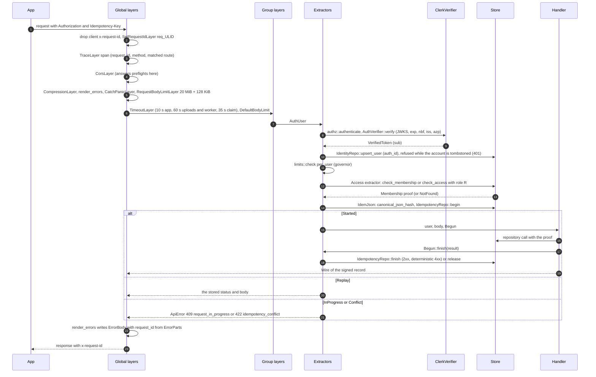

| Arrows | Item | Where |
|---|---|---|
| 2–5 | `router::app`: `SetRequestIdLayer::x_request_id(MakeReqId)`, `PropagateRequestIdLayer`, `TraceLayer`, `cors()`, `CompressionLayer` (skips `text/event-stream` and images), `render_errors`, `CatchPanicLayer::custom(panic_response)`, `RequestBodyLimitLayer` | [api 7](api.md#7-the-router-and-the-layer-stack) |
| 6 | `router::routes`: each group is its own `OpenApiRouter`, layered, then merged; `TimeoutLayer::with_status_code` bounds only the time to the response head, so SSE bodies keep flowing | [api 7](api.md#7-the-router-and-the-layer-stack) |
| 7–11 | `AuthUser::from_request_parts`, `domain::authz::authenticate`, `ClerkVerifier`, `IdentityRepo::upsert_user`, `limits::check` | [api 9, `AuthUser`](api.md#authuser), [integrations 10](integrations.md#session-tokens-authverifier) |
| 12–13 | `Access<R, T>`: `Scoped::locate`, `check_membership::<R>` or `check_access::<R>` | [api 9](api.md#9-authentication-and-access), [domain 8](domain.md#8-authorization-proofs) |
| 14–21 | `IdemJson<T>`, `idempotency::begin`, `Begun::finish`, `IdempotencyRepo` | [api 10](api.md#10-idempotency), [database 4](../database/README.md#idempotency-keys-) |
| 22 | `ApiError::into_response` leaves `ErrorParts` in the response; `render_errors` writes `ErrorBody`; `from_status` covers axum and tower-http responses | [api 8](api.md#8-errors) |

**Rules this flow carries.**

- **The request id** is always the server's `req_<ULID>`. It is on the span, in every `ErrorBody` and in `x-request-id`; a `5xx` cause is logged with `request_id` as a field of the event ([contracts 2](../architecture/contracts.md#2-errors)).
- **A non-member is `404`**, the same body as an unknown id; a member below `R` is `403 forbidden` with `required_role`. A malformed path id is `404` ([api 22](api.md#22-decisions-on-the-contracts-open-questions), question 14).
- **Rate limits are not a layer.** The general limit runs in `AuthUser`, after the token check, keyed by `UserId`, so an unauthenticated caller can't fill the key map. The invite limit runs in `accept_invite`; the daily scan limit in `ScanRepo::create_scan`'s transaction; the chat budget in `ChatAgent::start_turn` ([api 19](api.md#19-rate-limits-and-budgets)).
- **Idempotency** stores a `2xx` or a deterministic `4xx`, releases the key for `409`, `429` and `5xx`, and a `Begun` dropped unfinished (panic, timeout, lost client) releases its key from `Drop` in a spawned task ([contracts 1](../architecture/contracts.md#idempotency)).
- **A timeout** drops the handler's future and answers `503 upstream_unavailable` with `upstream: "api"`, `retry_after_s: 5` ([api 22](api.md#22-decisions-on-the-contracts-open-questions), question 17).
- **Worker routes** use `WorkerAuth` (the bearer token compared in constant time with every configured token in `WorkerTokens`) and `JobLease` (`WorkerAuth`, the `{id}` capture and `X-Lease-Token`). The lease isn't read here: the store compares token, worker and status inside the write, so a stale lease is `409 lease_lost` from the write itself ([api 9, workers](api.md#workers)). A missing `X-Lease-Token` is `400 invalid_request` (question 23).

The full mapping of every lower error to a contracts 2 code is [api 8](api.md#8-errors).

---

## 2. Uploads and signed reads

### Upload

`POST /scans/{id}/images` reads the whole multipart body within its caps, fingerprints it, then runs the CPU pipeline on a blocking thread, writes RustFS, and records the image last, so a crash leaves an orphan object but never a record without its object ([contracts 3](../architecture/contracts.md#post-scansidimages), [storage 4](../storage/README.md#4-writes-and-deletes), [api 12](api.md#12-uploads)).

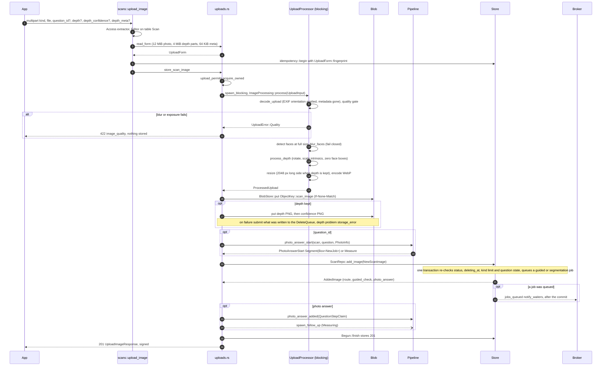

| Arrows | Item | Where |
|---|---|---|
| 3, 5 | `uploads::read_form`, `read_capped`, `UploadForm::fingerprint` (field hashes, never the boundary) | [api 12](api.md#12-uploads), [api 10](api.md#10-idempotency) |
| 7–8 | `uploads::process`: `Semaphore::acquire_owned`, `spawn_blocking`, the `ImageProcessing` seam over `vision::upload::UploadProcessor` | [api 6](api.md#6-application-state-wiring-and-the-seams), [vision 7](vision.md#7-the-upload-pipeline) |
| 9–15 | `UploadProcessor::process`: `imaging::decode_upload`, `quality::score`/`verdict`, `faces.detect`, `blur_faces`, `process_depth`, `resize_long_side`, `encode_webp` | [vision 7](vision.md#7-the-upload-pipeline), [vision 8](vision.md#8-depth) |
| 16–17 | `BlobStore::put` with `ObjectKey::scan_image`, `uploads::store_depth` | [blob 5](blob.md#5-the-object-store), [storage 4](../storage/README.md#4-writes-and-deletes) |
| 18–19 | `Pipeline::photo_answer_start`, `needs_segmentation` | [pipeline 9](pipeline.md#9-entry-points) |
| 20–21 | `ScanRepo::add_image`, `AddedImage`, `UploadRoute` | [store 10](store.md#10-scans-and-events), [domain 7, uploads](domain.md#uploads) |
| 22–24 | the store's `jobs_queued` `Notify` (signalled by `add_image` after its commit), `Pipeline::photo_answer_added`, `AppState::spawn_follow_up` | [api 15](api.md#15-the-job-broker-and-the-worker-api), [flow 7](#photo-answer) |

- **Errors before anything is stored:** `413 upload_too_large`, `415 unsupported_media_type` (declared type or sniffed bytes), `422 image_quality`, and `503 processing_unavailable` when face blurring, encoding or the photo's put fails ([api 8](api.md#8-errors)). Depth problems never fail the upload: `depth: { stored: false, problem }`.
- **The photo answer's first step is chosen before `add_image`,** so its step and its segmentation job go into the same transaction, and a crash can't leave an `answering` question with nothing in flight ([pipeline 9](pipeline.md#9-entry-points)).
- **Chat images** take the same path through `ImageProcessing::process_chat` (no quality gate, no depth) and `ChatRepo::add_chat_image`, and answer `201 { image_id, url }`.

### Signed reads

Stored records hold image and mask ids. A response signs them as it is built: `AppState::signer()` makes a `Signer<'_>` whose URLs expire 15 minutes from now, and `X<Stored>::sign` produces the owned `X<Signed>` that `Wire<T>` serialises ([domain 5](domain.md#5-signed-url-typing), [storage 3](../storage/README.md#3-how-images-are-served)). The signature is HMAC-SHA256 over `SigningInput::canonical()`, the string `GET\n{path}\n{exp}`, in lowercase hex.

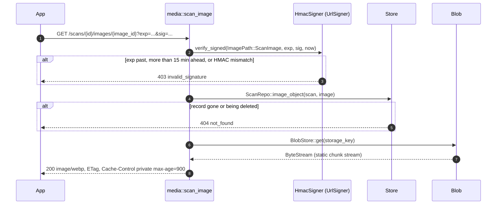

`verify_signed` compares in constant time (`Hmac::verify_slice`). The body is handed to hyper with `Body::from_stream`; a client that leaves drops the stream and the RustFS connection. Masks, chat images and species photos (`/species/{id}/images/{hash}`, from `knowledge/`) use the same check. Workers read job images through `GET /internal/jobs/{id}/images/{image_id}`, authorised by the lease (`JobRepo::job_image`), never by a signature ([api 18](api.md#18-media)). Depth maps have no route.

---

## 3. A scan from submit to plan

The run of [contracts 4's example](../architecture/contracts.md#event-catalogue), split in three parts. Each part ends where work leaves `api` for a worker, or the stream closes. Every scan event goes through `ScanWriter::emit` ([flow 5](#5-the-per-scan-writer-and-the-sse-stream)).

### Submit to the first job

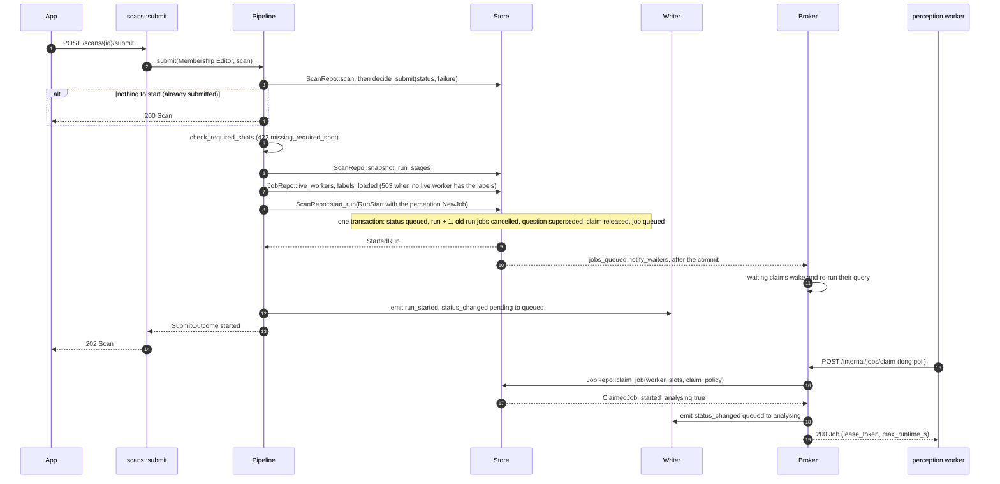

### Perception result, `retrieve` and the `vlm` job

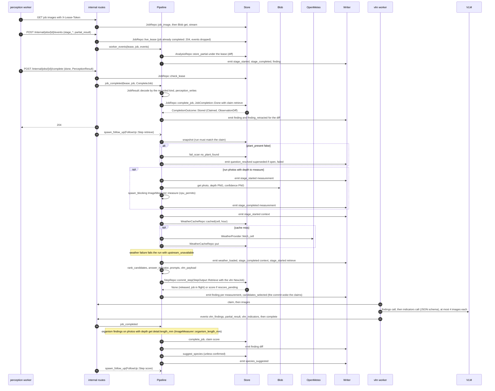

### `score` and `plan`

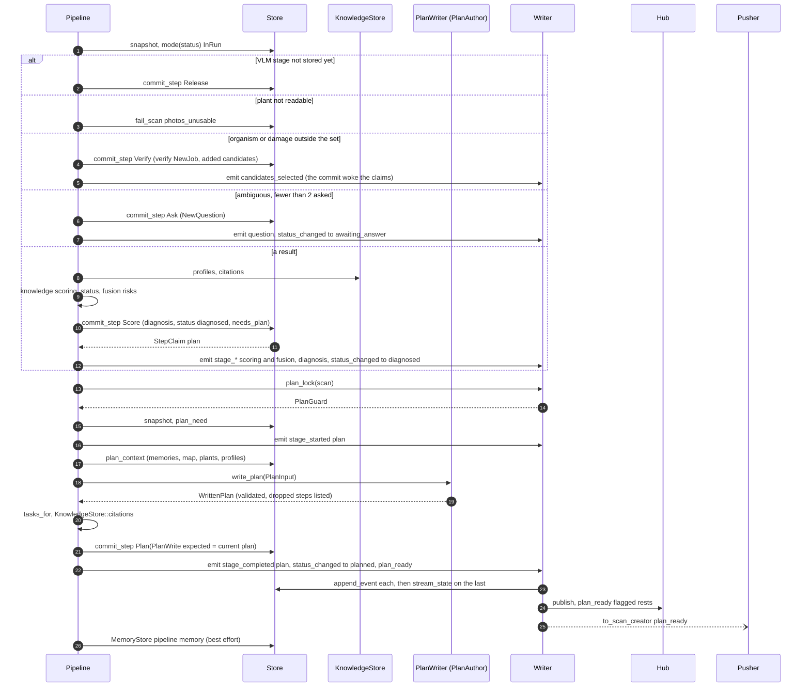

| Part, arrows | Item | Where |
|---|---|---|
| Submit 2–14 | `Pipeline::submit`, `decide_submit`, `run_stages`, `perception_job`, `labels_loaded`, `ScanRepo::start_run`, `RunStart`, `StartedRun` | [pipeline 11](pipeline.md#11-runs), [domain 7, scan state machine](domain.md#scan-state-machine) |
| Submit 15–19 | `internal::claim`, `JobBroker::claim`, `JobRepo::claim_job`, `ClaimedJob::started_analysing` | [api 15](api.md#15-the-job-broker-and-the-worker-api), [store 14](store.md#14-jobs-and-workers), [database 4](../database/README.md#job-claim-with-slots-) |
| Perception 3–7 | `internal::job_events`, `JobRepo::live_lease` (late events after `complete` answer `204` and are dropped), `Pipeline::worker_events`, partial results stored once | [contracts 5, events](../architecture/contracts.md#post-internaljobsidevents) |
| Perception 8–16 | `internal::complete`, `Pipeline::job_completed`, `JobResult::decode`, `JobRepo::complete_job`, `JobCompletion::Done { claim }` | [pipeline 9](pipeline.md#9-entry-points), [contracts 5, complete](../architecture/contracts.md#post-internaljobsidcomplete) |
| Perception 17–32 | `Pipeline::retrieve`, `images_to_measure`, `ImageMeasurer`, `weather_for`, `rank_candidates`, `answer_indicator`, `vlm_payload`, `StepOutput::Retrieve` | [pipeline 6](pipeline.md#6-retrieve), [knowledge 5](knowledge.md#5-candidate-ranking) |
| Perception 33–41 | the VLM adapter's two calls, organism lengths (`organism_boxes`, `ImageMeasurer::organism_length_mm`), `suggest_species` | [worker 8](worker.md#8-the-vlm-adapters), [worker 9](worker.md#9-the-per-call-schema-and-decoding), [integrations 6](integrations.md#6-openai-compatible-vlm-servers), [pipeline 4](pipeline.md#4-ports-and-construction), [pipeline 9](pipeline.md#9-entry-points) |
| Score 1–12 | `Pipeline::score`, `ScoreMode`, `readable`, `verify_outside`, `StepOutput::{Release, Verify, Ask, Score}` | [pipeline 7](pipeline.md#7-score), [knowledge 7](knowledge.md#7-scoring), [knowledge 8](knowledge.md#8-diagnosis-status-and-the-question) |
| Score 13–26 | `Pipeline::plan`, `ScanWriter::plan_lock`, `plan_need`, `PlanAuthor::write_plan`, `tasks_for`, `StepOutput::Plan`, `remember_scan` | [pipeline 8](pipeline.md#8-plan), [agent 10](agent.md#10-the-plan-writer) |

- **One task follows the hand-overs.** `Pipeline::follow_up` loops `retrieve`/`score`/`plan` while each commit returns the next `StepClaim`, and ends quietly on `Conflict::ClaimLost` ([pipeline 5](pipeline.md#5-the-step-machine)).
- **Progress events go out as work happens; outcome events only after the commit that makes them true**, and each step's last events go in one `emit` call ([pipeline 10](pipeline.md#10-events)). A sweep re-run can repeat `stage_started`; it can't repeat a `diagnosis`.
- **The `step_claimed` stream rule.** `StreamState::at_rest()` is false while `pipeline_step` is set, so the `diagnosis` emitted by `score` (claim handed to `plan`) never closes the stream. The stream closes after `plan_ready`, when the plan commit has released the claim ([domain `rules::stream`](domain.md#stages-stream-and-routing), [pipeline 16](pipeline.md#16-domain-changes)).
- **The plan writer fails on a first plan:** the run fails with `upstream_unavailable` (`question_resolved` superseded if a question was open, then `failed`). A failing re-plan keeps the current plan and the sweep retries ([pipeline 8](pipeline.md#8-plan), [pipeline 17](pipeline.md#17-open-questions-and-decisions), question 2).
- **A busy scan** (a second input while a step runs) gets `ClaimAttempt::Busy`: the store sets `rescore_pending`, no follow-up is spawned, and the running step's commit hands over to `score` ([flow 4](#4-step-claims-the-sweep-and-plan-writes)).

The app's side of this flow is [frontend flows 4 and 5](../frontend/flows.md#5-live-scan-progress).

---

## 4. Step claims, the sweep and plan writes

A scan holds at most one step claim (`pipeline_step`, `pipeline_step_run`, `pipeline_step_at`). Entry points claim in the transaction that stores their input; steps commit with a compare-and-set on the claim; the sweep recovers a claim whose task died ([contracts 3](../architecture/contracts.md#scan-lifecycle), [database 4](../database/README.md#steps-between-jobs-)).

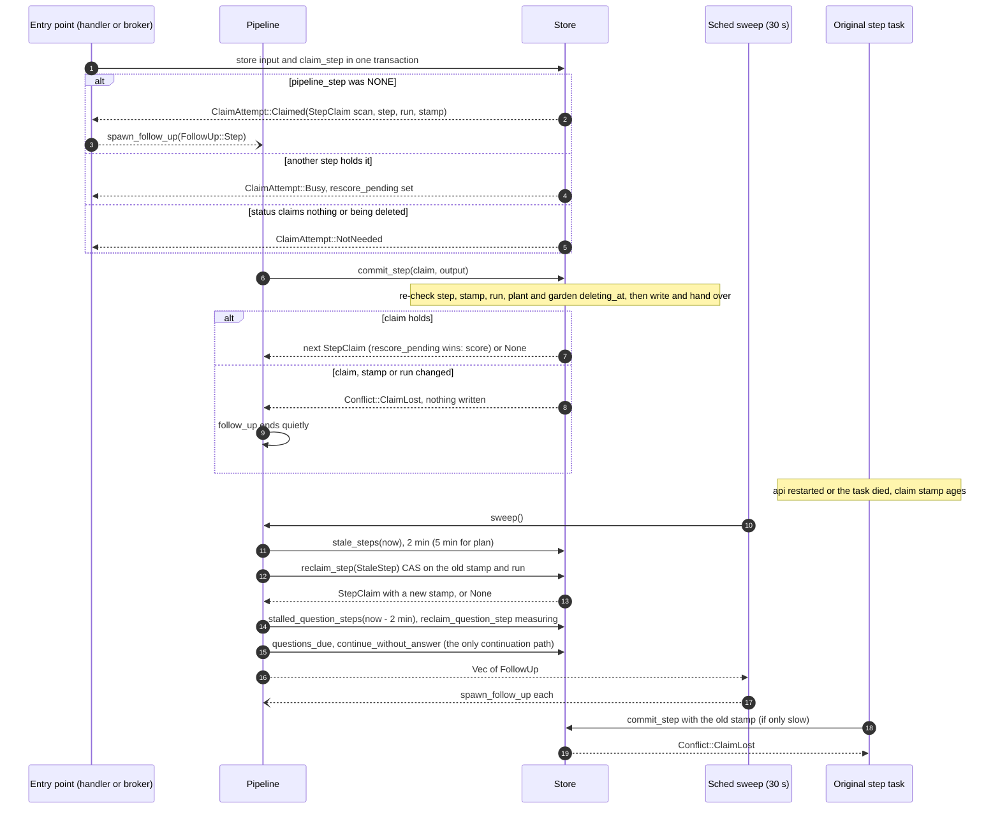

### Plan writes

Every plan write of a scan holds the scan's plan lock, from reading the current plan to storing the new one, and the store's write is a compare-and-set on `scan.plan` ([database 4](../database/README.md#plan-writes-compare-and-set-), [contracts 7](../architecture/contracts.md#actionplan)).

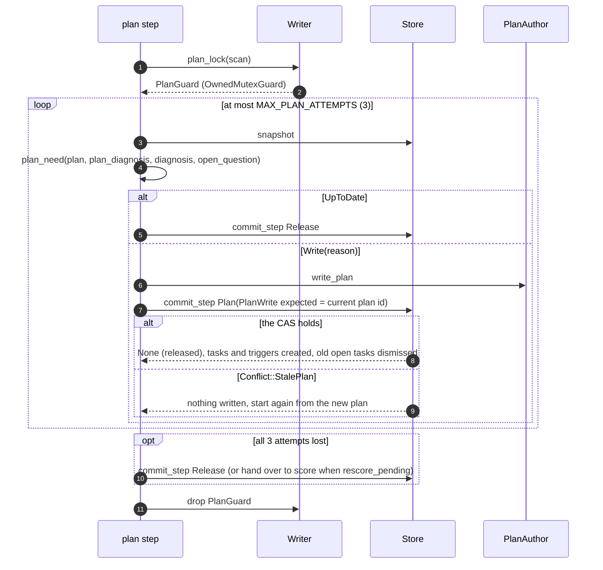

| Arrows | Item | Where |
|---|---|---|
| Claims 1–5 | `StepRepo::claim_step` (inside `complete_job`, `answer_question`, `continue_without_answer`, `finish_guided_check`, `advance_question_step`), `ClaimAttempt` | [store 11](store.md#11-steps-between-jobs), [domain 9, the store](domain.md#the-store), [pipeline 9](pipeline.md#9-entry-points) |
| Claims 6–9 | `StepRepo::commit_step`, `StepOutput`, `PipelineError::lost` | [pipeline 5](pipeline.md#5-the-step-machine), [pipeline 14](pipeline.md#14-errors) |
| Claims 10–19 | `scheduler::sweep`, `Pipeline::sweep`, `StaleStep`, `reclaim_step`, `stalled_question_steps`, `reclaim_question_step` | [api 16](api.md#16-the-scheduler), [pipeline 12](pipeline.md#12-idempotency-and-recovery) |
| Plans 1–2 | `ScanWriters::plan_lock`, a per-scan `tokio::sync::Mutex<()>` behind `lock_owned` | [api 13, the writer](api.md#the-writer) |
| Plans 3–11 | `Pipeline::plan`, `plan_need`, `PlanNeed`, `Conflict::StalePlan`, `MAX_PLAN_ATTEMPTS`; after 3 losses the claim is released at once instead of waiting for the 5-minute sweep | [pipeline 8](pipeline.md#8-plan) |

- **The plan lock is separate from the event channel,** so a 10-second plan-writer call never delays event delivery.
- **A chat revision** takes the same lock in `Pipeline::store_revision` and calls `PlanRepo::write_revision` with `expected = base_plan_id`; it is never retried, and a lost race is `409 invalid_state` with `current_plan_id` ([flow 9](#9-pending-actions)).
- **Every write is retried on a SurrealDB `TransactionConflict`** by `store::tx::run_tx`, up to 5 attempts with 10–50 ms jitter doubling per attempt; a lost compare-and-set is final and never retried there ([store 5](store.md#5-transactions-retries-and-the-error-mapping), [database 4](../database/README.md#4-write-patterns)).

---

## 5. The per-scan writer and the SSE stream

One actor per active scan assigns `seq` through the database, stores, then broadcasts; each SSE stream subscribes first, replays, then goes live ([contracts 4, transport](../architecture/contracts.md#transport), [api 13](api.md#13-scan-events-writer-hub-and-stream)).

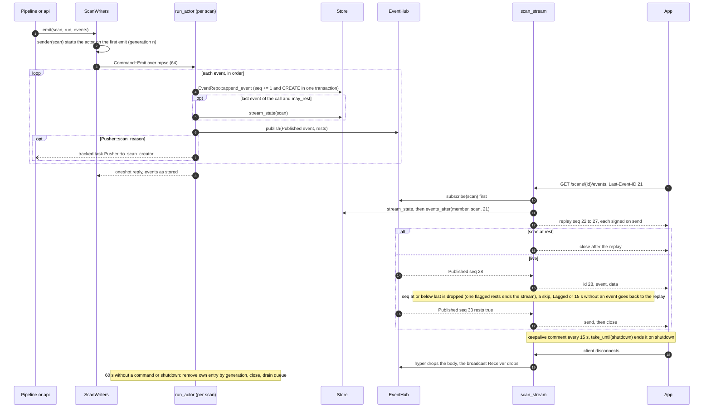

| Arrows | Item | Where |
|---|---|---|
| 1–3 | `ScanWriter::emit`, `ScanWriters::sender`, `Command::Emit`; a send that races the retirement gets its command back and starts a new actor (at most two tries) | [api 13, the writer](api.md#the-writer) |
| 4–8 | `append_all`, `EventRepo::append_event`, `may_rest`, `EventRepo::stream_state`, `EventHub::publish`, `Pusher::scan_reason` | [api 13](api.md#13-scan-events-writer-hub-and-stream), [store 10](store.md#10-scans-and-events), [database 4](../database/README.md#scan-events-a-gap-free-seq-) |
| 9–17 | `scans::events` (auth, membership, `Last-Event-ID` checked before the first byte), `scan_stream`, `EventHub::subscribe`, `events_after`, `to_sse` | [api 13, the stream](api.md#the-stream) |
| 18–19 | the disconnect: no guard object; the dropped `broadcast::Receiver` lowers `receiver_count()`, and the `idle` task removes the channel | [api 13, the hub](api.md#the-hub), [api 16](api.md#16-the-scheduler) |

- **`seq` comes from the database,** not the actor: `append_event` increments `scan.last_event_seq` and creates `scan_event:[scan, seq]` in one transaction, so a writer that retired and came back continues the sequence ([pipeline 17](pipeline.md#17-open-questions-and-decisions), question 22).
- **Resting points.** The writer reads `stream_state` only after the last event of a call that may end a resting point (`plan_ready`, `plan_superseded`, `diagnosis`, `question_resolved`, `guided_check_done`, `failed`). At rest means `planned` or `failed`, no question open or `answering`, no guided check `analysing`, and no step claim held ([contracts 4, when the stream closes](../architecture/contracts.md#when-the-stream-closes)).
- **State before replay.** The stream reads the state, then replays, so every event stored before the read is in the replay. The replay can still miss a resting point's last events: a step commits its state, then emits ([pipeline 10](pipeline.md#10-events)), so a stream that reads between the two sees the scan at rest and closes without them. The app refetches `GET /scans/{id}` on every close ([frontend 10](../frontend/README.md#10-live-streams)), which holds what the step committed. A resting event stored after the state read reaches the stream twice, in the replay and live; the live copy is a duplicate flagged `rests`, and it ends the stream.
- **Rest without an event.** A live stream that gets no event for 15 s (`REST_CHECK`) reads the state and replays again. A resting point reached without an event (a step claim released with nothing to say) then closes it, and so does a scan being deleted: `stream_state` answers `NotFound`.
- **A slow subscriber** sees `RecvError::Lagged` on the 256-slot broadcast and replays from the database; it never sees a gap.
- **Pushes** for `plan_ready`, `plan_superseded` (not `chat_revision`), `question` and `failed` go to the scan's creator while still a member, from the writer, because it sees every event ([contracts 9, push](../architecture/contracts.md#push-notifications)).

The app's side is [frontend flows 17](../frontend/flows.md#17-scan-event-stream).

---

## 6. A job's lease

A worker holds at most `slots` jobs. Each job has a lease of 2 minutes, extended by heartbeats but never past `claimed_at + max_runtime`; a stale worker's jobs go back to the queue ([contracts 5, leases](../architecture/contracts.md#leases-runs-and-attempts), [architecture 8.4](../architecture/README.md#84-job-leasing-and-fallback)).

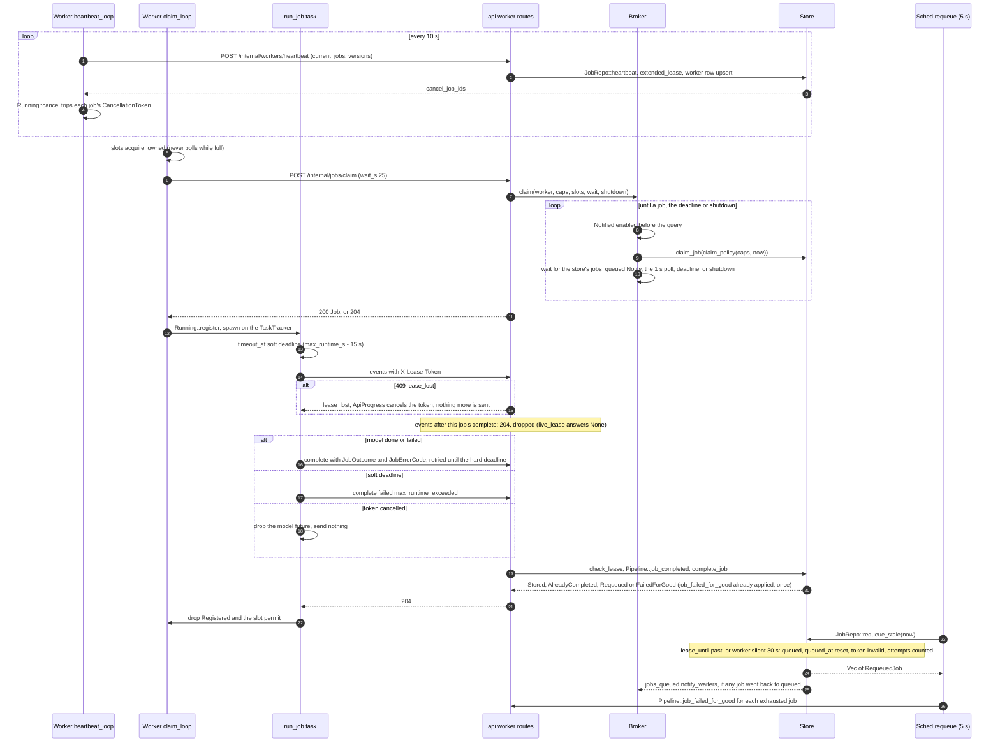

| Arrows | Item | Where |
|---|---|---|
| 1–4 | `Worker::heartbeat_loop` (5 s request timeout, `MissedTickBehavior::Delay`), `internal::heartbeat`, `JobRepo::heartbeat`, `Running::cancel` | [worker 6](worker.md#6-leases-heartbeats-and-completion), [api 15](api.md#15-the-job-broker-and-the-worker-api) |
| 5–11 | `Worker::claim_loop`, `JobBroker::claim`, `claim_policy`, `JobRepo::claim_job` | [api 15](api.md#15-the-job-broker-and-the-worker-api), [domain 7, jobs](domain.md#jobs), [database 4](../database/README.md#job-claim-with-slots-) |
| 12–18, 22 | `Worker::start`, `run_job`, `JobRunner::execute`, `ApiProgress`, `complete_with_retry` | [worker 6](worker.md#6-leases-heartbeats-and-completion), [worker 7](worker.md#7-cancellation) |
| 19–21 | `internal::complete`, `CompletionOutcome`; a job out of attempts fails for good inside `Pipeline::job_completed`, and the handler only spawns its follow-up | [api 15](api.md#15-the-job-broker-and-the-worker-api), [pipeline 9](pipeline.md#9-entry-points) |
| 23–26 | `scheduler::requeue`, `JobRepo::requeue_stale` (which signals the store's `Notify` itself), `attempts_after_requeue`, `exhausted`, `final_failure` | [api 16](api.md#16-the-scheduler), [store 14](store.md#14-jobs-and-workers), [domain 7, jobs](domain.md#jobs) |

**Rules this flow carries.**

| Rule | Value or behaviour |
|---|---|
| `max_runtime` | `perception` 2 min, `vlm` 5 min, `verify` and `guided` 3 min, twice that on the fallback (`JobKind::max_runtime`) |
| The worker's soft deadline | 15 s before `max_runtime_s`, on the monotonic clock; `complete` is retried until the hard deadline |
| Attempts | Retryable failures, plus every requeue after the 2nd (`FREE_REQUEUES`); the 3rd attempt fails for good (`MAX_ATTEMPTS`) |
| `JobErrorCode` | `unsupported_version` and `unknown_label_version` not retryable; `model_error` (output failed validation twice, or a result that doesn't decode for the recorded kind) and `image_fetch_failed` retryable; `max_runtime_exceeded` from the worker ([pipeline 17](pipeline.md#17-open-questions-and-decisions), question 18) |
| A job of an older kind or `v` | `decode_claim` keeps it as `ClaimedJob::Unsupported`, completed at once as `unsupported_version` (questions 19, 21) |
| A repeated `complete` | `check_lease` accepts a job already completed with the same token; `complete_job` answers `AlreadyCompleted`, `204` |
| `events` after `complete` | `live_lease` answers `None` for a job completed with the same token: `204`, the events are dropped, never forwarded ([api 15](api.md#15-the-job-broker-and-the-worker-api)) |
| Heartbeat label versions | Every loaded `label_set_version` and `classifier_labels_version`, comma-separated; `labels_loaded` splits each list before comparing ([pipeline 11](pipeline.md#11-runs)) |
| Any call on a requeued, expired, cancelled or older-run job | `409 lease_lost`; the worker drops the job |
| The fallback | Claims every kind 15 s after `queued_at`; a photo answer's segmentation job only when no perception worker has heartbeated for 30 s (`ClaimPolicy::hold_question_segmentation`) |
| Two VLM workers | The RTX 5070 Ti and the RX 9070 XT both run `worker --caps vlm` against the same queue, each with its own `VLM_SLOTS`. `claim_job`'s re-check of `status = 'queued'` gives each job to one of them; the loser conflicts and takes the next. Both serve the same checkpoint, and `model_versions.worker_id` and `vlm_server` record which one ran it |

### SIGTERM drain

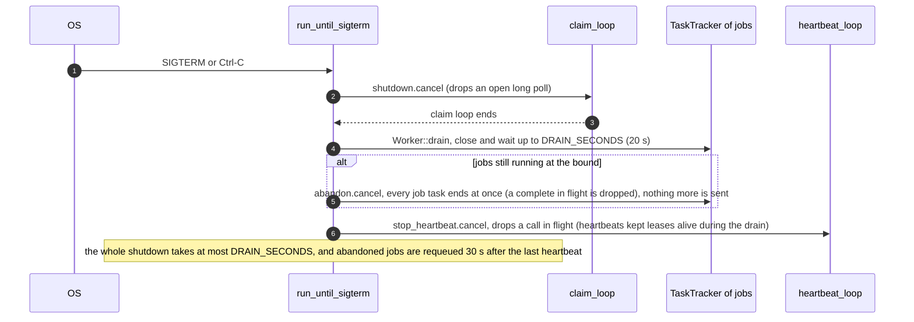

Contracts open question 20 is answered by [worker 16](worker.md#16-decisions-on-the-contracts-open-questions) and [store 21](store.md#21-decisions-on-open-questions): no hand-back call, the stale-heartbeat requeue takes the jobs back, and the first two requeues are free. A job being cancelled drops the model's future; the perception pipeline's `TerminateOnDrop` guard stops a running ONNX Runtime batch and a dropped `reqwest` future closes the VLM server's connection ([worker 7](worker.md#7-cancellation)).

---

## 7. Questions, species changes and guided checks

### Indicator answer and late answer

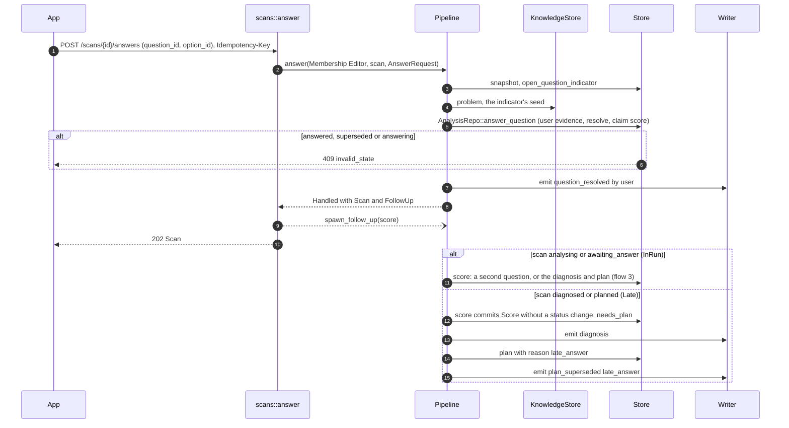

A late answer always re-diagnoses and re-plans. `question_resolved` is emitted while `score` holds the claim taken in `answer_question`'s transaction, so `step_claimed` keeps the stream open until the plan events ([pipeline 10](pipeline.md#10-events), [contracts 3, answers](../architecture/contracts.md#post-scansidanswers)).

### Photo answer

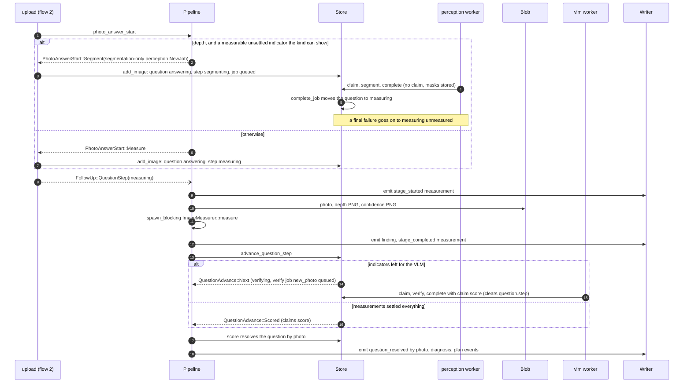

| Arrows | Item | Where |
|---|---|---|
| 1–7 | `photo_answer_start`, `PhotoAnswerStart::{Segment, Measure}`, `ScanRepo::add_image`, `ClaimPolicy::hold_question_segmentation` | [pipeline 9](pipeline.md#9-entry-points), [domain 7, questions](domain.md#questions) |
| 8–14 | `Pipeline::measuring` (`steps/question.rs`), `AnalysisRepo::advance_question_step`, `QuestionAdvance` | [pipeline 9](pipeline.md#9-entry-points), [store 12](store.md#12-observations-questions-and-indicator-answers), [vision 9](vision.md#9-measurement), [contracts 3, answers](../architecture/contracts.md#post-scansidanswers) |
| 15–18 | the `verify` job (`VerifyReason::NewPhoto`), `verify_payload`, `score` | [pipeline 6](pipeline.md#6-retrieve), [pipeline 7](pipeline.md#7-score) |

- A `measuring` step older than 2 minutes is re-claimed by the sweep (`reclaim_question_step`), and re-measuring replaces that photo's measurements. `segmenting` and `verifying` belong to the broker's leases and attempts.
- A late `verify` that fails for good drops the question (`drop_photo_answer`, `question_resolved` by `dropped`); a run's `verify` that fails for good fails the scan, which supersedes the question; it is never reopened (`final_failure`, `QuestionState::after_failed_photo`, [domain 7, jobs](domain.md#jobs), [pipeline 9](pipeline.md#9-entry-points)).

### Continuing without an answer

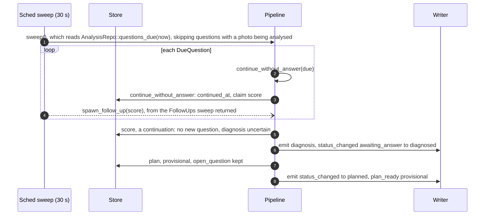

The question stays open after the continuation, so the stream stays open too; answering it later is a late answer. `Pipeline::sweep` is the continuation's only owner: there is no separate `questions` task ([api 16](api.md#16-the-scheduler)).

### Species confirmation

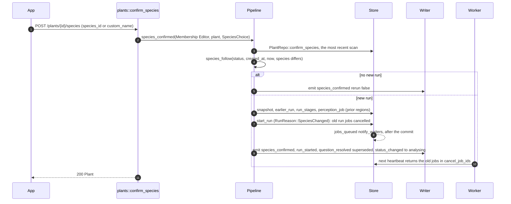

The new run's plan supersedes the old one with reason `species_changed`; `plan_superseded` comes before `plan_ready` ([pipeline 11](pipeline.md#11-runs), [contracts 3, species](../architecture/contracts.md#post-plantsidspecies)).

### Guided check

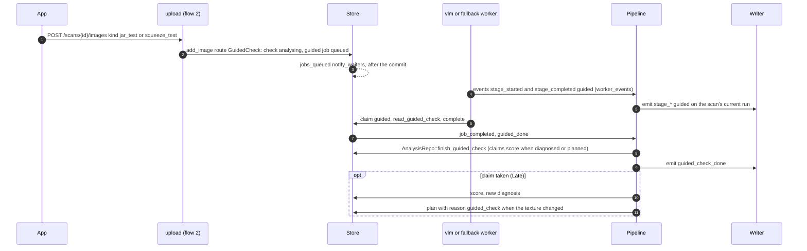

A guided job belongs to the scan, not a run: a new run never cancels it, and its final failure only sends `guided_check_done` with a failed check. Its stage events (contracts 4's `guided` stage) go out on the scan's current run, the run `guided_check_done` carries ([pipeline 10](pipeline.md#10-events)).

---

## 8. Chat turn

`POST /conversations/{id}/messages` starts a turn in the agent, which runs in a task on the process tracker and streams `ChatEvent`s through a channel that `api` maps to SSE frames without `id:` lines ([agent 13](agent.md#13-the-chat-turn), [api 14](api.md#14-chat-streaming-and-confirmation-cards), [contracts 8](../architecture/contracts.md#sending-a-message)).

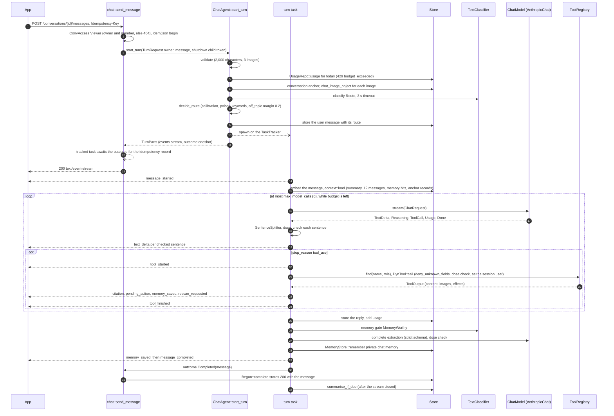

| Arrows | Item | Where |
|---|---|---|
| 2 | `ConvAccess<Viewer, table::Conversation>`, `check_conversation` | [api 9](api.md#9-authentication-and-access) |
| 3–11 | `ChatAgent::start_turn`, `validate`, `UsageRepo::usage`, `TextClassifier::classify`, `decide_route`, `ChatRepo::store_message` | [agent 13](agent.md#13-the-chat-turn), [agent 7](agent.md#7-router-and-safety-gate) |
| 12, 30–31 | the handler's finisher task, `TurnOutcome`, `Begun::complete` or `release` | [api 14](api.md#14-chat-streaming-and-confirmation-cards) |
| 15 | `context::load`, `TurnContext` | [agent 11](agent.md#11-context-per-anchor) |
| 16–24 | the loop, `dose_check`, `ToolRegistry::find` (role-filtered), `DynTool::call` | [agent 13, the loop](agent.md#the-loop), [agent 12](agent.md#the-registry-and-roles), [agent 4](agent.md#4-the-dose-check) |
| 26–29, 32 | `memory::after_turn`, `summarise_if_due` | [agent 14](agent.md#14-memory) |

- **Role-filtered tools.** Viewers and reviewers are offered the read tools, `request_rescan` and `remember`; editors and owners all twenty. `search_farm_records` is offered only when the garden has farm records or a connector past `pending`, a fact the context reads once per turn. A call to a tool that wasn't offered is answered like an unknown tool ([agent 12](agent.md#the-registry-and-roles)).
- **Routes without a model:** `PoisonControl` streams the configured text sentence by sentence, with no model call and no tools; `OffTopic` gets a short redirect from the cheapest model with no tools.
- **Budget.** The day's total is read before the stream; during the turn each call's usage is added, and a turn that has spent what was left ends with `BUDGET_TEXT` before its next call. A turn can overrun by at most one call ([agent 13, token budget](agent.md#token-budget)).
- **Cancellation by a closed channel.** When the client leaves, hyper drops the body, which drops the channel's receiver. The task sees its next `send` fail, or `Sender::closed()` resolve inside its `select!` with the model stream and the shutdown token; it drops the model stream (which stops the HTTP call) and stores the partial reply with `interrupted: true`. The outcome is `Interrupted`, and the handler's task releases the idempotency key ([agent 13, cancellation](agent.md#cancellation)).
- **A model failure after the stream started** ends it with an `error` event (`upstream_unavailable` or `internal`) and stores the partial reply with `interrupted: true` ([agent 13](agent.md#errors-after-the-stream-started)).
- **Shutdown** ends the frames through `take_until`, which interrupts the turn the same way; the turn task is on the tracker, so shutdown waits for it to store its message.

---

## 9. Pending actions

A write tool stores a `proposed` card; confirming is `api`'s ([contracts 8, pending actions](../architecture/contracts.md#pending-actions-confirmation-cards), [api 14](api.md#14-chat-streaming-and-confirmation-cards)).

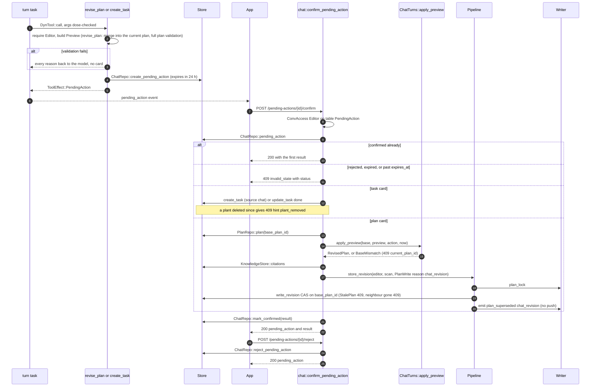

| Arrows | Item | Where |
|---|---|---|
| 1–6 | `tools::propose`, `RevisePlanArgs`, `ChatRepo::create_pending_action` | [agent 12](agent.md#12-tools), [agent 12, revise_plan](agent.md#revise_plan-and-apply_preview) |
| 7–12 | `confirm_pending_action`, `PendingStatus` | [api 14](api.md#14-chat-streaming-and-confirmation-cards) |
| 13–20 | `confirm_revision`, `apply_preview`, `PreviewError::BaseMismatch`, `Pipeline::store_revision`, `PlanRepo::write_revision` | [api 14](api.md#14-chat-streaming-and-confirmation-cards), [pipeline 9](pipeline.md#9-entry-points) |
| 23–25 | `reject_pending_action` | [api 11](api.md#11-endpoint-index) |

A plan revision is never retried: losing the race to an automatic re-plan is `409 invalid_state` with `current_plan_id`, and the card offers to ask again. The `cleanup` task marks `proposed` cards past `expires_at` as `expired` every 10 minutes ([flow 11](#11-scheduler-loops)).

---

## 10. Deletion cascades

Deletion has a synchronous part (mark, cancel, clear) and a background cascade on the tracker: objects first, through `AppState`'s one `blob::DeleteQueue`, never cancelled, then records in [database 4](../database/README.md#deletion-) order, in batches of 500 ([contracts 9, deletion cascades](../architecture/contracts.md#deletion-cascades), [api 17](api.md#17-deletion), [store 17](store.md#17-deletion-and-cleanup), [blob 6](blob.md#6-deletes-that-are-never-cancelled)).

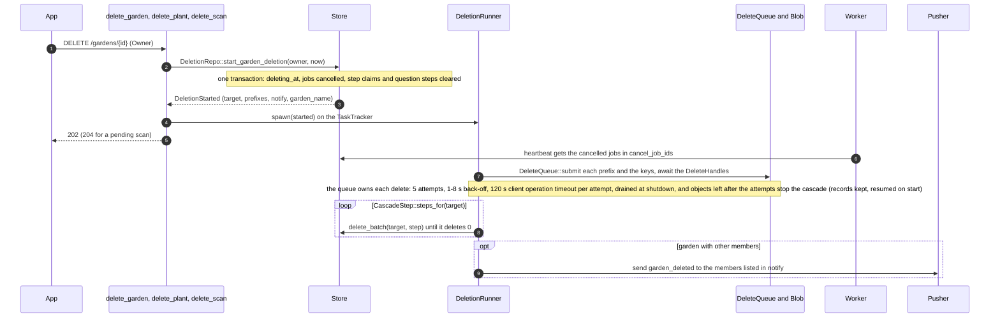

| Target | Request | Background, in order |
|---|---|---|
| Garden (`DELETE /gardens/{id}`, owner) | `start_garden_deletion`; `202` | Its prefix `gardens/{garden_id}/`; every cascade step; `garden_deleted` pushes |
| Plant (`DELETE /plants/{id}`, owner) | `start_plant_deletion` (also removes its pin from the current map in place); `202` | Its scans' prefixes; the plant steps |
| Pending scan (`DELETE /scans/{id}`, editor) | `start_scan_deletion` (`pending` only, else `409`); `204` | Its prefix; its own short list; the jar-test task goes through `task.scan`'s `CASCADE` |
| Member (`DELETE /gardens/{id}/members/{user_id}`) | `remove_member` (the last owner can't); `204` | Their conversations' image prefixes; their conversations and unshared chat memories in that garden (`DeletionTarget::Member`) |
| Account | [flow 12](#12-the-auth-webhook-and-account-deletion) | |

- **Why objects first and never cancelled.** On RustFS 1.0.1 an interrupted `DeleteObjects` can leave objects that can never be listed or deleted. Every delete in `api` (cascades, a removed shot, an upload's depth maps, the orphan sweep) goes through one `blob::DeleteQueue` in `AppState`, which runs each job in a task it owns: dropping the cascade or the handle never stops it. The only time limit is the client's 120-second per-attempt operation timeout. At shutdown the queue is drained for `max(SHUTDOWN_DRAIN_S, 120 s)`, so a pending delete always gets one full attempt ([storage 4](../storage/README.md#4-writes-and-deletes), [api 17](api.md#17-deletion), [blob 6](blob.md#6-deletes-that-are-never-cancelled)).
- **Why a running step can't write afterwards.** The synchronous part clears `pipeline_step` and question steps, and `commit_step` re-checks `deleting_at` on the plant and garden, so a step already running fails with `ClaimLost` ([database 4](../database/README.md#deletion-)).
- **Resumable.** At start, `DeletionRunner::resume` runs every target still marked `deleting_at` from its first step; a garden's prefix is deleted again, and a plant's or scan's objects are left to the orphan sweep ([api 23](api.md#23-open-questions), question 5).
- **A missed step fails loudly** on `REFERENCE ON DELETE REJECT` instead of orphaning records.

---

## 11. Scheduler loops

Ten loops run on the process `TaskTracker` through `scheduler::every` (`connectors` only when connectors are on): `interval_at` with a first delay, `MissedTickBehavior::Delay`, and a `select!` on the shutdown token. A failed run is logged and the next tick tries again ([api 16](api.md#16-the-scheduler)).

| Task | Every | What | Flow |
|---|---|---|---|
| `requeue` | 5 s | `JobRepo::requeue_stale` (the store wakes the claims); `job_failed_for_good` for exhausted jobs | [6](#6-a-jobs-lease) |
| `sweep` | 30 s | `Pipeline::sweep`: stale steps, stalled `measuring`, and the 10-minute continuation of due questions (its only owner) | [4](#4-step-claims-the-sweep-and-plan-writes), [7](#continuing-without-an-answer) |
| `idle` | 60 s | `RateLimits::retain_recent`, `EventHub::sweep_idle`, `ScanWriters::sweep_idle` | [19](#19-writer-actor-broadcast-channel-and-plan-lock) |
| `beliefs` | 10 s | `agent::beliefs::sync_pending`: queued erases, then unsynced shared memories, the only writer to Agent Memory | [api 16](api.md#16-the-scheduler) |
| `cleanup` | 10 min | Expired idempotency keys, weather older than 2 h, expired pending actions, finished jobs older than 7 days, account tombstones 24 h after Clerk confirmed the deletion, synced Slack messages older than 180 days (Drive documents stay) | [database 4](../database/README.md#cleanup-no-ttl) |
| `weather` | 1 h | Weather by cell, forecast alerts, plan triggers | below |
| `soil` | 15 min | SoilGrids for due gardens (`pending`, or past `soil_retry_at`), 4 a run | below |
| `connectors` | 1 min | `FarmSync::run_due`: at most 4 due farm connectors, side by side | below |
| `receipts` | 15 min | `Notifier::check_receipts`, `IdentityRepo::forget_push_tokens` | below |
| `orphans` | 24 h | Objects older than an hour that no record points to | below |

### Weather, forecast alerts and plan triggers

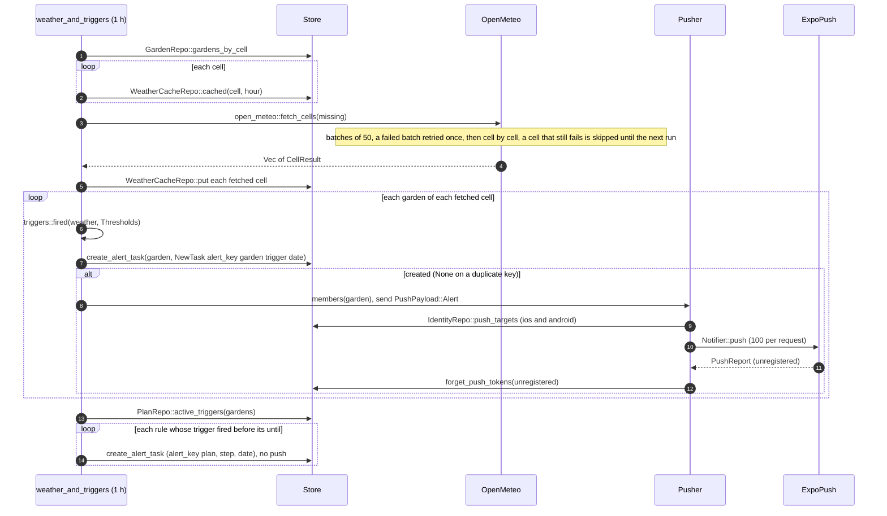

- **Dedupe.** The unique `alert_key` index makes a duplicate insert fail, which `create_alert_task` answers `None`, so overlapping runs or a run repeated after a crash create each task once and push once ([database 4](../database/README.md#alert-dedupe-)). A dead plant also gets `None`.
- **Local dates.** Open-Meteo answers in the cell's time zone, so the forecast's first day is the garden's local today ([integrations 7](integrations.md#7-open-meteo-weather)).

### Soil profiles

```mermaid
sequenceDiagram
    autonumber
    participant H as gardens::create_garden
    participant Sched as soil (15 min)
    participant Store
    participant SG as SoilGrids
    H--)SG: spawn_soil_fetch(garden, at) after 201, fetch_soil_profile as below
    Sched->>Store: gardens_due_soil_profile(now, 4): pending, or unavailable past soil_retry_at
    loop each garden
        Sched->>SG: SoilProvider::soil_profile(at)
        Note over SG: full query at the point, then one-value probes on rings at 2 km and 5 km, Pacer 15 s apart
        alt data at the point or nearby
            SG-->>Sched: SoilProfile
            Sched->>Store: set_soil_profile Ready
        else NotFound (null pixels everywhere), Unavailable, RateLimited or BadResponse
            SG-->>Sched: ProviderError
            Sched->>Store: soil_profile_failed(garden, now + soil_retry_after): 7 days for NotFound, 15 min otherwise
        end
    end
```

The first fetch runs right after `POST /gardens` (`spawn_soil_fetch`, through `scheduler::fetch_soil_profile`); the `soil` task retries due gardens. A failure stores `unavailable` and `garden.soil_retry_at`: 15 minutes after an outage, 7 days after no data, so a null-pixel garden (Toronto, Guelph) costs its 9 paced calls once a week, not every 15 minutes ([contracts 9, the soil profile](../architecture/contracts.md#gardens), [integrations 8](integrations.md#8-soilgrids), [api 16](api.md#16-the-scheduler)).

### Farm connectors' sync

```mermaid
sequenceDiagram
    autonumber
    participant Sched as connectors (1 min)
    participant Sync as FarmSync
    participant Store
    participant Src as FarmSource (SlackSource; Drive in E4.3)
    participant Emb as TextEmbedder
    Sched->>Store: due_connectors(now, 4): active, next_sync_at passed, not stopped by too_large or source_missing
    par each connector, side by side
        Sync->>Sync: FarmSources by kind and endpoint; ConnectorKey::unseal the token
        Sync->>Store: garden_record_count
        loop each chosen source, page by page from its SourceState, until the pass ends, 3 min pass or shutdown
            Note over Sync: a day after the last finished pass, and with a reread_window, the pass starts 7 days back (reread_from)
            Sync->>Src: read_page(token, cursor, oldest = now - 180 days, reread_from)
            Src-->>Sync: FarmPage: items, removed, kept, cursor, more
            Sync->>Store: record_hashes(page's vendor ids)
            Sync->>Sync: chunk (2,000 chars), text_hash; stop with too_large past 10,000 records
            Sync->>Emb: embed(Document, new or changed chunks only), 32 a call
            Sync->>Store: upsert_records (no vector: the stored one stays), delete_chunks_from, delete_records(removed)
            opt the re-read pass ended
                Sync->>Store: source_vendor_ids_since(source, from + 1 s)
                Sync->>Store: delete_records(not seen and not kept)
            end
        end
        alt every source read to its end
            Sync->>Store: finish_sync(cursors, synced_at now, next +15 min)
        else pages left
            Sync->>Store: finish_sync(cursors, next now)
        else the vendor or the limit stopped it
            Sync->>Store: finish_sync(cursors, last_error, next: Retry-After for rate_limited, else +15 min)
            opt auth_refused
                Sync->>Store: set_status(reauth_needed, auth_refused)
            end
        end
    end
```

- **No duplicates.** Records are keyed by `(connector, vendor_id, n)` and a pass continues from its saved cursor, so a throttled first sync finishes on a later run without storing a message twice ([api 16](api.md#the-farm-sync)).
- **Slack's cursor** holds the newest `ts` of finished passes, a pass with pages left and each thread's read state, so a quiet channel costs one `conversations.history` call and an unchanged thread no `conversations.replies` call ([integrations 15](integrations.md#slacksource-the-port-for-the-sync)).
- **A Sync now during a run.** A **Sync now** or new sources during the run move `next_sync_at` past the value the run started from; `finish_sync` then keeps that time and doesn't store a stopping failure over the owner's change ([store](store.md)).

### Push receipts and orphans

```mermaid
sequenceDiagram
    autonumber
    participant R as receipts (15 min)
    participant Expo as ExpoPush
    participant O as orphans (24 h)
    participant Store
    participant Blob
    R->>Expo: Notifier::check_receipts (tickets 15 min or older, at most 1,000 ids)
    Expo-->>R: tokens with DeviceNotRegistered
    R->>Store: IdentityRepo::forget_push_tokens
    O->>Store: gardens_by_cell (every garden)
    loop each garden
        O->>Blob: list ObjectPrefix::garden, keep last_modified older than 1 h
        O->>Store: DeletionRepo::unreferenced_keys (every key field counts)
        O->>Blob: DeleteQueue::submit Keys, await the outcome
    end
```

Pending tickets live only in the `ExpoPush` adapter's memory: a restart loses at most 15 minutes of receipts ([integrations 12](integrations.md#12-expo-push)). The orphan sweep's three sides are [blob 9](blob.md#9-the-orphan-sweep), `DeletionRepo::unreferenced_keys` ([store 17](store.md#17-deletion-and-cleanup)) and `scheduler::orphans`.

**Memory summaries are not a scheduler loop.** Conversation summaries run after a turn's stream closes (`summarise_if_due`, every 20 messages, [agent 14](agent.md#14-memory)), and the pipeline's memory after a first or species-change plan (`remember_scan`, [pipeline 8](pipeline.md#8-plan)).

---

## 12. The auth webhook and account deletion

### The webhook

```mermaid
sequenceDiagram
    autonumber
    participant Svix as Clerk via Svix
    participant Handler as ops::auth_webhook
    participant Ver as SvixVerifier
    participant Store
    participant Runner as DeletionRunner
    Svix->>Handler: POST /webhooks/auth, svix-id, svix-timestamp, svix-signature, raw body
    Handler->>Ver: WebhookVerifier::verify(headers, body, now)
    Note over Ver: HMAC-SHA256 over id.timestamp.body, every v1 entry compared in constant time, timestamp within 5 min either way
    alt bad signature or timestamp
        Ver-->>Svix: 401 unauthenticated (Svix redelivers)
    end
    Ver->>Ver: map_clerk_event(body)
    alt other type, no data.id, or unreadable signed body
        Handler-->>Svix: 204
    else user.created
        Handler-->>Svix: 204, nothing changes
    else user.deleted
        Handler->>Store: IdentityRepo::user_by_auth(data.id)
        opt the user exists
            Handler->>Runner: start_account(user, auth_id): tombstone CAS, no-op when a cascade already runs
        end
        Handler-->>Svix: 204
    end
```

- **Out-of-order events.** Clerk doesn't guarantee delivery order. `user.created` changes nothing: the user record is made by the first authenticated request (`IdentityRepo::upsert_user` in `AuthUser`), so a late `user.created` can never recreate a deleted user. A `user.deleted` for a user who never made a request finds nobody and does nothing ([api 22](api.md#22-decisions-on-the-contracts-open-questions), question 24).
- **Idempotent.** A redelivery maps to the same event; a `user.deleted` during a `DELETE /me` cascade finds the tombstone (`start_account_deletion` answers `false`) and starts nothing; one after the cascade finds no user.

### Account deletion

`DELETE /me` and `user.deleted` run the same cascade ([architecture 5, deletion](../architecture/README.md#deletion), [contracts 9, account](../architecture/contracts.md#account)).

```mermaid
sequenceDiagram
    autonumber
    participant App
    participant Handler as account::delete_me
    participant Runner as DeletionRunner
    participant Store
    participant Blob
    participant Clerk as ClerkAdmin
    App->>Handler: DELETE /me
    Handler->>Runner: plan_account(user)
    Runner->>Store: plan_account_deletion (delete, transfer, leave)
    Handler->>Runner: start_account(user, auth_id): DeletionRepo::start_account_deletion, the tombstone CAS
    Handler-->>App: 202 deleted_gardens, transferred_gardens
    Runner->>Store: plan_account_deletion again
    loop each transfer
        Runner->>Store: transfer_ownership (longest-standing editor)
    end
    loop each garden the user alone used
        Runner->>Store: check_membership_of Owner, start_garden_deletion
        Runner->>Blob: garden prefix, then records (flow 10)
    end
    loop each shared garden
        Runner->>Store: check_membership_of Viewer, remove_member
        Runner->>Blob: chat prefixes
        Runner->>Store: delete_records DeletionTarget::Member
    end
    Runner->>Store: delete_user_feedback, delete_user (push tokens cascade, author links unset)
    loop until it succeeds or shutdown, back-off 1 s doubling to ADMIN_BACKOFF_MAX
        Runner->>Clerk: AuthAdmin::delete_account(auth_id) (404 counts as done)
    end
    Runner->>Store: finish_account_deletion (clerk_deleted_at, the tombstone stays 24 h)
```

`authz::check_membership_of` reads a role for a `UserId` that a verified webhook or the session named, since the webhook has no `CurrentUser` ([api 17](api.md#17-deletion)).

- **The tombstone** (`deleted_user:[auth_id]`, written by `start_account_deletion` before anything else) does three jobs ([api 17](api.md#17-deletion), [database 4](../database/README.md#deletion-)): its compare-and-set makes a second cascade for the same account a no-op; while it exists, `upsert_user` refuses the auth id, so the deleted account's still-valid session token gets `401` in `AuthUser` and never creates a new user; and `DeletionRunner::resume` lists `unfinished_account_deletions` at start, so the record steps and the Clerk retry survive a restart. `finish_account_deletion` records Clerk's answer, and the `cleanup` task deletes the tombstone 24 h later (`TOMBSTONE_KEEP`).

---

## 13. Start-up and shutdown

### `api`

```mermaid
sequenceDiagram
    autonumber
    participant Main as api main
    participant Store as SurrealStore
    participant Blob as S3BlobStore
    participant Ints as integrations adapters
    participant Vision as vision models (blocking)
    participant State as AppState
    participant Sched as scheduler
    participant Serve as axum::serve
    Main->>Main: Config::from_env, init_tracing (JSON, RUST_LOG)
    Main->>Main: CancellationToken, TaskTracker
    Main->>Store: apply_schema over a root connection (SURREAL_ROOT_USER), then connect as api
    Main->>Blob: storage_client (path-style, 120 s operation timeout)
    Main->>Ints: one reqwest client: ClerkVerifier, SvixVerifier, ClerkAdmin, OpenMeteo, SoilGrids, CompositeGeocoder (TimeZoneFinder on spawn_blocking), ExpoPush
    Main->>Vision: load_models on spawn_blocking: text embedder, UploadProcessor (face detector)
    Main->>Store: KnowledgeRepo::load_knowledge, PhotoIndex, HmacSigner
    Main->>State: EventHub, JobBroker, Pusher, ScanWriters, Pipeline, ChatAgent, DeletionRunner
    Main->>State: DeletionRunner::resume (deleting_at targets, unfinished account tombstones)
    Main->>Store: farm_sync::seed::at_start: with CONNECTOR_KEY, both ERA_* bases and ERA_DEMO_GARDEN_ID, seed_connector the two era connectors by fixed id (skipped while the garden has no owner)
    Main->>Sched: scheduler::start (ten loops on the tracker; connectors only when connectors are on)
    Main->>Main: spawn signal (Ctrl-C or SIGTERM cancels the token)
    Main->>Serve: bind, serve with_graceful_shutdown(token.cancelled_owned)
    Note over Serve: SSE streams and image bodies end through take_until, the claim long poll answers 204
    Serve-->>Main: last connection closed
    Main->>Main: tasks.close, wait up to SHUTDOWN_DRAIN_S (30 s), and DeleteQueue::drain up to max(SHUTDOWN_DRAIN_S, 120 s)
    Note over Main: writer actors drain and stop, scheduler loops end, follow-ups and chat turns finish, cascades run on (cut off at the deadline, resumed on start), pending RustFS deletes get at least one full 120 s attempt
```

| Step | Fails how | Where |
|---|---|---|
| 1–3 | Exits naming the variable; exits without SurrealDB | [api 4](api.md#4-start-up-and-shutdown), [database 1](../database/README.md#1-version-and-setup), [store 4](store.md#4-connecting-and-the-schema) |
| 4–5 | Exits on a bad secret | [api 6](api.md#6-application-state-wiring-and-the-seams), [integrations 4](integrations.md#4-shared-http-client-retries-pacing-sse) |
| 6 | Exits: face blurring fails closed, so uploads can't run without it | [vision 7](vision.md#7-the-upload-pipeline), [vision 10](vision.md#10-the-text-embedder) |
| 7–9 | Exits on a store error | [api 4](api.md#4-start-up-and-shutdown), [api 17](api.md#17-deletion) |
| 10 | Logged, not fatal: the demo connectors come on the next start | [api 16](api.md#the-farm-sync) |
| 13–15 | `with_graceful_shutdown` waits for every open connection, which is why every long response ends on the token | [api 4](api.md#4-start-up-and-shutdown) |

The `api` service's `stop_grace_period` is 190 s, so Compose's SIGKILL doesn't land inside that drain: 60 s for the slowest request, 120 s for a delete attempt and 10 s of margin ([api 4](api.md#4-start-up-and-shutdown)).

`seed-upload` has finished before `api` starts (`depends_on` with `service_completed_successfully`), so the photo index sees the species photos ([architecture 12](../architecture/README.md#12-deployment)).

### `worker`

```mermaid
sequenceDiagram
    autonumber
    participant Main as worker main
    participant Model as VisionModel adapter
    participant VLM
    participant WL as run_until_sigterm
    participant Api as api
    Main->>Main: Cli::parse (CAPS, SLOTS, WORKER_ID, WORKER_TOKEN), JSON tracing
    Main->>Main: one reqwest client (600 s read gap), CPU semaphore
    alt caps perception
        Main->>Model: Manifest::load (SHA-256 of every file), OrtRuntime::init (ORT_EP), PerceptionPipeline::load
    else caps vlm
        Main->>VLM: OpenAiCompatClient::models, the served name must be listed
        Main->>Model: VlmAdapter over OpenAiBackend, AdapterProfile (box format, cell, max pixels)
    else caps fallback
        Main->>Model: AnthropicClient, FallbackLabels from the manifest, FallbackModel
    end
    Main->>WL: Worker::new(HttpWorkerApi, model, Identity, Timings)
    WL->>Api: heartbeat every 10 s, claim loop while a slot is free
    Note over WL: SIGTERM: stop claiming, drain, then stop heartbeating (flow 6)
```

A missing driver, file, key or served model fails start-up instead of a job. The worker holds no state: everything it needs comes with the job, and everything it produces goes back through the worker API ([README 8](README.md#8-runtime-composition), [worker 4](worker.md#4-configuration), [worker 11](worker.md#11-multi-vendor-gpus), [vision 5](vision.md#5-the-model-manifest)).

---

## 14. Scan status

The server's state machine of [contracts 3](../architecture/contracts.md#scan-lifecycle), as `domain::rules::scan_state` implements it ([domain 7](domain.md#scan-state-machine)). A refused trigger is `409 invalid_state` with `status` and `allowed`.

```mermaid
stateDiagram-v2
    [*] --> pending: POST /scans (create_scan)
    pending --> queued: Submit (start_run)
    queued --> analysing: Claimed (claim_job, started_analysing)
    analysing --> awaiting_answer: QuestionAsked (score commits Ask)
    awaiting_answer --> awaiting_answer: QuestionAsked (second question)
    analysing --> diagnosed: Diagnosed (score commits Score)
    awaiting_answer --> diagnosed: Diagnosed (answer, or the 10-minute continuation)
    diagnosed --> planned: Planned (plan commits Plan)
    analysing --> analysing: SpeciesChanged (new run)
    awaiting_answer --> analysing: SpeciesChanged (new run)
    diagnosed --> analysing: SpeciesChanged (new run)
    planned --> analysing: SpeciesChanged (new run)
    queued --> failed: Fail
    analysing --> failed: Fail
    awaiting_answer --> failed: Fail
    diagnosed --> failed: Fail (first plan writer outage)
    failed --> queued: Resubmit (processing_error or upstream_unavailable only)
    diagnosed --> diagnosed: LateWork
    planned --> planned: LateWork
    pending --> [*]: DELETE /scans (pending only)
```

- `Fail` codes: `no_plant_found` (`retrieve`), `photos_unusable` (`score`), `upstream_unavailable` (weather in `retrieve`, the plan writer on a first plan), `processing_error` (a run's job out of attempts). `fail_scan` releases the claim and supersedes the question in its transaction.
- `planned` never fails: nothing of a run is in flight once it is planned, and late work never fails a scan.
- Every transition except `Claimed` is emitted by the pipeline; `Claimed` by `internal::claim`.

---

## 15. Step claim

The claim on one scan, as `StepRepo` stores it. The pipeline's own view, by step, is [pipeline 5](pipeline.md#5-the-step-machine).

```mermaid
stateDiagram-v2
    [*] --> free
    free --> claimed: claim_step in an entry point's transaction
    free --> free: claim_step NotNeeded (status claims nothing, being deleted)
    claimed --> claimed: claim_step Busy sets rescore_pending
    claimed --> claimed: commit hands over (retrieve to score, score to plan, any to score with rescore_pending)
    claimed --> free: commit releases (job queued, question asked, plan stored, Release)
    claimed --> stale: stamp older than 2 min (5 min for plan)
    stale --> claimed: reclaim_step CAS on the old stamp and run (new stamp)
    claimed --> free: start_run, fail_scan, start of plant or garden deletion
    stale --> free: start_run, fail_scan, deletion
    note right of stale
        The slow original commit fails
        with Conflict ClaimLost, so only
        one of them ever commits.
    end note
```

---

## 16. Photo answer

A question's server-side states (`QuestionState`) and a photo answer's steps (`QuestionStep`), from [domain 7, questions](domain.md#questions) and [contracts 3, answers](../architecture/contracts.md#post-scansidanswers).

```mermaid
stateDiagram-v2
    [*] --> open: score commits Ask
    open --> answered: indicator answer (answer_question)
    open --> superseded: new run or the scan fails
    open --> segmenting: photo with depth and a measurable indicator (add_image, Segment)
    open --> measuring: other photo (add_image, Measure)
    segmenting --> measuring: segmentation result, or its final failure
    measuring --> measuring: sweep re-claims after 2 min
    measuring --> verifying: advance_question_step Next (verify job)
    measuring --> answered: advance_question_step Scored, score resolves by photo
    verifying --> answered: verify result, score resolves by photo
    verifying --> dropped: late verify fails for good
    segmenting --> superseded: new run or the scan fails
    measuring --> superseded: new run or the scan fails
    verifying --> superseded: new run or the scan fails
    answered --> [*]
    superseded --> [*]
    dropped --> [*]
```

`segmenting`, `measuring` and `verifying` are all `answering` on the wire. The 10-minute continuation leaves the question `open`, and the sweep's continuation skips a question whose photo is being analysed.

---

## 17. Job

The `job.status` values of the schema and the transitions of [contracts 5](../architecture/contracts.md#leases-runs-and-attempts) ([domain 7, jobs](domain.md#jobs)).

```mermaid
stateDiagram-v2
    [*] --> queued: start_run, commit_step, add_image, enqueue_job
    queued --> leased: claim_job (slots, kinds, eligible_before, fresh lease_token)
    leased --> leased: heartbeat extends lease_until (never past claimed_at + max_runtime)
    leased --> done: complete done
    leased --> queued: requeue_stale (lease expired or worker silent 30 s), attempts left
    leased --> queued: complete failed, retryable, attempts left (Requeued)
    leased --> failed: complete failed not retryable, or attempts exhausted (FailedForGood)
    leased --> failed: requeue_stale with attempts exhausted
    queued --> cancelled: new run (run jobs only) or deletion
    leased --> cancelled: new run (run jobs only) or deletion
    done --> [*]
    failed --> [*]
    cancelled --> [*]
    note right of failed
        final_failure by kind: a run job fails the scan,
        a late verify drops the question, a guided job
        fails its check, a question segmentation job
        goes on unmeasured.
    end note
```

A requeue or cancellation invalidates the lease token, so the old holder's next call is `409 lease_lost`. Finished jobs are deleted after 7 days by `cleanup`.

---

## 18. Pending action

```mermaid
stateDiagram-v2
    [*] --> proposed: write tool, create_pending_action (expires_at now + 24 h)
    proposed --> confirmed: confirm, the write succeeds (mark_confirmed)
    proposed --> proposed: confirm refused (409 plant_removed, neighbour_removed, current_plan_id)
    proposed --> rejected: reject
    proposed --> expired: cleanup after expires_at (a confirm past expires_at is 409 already)
    confirmed --> confirmed: confirm again returns the first result
    confirmed --> [*]
    rejected --> [*]
    expired --> [*]
```

A refused confirm stores nothing and leaves the card `proposed`; the app offers to ask again ([api 14](api.md#14-chat-streaming-and-confirmation-cards)).

---

## 19. Writer actor, broadcast channel and plan lock

Contracts open question 22, as settled by `api` and `pipeline`: three pieces with independent lifetimes, so none keeps another alive, and correctness doesn't depend on any of them because `seq` comes from `append_event`'s transaction ([api 13](api.md#13-scan-events-writer-hub-and-stream), [pipeline 17](pipeline.md#17-open-questions-and-decisions)).

```mermaid
stateDiagram-v2
    state "Writer actor (per scan)" as A {
        [*] --> running: first emit, sender() inserts Handle with generation n
        running --> running: Command Emit handled
        running --> retiring: 60 s without a command, or shutdown
        retiring --> [*]: remove own entry by generation, close mpsc, drain queued commands
    }
    state "Broadcast channel (per scan)" as B {
        [*] --> open: first subscribe creates it
        open --> open: publish, subscribe, a receiver drops
        open --> removed: idle sweep finds receiver_count 0
        removed --> [*]
    }
    state "Plan lock (per scan)" as C {
        [*] --> present: first plan_lock
        present --> present: lock_owned, guard dropped
        present --> swept: idle sweep finds strong_count 1
        swept --> [*]
    }
```

- **An `emit` that races the retirement** gets its command back from the failed `send` and starts a new actor (`generation` n + 1); the retiring actor removes only its own entry.
- **A publish to a scan without a channel** does nothing: nobody listens, and the event is stored. The writer looks the sender up under the map's lock for every publish, so the sweep can't strand a subscriber.
- **The `idle` task** (60 s) runs both sweeps; a plan lock held or waited on has `Arc::strong_count > 1` and stays.

---

## 20. Gaps and contradictions

Found while tracing the flows. Where sources disagreed, the diagrams followed the most specific one (code, then crate document, then contracts, then architecture). v0.2: every gap is now fixed, settled or documented, and the diagrams above show the fixed behaviour.

| # | What conflicted or was missing | Status |
|---|---|---|
| 1 | `internal::complete` called `job_failed_for_good` after `Pipeline::job_completed` had already handled `CompletionOutcome::FailedForGood`, so a run job out of attempts ran `fail_scan` twice | **Fixed:** the handler only spawns `handled.follow_up`; the final failure runs once, inside `job_completed` ([api 15](api.md#15-the-job-broker-and-the-worker-api); flow 6) |
| 2 | `Pipeline::sweep` and the scheduler's own `questions` task both continued due questions | **Fixed:** `Pipeline::sweep` is the only owner; the `questions` task and the `continue_without_answer` seam method are gone, and the scheduler's `sweep` task calls it ([api 16](api.md#16-the-scheduler), [pipeline 1](pipeline.md#1-purpose-and-boundaries); flows 4, 7, 11) |
| 3 | integrations said "a scan proceeds without weather" when Open-Meteo fails; contracts 3 and the pipeline fail the run with `upstream_unavailable` | **Fixed:** integrations follows the contract ([integrations 7](integrations.md#7-open-meteo-weather)) |
| 4 | integrations' webhook table said "upsert / cascade" for `user.created`; `api` does nothing | **Fixed:** integrations 11 and the `AuthUser` comment ([api 9, `AuthUser`](api.md#authuser)) say `user.created` changes nothing; architecture 4 was narrowed in v0.7 |
| 5 | SoilGrids `NotFound` (null pixels) was retried like an outage, every 15 minutes, costing up to 9 paced calls per garden each time | **Fixed:** `soil_retry_after` gives 15 minutes after an outage and 7 days after `NotFound`; `garden.soil_retry_at` (schema, store) and `gardens_due_soil_profile` pick due gardens; status `unavailable` either way, as contracts 9 says ([api 16](api.md#16-the-scheduler), [integrations 8](integrations.md#8-soilgrids), [domain 7, limits](domain.md#limits); flow 11) |
| 6 | `api` didn't use `blob::DeleteQueue` (`DeletionRunner` and `store_depth` spawned their own deletes), and `SHUTDOWN_DRAIN_S` (30 s) was shorter than one 120 s delete attempt | **Fixed:** every `RustFS` delete goes through `AppState::deletes` (cascades, removed shots, an upload's depth maps, the orphan sweep); shutdown drains it for `max(SHUTDOWN_DRAIN_S, 120 s)`, as storage v1.2.3 §4 says; a cascade with objects left keeps its records and resumes ([api 4](api.md#4-start-up-and-shutdown), [api 17](api.md#17-deletion); flows 10, 13) |
| 7 | No disconnect drop guard on the scan stream: the channel is removed by the `idle` task within 60 s when `receiver_count() == 0` | Documented; by design ([api 13](api.md#13-scan-events-writer-hub-and-stream); flow 5) |
| 8 | `JobRepo::check_lease`'s doc said `events` only | **Fixed** in domain v0.2: it serves `events` and `complete` ([domain 9, the store](domain.md#the-store)); `events` now uses `live_lease` (row 23) |
| 9 | `DeletionRepo::delete_batch`'s doc gave `RETURN NONE` | **Fixed** in domain v0.2: `RETURN VALUE $before.id` ([domain 9, the store](domain.md#the-store)) |
| 10 | Two claim wake paths: the store's `jobs_queued` `Notify` and `api`'s `JobBroker`/`ScanWriter::job_queued` | **Fixed:** the store's `Notify` is the only one; `ScanWriter::job_queued` and `JobBroker::job_queued` are removed, and `requeue_stale` now signals too, so stale-lease requeues wake waiting claims ([api 15](api.md#15-the-job-broker-and-the-worker-api), [store 14](store.md#14-jobs-and-workers), [pipeline 4](pipeline.md#4-ports-and-construction); flows 2, 3, 6, 7) |
| 11 | After 3 lost compare-and-sets the `plan` step returned with the claim held until the 5-minute sweep | **Fixed:** it commits `StepOutput::Release` (or hands over to `score` when `rescore_pending`) ([pipeline 8](pipeline.md#8-plan); flow 4) |
| 12 | `QuestionState::after_failed_photo(late: false)` reopened the question; `final_failure(Verify, false)` fails the scan, as contracts 5 says | **Fixed:** they conflicted. `after_failed_photo(false)` is now `Superseded` (the failing scan supersedes the question, contracts 3), and a domain test pins it to `final_failure` ([pipeline 9](pipeline.md#9-entry-points), [domain 7, questions](domain.md#questions)) |
| 13 | `api`'s seams differed from the pipeline's types (`LabelsNotLoaded`, `PlanWriter`, `photo_answer_added`) | **Fixed:** the seams `pub use` the pipeline's `PipelineError`, `FollowUp`, `Handled` and the rest, and `photo_answer_added` is synchronous and infallible as in the pipeline ([api 6](api.md#6-application-state-wiring-and-the-seams)) |
| 14 | A Clerk session token still valid after `user.deleted` made `AuthUser` upsert a new user; the Clerk deletion retry lived in memory | **Fixed:** the account tombstone `deleted_user:[auth_id]` (schema, database 4): `upsert_user` refuses a tombstoned auth id, `AuthUser` answers `401`; `unfinished_account_deletions` resumes the records and the Clerk retry after a restart; `finish_account_deletion` and a 24 h `TOMBSTONE_KEEP` end it ([api 9, `AuthUser`](api.md#authuser), [api 17](api.md#17-deletion); flow 12) |
| 15 | Two account cascades for one user could run at once | **Fixed:** `start_account_deletion` is a compare-and-set on the tombstone; the second request starts nothing ([api 17](api.md#17-deletion); flow 12) |
| 16 | A guided job's `stage_*` events never reached the app | **Fixed:** contracts 4 lists a `guided` stage and contracts 5 turns every worker's stage events into scan events, so `worker_events` forwards a guided job's stage events on the scan's current run ([pipeline 10](pipeline.md#10-events); flow 7) |
| 17 | Three frost numbers (integrations, api, pipeline) | **Fixed** by the threshold pass: one `WeatherThresholds` ([domain 7, weather thresholds](domain.md#weather-thresholds)), the owner contracts open question 27 and architecture open decision 20 now point to |
| 18 | No scheduled memory-summary loop | Documented: summaries run after turns and first plans (flow 11) |
| 19 | Contracts 4's resting points didn't mention `step_claimed` | **Fixed** in contracts v0.10 ("a held step claim keeps the stream open") |
| 20 | README 9 lacked `SURREAL_ROOT_USER` and `SURREAL_ROOT_PASS` | **Fixed** ([README 9](README.md#9-configuration)) |
| 21 | Contracts open question 20 (lease hand-back) was open | **Settled** in contracts v0.10: no hand-back; the stale-heartbeat requeue takes the jobs back |
| 22 | The heartbeat reports label versions comma-separated; `labels_loaded` compared for equality | **Fixed:** `labels_loaded` splits each list on commas, tested ([pipeline 11](pipeline.md#11-runs); flow 6) |
| 23 | `check_lease` accepted a completed job, so late `events` after `complete` reached `worker_events` | **Fixed:** `events` uses `JobRepo::live_lease`; a job completed with the same token answers `204` and the events are dropped ([api 15](api.md#15-the-job-broker-and-the-worker-api); flows 3, 6) |
| 24 | Organism `length_mm` (contracts 7) wasn't wired | **Fixed:** `ImageMeasurer::organism_length_mm` over `vision::measure::Measurer::organism_length_mm`, set on organism findings of photos with depth before their `finding` events, in `job_completed` and partial results ([pipeline 4](pipeline.md#4-ports-and-construction); flow 3) |
| 25 | A humid stretch "in the past 7 days" (contracts 9, architecture 6.8) couldn't be detected from `past_7_days`' total hours | **Fixed:** `WeatherSummary.past_7_days.longest_humid_run_days` (contracts v0.10, section 7), computed by Open-Meteo's adapter, read by fusion's crowding rule ([integrations 7](integrations.md#7-open-meteo-weather), [pipeline 7](pipeline.md#7-score)) |
| 26 | The fallback worker read `ANTHROPIC_API_KEY`; `api` and README 9 use `LLM_API_KEY` | **Fixed** ([worker 4](worker.md#4-configuration)) |

---

## 21. Sources

**Project documents**

- Backend: [README](README.md), [domain](domain.md), [domain-types](domain-types.md), [store](store.md), [blob](blob.md), [integrations](integrations.md), [vision](vision.md), [knowledge](knowledge.md), [agent](agent.md), [pipeline](pipeline.md), [api](api.md), [worker](worker.md)
- [Architecture 8](../architecture/README.md#8-main-flows), [6](../architecture/README.md#6-analysis-pipeline), [7](../architecture/README.md#7-chat-and-agent-core), [5, deletion](../architecture/README.md#deletion)
- [Contracts 3](../architecture/contracts.md#3-scan-rest-api), [4](../architecture/contracts.md#4-scan-events-sse), [5](../architecture/contracts.md#5-worker-api-and-jobs), [8](../architecture/contracts.md#8-chat-and-memory), [9](../architecture/contracts.md#9-gardens-plants-tasks-and-account), [12](../architecture/contracts.md#12-open-questions)
- [Database 4](../database/README.md#4-write-patterns), [storage 3](../storage/README.md#3-how-images-are-served) and [4](../storage/README.md#4-writes-and-deletes)
- [Frontend flows](../frontend/flows.md), the app's side of the same sequences
- The compiled scratch workspace: `crates/*` and `bins/{api, worker}`

**Libraries and formats**

- [tokio `broadcast`](https://docs.rs/tokio/1.53.3/tokio/sync/broadcast/index.html), [`Notify`](https://docs.rs/tokio/1.53.3/tokio/sync/struct.Notify.html), [`Mutex` and `OwnedMutexGuard`](https://docs.rs/tokio/1.53.3/tokio/sync/struct.Mutex.html), [`spawn_blocking`](https://docs.rs/tokio/1.53.3/tokio/task/fn.spawn_blocking.html)
- [tokio-util `CancellationToken`](https://docs.rs/tokio-util/0.7.20/tokio_util/sync/struct.CancellationToken.html) and [`TaskTracker`](https://docs.rs/tokio-util/0.7.20/tokio_util/task/task_tracker/struct.TaskTracker.html)
- [axum 0.8.9 `serve` and graceful shutdown](https://docs.rs/axum/0.8.9/axum/serve/index.html), [`Sse`](https://docs.rs/axum/0.8.9/axum/response/sse/index.html)
- [tower-http 0.7.1](https://docs.rs/tower-http/0.7.1/tower_http/)
- [Server-sent events (WHATWG)](https://html.spec.whatwg.org/multipage/server-sent-events.html)
- [Mermaid sequence diagrams](https://mermaid.js.org/syntax/sequenceDiagram.html) and [state diagrams](https://mermaid.js.org/syntax/stateDiagram.html), [GitHub's Mermaid support](https://docs.github.com/en/get-started/writing-on-github/working-with-advanced-formatting/creating-diagrams)
