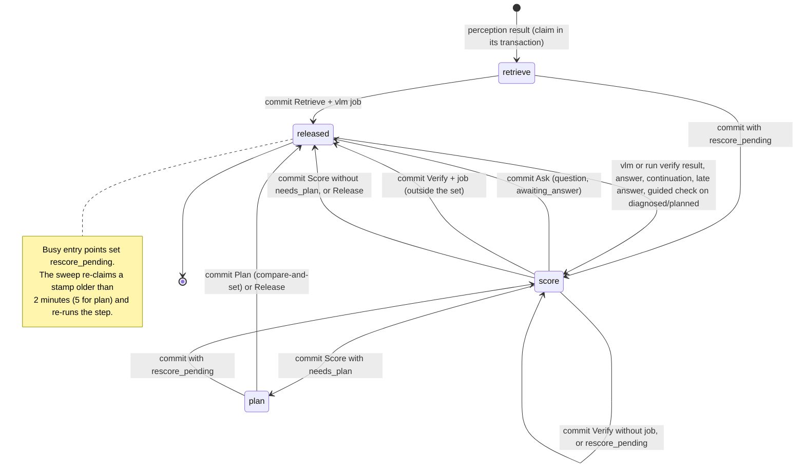

# PDM Backend: `pipeline` crate

> **Status:** Draft v0.5.4, 2026-10-23. v0.5.4: `species_confirmed`'s adopt also gives the queued `perception` job the payload a run started with the species would have queued, and a refused adopt (a claim since the snapshot) is decided again on a new snapshot, at most 3 times (section 11). v0.5.3: a species confirmed while the scan is `queued` becomes its run's working species through `PlantRepo::adopt_confirmed_species`, since that run started without it (section 11). v0.5.2: the `vlm` result's species suggestion makes its best candidate the scan's working species for its run, unless the run already has one, and a stale run's suggestion writes nothing; a submitted run starts with the plant's confirmed species (`confirmed_species`), so confirming the suggested species keeps the run and its question (section 11). v0.5.1: a `guided` job's completion sends no catch-up stage events, since the `guided` stage is shared by the run's checks and the fold can't tell them apart; the catch-up wiring is tested through `api`'s fake store (`tests/pipeline.rs`); a failed read of the run's stage events is logged with its error chain; open questions 4 to 6 record the limits and the bug the audit found. v0.5: `job_completed` sends the stage events the stream missed before a job's findings (`catch_up::ResultStages`, read through `EventRepo::run_stage_events`): a stage left started gets its `stage_completed`, a stage of the result with no event in the run gets both, with `duration_ms: 0`, so a stage whose worker events were lost while `api` was down doesn't stay open (backend roadmap gap 9). v0.4: `PipelineDeps` gains `beliefs` (Agent Memory) and `PipelineConfig` its `beliefs_read_timeout`; the plan step reads the plant's current beliefs beside its shared memories and passes them to the plan writer, and the scan summary memory has topic `health`, so each new summary supersedes the last in Agent Memory. v0.3.1: open question 3 is resolved: the run's evidence fields are in the schema. v0.3: the cross-crate fixes: `ScanWriter` lost `job_queued` (the store's `Notify` is the only wake-up), `plan` releases its claim after 3 lost compare-and-sets, `worker_events` forwards a `guided` job's stage events on the scan's current run, `labels_loaded` splits the heartbeat's comma-separated lists, organism findings get `detail.length_mm` from the depth map before their `finding` events, and fusion counts a humid stretch in the past week (`past_7_days.longest_humid_run_days`). v0.2: fusion reads the shared `WeatherThresholds` (`PipelineConfig::weather`): a humid stretch is two days in a row with ≥ 10 hours over 90% each (the mean-humidity and past-week variants are gone), frost is a 2 m minimum ≤ 0.5 °C or the day's `frost_risk`, hard frost ≤ −2 °C; the memory summary is embedded with `EmbedMode::Document`; `PhotoAnswerStart::Segment` boxes its job. v0.1: `api`'s own work between a scan's jobs: the `retrieve`, `score` and `plan` steps under the scan's step claim, every entry point that claims them, measurable indicators, fusion, re-planning, runs and recovery, compiled on Rust 1.99.1 against the `domain`, `knowledge`, `agent` and `vision` crates.

Companion to the [backend architecture](README.md). It implements [contracts 3, steps between jobs](../architecture/contracts.md#scan-lifecycle), [contracts 4](../architecture/contracts.md#4-scan-events-sse) (event order), [contracts 7](../architecture/contracts.md#7-pipeline-records), [architecture 6](../architecture/README.md#6-analysis-pipeline), [8.1](../architecture/README.md#81-scan--diagnosis--plan) and [8.3](../architecture/README.md#83-forecast-alerts), and [database 4, steps between jobs](../database/README.md#steps-between-jobs-) and [plan writes](../database/README.md#plan-writes-compare-and-set-). The rules of retrieve-then-verify are in [knowledge](knowledge.md). Every listing is copied from `crates/pipeline` by the docgen tool. `cargo check --workspace`, `cargo clippy -p pipeline --all-targets` and `cargo test -p pipeline` pass.

## Contents

1. [Purpose and boundaries](#1-purpose-and-boundaries)
2. [Dependencies](#2-dependencies)
3. [Module layout](#3-module-layout)
4. [Ports and construction](#4-ports-and-construction)
5. [The step machine](#5-the-step-machine)
6. [Retrieve](#6-retrieve)
7. [Score](#7-score)
8. [Plan](#8-plan)
9. [Entry points](#9-entry-points)
10. [Events](#10-events)
11. [Runs](#11-runs)
12. [Idempotency and recovery](#12-idempotency-and-recovery)
13. [Concurrency and lifetimes](#13-concurrency-and-lifetimes)
14. [Errors](#14-errors)
15. [Testing](#15-testing)
16. [Domain changes](#16-domain-changes)
17. [Open questions and decisions](#17-open-questions-and-decisions)
18. [Sources](#18-sources)

---

## 1. Purpose and boundaries

**What it owns.** Everything `api` does to a scan between jobs ([contracts 3](../architecture/contracts.md#scan-lifecycle)):

- **The three steps.** `retrieve` (measurement, context, the candidate set, the measured answers, the `vlm` job), `score` (the outside-set `verify` job, scoring, a question or the diagnosis, fusion) and `plan` (the plan writer, the plan, its tasks and trigger rules).
- **The entry points.** Every input that continues a scan: a job's events and result, an indicator answer, a photo answer and its `measuring` step, the 10-minute continuation, a late answer, a guided check, the sweep, a run start (submit, resubmit, species change), a confirmed chat revision.
- **The events** these send, in the order of contracts 4, through the per-scan [`ScanWriter`](#4-ports-and-construction).

**What it never does.**

- It holds no HTTP, no SSE and no database client. It talks to the world only through the ports in [`PipelineDeps`](#4-ports-and-construction).
- It never spawns tasks: work that outlives a request comes back to `api` as a [`FollowUp`](#4-ports-and-construction), and `api` runs it on its task tracker.
- It doesn't check dose limits or validate plans; the agent crate does both (`agent::safety` and `agent::plan_writer`).
- It sends no push notifications. `api`'s writer pushes by the contracts 9 rule, because it sees every event, including the ones `api` emits itself.

**Who calls it.**

| Caller | Calls |
|---|---|
| `api`'s handlers | `submit`, `species_confirmed`, `answer`, `photo_answer_start`, `photo_answer_added`, `store_revision` |
| `api`'s job broker | `worker_events`, `job_completed`, `job_failed_for_good` |
| `api`'s scheduler | `sweep`, the one owner of recovery and of the 10-minute continuation (it calls `continue_without_answer` for every due question) |
| `api`'s task tracker | `follow_up` for everything the calls above return |

---

## 2. Dependencies

```toml
[package]
name = "pipeline"
version.workspace = true
edition.workspace = true
rust-version.workspace = true
publish.workspace = true

[lints]
workspace = true

[dependencies]
# Shapes, rules and every port the steps call.
domain.workspace = true
# Candidate ranking, scoring, status and the question rule.
knowledge = { workspace = true }
# The plan writer and the plan validation it runs (agent::plan_writer, agent::safety).
agent.workspace = true
# The measurement geometry (vision::measure), run on a blocking thread.
vision.workspace = true
async-trait.workspace = true
bytes.workspace = true
# Local dates in the garden's time zone (task due dates, memory summaries).
chrono.workspace = true
chrono-tz.workspace = true
# Semaphore for bounded CPU work, spawn_blocking, the plan lock's OwnedMutexGuard.
tokio.workspace = true
# Raw job results (`serde_json::Value`) and the wire names of enums in observation labels.
serde.workspace = true
serde_json.workspace = true
thiserror.workspace = true
tracing.workspace = true

[dev-dependencies]
domain = { workspace = true, features = ["mock", "test-util"] }
tokio = { workspace = true, features = ["test-util"] }
proptest.workspace = true
```

| Crate | Why |
|---|---|
| `domain` | Shapes, rules (`steps`, `questions`, `stages`, `scan_state`, `routing`, `limits`) and every port |
| `knowledge` | Candidate ranking, scoring, status, the question choice ([knowledge](knowledge.md)) |
| `agent` | `plan_writer::{PlanWriter, PlanInput, SharedMemories, WrittenPlan}`, `PlanWriterError` and `beliefs::current_beliefs` |
| `vision` | `measure::Measurer`, behind [`ImageMeasurer`](#4-ports-and-construction) |
| `tokio` | `spawn_blocking` for measurement, the CPU `Semaphore`, `OwnedMutexGuard` in `PlanGuard` |
| `chrono`, `chrono-tz` | A garden's local date for task due dates (`chrono-tz` 0.10.4, added to the workspace) |
| `bytes` | Photo and depth bytes moved into the blocking task |
| `serde`, `serde_json` | Raw job results (`serde_json::Value`) and enum wire names in labels |
| `async-trait`, `thiserror`, `tracing` | The `ScanWriter` and `PlanAuthor` traits, `PipelineError`, logs |
| `domain` with `mock`, `test-util`; `proptest` (dev) | Mocks, `SequentialIds`, property tests |

---

## 3. Module layout

```
crates/pipeline/src/
├─ lib.rs            Pipeline, PipelineDeps, PipelineConfig, FollowUp, Handled, local_today
├─ error.rs          PipelineError
├─ writer.rs         ScanWriter, PlanGuard: the per-scan writer port api implements
├─ plan_author.rs    PlanAuthor, implemented for agent::plan_writer::PlanWriter
├─ measure.rs        ImageMeasurer, MeasureRequest; the margin rule and measured answers
│  └─ vision_adapter.rs   VisionMeasurer over vision::measure::Measurer
├─ findings.rs       reading observations: readable, plant check, classifier hits, soil, texture
├─ payloads.rs       perception, vlm and verify payloads with photo routing
├─ fusion.rs         risks: fungal spread, crowding, frost, root rot, growth_stalled
├─ questions.rs      a question's wording from the knowledge crate's choice
├─ replan.rs         PlanNeed, plan_problems, neighbours, steps to tasks
├─ results.rs        worker results to observations and evidence; the species suggestion
├─ runs.rs           submit, species change, the label-version rule
├─ entry.rs          the other entry points: answers, photo answers, broker, sweep, revisions
├─ catch_up.rs       ResultStages: the stage events a job's complete stands in for
├─ steps.rs          the step loop, commit, fail_run, event helpers
│  ├─ retrieve.rs    retrieve, measurement, the weather cache
│  ├─ score.rs       score, verify_outside, diagnose
│  ├─ plan.rs        plan, plan_context, the pipeline's memory
│  └─ question.rs    a photo answer's measuring step
└─ testkit.rs        (tests) record builders
```

---

## 4. Ports and construction

Every external dependency is a trait object: runtime-swappable, dyn compatible and `Send + Sync`, as [README 7](README.md#7-rust-conventions) requires. `api` builds one `PipelineDeps` in its wiring and holds the `Pipeline` in an `Arc`. Its `memory` is `agent::MirroredMemory`, so the pipeline's summary reaches Agent Memory without the pipeline knowing; `beliefs` is the `BeliefStore` itself (`NoBeliefs` when Agent Memory isn't configured), read only by the plan step.

```rust
/// Tunables that the contracts leave to the evaluation set.
#[derive(Debug, Clone)]
pub struct PipelineConfig {
    /// How far the top candidate must lead the second to be `confirmed` (open question 3 of
    /// contracts 12). Default 2: one weight-2 indicator.
    pub diagnosis_margin: i32,
    /// The weather thresholds fusion reads (the humid stretch, frost and hard frost): the same
    /// instance `api` gives Open-Meteo and its triggers.
    pub weather: domain::rules::weather::WeatherThresholds,
    /// Bounds concurrent measurement on the blocking pool: one permit per core.
    pub cpu_permits: Arc<tokio::sync::Semaphore>,
    /// How long the plan step waits for the plant's current beliefs from Agent Memory before
    /// writing the plan without them. `api` sets it from the agent's `beliefs_read_timeout`.
    pub beliefs_read_timeout: std::time::Duration,
}

/// Every port the pipeline calls, as trait objects (runtime-swappable adapters, dyn
/// compatible and `Send + Sync`). `api` builds it in its wiring.
#[derive(Clone)]
pub struct PipelineDeps {
    /// Every repository (`Store` is the supertrait of all of them).
    pub store: Arc<dyn Store>,
    /// The per-scan event and plan writer.
    pub writer: Arc<dyn ScanWriter>,
    /// The knowledge base.
    pub knowledge: Arc<dyn KnowledgeStore>,
    /// Open-Meteo, behind the weather cache this crate reads first.
    pub weather: Arc<dyn WeatherProvider>,
    /// Garden memory: shared memories for the plan writer, the pipeline's summary. The summary
    /// is shared, so `api`'s belief sweep records it in Agent Memory.
    pub memory: Arc<dyn MemoryStore>,
    /// Agent Memory: the plant's current beliefs for the plan writer; `NoBeliefs` when it
    /// isn't configured.
    pub beliefs: Arc<dyn BeliefStore>,
    /// Text embeddings for the pipeline's memory summary, embedded as
    /// [`EmbedMode::Document`](domain::ports::EmbedMode::Document): the pipeline only stores
    /// memories and never searches.
    pub embedder: Arc<dyn TextEmbedder>,
    /// Photos and depth maps for measurement.
    pub blobs: Arc<dyn BlobStore>,
    /// The measurement geometry (`vision::measure` behind [`ImageMeasurer`]).
    pub measurer: Arc<dyn ImageMeasurer>,
    /// The plan writer (`agent::plan_writer::PlanWriter`).
    pub plan_author: Arc<dyn PlanAuthor>,
    /// Time.
    pub clock: Arc<dyn Clock>,
    /// Record keys.
    pub ids: Arc<dyn IdGen>,
    /// Tunables.
    pub config: PipelineConfig,
}

/// Work an entry point started that the caller runs next, on its task tracker.
#[derive(Debug, Clone, Copy, PartialEq, Eq)]
pub enum FollowUp {
    /// Run the scan's steps from this claim, following hand-overs.
    Step(StepClaim),
    /// Run a photo answer's `measuring` step.
    QuestionStep(QuestionStepClaim),
}

/// An entry point's answer plus the work it handed to the caller.
#[derive(Debug, Clone, PartialEq)]
pub struct Handled<T> {
    /// What the endpoint returns.
    pub value: T,
    /// What to spawn next.
    pub follow_up: Option<FollowUp>,
}

/// The pipeline. Cheap to share: `api` holds one in an `Arc`.
pub struct Pipeline {
    deps: PipelineDeps,
}
```

**The per-scan writer.** Contracts 4 requires one serialised writer per scan that assigns `seq`, stores, then broadcasts. Contracts 7 requires every plan write of a scan to run one at a time. The pipeline defines the port and `api` implements it ([api](api.md)): a per-scan `mpsc` actor for events, and a per-scan mutex for plan writes, so a 10-second plan-writer call never delays event delivery. It lives here, not in `domain`, because `PlanGuard` is tokio's `OwnedMutexGuard` and `domain` has no runtime. Its lifecycle answers contracts open question 22 ([section 17](#17-open-questions-and-decisions)).

```rust
/// Proof that the caller holds the scan's plan lock. Dropping it releases the lock. Owned
/// (`OwnedMutexGuard`, not `MutexGuard<'a, ()>`), so it carries no borrow of the writer and can
/// be held across `.await`s inside a spawned, `'static` task.
#[derive(Debug)]
pub struct PlanGuard(
    #[expect(dead_code, reason = "held for its Drop")] tokio::sync::OwnedMutexGuard<()>,
);

/// The serialised writer of one scan's events and plan writes.
#[async_trait::async_trait]
pub trait ScanWriter: Send + Sync {
    /// Assigns each event its `seq`, stores it, then broadcasts it, in that order, serialised
    /// per scan; `ts` comes from `api`'s clock. Events of one call are stored in order and
    /// returned as stored. After the call, the writer checks `stream_state` once and closes
    /// live streams that reached a resting point.
    async fn emit(
        &self,
        scan: ScanId,
        run: Run,
        events: Vec<ScanEventBody<Stored>>,
    ) -> Result<Vec<ScanEvent<Stored>>, StoreError>;

    /// Waits for the scan's plan lock. Every plan write of a scan (a run's first plan, an
    /// automatic re-plan, a confirmed chat revision) holds it from reading the current plan to
    /// storing the new one.
    async fn plan_lock(&self, scan: ScanId) -> PlanGuard;
}
```

**The plan writer.** The agent crate owns the LLM call and the validation round trip ([contracts 7, plan validation](../architecture/contracts.md#actionplan)). A pipeline-local trait lets tests replace it:

```rust
//! The plan writer as a port of the pipeline. The writer itself is `agent::plan_writer`
//! (the LLM call with one validation round-trip inside, [contracts 7], plan validation); this
//! trait lets the steps hold it as `Arc<dyn PlanAuthor>` and tests replace it.

use agent::{
    PlanWriterError,
    plan_writer::{PlanInput, PlanWriter, WrittenPlan},
};

/// Writes a plan from its input. Async and dyn compatible through `#[async_trait]`; the
/// input is borrowed for the call only (`PlanInput<'_>` borrows the step's records).
#[async_trait::async_trait]
pub trait PlanAuthor: Send + Sync {
    /// One plan, validated; failing steps are dropped and listed in `WrittenPlan::dropped`.
    async fn write_plan(&self, input: &PlanInput<'_>) -> Result<WrittenPlan, PlanWriterError>;
}

#[async_trait::async_trait]
impl PlanAuthor for PlanWriter {
    async fn write_plan(&self, input: &PlanInput<'_>) -> Result<WrittenPlan, PlanWriterError> {
        self.write(input).await
    }
}
```

**The wake-up.** `ScanWriter` has no `job_queued`: every store write that queues or requeues a job signals the claim long poll's `Notify` after its commit ([store 14](store.md#14-jobs-and-workers)), so the pipeline never wakes it by hand.

**Measurement.** `vision::measure::Measurer` is synchronous CPU work over borrowed buffers. The pipeline's own `ImageMeasurer` takes an owned `MeasureRequest`, because the request must move into `spawn_blocking`, which requires `'static`. The adapter borrows it back into vision's `MeasureInput<'_>` inside the closure:

```rust
/// A region to measure inside: a segmentation region of the photo, with its mask when it has
/// one.
#[derive(Debug, Clone, PartialEq)]
pub struct MeasureRegion {
    /// The region.
    pub region_id: RegionId,
    /// Its class.
    pub class: RegionClass,
    /// Its box.
    pub bbox: BBox,
    /// Its mask.
    pub mask: Option<RleMask>,
}

/// One photo to measure, owned so it can move into `spawn_blocking` (which needs `'static`).
#[derive(Debug, Clone)]
pub struct MeasureRequest {
    /// The photo.
    pub image_id: ImageId,
    /// Its kind.
    pub kind: ImageKind,
    /// The stored image file.
    pub photo: Bytes,
    /// The 16-bit depth PNG.
    pub depth_png: Bytes,
    /// The confidence PNG, when sent.
    pub confidence_png: Option<Bytes>,
    /// The metadata in the stored image's frame.
    pub meta: DepthMeta,
    /// The photo's segmentation regions.
    pub regions: Vec<MeasureRegion>,
}

/// One measured quantity of a photo: becomes a `measurement` observation.
#[derive(Debug, Clone, PartialEq)]
pub struct MeasuredQuantity {
    /// The measurement.
    pub measurement: Measurement,
    /// 0.4, 0.65 or 0.85 from the confidence rules.
    pub confidence: Confidence,
    /// The observation's region box: the plant's box, or the box around the measured leaves.
    pub bbox: BBox,
}

/// The measurement geometry. Synchronous CPU work, called inside `spawn_blocking`; the
/// implementation is [`VisionMeasurer`] over `vision::measure`, and tests use a fake.
pub trait ImageMeasurer: Send + Sync {
    /// `measure-<n>+<spot segmenter version>`; the observation's `model_version` appends the
    /// device model.
    fn version(&self) -> String;

    /// Every quantity whose needs are met (contracts 7, the quantity table); never panics on
    /// bad input.
    fn measure(&self, request: &MeasureRequest) -> Result<Vec<MeasuredQuantity>, MeasureFailed>;

    /// [contracts 7] organism length (`detail.length_mm`): the longer side of the organism's
    /// box at the median confident depth inside it, in millimetres, from the photo's 16-bit
    /// depth PNG and its metadata in the stored image's frame. `None` when the depth can't be
    /// read or the box holds no confident depth. The default answers `None` (test fakes).
    fn organism_length_mm(&self, depth_png: &[u8], meta: &DepthMeta, bbox: BBox) -> Option<f64> {
        let _ = (depth_png, meta, bbox);
        None
    }
}
```

```rust
impl ImageMeasurer for VisionMeasurer {
    fn version(&self) -> String {
        self.inner.version()
    }

    fn measure(&self, request: &MeasureRequest) -> Result<Vec<MeasuredQuantity>, MeasureFailed> {
        let regions: Vec<vision::measure::MeasureRegion> = request
            .regions
            .iter()
            .map(|r| vision::measure::MeasureRegion {
                region_id: r.region_id,
                class: r.class,
                bbox: r.bbox,
                mask: r.mask.clone(),
            })
            .collect();
        let input = vision::measure::MeasureInput {
            image_id: request.image_id,
            kind: request.kind,
            photo: &request.photo,
            depth_png: &request.depth_png,
            confidence_png: request.confidence_png.as_deref(),
            meta: &request.meta,
            regions: &regions,
        };
        self.inner
            .measure(&input)
            .map(|qs| {
                qs.into_iter()
                    .map(|q| MeasuredQuantity {
                        measurement: q.measurement,
                        confidence: q.confidence,
                        bbox: q.bbox,
                    })
                    .collect()
            })
            .map_err(|e| MeasureFailed(e.to_string()))
    }

    fn organism_length_mm(
        &self,
        depth_png: &[u8],
        meta: &domain::scan::DepthMeta,
        bbox: domain::wire::BBox,
    ) -> Option<f64> {
        let depth = vision::depth::decode_depth_png(depth_png).ok()?;
        self.inner.organism_length_mm(&depth.view(), meta, bbox)
    }
}
```

**Organism length** ([contracts 7](../architecture/contracts.md#measurement), organism length). `ImageMeasurer::organism_length_mm` sizes an organism box from the photo's depth PNG (`vision::measure::Measurer::organism_length_mm`: the box's longer side at the median confident depth inside it). The pipeline adds it when it stores the VLM findings, in `job_completed` and for a `vlm_findings` partial result alike, before their `finding` events are sent: each organism observation on a photo with depth gets `detail.length_mm`, rounded to 0.1 mm. One depth map is read per photo, and the geometry runs on the blocking pool under a CPU permit. It is best effort, since the length is shown and never scored: a depth map that can't be read leaves it out and is logged.

```rust
/// The organism observations of a write whose image has depth, as `(index, image, box)`: the
/// ones [`ImageMeasurer::organism_length_mm`] can size ([contracts 7], organism length).
pub fn organism_boxes(
    write: &ObservationWrite,
    with_depth: &[ImageId],
) -> Vec<(usize, ImageId, BBox)> {
    write
        .observations
        .iter()
        .enumerate()
        .filter(|(_, o)| o.stage == ObservationStage::Organism)
        .filter_map(|(i, o)| o.region.as_ref().map(|r| (i, r.image_id, r.bbox)))
        .filter(|(_, image, _)| with_depth.contains(image))
        .collect()
}

/// Sets the observation's `detail.length_mm`, rounded to 0.1 mm.
pub fn set_organism_length(write: &mut ObservationWrite, index: usize, length_mm: f64) {
    if let Some(o) = write.observations.get_mut(index) {
        let detail = o.detail.get_or_insert_with(ObservationDetail::default);
        detail.length_mm = Some((length_mm * 10.0).round() / 10.0);
    }
}
```

---

## 5. The step machine

A scan holds at most one step claim (`pipeline_step`, `pipeline_step_run`, `pipeline_step_at`) ([contracts 3](../architecture/contracts.md#scan-lifecycle), [database 4](../database/README.md#steps-between-jobs-)). Every step:

1. takes its [`StepClaim`](domain.md#9-boundary-traits);
2. re-reads everything through `ScanRepo::snapshot`;
3. commits one `StepOutput` through `StepRepo::commit_step`. The commit re-checks the claim, the stamp, the run and deletion, writes the output, and sets the next claim in the same transaction.



| Step | Reads | Commits | Own hand-over | With `rescore_pending` |
|---|---|---|---|---|
| `retrieve` | Snapshot, the weather cache or Open-Meteo, profiles | `Retrieve { observations, evidence, candidates, weather, job }` | Release (the `vlm` job is in flight) | `score` |
| `score`, VLM stage not done, or idle status | Snapshot | `Release` | Release | `score` |
| `score`, organisms or damage outside the set | Snapshot, profiles | `Verify { job, evidence, added_candidates }` | Release with a job; `score` without | `score` |
| `score`, ambiguous and may ask | Snapshot, profiles | `Ask { question, resolved_question }` | Release (`awaiting_answer`) | `score` |
| `score`, otherwise | Snapshot, profiles, heights, map, memories | `Score { diagnosis, status, resolved_question, needs_plan }` | `plan` when `needs_plan`, else release | `score` |
| `plan` | Snapshot, profiles, memories, map, plants | `Plan(PlanWrite)` or `Release` | Release | `score` |

The loop follows hand-overs until a commit releases. A lost claim (`Conflict::ClaimLost` or `QuestionStepLost`) ends it quietly, because another owner has the work:

```rust
impl Pipeline {
    /// Runs a follow-up: the scan's steps from a claim, following each hand-over, or a photo
    /// answer's `measuring` step. A lost claim ends quietly: another owner has the work.
    pub async fn follow_up(&self, follow_up: FollowUp) -> Result<(), PipelineError> {
        let result = match follow_up {
            FollowUp::Step(claim) => self.run_steps(claim).await,
            FollowUp::QuestionStep(claim) => match self.measuring(claim).await {
                Ok(Some(next)) => self.run_steps(next).await,
                Ok(None) => Ok(()),
                Err(e) => Err(e),
            },
        };
        match result {
            Err(e) if e.lost() => {
                tracing::info!("step lost its claim; another owner continues");
                Ok(())
            }
            other => other,
        }
    }

    async fn run_steps(&self, mut claim: StepClaim) -> Result<(), PipelineError> {
        loop {
            let next = match claim.step {
                PipelineStep::Retrieve => self.retrieve(claim).await?,
                PipelineStep::Score => self.score(claim).await?,
                PipelineStep::Plan => self.plan(claim).await?,
            };
            match next {
                Some(c) => claim = c,
                None => return Ok(()),
            }
        }
    }

    /// Commits a step's output; the next claim, or `None` when released.
    async fn commit(
        &self,
        claim: StepClaim,
        output: StepOutput,
    ) -> Result<Option<StepClaim>, PipelineError> {
        Ok(self
            .deps
            .store
            .commit_step(claim, output, self.now())
            .await?)
    }

    /// Reads the scan for a step; `None` when the claim's run is no longer the scan's (its
    /// commit would be refused anyway).
    async fn snapshot_for(&self, claim: StepClaim) -> Result<Option<ScanSnapshot>, PipelineError> {
        let snap = self.deps.store.snapshot(claim.scan).await?;
        Ok((snap.scan.run == claim.run).then_some(snap))
    }

    /// Fails the scan's run ([contracts 3]): releases the claim and supersedes the question in
    /// the store's transaction, then `question_resolved` (superseded) and `failed`, in one
    /// batch.
    async fn fail_run(
        &self,
        snap: &ScanSnapshot,
        code: ScanFailureCode,
        message: &str,
    ) -> Result<(), PipelineError> {
        let failure = ScanFailure::new(code, message);
        let failed = self
            .deps
            .store
            .fail_scan(snap.scan.id, snap.scan.run, failure.clone(), self.now())
            .await?;
        let mut events = Vec::new();
        if let Some(q) = failed.superseded_question {
            events.push(ScanEventBody::QuestionResolved {
                question_id: q,
                by: domain::events::ResolvedBy::Superseded,
            });
        }
        events.push(ScanEventBody::Failed { failure });
        self.emit(snap.scan.id, snap.scan.run, events).await
    }
}
```

---

## 6. Retrieve

[Contracts 3](../architecture/contracts.md#scan-lifecycle): measurement, context, retrieval and queueing the `vlm` job, after the perception result.

| Order | Work | Events | Failure |
|---|---|---|---|
| 1 | Plant check: `plant_present: false` | `question_resolved` (superseded) if one was open, then `failed` | `no_plant_found` |
| 2 | Measurement, when a run photo has depth and the run must measure (below) | `stage_started measurement`, `stage_completed measurement` (`skipped: nothing_measurable` or `error`) | Never fails the scan |
| 3 | Context: the garden's weather cache cell for this hour, fetched from Open-Meteo on a miss and cached | `stage_started context`, `weather_loaded`, `stage_completed context` | `upstream_unavailable` |
| 4 | Retrieve: rank the candidates, answer measurable indicators, build the `vlm` payload | `stage_started retrieve`, `stage_completed retrieve` | |
| 5 | Commit (the store wakes the claims for the `vlm` job) | `finding` per measurement, then `candidates_selected` | |

**Which runs measure** ([architecture 6.7, runs](../architecture/README.md#67-depth-and-measurement-lidar)): every photo with depth when the run has no measurement yet, or when segmentation re-ran after the last measurement. A species-change run that kept segmentation and measurements measures nothing.

```rust
/// The run's photos with depth that must be measured ([architecture 6.7], runs): all of
/// them when the run has no measurement yet, or when segmentation re-ran after the last
/// measurement; none when an earlier run's measurements still stand.
pub(crate) fn images_to_measure(snap: &ScanSnapshot) -> Vec<&ScanImage<Stored>> {
    let with_depth: Vec<&ScanImage<Stored>> = snap
        .scan
        .images
        .iter()
        .filter(|i| {
            i.depth.is_some() && i.kind.is_plant_or_soil() && i.answers_question_id.is_none()
        })
        .collect();
    if with_depth.is_empty() {
        return with_depth;
    }
    let last = |stage: ObservationStage| {
        snap.observations
            .iter()
            .filter(|o| {
                o.stage == stage
                    && o.region
                        .as_ref()
                        .is_some_and(|r| with_depth.iter().any(|i| i.id == r.image_id))
            })
            .map(|o| o.run)
            .max()
    };
    match (
        last(ObservationStage::Measurement),
        last(ObservationStage::Segmentation),
    ) {
        (Some(m), Some(s)) if m >= s => Vec::new(),
        (Some(_), None) => Vec::new(),
        _ => with_depth,
    }
}

/// A photo's segmentation regions with their masks, for measurement.
pub(crate) fn regions_of(snap: &ScanSnapshot, image: ImageId) -> Vec<MeasureRegion> {
    snap.observations
        .iter()
        .filter(|o| o.stage == ObservationStage::Segmentation)
        .filter_map(|o| {
            let region = o.region.as_ref().filter(|r| r.image_id == image)?;
            let region_id = region.region_id?;
            let class = o
                .detail
                .as_ref()
                .and_then(|d| d.region_class)
                .unwrap_or(RegionClass::Leaf);
            let mask = snap
                .masks
                .iter()
                .find(|m| m.region_id == region_id)
                .map(|m| m.rle.clone());
            Some(MeasureRegion {
                region_id,
                class,
                bbox: region.bbox,
                mask,
            })
        })
        .collect()
}
```

Measurement reads each photo, its depth PNG and its confidence PNG through `BlobStore`. It then runs on the blocking pool behind a semaphore of one permit per core, as the `rust-async` skill (§2, `.claude/skills/`) says. Each quantity becomes an observation with `model_version` = the algorithm version plus `depth_meta.device_model` ([contracts 7, observation](../architecture/contracts.md#observation)).

**Measurable indicators** ([contracts 7, measurable indicators](../architecture/contracts.md#measurement)):

| Rule | Here |
|---|---|
| Which measurement | The indicator's quantity, from an image whose kind it lists, medium confidence or more; highest confidence, then largest `n` |
| Which value | `stat`: `median` is `value`, `max`, `min` |
| Margin | 10% of the bound; at least 2 stored-image pixels at the measured distance for lengths (2 × `distance_m` / `fx`, × 1000 in mm, × 100 in cm); at least 1 for counts |
| `yes` | Inside by at least the margin from each bound it has |
| `no` | Outside by more than the margin |
| Not answered | Within the margin, or no usable measurement: the indicator goes to the VLM |
| Evidence | `source: measurement`, `measured { quantity, value, image_id }`, a reason like "Median spot 2.1 mm; range 1.5–3 mm" |
| `fx` | From the photo's stored `DepthMeta`, rescaled when its reference width isn't the stored width |

```rust
/// The margin at a bound ([contracts 7]): 10% of the bound, but at least two stored-image
/// pixels at the measured distance for lengths and diameters (2 × `distance_m` / `fx` metres,
/// × 1000 in mm, × 100 in cm), and at least 1 for counts.
pub fn margin(bound: f64, quantity: MeasureQuantity, distance_m: f64, fx: Option<f64>) -> f64 {
    let tenth = bound.abs() * 0.1;
    match quantity.unit() {
        MeasureUnit::Count => tenth.max(1.0),
        MeasureUnit::Mm | MeasureUnit::Cm if quantity.is_length() => {
            let per_metre = if quantity.unit() == MeasureUnit::Mm {
                1000.0
            } else {
                100.0
            };
            let pixels = fx
                .filter(|f| *f > 0.0)
                .map_or(0.0, |f| 2.0 * distance_m / f * per_metre);
            tenth.max(pixels)
        }
        _ => tenth,
    }
}

/// The value an indicator's `stat` picks.
pub const fn pick(m: &Measurement, stat: MeasureStat) -> f64 {
    match stat {
        MeasureStat::Median => m.value,
        MeasureStat::Max => m.max,
        MeasureStat::Min => m.min,
    }
}

/// The best usable measurement for an indicator: its quantity, from an image whose kind the
/// indicator lists, medium confidence or more; highest confidence, then largest `n`.
pub fn best_measurement<'o>(
    ind: &IndicatorSeed,
    measured: &[MeasuredObs<'o>],
) -> Option<MeasuredObs<'o>> {
    let measure = ind.measure?;
    measured
        .iter()
        .filter(|m| {
            m.measurement.quantity == measure.quantity
                && m.confidence.at_least_medium()
                && ind.image_kinds.contains(&m.kind)
        })
        .max_by(|a, b| {
            a.confidence
                .get()
                .total_cmp(&b.confidence.get())
                .then(a.measurement.n.cmp(&b.measurement.n))
        })
        .copied()
}

/// Answers a measurable indicator ([contracts 7], the margin table): inside the range by at
/// least the margin from each bound it has is `yes`; outside by more than the margin is `no`;
/// anything else, or no usable measurement, is `None` and the indicator goes to the VLM.
pub fn answer_indicator(
    ind: &IndicatorSeed,
    measured: &[MeasuredObs<'_>],
) -> Option<IndicatorEvidence> {
    let measure = ind.measure?;
    let best = best_measurement(ind, measured)?;
    let m = best.measurement;
    let v = pick(m, measure.stat);
    let mg = |bound: f64| margin(bound, measure.quantity, m.distance_m, best.fx);
    let inside = measure.min.is_none_or(|lo| v >= lo + mg(lo))
        && measure.max.is_none_or(|hi| v <= hi - mg(hi));
    let outside = measure.min.is_some_and(|lo| v < lo - mg(lo))
        || measure.max.is_some_and(|hi| v > hi + mg(hi));
    let answer = if inside {
        Answer::Yes
    } else if outside {
        Answer::No
    } else {
        return None;
    };
    let unit = unit_label(measure.quantity);
    let with_unit = |x: f64| {
        if unit.is_empty() {
            number(x)
        } else {
            format!("{} {unit}", number(x))
        }
    };
    let range = match (measure.min, measure.max) {
        (Some(lo), Some(hi)) => format!("range {}–{}", number(lo), with_unit(hi)),
        (Some(lo), None) => format!("at least {}", with_unit(lo)),
        (None, Some(hi)) => format!("at most {}", with_unit(hi)),
        (None, None) => String::new(),
    };
    Some(IndicatorEvidence {
        indicator_id: ind.id.clone(),
        text: ind.text.clone(),
        weight: ind.weight,
        answer,
        reason: format!(
            "{} {}; {range}",
            stat_label(measure.quantity, measure.stat),
            with_unit(v)
        ),
        source: EvidenceSource::Measurement,
        measured: Some(MeasuredValue {
            quantity: measure.quantity,
            value: v,
            image_id: best.image_id,
        }),
    })
}

/// The images whose measurements show nothing on any leaf: `lesion_count` and `hole_count`
/// both measured with a `max` of 0 ([contracts 7]: a measured `no` is evidence of health only
/// from such an image).
pub fn clean_images(measured: &[MeasuredObs<'_>]) -> std::collections::BTreeSet<ImageId> {
    let zero = |img: ImageId, q: MeasureQuantity| {
        measured
            .iter()
            .any(|m| m.image_id == img && m.measurement.quantity == q && m.measurement.max == 0.0)
    };
    measured
        .iter()
        .map(|m| m.image_id)
        .filter(|&img| {
            zero(img, MeasureQuantity::LesionCount) && zero(img, MeasureQuantity::HoleCount)
        })
        .collect()
}
```

**Payloads and photo routing** ([contracts 5, payloads](../architecture/contracts.md#payloads)). A measured indicator leaves the job; a candidate with none left is not sent. When none is left, `candidates` and `indicator_images` are empty and the worker skips the indicators call:

```rust
/// The run's plant and soil shots, in upload order, numbered within their kind for the
/// routing table. Question photos and guided checks are left out.
pub fn run_images(images: &[ScanImage<Stored>]) -> Vec<RoutableImage<&ScanImage<Stored>>> {
    let mut out: Vec<RoutableImage<&ScanImage<Stored>>> = Vec::new();
    for img in images
        .iter()
        .filter(|i| i.kind.is_plant_or_soil() && i.answers_question_id.is_none())
    {
        let nth = out.iter().filter(|r| r.kind == img.kind).count();
        out.push(RoutableImage {
            kind: img.kind,
            nth_of_kind: u32::try_from(nth).unwrap_or(u32::MAX),
            item: img,
        });
    }
    out
}

/// The indicators a job asks: each candidate's 3 discriminating ones, minus those the user or
/// a measurement settled ([contracts 7]); a candidate with none left is not sent; at most
/// [`MAX_CANDIDATES`].
pub fn prompts(candidates: &[Candidate<'_>], answers: &AnswerSet<'_>) -> Vec<CandidatePrompt> {
    candidates
        .iter()
        .filter_map(|c| {
            let indicators: Vec<Indicator> = c
                .indicators()
                .filter(|i| !answers.settled(&i.id))
                .map(|i| Indicator {
                    indicator_id: i.id.clone(),
                    question: i.question.clone(),
                    r#where: i.r#where,
                    image_kinds: i.image_kinds.clone(),
                })
                .collect();
            (!indicators.is_empty()).then(|| CandidatePrompt {
                problem_id: c.profile.id.clone(),
                name: c.profile.name.clone(),
                indicators,
            })
        })
        .take(MAX_CANDIDATES)
        .collect()
}

/// The `vlm` job ([contracts 5]): findings images in the fixed order, indicator images chosen
/// by the questions. With no candidate left (measurements answered everything) `candidates`
/// and `indicator_images` are empty and the worker skips the indicators call.
pub fn vlm_payload(
    job: JobId,
    images: &[ScanImage<Stored>],
    candidates: Vec<CandidatePrompt>,
    working_species: Option<WorkingSpecies>,
    options: &VlmOptions,
) -> VlmPayload {
    let routable = run_images(images);
    let findings = findings_images(&routable)
        .into_iter()
        .map(|i| job_image(job, i))
        .collect();
    let indicators: Vec<&Indicator> = candidates.iter().flat_map(|c| &c.indicators).collect();
    let indicator_imgs = if indicators.is_empty() {
        Vec::new()
    } else {
        indicator_images(&routable, &indicators, None)
            .into_iter()
            .map(|i| job_image(job, i))
            .collect()
    };
    VlmPayload {
        findings_images: findings,
        indicator_images: indicator_imgs,
        working_species,
        species_options: options.species.clone(),
        organism_options: options.organisms.clone(),
        candidates,
    }
}

/// A `verify` job ([contracts 5], verify routing): the answering photo first, then the
/// indicator-call rule for the rest; at most 4 images.
pub fn verify_payload(
    job: JobId,
    reason: VerifyReason,
    question: Option<QuestionId>,
    images: &[ScanImage<Stored>],
    new_photo: Option<ImageId>,
    candidates: Vec<CandidatePrompt>,
) -> VerifyPayload {
    let routable = run_images(images);
    let first = new_photo
        .and_then(|id| images.iter().find(|i| i.id == id))
        .map(|img| RoutableImage {
            kind: img.kind,
            nth_of_kind: 0,
            item: img,
        });
    let indicators: Vec<&Indicator> = candidates.iter().flat_map(|c| &c.indicators).collect();
    let mut chosen: Vec<JobImage> = indicator_images(&routable, &indicators, first.as_ref())
        .into_iter()
        .map(|i| job_image(job, i))
        .collect();
    chosen.truncate(MAX_VLM_IMAGES);
    VerifyPayload {
        reason,
        question_id: question,
        images: chosen,
        candidates,
    }
}
```

---

## 7. Score

[Contracts 3](../architecture/contracts.md#scan-lifecycle): scoring, fusion and the diagnosis, then a question or the plan. Where the scan is decides what `score` may do:

```rust
/// Where the scan is when `score` runs.
#[derive(Debug, Clone, Copy, PartialEq, Eq)]
pub(crate) enum ScoreMode {
    /// `analysing` or `awaiting_answer`: the run's own scoring; may ask a question.
    InRun,
    /// `diagnosed` or `planned`: late work; never asks, never moves the status.
    Late,
    /// Anything else claims nothing.
    Idle,
}

pub(crate) const fn mode(status: ScanStatus) -> ScoreMode {
    match status {
        ScanStatus::Analysing | ScanStatus::AwaitingAnswer => ScoreMode::InRun,
        ScanStatus::Diagnosed | ScanStatus::Planned => ScoreMode::Late,
        _ => ScoreMode::Idle,
    }
}
```

| Order | Check | Result |
|---|---|---|
| 1 | Status claims nothing, or in a run the VLM stage hasn't stored findings | `Release` |
| 2 | In a run, the plant isn't readable ([contracts 3](../architecture/contracts.md#scan-lifecycle): no leaf region, no medium disease result, no medium species, no medium VLM finding) | `failed` with `photos_unusable` |
| 3 | In a run, the VLM's organisms or damage (medium or more) point to problems outside the set | `Verify`: the added candidates, their measured answers and one `verify` job; `candidates_selected` again |
| 4 | Score the stored set; decide the status ([knowledge 8](knowledge.md#8-diagnosis-status-and-the-question)) | |
| 5 | Ambiguous, in a run, not a continuation, fewer than 2 asked, and a question exists | `Ask`, then `question` and `status_changed → awaiting_answer` |
| 6 | Otherwise: fusion and the diagnosis | |
| 7 | Late work whose result didn't change and resolved no question | `Release` |
| 8 | `Score`, `needs_plan` by the [re-planning rules](#8-plan) | `question_resolved` (photo) if the score resolved one, `diagnosis`, `status_changed → diagnosed` in a run |

The open question tells the cases apart. `answering` with no step means its `verify` job finished, so this score resolves it by photo. `open` means the scheduler continued without an answer: the diagnosis is `uncertain`, and no new question is asked.

```rust
/// A plant is **readable** ([contracts 3]) when any of these holds: a leaf region was found;
/// the disease stage produced any result of medium confidence or more, `healthy` included;
/// `BioCLIP` or the VLM named a species with medium confidence or more; or the VLM findings
/// contain any finding of medium confidence or more.
pub fn readable(observations: &[Observation<Stored>]) -> bool {
    observations.iter().any(|o| match o.stage {
        ObservationStage::Segmentation => {
            o.detail.as_ref().and_then(|d| d.region_class) == Some(RegionClass::Leaf)
        }
        ObservationStage::Disease | ObservationStage::Species => medium(o),
        ObservationStage::Soil | ObservationStage::Organism | ObservationStage::Damage => {
            o.pipeline_stage == Stage::VlmFindings && medium(o)
        }
        ObservationStage::PlantCheck | ObservationStage::Measurement => false,
    })
}

/// What the status rule reads besides the scores ([contracts 7], diagnosis).
pub fn finding_summary(observations: &[Observation<Stored>]) -> FindingSummary {
    let pest_or_damage = observations.iter().any(|o| {
        medium(o)
            && match o.stage {
                ObservationStage::Organism => {
                    matches!(o.role, Some(OrganismRole::Pest | OrganismRole::Invasive))
                }
                ObservationStage::Damage => true,
                _ => false,
            }
    });
    let results = classifier_results(observations);
    let classifier_problem = results
        .iter()
        .any(|(p, c)| matches!(p, ProblemOrHealthy::Problem(_)) && c.at_least_medium());
    let classifier_healthy = results
        .iter()
        .max_by(|a, b| a.1.get().total_cmp(&b.1.get()))
        .is_some_and(|(p, c)| *p == ProblemOrHealthy::Healthy && c.at_least_medium());
    FindingSummary {
        pest_or_damage,
        classifier_problem,
        classifier_healthy,
    }
}
```

**Fusion** ([architecture 6.1, fusion](../architecture/README.md#61-stages); [contracts 7](../architecture/contracts.md#diagnosis), [contracts 9, garden map](../architecture/contracts.md#garden-map)). Disease thresholds come from the profiles; weather thresholds from `domain::rules::weather::WeatherThresholds` ([domain 7, weather thresholds](domain.md#weather-thresholds)), the instance `api` also gives Open-Meteo and its triggers (`PipelineConfig::weather`); the other constants are the contracts' own:

| Risk | Rule |
|---|---|
| `fungal_spread` | For each fungal or bacterial problem the diagnosis points to, the forecast days that meet its `conditions`: 1 day `low`, 2–3 `medium`, 4 or more `high` |
| Crowding | The plant's nearest pin closer than 0.75 × its species' `spacing_cm`, plus a humid stretch forecast or in the past 7 days, raises `fungal_spread` one step, or adds it at `low` |
| `frost_damage` | A frost day in the next 3 days (a 2 m minimum ≤ 0.5 °C, or the day's `frost_risk`): `medium`, `high` at hard frost (≤ −2 °C) |
| `root_rot` | The photo shows waterlogged soil at medium or more: `low`, raised a step when the modelled top-9-cm moisture is at least 0.45 m³/m³ |
| `growth_stalled` | The species has `mature_height_cm`; the latest height is from the past 7 days and below it; the latest height 14 or more days earlier is within 2 cm or 5%. Medium and high points only |

A **humid stretch** is two humid days in a row, a humid day having 10 or more hours over 90%, forecast in the next 7 days or in the past 7 ([contracts 9](../architecture/contracts.md#garden-map), crowding; [architecture 6.8](../architecture/README.md#68-garden-map-lidar)): `WeatherThresholds::humid_stretch_now_or_past`. The past week comes from `past_7_days.longest_humid_run_days`, which Open-Meteo's adapter computes from the hourly history with the same thresholds ([integrations 7](integrations.md#7-open-meteo-weather)). The driver text names the forecast when it holds the stretch, else the past week. The scheduler's `humid_stretch` trigger reads the forecast rule alone, over its 3-day horizon.

```rust
/// A humid stretch ([architecture 6.8], spacing; [contracts 9], crowding) forecast in the next
/// [`FORECAST_DAYS`] days or in the past 7: [`WeatherThresholds::humid_stretch_now_or_past`],
/// two humid days in a row, a humid day being 10 or more hours over 90% by default. The past
/// week comes from `past_7_days.longest_humid_run_days`. Returns the driver text, naming the
/// forecast when it holds the stretch. The scheduler's `humid_stretch` trigger reads the
/// forecast rule alone, over its own 3-day horizon.
pub fn humid_stretch(weather: &WeatherSummary, thresholds: &WeatherThresholds) -> Option<String> {
    let days = &weather.forecast[..weather.forecast.len().min(FORECAST_DAYS)];
    if thresholds.has_humid_stretch(days) {
        let n = days.iter().filter(|d| thresholds.is_humid_day(d)).count();
        return Some(format!("{n} humid days in the forecast"));
    }
    thresholds.had_humid_stretch(&weather.past_7_days).then(|| {
        format!(
            "{} humid days in a row in the past week",
            weather.past_7_days.longest_humid_run_days
        )
    })
}

/// Forecast days that meet a profile's favourable conditions: the day's mean temperature in
/// `temp_c`, its mean humidity at or above `rh_pct_min`, and, when `humid_hours_min` is set,
/// at least a seventh of it in hours over 90% that day. A profile with no conditions has none.
pub fn favourable_days(profile: &ProblemSeed, weather: &WeatherSummary) -> usize {
    let c = &profile.conditions;
    if c.temp_c.is_none() && c.rh_pct_min.is_none() && c.humid_hours_min.is_none() {
        return 0;
    }
    weather
        .forecast
        .iter()
        .take(FORECAST_DAYS)
        .filter(|d| {
            let t = f64::midpoint(d.t_min_c, d.t_max_c);
            c.temp_c.is_none_or(|r| t >= r.min && t <= r.max)
                && c.rh_pct_min.is_none_or(|rh| d.mean_rh_pct >= rh)
                && c.humid_hours_min
                    .is_none_or(|h| d.hours_rh_over_90 * 7 >= h)
        })
        .count()
}

/// `growth_stalled` ([contracts 7], growth): the species has a mature height; the latest
/// height is from the past 7 days and below it; and the most recent height at least 14 days
/// before it differs by less than 2 cm or 5% of the earlier height, whichever is larger. Only
/// medium and high points count.
pub fn growth_stalled(
    heights: &[MeasurementPoint],
    mature_height_cm: Option<f64>,
    now: Timestamp,
) -> Option<Risk> {
    let mature = mature_height_cm?;
    let usable: Vec<&MeasurementPoint> = heights
        .iter()
        .filter(|p| p.confidence_band >= ConfidenceBand::Medium)
        .collect();
    let latest = usable.iter().max_by_key(|p| p.created_at)?;
    let day = std::time::Duration::from_hours(24);
    if now.since(latest.created_at) > day * u32::try_from(GROWTH_RECENT_DAYS).unwrap_or(7)
        || latest.value >= mature
    {
        return None;
    }
    let cutoff = latest
        .created_at
        .minus(day * u32::try_from(GROWTH_GAP_DAYS).unwrap_or(14));
    let earlier = usable
        .iter()
        .filter(|p| p.created_at <= cutoff)
        .max_by_key(|p| p.created_at)?;
    let noise = GROWTH_NOISE_CM.max(earlier.value * GROWTH_NOISE_SHARE);
    ((latest.value - earlier.value).abs() < noise).then(|| Risk {
        risk: Risk::GROWTH_STALLED.to_owned(),
        level: RiskLevel::Low,
        drivers: vec![format!(
            "Height {:.0} cm, {:.0} cm two weeks earlier; mature height {mature:.0} cm",
            latest.value, earlier.value
        )],
    })
}

/// Every risk, in a fixed order.
pub fn risks(input: &FusionInput<'_>) -> Vec<Risk> {
    [
        fungal_spread(input),
        root_rot(input.soil, input.weather),
        frost(input.weather, &input.thresholds),
        growth_stalled(input.heights, input.mature_height_cm, input.now),
    ]
    .into_iter()
    .flatten()
    .collect()
}
```

`evidence_basis` lists the user's shared memories (`source: user`), then the photo (measured reasons and soil findings), then modelled data (weather, soil moisture, SoilGrids pH) ([architecture 6.4](../architecture/README.md#64-soil)). `citations` are the sources of the problems the diagnosis points to, or the species' sources for a healthy plant.

---

## 8. Plan

[Contracts 7, re-planning](../architecture/contracts.md#actionplan). `plan` holds the scan's plan lock from reading the current plan to storing the new one, and decides from the snapshot what to write, so the sweep's re-run decides the same way:

```rust
/// What the `plan` step must do, read from the snapshot each time it starts (so the sweep's
/// re-run decides the same way).
#[derive(Debug, Clone, Copy, PartialEq, Eq)]
pub enum PlanNeed {
    /// Write a plan for this reason.
    Write(PlanReason),
    /// The current plan already follows the current diagnosis: nothing to write.
    UpToDate,
}

/// Decides whether a plan must be written ([contracts 7], re-planning: these reasons only):
///
/// | Case | Need |
/// |---|---|
/// | no plan yet | `initial` |
/// | the plan was written from this diagnosis | up to date |
/// | the plan's diagnosis is of an earlier run | `species_changed` |
/// | the question open when the plan was written is no longer open, or the scores or status changed | `late_answer` |
/// | the texture changed, or the plan's diagnosis had none and this one has | `guided_check` |
/// | otherwise | up to date |
pub fn plan_need(
    plan: Option<&ActionPlan>,
    plan_diagnosis: Option<&Diagnosis<Stored>>,
    diagnosis: &Diagnosis<Stored>,
    open_question: Option<&Question>,
) -> PlanNeed {
    let Some(plan) = plan else {
        return PlanNeed::Write(PlanReason::Initial);
    };
    if plan.diagnosis_id == diagnosis.id {
        return PlanNeed::UpToDate;
    }
    let Some(before) = plan_diagnosis else {
        return PlanNeed::Write(PlanReason::LateAnswer);
    };
    if before.run != diagnosis.run {
        return PlanNeed::Write(PlanReason::SpeciesChanged);
    }
    let question_resolved = plan
        .open_question
        .as_ref()
        .is_some_and(|q| open_question.is_none_or(|now| now.id != q.id));
    if question_resolved
        || before.status != diagnosis.status
        || before.candidates != diagnosis.candidates
    {
        return PlanNeed::Write(PlanReason::LateAnswer);
    }
    if texture(&before.soil) != texture(&diagnosis.soil) {
        return PlanNeed::Write(PlanReason::GuidedCheck);
    }
    PlanNeed::UpToDate
}

/// The problems a plan is written for: the primary, or for an `uncertain` diagnosis every
/// candidate that scored zero or more; none when healthy.
pub fn plan_problems(diagnosis: &Diagnosis<Stored>) -> Vec<ProblemId> {
    match diagnosis.status {
        DiagnosisStatus::Healthy => Vec::new(),
        DiagnosisStatus::Confirmed => diagnosis
            .primary
            .iter()
            .map(|p| p.problem_id.clone())
            .collect(),
        DiagnosisStatus::Uncertain => diagnosis
            .candidates
            .iter()
            .filter(|c| c.score >= 0)
            .map(|c| c.problem_id.clone())
            .collect(),
    }
}
```

| Case | Reason |
|---|---|
| No plan yet | `initial` (stored as `action_plan.reason`; no `plan_superseded`) |
| The plan was written from this diagnosis | Nothing to write |
| The plan's diagnosis is of an earlier run | `species_changed` |
| The question open when the plan was written isn't open now, or the scores or status changed | `late_answer` |
| The texture differs, or the plan's diagnosis had none | `guided_check` |
| Otherwise | Nothing to write |

**What the plan writer reads** (`PlanInput<'_>`, agreed with the agent crate): the plan's problems (the primary, or every candidate scored zero or more for `uncertain`, none for `healthy`), their treatments, the organisms seen and the ones the problems are `caused_by`, the species, the shared memories (`SharedMemories::new` refuses a private one), the plant's and its garden's current beliefs from Agent Memory (`agent::beliefs::current_beliefs`, read with `tokio::join!` beside `shared_for_plan` and bounded by `PipelineConfig::beliefs_read_timeout`, 1.5 s; empty when Agent Memory is off, failing or slow, and the plan is written without them), the constraints carried from the current plan, the neighbours, the open question and the weather. `known_sources` is the union of their sources.

**Neighbours** ([contracts 7](../architecture/contracts.md#actionplan)): when the plant is pinned and a plan problem spreads, up to 5 pins within 1.5 m, nearest first, whose species is `susceptible_to` a spreading plan problem:

```rust
/// A plant on the map with what the neighbour rule needs.
#[derive(Debug, Clone, Copy)]
pub struct NeighbourPlant<'a> {
    /// The plant.
    pub plant: &'a Plant<Stored>,
    /// Its species, confirmed or suggested.
    pub species: Option<&'a SpeciesId>,
    /// The common name shown.
    pub species_name: Option<&'a str>,
}

/// Neighbours for the plan writer ([contracts 7]): when the plant is pinned and a plan
/// problem spreads, up to 5 pinned plants within 1.5 m, nearest first, each with the spreading
/// problems its species is `susceptible_to`; a neighbour with no species, or susceptible to
/// none of them, is left out.
pub fn neighbours(
    plant: PlantId,
    pins: &[Pin],
    plants: &[NeighbourPlant<'_>],
    problems: &[&ProblemSeed],
) -> Vec<PlanNeighbour> {
    let spreading: Vec<&ProblemSeed> = problems
        .iter()
        .copied()
        .filter(|p| p.kind.spreads())
        .collect();
    let Some(me) = pins.iter().find(|p| p.plant_id == plant) else {
        return Vec::new();
    };
    if spreading.is_empty() {
        return Vec::new();
    }
    let mut near: Vec<(f64, PlanNeighbour)> = pins
        .iter()
        .filter(|p| p.plant_id != plant)
        .filter_map(|pin| {
            let d = distance_m(me, pin);
            if d > NEIGHBOUR_RADIUS_M {
                return None;
            }
            let np = plants.iter().find(|n| n.plant.id == pin.plant_id)?;
            let species = np.species?;
            let problems: Vec<ProblemId> = spreading
                .iter()
                .filter(|p| p.affects.contains(species))
                .map(|p| p.id.clone())
                .collect();
            (!problems.is_empty()).then(|| {
                (
                    d,
                    PlanNeighbour {
                        plant_id: pin.plant_id,
                        name: np.plant.name.clone(),
                        species_name: np.species_name.unwrap_or_default().to_owned(),
                        distance_m: d,
                        problems,
                    },
                )
            })
        })
        .collect();
    near.sort_by(|a, b| a.0.total_cmp(&b.0));
    near.into_iter()
        .take(MAX_PLAN_NEIGHBOURS)
        .map(|(_, n)| n)
        .collect()
}
```

**Assembly and storage.** The pipeline assembles the `ActionPlan`:

- `version` is the current version plus one, and `supersedes` the current plan.
- `provisional` is true exactly when the diagnosis is `uncertain`.
- `open_question` is the scan's open question, and the constraints are the current plan's.
- Citations are resolved through `KnowledgeStore::citations`.

It then commits `StepOutput::Plan(PlanWrite { expected: current plan })`. The store's compare-and-set ([database 4](../database/README.md#plan-writes-compare-and-set-)) dismisses the superseded plan's open tasks, deactivates its trigger rules, and skips tasks for plants that are gone. A `Conflict::StalePlan` starts again from the new current plan, up to 3 times (`MAX_PLAN_ATTEMPTS`).

**After 3 lost compare-and-sets** the step commits `StepOutput::Release`: the claim is released, or handed over to `score` when an input set `rescore_pending` meanwhile. It doesn't return with the claim held, which would block the scan's steps and keep its stream open (`step_claimed`) until the 5-minute sweep. Every plan write of a scan in this process holds the plan lock, so a loss means a writer in another process stored a newer plan; that plan stays current, and the next diagnosis change re-plans from it. The step logs a warning.

```rust
/// Automatic re-plans that lose the compare-and-set start again from the new current plan;
/// after this many losses the step releases its claim (or hands over to `score` when
/// `rescore_pending` is set) instead of holding it until the 5-minute sweep.
const MAX_PLAN_ATTEMPTS: u32 = 3;
```

| `when` | Task |
|---|---|
| `now` | Due today in the garden's time zone |
| `by_date` | Due on its date |
| `recurring` | Due today, with `repeat` |
| `on_trigger` | No task: a plan trigger rule on the step's plant |

```rust
/// The tasks and trigger rules a plan version creates ([contracts 7], steps to tasks): `now`
/// is due today, `by_date` on its date, `recurring` repeats, `on_trigger` registers a rule.
/// A step's task goes to its `plant_id` when it has one, otherwise to the plan's plant. The
/// store skips any whose plant is gone (tasks only on live plants).
pub fn tasks_for(
    plan: PlanId,
    plan_plant: PlantId,
    steps: &[PlanStep],
    today: LocalDate,
    now: Timestamp,
    mut task_id: impl FnMut() -> TaskId,
    mut trigger_id: impl FnMut() -> PlanTriggerId,
) -> (Vec<NewTask>, Vec<NewPlanTrigger>) {
    let mut tasks = Vec::new();
    let mut triggers = Vec::new();
    for step in steps {
        let plant = step.plant_id.unwrap_or(plan_plant);
        let task = |due: Option<LocalDate>, repeat: Option<Repeat>, id: TaskId| NewTask {
            id,
            plant: Some(plant),
            plan: Some(plan),
            plan_step: Some(step.id.clone()),
            scan: None,
            title: step.title.clone(),
            detail: Some(step.detail.clone()),
            due,
            repeat,
            source: TaskSource::Plan,
            trigger: None,
            alert_key: None,
            created_by: None,
            created_at: now,
        };
        match &step.when {
            PlanWhen::Now => tasks.push(task(Some(today), None, task_id())),
            PlanWhen::ByDate { due } => tasks.push(task(Some(*due), None, task_id())),
            PlanWhen::Recurring { every_days, until } => tasks.push(task(
                Some(today),
                Some(Repeat {
                    every_days: *every_days,
                    until: *until,
                }),
                task_id(),
            )),
            PlanWhen::OnTrigger { trigger, until } => triggers.push(NewPlanTrigger {
                id: trigger_id(),
                plant,
                step: step.id.clone(),
                trigger: *trigger,
                until: *until,
            }),
        }
    }
    (tasks, triggers)
}
```

If the plan writer fails on a run's first plan (status `diagnosed`, no plan), the scan fails with `upstream_unavailable`. A failing re-plan keeps the current plan, and the sweep retries the step. After a first plan or a species-change plan, the pipeline stores a short memory with `source: pipeline`, kind `summary` and topic `health` (best effort); its belief key is `scan_summary`, so each new summary supersedes the last one in Agent Memory.

---

## 9. Entry points

Every entry point stores its input and claims (or flags `rescore_pending`) in one store transaction, then returns the claim as a `FollowUp`.

| Entry point | Store call (claim in the same transaction) | Step | Hand-over after | Events it sends |
|---|---|---|---|---|
| Perception result (run) | `complete_job` with `claim: retrieve` | `retrieve` | release, `vlm` job queued | missed perception stage events, `finding` / `finding_retracted` (diff), then retrieve's |
| `vlm` result | `complete_job` with `claim: score` | `score` | question, diagnosis + plan, or verify | missed `vlm_*` stage events, `finding` (diff), `species_suggested` |
| Run `verify` result (outside the set, or a photo answer) | `complete_job` with `claim: score` (clears `question.step`) | `score` | as above; resolves the photo answer | a missed `verify` stage event |
| Indicator answer, in a run | `answer_question` | `score` | question or diagnosis | `question_resolved` (user) |
| Late answer | `answer_question` (`late: true`) | `score` | diagnosis, `plan` (`late_answer`) | `question_resolved` (user) |
| Photo answer, `segmenting` | `add_image` with `PhotoAnswerStart::Segment(job)` | | job in flight | |
| Question photo's segmentation result | `complete_job` moves the question to `measuring` | `measuring` | `verify` job, or `score` | worker stage events |
| Photo answer, `measuring` | `add_image` with `PhotoAnswerStart::Measure`, or the result above | `measuring` | `advance_question_step`: `Verify` (job), or `Score` (claims `score`) | `measurement` stage, `finding` |
| 10-minute continuation | `continue_without_answer` | `score` | diagnosis `uncertain`, `plan` | `diagnosis`, `status_changed` |
| Guided check, `diagnosed` or `planned` | `finish_guided_check` | `score` | new diagnosis; `plan` if the texture changed | `guided_check_done`; no missed stage events ([section 10](#10-events)) |
| Guided check, other statuses | `finish_guided_check` (`NotNeeded`) | | | `guided_check_done`; no missed stage events |
| The sweep | `reclaim_step` / `reclaim_question_step` / `continue_without_answer` | the stale step | as the step | the step's |
| Submit, resubmit | `start_run` | | `perception` job queued | `run_started`, `status_changed` |
| Species change | `confirm_species`, then `start_run` | | `perception` job queued | `species_confirmed`, `run_started`, `question_resolved` (superseded), `status_changed → analysing` |
| Chat revision | `write_revision` under the plan lock | | | `plan_superseded` (`chat_revision`) |

A busy scan (`ClaimAttempt::Busy`) gets no follow-up: the running step hands over to `score` when it commits.

The photo answer's first step is decided before the upload is recorded, so that its step and job go into `add_image`'s transaction. A crash in between can then never leave an `answering` question with nothing in flight:

```rust
/// A question photo, before it is recorded.
#[derive(Debug, Clone, Copy, PartialEq, Eq)]
pub struct PhotoInfo {
    /// Its id, generated by `api` before the upload is recorded.
    pub image_id: domain::id::ImageId,
    /// Its kind.
    pub kind: ImageKind,
    /// Stored width.
    pub width: u32,
    /// Stored height.
    pub height: u32,
    /// It came with a depth map that fits.
    pub has_depth: bool,
}

/// Whether a photo of this kind, with depth, needs its segmentation job first ([contracts 7],
/// photos sent for a question): one of the question's candidates has a measurable indicator
/// that neither the user nor a measurement answered, whose `image_kinds` include the kind and
/// whose quantity that kind can measure.
pub fn needs_segmentation(
    kind: ImageKind,
    has_depth: bool,
    indicators: &[&IndicatorSeed],
    answers: &AnswerSet<'_>,
) -> bool {
    has_depth
        && indicators.iter().any(|i| {
            i.measure.is_some_and(|m| m.quantity.measurable_from(kind))
                && i.image_kinds.contains(&kind)
                && !answers.settled(&i.id)
        })
}
```

**A job that fails for good** ([contracts 5](../architecture/contracts.md#leases-runs-and-attempts); `final_failure`):

| Job | Effect |
|---|---|
| A run's `perception`, `vlm` or `verify` | `failed` with `processing_error`, its question superseded |
| A late `verify` | The photo answer dropped: `question_resolved` with `dropped` |
| A question photo's segmentation | The photo goes to `measuring` unmeasured |
| `guided` | The store marks the check `failed` in the failing transaction; the pipeline sends `guided_check_done` |

`QuestionState::after_failed_photo` agrees with this table: a late photo answer's question is `dropped`; in a run, the `verify` job is a run's job, so the scan fails and the failure supersedes the question in the same transaction ([contracts 3](../architecture/contracts.md#scan-lifecycle): a `failed` scan never holds a question). The question is never reopened. A domain test pins the two rules together.

A result that doesn't decode for the job's recorded kind is completed as failed with `model_error`, `retryable: true` ([section 17](#17-open-questions-and-decisions), question 18).

---

## 10. Events

Events go out after the commit that makes them true. Progress events (`stage_*`, `weather_loaded`) go out as work happens. Each step's last events go in one `emit` call. The writer then checks the resting point once ([contracts 4, when the stream closes](../architecture/contracts.md#when-the-stream-closes)).

`StreamState` gained `step_claimed` ([section 16](#16-domain-changes)). A late answer's `question_resolved` and a guided check's `guided_check_done` are sent while `score` holds the claim taken in their transaction, so the stream stays open until the new `diagnosis` and plan events.

Order of a typical run, as [contracts 4](../architecture/contracts.md#event-catalogue)'s example, with the stages this crate sends marked:

| Events | Sent by |
|---|---|
| `run_started`, `status_changed pending → queued` | `submit` |
| `status_changed queued → analysing` | `api`'s claim |
| perception stages, `finding` | the worker, through `worker_events` |
| `stage_* guided` | a `guided` job's worker, through `worker_events`, on the scan's current run |
| `stage_* measurement`, `stage_* context`, `weather_loaded`, `stage_* retrieve`, `finding` (measurements), `candidates_selected` | `retrieve` |
| `vlm_findings` stages, `finding`, `species_suggested`, `vlm_indicators` stages | the worker and `job_completed` |
| `stage_* scoring`, `stage_* fusion`, `diagnosis`, `status_changed analysing → diagnosed` | `score` |
| `stage_* plan`, `status_changed diagnosed → planned`, `plan_ready` (with `plan_superseded` first after a species change) | `plan` |

A sweep's re-run can repeat progress events (`stage_started` twice). Outcome events come only from the commit that won, so the app sees one `diagnosis` per stored diagnosis.

**Guided jobs' stage events.** A `guided` job has no run of its own (`job.run` is `None`), but contracts 4's `Stage` includes `guided`, and contracts 5 turns every worker's stage events into scan events. So `worker_events` forwards a guided job's `stage_started` and `stage_completed` on the scan's current run, the run its `guided_check_done` carries, and the app can show the check in progress. A guided job sends no partial results. Events that arrive after a job completed never reach `worker_events`: `api` drops them ([api 15](api.md#15-the-job-broker-and-the-worker-api)).

```rust
/// A worker's stage event as the scan event it becomes; `None` for anything else.
fn stage_event(event: WorkerEvent) -> Option<ScanEventBody<Stored>> {
    match event {
        WorkerEvent::StageStarted { stage } => Some(ScanEventBody::StageStarted { stage }),
        WorkerEvent::StageCompleted {
            stage,
            duration_ms,
            skipped,
        } => Some(ScanEventBody::StageCompleted {
            stage,
            duration_ms,
            skipped,
        }),
        WorkerEvent::PartialResult { .. } | WorkerEvent::Unknown => None,
    }
}
```

**Stage events `complete` stands in for** ([contracts 5](../architecture/contracts.md#post-internaljobsidevents), backend roadmap gap 9). A worker's `events` calls are best effort: while `api` is down the worker drops them and goes on, because `complete` repeats every stage's output. The findings then come from `complete`, but a lost `stage_completed` would leave its stage open on the stream for good. So `job_completed` reads the run's stored `run_started` and stage events (`EventRepo::run_stage_events`), folds them per stage as the app's reducer does, and sends what the stream is missing for each stage of the job's kind, in one `emit` with the findings and before them:

| The run's last event for the stage | Sent |
|---|---|
| `stage_started` (the worker started it; a requeue's second start counts) | `stage_completed`, with no second `stage_started` |
| none, and the result has output for the stage (for a perception stage, also listed in `run_started.rerun_stages`) | `stage_started`, then `stage_completed` |
| `stage_completed` | nothing, so a job whose events all arrived adds none |

- **`duration_ms: 0`.** `api` never timed the stage, and the worker's `timings_ms` is per job, not per stage. A start-to-complete difference would measure the outage, not the stage.
- **`skipped`** only where the result shows it: `disease_skipped`'s reason, and `all_measured` for a `vlm` result with no indicator answers (contracts 5: the answers are empty only when the indicators call was skipped). A stage isn't marked skipped to say that its events were recovered.
- **The `rerun_stages` check** covers a species-change run that keeps the earlier segmentation: its regions pass through the result, which is no segmentation stage of this run.
- **Best effort.** The result is stored before the read, so a failed read is logged with its error chain and sends no stage events; failing `complete` would make its retry answer `AlreadyCompleted` and send no findings either.
- **Not for `guided` jobs.** The `guided` stage is one stage shared by every guided check of the run, and two checks can run at once. The fold keys on the stage alone, so it can't tell which check's `stage_started` is still open: one check's completion would close another's stage, and two completions could each send a start and a completion. `ResultStages::of` gives a guided result no stages, and `guided_done` sends only `guided_check_done`, which tells the app the check finished.
- **`Done` only.** A job that fails for good sends no catch-up, so a `guided` job or a late `verify` that fails for good on a `planned` scan leaves its started stage open (open question 4).

```rust
/// What a job's result says about its stages.
#[derive(Debug, Clone, PartialEq)]
pub(crate) struct ResultStages {
    /// The stages a job of this kind reports, in pipeline order.
    kind: &'static [Stage],
    /// The stages the result has output for, with the `skipped` their `stage_completed` carries.
    shown: BTreeMap<Stage, Option<Skipped>>,
}

/// Everything a stored completion sends, in order: the stage events the stream is missing
/// (none without a decoded result), then the `finding` and `finding_retracted` events of the
/// result's diff.
pub(crate) fn completion_events(
    stages: Option<&ResultStages>,
    run_events: &[ScanEventBody<Stored>],
    diff: &ObservationDiff,
) -> Vec<ScanEventBody<Stored>> {
    let mut events = stages.map_or_else(Vec::new, |s| s.missing(run_events));
    events.extend(
        diff.added
            .iter()
            .cloned()
            .map(|observation| ScanEventBody::Finding { observation }),
    );
    events.extend(
        diff.retracted
            .iter()
            .map(|&observation_id| ScanEventBody::FindingRetracted { observation_id }),
    );
    events
}
```

```rust
impl ResultStages {
    /// The stages of a decoded result.
    pub(crate) fn of(result: &JobResult) -> Self {
        let mut shown = BTreeMap::new();
        let kind: &'static [Stage] = match result {
            JobResult::Perception(r) => {
                if r.plant_present.is_some() {
                    shown.insert(Stage::PlantCheck, None);
                }
                if !r.regions.is_empty() {
                    shown.insert(Stage::Segmentation, None);
                }
                if r.species.is_some() {
                    shown.insert(Stage::Species, None);
                }
                if r.disease.is_some() {
                    shown.insert(Stage::Disease, None);
                } else if let Some(s) = r.disease_skipped {
                    let why = match s.reason {
                        DiseaseSkipReason::SpeciesNotSupported => "species_not_supported",
                        DiseaseSkipReason::NoLeavesFound => "no_leaves_found",
                    };
                    shown.insert(Stage::Disease, Some(skipped(why)));
                }
                if r.image_embeddings.is_some() {
                    shown.insert(Stage::ImageEmbedding, None);
                }
                &PERCEPTION
            }
            JobResult::Vlm(r) => {
                shown.insert(Stage::VlmFindings, None);
                // contracts 5: the answers are empty only when the indicators call was skipped.
                let indicators = if r.indicators.answers.is_empty() {
                    Some(skipped(Skipped::ALL_MEASURED))
                } else {
                    None
                };
                shown.insert(Stage::VlmIndicators, indicators);
                &[Stage::VlmFindings, Stage::VlmIndicators]
            }
            JobResult::Verify(_) => {
                shown.insert(Stage::Verify, None);
                &[Stage::Verify]
            }
            // The `guided` stage is shared by every check of the run (module docs).
            JobResult::Guided(_) => &[],
        };
        Self { kind, shown }
    }

    /// The stage events the stream is missing for this job, given the run's stored
    /// `run_started` and stage events in `seq` order (other events are ignored).
    pub(crate) fn missing(
        &self,
        run_events: &[ScanEventBody<Stored>],
    ) -> Vec<ScanEventBody<Stored>> {
        let mut listed: &[Stage] = &[];
        // Per stage: `true` while its last stage event is a `stage_started`.
        let mut open = BTreeMap::new();
        for event in run_events {
            match event {
                ScanEventBody::RunStarted { rerun_stages, .. } => listed = rerun_stages,
                ScanEventBody::StageStarted { stage } => {
                    open.insert(*stage, true);
                }
                ScanEventBody::StageCompleted { stage, .. } => {
                    open.insert(*stage, false);
                }
                _ => {}
            }
        }
        let mut out = Vec::new();
        for &stage in self.kind {
            let completed = |skipped| ScanEventBody::StageCompleted {
                stage,
                duration_ms: 0,
                skipped,
            };
            match open.get(&stage) {
                Some(true) => out.push(completed(self.shown.get(&stage).cloned().flatten())),
                Some(false) => {}
                None => {
                    let in_run = !PERCEPTION.contains(&stage) || listed.contains(&stage);
                    if let Some(skip) = self.shown.get(&stage).filter(|_| in_run) {
                        out.push(ScanEventBody::StageStarted { stage });
                        out.push(completed(skip.clone()));
                    }
                }
            }
        }
        out
    }
}
```

---

## 11. Runs

[Contracts 3](../architecture/contracts.md#scan-lifecycle), [architecture 6.2](../architecture/README.md#62-species-identification). `submit` uses `decide_submit` and `run_stages(None, …)`. A species change uses `species_follow` and `run_stages(Some(earlier), …)`. The earlier run's regions travel in the payload when segmentation isn't re-run.

**The run's working species.** The scan's `working_species` is what retrieve, score, the plan and a species change read. A submitted run starts with the plant's confirmed species, the one its `perception` job names, and otherwise with none: a resubmitted run identifies the species again, so it doesn't keep the earlier run's suggestion. A species change starts its run with the chosen species. A species confirmed while the scan is `queued` arrives after its run started: `species_confirmed` then sets that run's working species to the plant's confirmed species (`PlantRepo::adopt_confirmed_species`, under the same run and deletion guard as the suggestion, and only while the scan is still `queued`), so retrieve, the `vlm` job and the plan use it, and the run's later suggestion is skipped because the plant is confirmed. In the same transaction the run's `perception` job, while still `queued`, gets the payload a run started with that species would have queued: `species_id` the species, or for "something else" no species, `skip_species_identification` and no `species` stage, so the worker doesn't identify a species the user named. A worker's claim moves the scan to `analysing` in the claim's transaction, so an adopt that a claim beat is refused; `species_confirmed` then decides again on a new snapshot, and the claimed run, whose job runs without the species, gets a species-change run when the species differs from its working species. After 3 refused adopts on a scan that still reads `queued` it answers `Conflict::Retries` (`503`, retryable) rather than send `species_confirmed` for a species the run didn't take. Without any of these, the `vlm` result's `species_suggested` fixes it: `PlantRepo::suggest_species` stores the plant's candidates and, in the same transaction, the best candidate as the scan's working species. It writes only while the job's run is still the scan's current run, and never replaces a working species the run already has. A suggestion from a run that is no longer current writes nothing and sends no event. So confirming the suggested species finds it as the run's working species and only sends `species_confirmed` with `rerun: false`, keeping the open question; another species starts a run.

```rust
/// What the earlier run finished, for a species-change run: plant check and segmentation
/// observations exist, and measuring finished (or wasn't needed).
pub fn earlier_run(snap: &ScanSnapshot) -> EarlierRun {
    let has = |stage: ObservationStage| snap.observations.iter().any(|o| o.stage == stage);
    EarlierRun {
        perception_base_done: has(ObservationStage::PlantCheck)
            && has(ObservationStage::Segmentation),
        measured: !findings::has_depth(&snap.scan.images) || has(ObservationStage::Measurement),
    }
}

/// The earlier run's regions, sent with a species-change run that keeps segmentation.
pub fn prior_regions(snap: &ScanSnapshot) -> Vec<PriorRegion> {
    snap.observations
        .iter()
        .filter(|o| o.stage == ObservationStage::Segmentation)
        .filter_map(|o| {
            let r = o.region.as_ref()?;
            Some(PriorRegion {
                region_id: r.region_id?,
                image_id: r.image_id,
                bbox: r.bbox,
                class: o
                    .detail
                    .as_ref()
                    .and_then(|d| d.region_class)
                    .unwrap_or(RegionClass::Leaf),
            })
        })
        .collect()
}

/// The plant's confirmed species: what a submitted run's `perception` job names, and the
/// working species that run starts with. Otherwise `None`, and the run's working species is
/// the best candidate of its own `species_suggested` ([architecture 6.2], step 4); a
/// resubmitted run doesn't keep the earlier run's suggestion, since it identifies the species
/// again.
fn confirmed_species(snap: &ScanSnapshot) -> Option<SpeciesId> {
    match snap.plant.species_status {
        SpeciesStatus::Confirmed => snap.plant.species.as_ref().map(|s| s.id.clone()),
        _ => None,
    }
}
```

**Label versions** ([contracts 5](../architecture/contracts.md#results), versions a worker hasn't loaded). A `perception` job never names a `label_set_version` or `classifier_labels_version` that no live perception or fallback worker reports. With no such worker live at all, the job is queued and waits. Otherwise the call fails with `PipelineError::LabelsNotLoaded`, which `api` answers with `503 upstream_unavailable`. A heartbeat reports every loaded version of each label key as a comma-separated list ([worker 17](worker.md#17-open-questions)), so each value is split on commas and trimmed before it is compared; a worker that loaded two label sets matches either:

```rust
/// The `versions` keys of the label lists ([contracts 5], `model_versions` keys).
pub const LABEL_SET_KEY: &str = "label_set_version";

/// The classifier labels' key.
pub const CLASSIFIER_LABELS_KEY: &str = "classifier_labels_version";

/// Whether a `perception` job may name these versions ([contracts 5], versions a worker
/// hasn't loaded): some live perception or fallback worker reports both, or no such worker is
/// live at all (the job waits, and a worker that starts on other versions is a deployment
/// mismatch it reports as `unknown_label_version`).
///
/// A heartbeat reports every loaded version of a label key as a comma-separated list
/// (`"2026-10-14,2026-10-18"`), so each value is split before it is compared.
pub fn labels_loaded(workers: &[LiveWorker], label_set: &str, classifier: &str) -> bool {
    let relevant: Vec<&LiveWorker> = workers
        .iter()
        .filter(|w| {
            w.caps
                .iter()
                .any(|c| matches!(c, Capability::Perception | Capability::Fallback))
        })
        .collect();
    relevant.is_empty()
        || relevant.iter().any(|w| {
            reports(w, LABEL_SET_KEY, label_set) && reports(w, CLASSIFIER_LABELS_KEY, classifier)
        })
}

/// Whether the worker's comma-separated list under `key` holds `version`.
fn reports(worker: &LiveWorker, key: &str, version: &str) -> bool {
    worker
        .versions
        .get(key)
        .is_some_and(|list| list.split(',').map(str::trim).any(|v| v == version))
}
```

---

## 12. Idempotency and recovery

| Situation | What happens |
|---|---|
| `api` restarts inside a step | The claim stays; the sweep re-claims it after 2 minutes (5 for `plan`) by its old stamp and re-runs the step from a fresh snapshot |
| The original step is only slow | Its commit fails with `ClaimLost`, because the sweep's new stamp replaced its own; it stops without events |
| A step of an older run | The snapshot's run differs, so it stops; its commit would be refused anyway |
| `retrieve` runs twice | The store checks for an existing `vlm` job of the run before queueing |
| `score` runs twice on late work | A diagnosis equal to the current one, with no question resolved, commits `Release` |
| `plan` runs twice | `plan_need` finds the plan up to date and commits `Release`; a lost compare-and-set restarts from the new plan; after 3 losses the step releases its claim |
| A photo answer stalls in `measuring` | The sweep re-claims the question step after 2 minutes; re-measuring replaces that photo's measurements |
| A photo answer stalls in `segmenting` or `verifying` | The broker's leases and attempts recover the job; a final failure goes on unmeasured, or drops the question when late |
| Input arrives while a step runs | The entry point sets `rescore_pending`; the step's commit hands over to `score` |
| A late result of an old run | The broker answers `409 lease_lost` before the pipeline sees it |
| Late work fails | Never fails the scan: `question_resolved` (`dropped`) or a failed `guided_check_done` |
| The per-scan writer retires and comes back | `seq` comes from `append_event`'s transaction, so the sequence continues ([section 17](#17-open-questions-and-decisions)) |
| `api` is down while a job runs | The worker's `events` calls fail and are dropped; `complete` sends the missing stage events before the findings ([section 10](#10-events)) |

---

## 13. Concurrency and lifetimes

- **Where it runs.** Entry points run on the request's task. `follow_up` runs on `api`'s task tracker. Measurement runs on the blocking pool, one photo per permit. The pipeline never holds a `std` lock across an `.await`. `PlanGuard` is an owned tokio guard, which may cross `.await`s ([tokio `Mutex`](https://docs.rs/tokio/1.53.3/tokio/sync/struct.Mutex.html)).
- **Why everything at the ports is owned.** Snapshots, payloads, observations and plans cross `.await`s, trait objects and the database. `#[async_trait]` futures must be `Send` ([domain 10](domain.md#10-concurrency-and-lifetimes)).
- **Where borrowing pays.** Inside a step, the profiles, observations and evidence sit in the step's snapshot, and the rules borrow them.

| Lifetime | Meaning |
|---|---|
| `'o` in `MeasuredObs<'o>` | A measurement borrowed from the step's observations |
| `'k` (knowledge crate) | The profiles the step fetched; candidates and chosen indicators point into them |
| `'k` in `agent::plan_writer::PlanInput<'k>` | The step's owned `PlanContext` and snapshot, borrowed for the plan-writer call. `PlanContext` exists so that the borrowed view has an owner that lives across the `.await` |
| `'a` in `FusionInput<'a>`, `NeighbourPlant<'a>` | The step's records, for one pure call |

No generic parameters are used outside the knowledge crate's rules: the ports are trait objects, and `tasks_for` takes two `FnMut` id generators. Those are closures over `dyn IdGen`, because `IdGenExt::id::<T>` is generic and can't be called through `dyn` ([domain 9](domain.md#9-boundary-traits)).

---

## 14. Errors

```rust
/// Why an entry point or a step stopped.
#[derive(Debug, thiserror::Error)]
pub enum PipelineError {
    /// The database. `Conflict(ClaimLost | QuestionStepLost)` inside a step means another
    /// owner (the sweep, a newer run) has the work; the step stops quietly ([`Self::lost`]).
    #[error("store failed")]
    Store(#[from] StoreError),
    /// A rule refused the request (`invalid_state`, `not_found`, …).
    #[error(transparent)]
    Domain(#[from] DomainError),
    /// Object storage (photos and depth maps for measurement).
    #[error("object storage failed")]
    Blob(#[from] BlobError),
    /// A model port (the text embedder for the pipeline's memory).
    #[error("model failed")]
    Model(#[from] ModelError),
    /// The weather provider; a run's `retrieve` fails the scan with `upstream_unavailable`.
    #[error("provider failed")]
    Provider(#[from] ProviderError),
    /// The plan writer.
    #[error("plan writer failed")]
    PlanWriter(#[from] agent::PlanWriterError),
    /// A blocking task panicked or was cancelled.
    #[error("blocking task failed")]
    Join(#[from] tokio::task::JoinError),
    /// No live perception or fallback worker has loaded the knowledge base's label versions
    /// ([contracts 5], versions a worker hasn't loaded): `api` answers `503
    /// upstream_unavailable`.
    #[error(
        "no live worker has loaded label set {label_set_version} / classifier labels {classifier_labels_version}"
    )]
    LabelsNotLoaded {
        /// The label set the job would name.
        label_set_version: String,
        /// The classifier labels it would name.
        classifier_labels_version: String,
    },
    /// The stored data breaks an invariant the pipeline relies on (a private memory offered to
    /// the plan writer, a question without its indicator).
    #[error("inconsistent data: {0}")]
    Inconsistent(&'static str),
}
```

```rust
impl PipelineError {
    /// Another owner has the step: the sweep re-claimed it, a new run started, or the plant or
    /// garden is being deleted. Not an error for the caller.
    pub const fn lost(&self) -> bool {
        matches!(
            self,
            Self::Store(StoreError::Conflict(
                Conflict::ClaimLost | Conflict::QuestionStepLost
            ))
        )
    }
}
```

| Variant | `api` maps it to |
|---|---|
| `Store(Conflict::ClaimLost \| QuestionStepLost)` inside a step | Nothing: `follow_up` swallows it |
| `Store(…)`, `Domain(…)` | Its tables for `StoreError` and `DomainError` ([contracts 2](../architecture/contracts.md#2-errors)) |
| `LabelsNotLoaded` | `503 upstream_unavailable`, `retryable: true` |
| `Provider`, `PlanWriter`, `Model`, `Blob`, `Join` | Logged by the follow-up; a request path answers `500 internal` |
| `Inconsistent` | Logged; `500 internal` |

---

## 15. Testing

`cargo test -p pipeline` runs the pure decisions with `domain`'s `test-util` builders:

| Area | Tests |
|---|---|
| Measured indicators | The margin table (2-pixel floor at 0.3 m, `yes`, `no`, within the margin, low confidence), best-measurement order, clean images |
| Readable and findings | The readable rule; early blight at 0.71 is a classifier problem, a `healthy` best result |
| Fusion | Humid stretch forecast; a humid stretch in the past week (`longest_humid_run_days`); `growth_stalled` (stalled, growing, too old, no mature height, at mature height); crowding alone adds `fungal_spread` at `low`; frost at −3 °C is `high`; frost at 0.5 °C is `medium`, −2 °C `high`, 0.6 °C none |
| Re-planning | Every `PlanNeed` row; steps to tasks with a neighbour's task and a trigger rule |
| Runs | The label-version rule (nobody live, VLM workers only, an old worker, one matching fallback); comma-separated heartbeat lists split into whole values |
| Organism length | `organism_boxes` picks organisms on photos with depth only; `set_organism_length` rounds to 0.1 mm; the vision adapter sizes a box on an encoded 16-bit depth PNG (30 mm at 0.3 m) and answers `None` for bytes that aren't a PNG |
| Entry points | Segmentation first only for measurable, unsettled indicators the kind can show |
| Results | VLM answers kept only for asked indicators; the species suggestion prefers agreement |
| Missing stage events | Lost after `plant_check` started: one `stage_completed` per stage, before the findings, no second start; every event arrived: none added; a requeue's second start completed; passed-through regions are no segmentation stage; a `vlm` result without answers completes `vlm_indicators` as `all_measured`; a `guided` result sends none, even with its stage open |
| Others | Score modes, local dates in the garden's zone |

The steps' I/O paths are exercised through `api`'s fake store in its integration tests ([api](api.md)). `api`'s `tests/pipeline.rs` drives `Pipeline::job_completed` over that fake store with a recording `ScanWriter`: a perception job whose stage events were lost sends one `emit`, the missing stage events then the findings; a repeated `complete` (`AlreadyCompleted`) sends nothing; a failed `run_stage_events` still sends the findings, without stage events; a `verify` job closes its `verify` stage; a guided completion sends `guided_check_done` alone and never reads the stage events.

---

## 16. Domain changes

These changes were made to `domain` while writing this crate. Each was agreed with the store author, and `cargo check --workspace` passes.

| Change | Why |
|---|---|
| `ScanSnapshot.candidates`, `weather` | The run's candidate set and weather snapshot survive between `retrieve` and `score` (`scan.candidates`, `scan.weather`) |
| `ScanSnapshot.open_question_claim`, `open_question_indicator`, `plan_diagnosis` | The photo answer's step (and "verified" when it is `None` while `answering`); the indicator an answer belongs to; the re-planning rules |
| `StepOutput::Retrieve` gains `candidates`, `weather`; `Score` slimmed; new `Ask`, `Verify`, `Release` | A question stores no diagnosis; the outside-set `verify` job with its measured answers; steps that find nothing to do |
| `NewQuestion.indicator` | `question.indicator`, server-side |
| `NewScanImage.photo_answer_start`, `PhotoAnswerStart` | A photo answer's first step and job in `add_image`'s transaction |
| `JobRepo::live_workers`, `LiveWorker` | The label-version rule |
| `PlantRepo::garden_plants` | Neighbour names and species |
| `StreamState.step_claimed` | The stream stays open while a step holds the claim |
| `ScanWriter::job_queued` removed (pipeline's own port) | The store's `Notify` is the claim long poll's only wake-up; every queueing write signals it |
| `PastWeather.longest_humid_run_days`, `WeatherThresholds::{longest_humid_run, had_humid_stretch, humid_stretch_now_or_past}` | A humid stretch in the past week, for crowding |
| `QuestionState::after_failed_photo(false)` is `Superseded` | It reopened the question, against contracts 5 and `final_failure` |
| `EventRepo::run_stage_events` | `complete` needs the run's stage events to send the ones the stream missed ([section 10](#10-events)); `events_after` needs a member's proof, which a worker's call doesn't have |

The store author changed in turn: `advance_question_step` returns `QuestionAdvance`, `CompletionOutcome::Stored` carries the `ObservationDiff`, and `GuidedOutcome` lost its `check` field.

---

## 17. Open questions and decisions

**Decisions on contracts open questions:**

- **22, the per-scan writer's lifecycle.** Settled jointly with `api` ([api](api.md) §13). The writer actor starts on the first `emit` and retires after 60 seconds without a command. It drains its queue first, and a racing `emit` starts a new actor.
  - The broadcast channel lives in `api`'s hub, created by the first subscriber, and is removed only when `receiver_count() == 0`.
  - The plan mutex is removed only when nobody holds or waits for it.
  - Correctness doesn't depend on the lifetimes: `seq` comes from `append_event`'s transaction.
- **18, job error codes.** The pipeline completes a result that doesn't decode for the job's recorded kind as `model_error` with `retryable: true`. That is the same code a worker sends for output that failed validation twice.

**Open questions** (for [contracts 12](../architecture/contracts.md#12-open-questions)):

1. **Weather fit, humid stretch and the fusion levels** are fixed here and in [knowledge 6](knowledge.md#6-weather-fit): 1, 2–3 or 4+ favourable forecast days; the 0.45 m³/m³ root-rot threshold; the weather thresholds of [domain 7](domain.md#weather-thresholds) (two humid days in a row, forecast or in the past week; frost at 0.5 °C, hard frost at −2 °C). The contracts give the example "2+ days" only. Set them from the evaluation set with the other thresholds of open question 10.
2. **A plan writer outage on a run's first plan** fails the scan with `upstream_unavailable` (contracts 3 lists "LLM API down"). The alternative is to keep the scan `diagnosed` and let the sweep retry the `plan` step every 5 minutes.
3. **Resolved: where the run's evidence lives.** `scan.candidates`, `question.indicator` and the `indicator_answer` table, added by the store author ([domain gap 7](domain.md#12-open-questions)), are in [`schema.surql`](../../backend/migrations/schema.surql) since database v1.4.
4. **A stage left open by a job that fails for good.** The catch-up of [section 10](#10-events) runs on `Done` only. A `guided` job, or a late `verify`, that fails for good after its worker sent `stage_started` leaves that stage open on a `planned` scan, and no later event closes it. A known limit, not fixed (backend roadmap gap 9).
5. **Late worker events can repeat a catch-up.** `job_events` (`api`'s `routes/internal.rs`) checks the lease and forwards the events in calls apart from `complete`'s transaction, so a worker's `events` call that passed its check before `complete` can store its `stage_completed` after the catch-up sent one, and the stream carries that stage's completion twice.
6. **Found bug: `guided_done` finishes the wrong check.** It picks the first `analysing` check in the snapshot, not the job's own. With a squeeze test and a jar test both `analysing` and the jar test's job finishing first, the store finishes the jar test (`finish_guided_check` finds the check from the job's payload image), but the texture observation is built on the squeeze test's photo and `guided_check_done` announces the squeeze test as done, with the jar test's texture. `guided_done` should find the check from the job's payload image, as the store does. Not fixed in this change.

---

## 18. Sources

**Project documents**

- [Architecture 6](../architecture/README.md#6-analysis-pipeline), [8.1](../architecture/README.md#81-scan--diagnosis--plan), [8.3](../architecture/README.md#83-forecast-alerts)
- [Contracts 3](../architecture/contracts.md#scan-lifecycle), [4](../architecture/contracts.md#4-scan-events-sse), [5](../architecture/contracts.md#5-worker-api-and-jobs), [7](../architecture/contracts.md#7-pipeline-records), [12](../architecture/contracts.md#12-open-questions)
- [Database 4, steps between jobs](../database/README.md#steps-between-jobs-), [plan writes](../database/README.md#plan-writes-compare-and-set-)
- [domain](domain.md), [knowledge](knowledge.md), [api](api.md)

**Rust and tokio**

- [The Rust Programming Language, 10.3: lifetimes](https://doc.rust-lang.org/book/ch10-03-lifetime-syntax.html); [16: concurrency](https://doc.rust-lang.org/book/ch16-00-concurrency.html)
- [Rust Reference: trait objects and dyn compatibility](https://doc.rust-lang.org/reference/items/traits.html#dyn-compatibility)
- [tokio `spawn_blocking`](https://docs.rs/tokio/1.53.3/tokio/task/fn.spawn_blocking.html), [`Semaphore::acquire_owned`](https://docs.rs/tokio/1.53.3/tokio/sync/struct.Semaphore.html#method.acquire_owned), [`Mutex` and `OwnedMutexGuard`](https://docs.rs/tokio/1.53.3/tokio/sync/struct.Mutex.html)
- [Alice Ryhl, Actors with Tokio](https://ryhl.io/blog/actors-with-tokio/)

**Crates**

- [async-trait 0.1](https://docs.rs/async-trait/0.1.92/async_trait/), [chrono-tz 0.10](https://docs.rs/chrono-tz/0.10.4/chrono_tz/), [proptest 1.12](https://docs.rs/proptest/1.12.0/proptest/)
