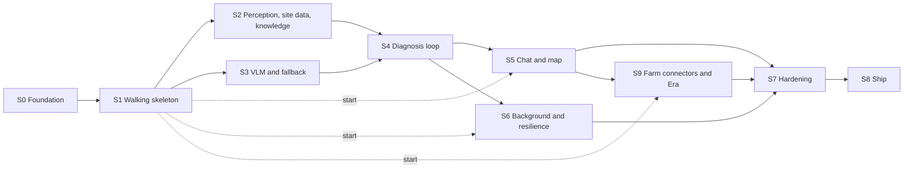

# PDM Backend Roadmap

> **Status:** Draft v0.33, 2026-10-25. v0.33: S2, S3, S4, S5, S6 and S9 are marked partly done in section 3, each row saying what has passed and what is left; S2 and S3 have their state; S9's row no longer says its exit-check scan waits on the rig, since it passed on Oct 24; S6 is merged (#229) and not yet deployed. v0.32: S6 is built on `feat/s6` and not yet deployed: forecast alerts come once per spell, push tokens must be Expo's and a refused batch is sent again in parts, an account deletion finishes after a failure or a restart and leaves only its tombstone, the orphan sweep covers deleted gardens' prefixes, the fallback reports its label versions so new scans start when the rig is down, and `s6.py` runs the slice's exit checks; the team's readings of the exit checks are recorded, and the 9070 XT isn't part of the rig. v0.31: S9's exit-check scan on the control plane: `s9.py`'s `connectors`, `plan`, `chat` and `era-guard` checks pass and `disconnect` waits on E11; bed 3's scan was diagnosed Septoria leaf spot but its plan cites the spray log, a step that rules copper out is tagged `chemical`, and the fixture's bed 3 is cleared on Oct 1, which the chat answer points out; E8.1's Q10 cited its message in 17 of 18 runs since G12, not every run. v0.30: S9's state: work items 1–7 were built as the EON roadmap's phases E0–E8 and are merged, the demo garden runs on the control plane but for the exit-check scan, real accounts wait on the team's Slack app and Google client, `s9.py` runs the slice's exit checks, and a plan step's `era` farm citation opens its text in the app. v0.29: S4's fallback-only rig run: Sam killed the 5070 Ti's worker mid-job, `cp-fallback-1` took both leased jobs over in 47.4 s (and one in 40.8 s on J6's second run), and `s4.py`'s three checks pass on the fallback with early blight leading by 1 to 3; Sam's check shows the disease head's 0.463 comes from the close-up's framing, not the pipeline. v0.28: S4's rig run on 384c2120: the `api` kill test passed on the control plane, but the early-blight scan was diagnosed Septoria leaf spot at 8 with the disease head below medium, the late check had no question to answer, and S4 stays open; the fallback-only run and P11 wait on #216. v0.27: S4's laptop half: the disease head's call counts in a candidate's score and never confirms alone, `s4.py` runs S4's three exit checks and they pass on a laptop (scan, `api` kill, late answer), four of S4's five decisions are recorded, P11's damage trace is in its own pull request, and the rig's list is written. v0.26: S5's rig list ran on the control plane: the deployment's Jev, Agent Memory and poison-control settings, `s5.py` on an early-blight scan, a farm record's text, the key's grants and Agent Memory's cost pass; the frost values and the iPhone are still to do, the dose check never fired, and six findings are recorded, among them that the disease head's call doesn't count in the diagnosis. v0.25: S5 is built and its checks pass on a laptop (`s5.py`, #200): the state of each work item and its pull requests, the seven bugs found building and running it, four findings left open, what the rig runs next, decisions 6, 8 and design 7 recorded, and gap 7 built. v0.24: after an audit of v0.23, S5 item 11 renders as a list item again; `weather_hours` can be anchored on a scan's weather snapshot as well as the forecast; `frost` is a top-level species field, since lettuce has a label-only profile with no care fields or sources; S5's row in section 3 and its Needs line agree. v0.23: after an audit of v0.22, S5's answer blocks are anchored on one tool result and filled from the store; frost tenderness is a species seed field, not a rule on `hardiness_zones`, whose `annual` means "grown as an annual"; the frost exit check uses tomato and lettuce, both seeded; a record's text and its rates are a decision for the team; `GET /farm-records/{id}` would need a roles row; S5 gains a **Needs** line and its row in section 3 names the new work. v0.22: S5 takes the four contract changes chat in the app needs (work 8–11 and their exit checks), proposed in PR #151 (app slice F6): answer blocks (gap 7), frost tenderness, a farm record's text and `Message` with the replay in OpenAPI. v0.21: S2 ran on real models on the control plane: the seed loaded, the 3070's worker replaced the stub, the real-photo and knowledge exit checks passed, and species confirmation ran end to end, with three bugs found, fixed in #163–#165 and checked on the rig (masks never stored, a rerun on confirming the suggested species, a segfault on every stop of the CUDA worker) and false face blurs over foliage recorded. v0.20: S2 item 3 records the rig run that stored a real scan's masks, and that a species-change run now keeps the earlier run's masks. v0.19: S2 item 3 records that a real perception result's masks were accepted but never stored, and that completion now stores them. v0.18: S2's knowledge loading names the curation work behind its seed files (#46) and where it stands. v0.17: S2's weather and soil exit check passed on the control plane, which runs the migration runner and `seed-upload` from `feat/s2`. v0.16: S2 item 4 (live site data) is built: fresh fixtures, Soil Landscapes of Canada for SoilGrids' null Canadian points, and the time-zone label when reverse geocoding fails. v0.15: S2 work 1 and 2 ran on the rig: the 3070's perception worker loads every model on CUDA and the day-1 checks pass, and the real scans wait on a seed that matches the models. v0.14: gap 1 is built: `store` applies the numbered migrations and the loader's `knowledge.surql` after the schema, and `api` runs them at start (S2 work 6). v0.13: S1 is done: its laptop half ran on Oct 17 and its exit checks passed on the deployed control plane on the rig on Oct 20, both recorded in section 5; gap 9 (a stage the API never heard about stays open) and the six bugs found by running S1 are in section 13; gap 9 is fixed: `complete` sends the stage events the stream missed before the job's findings; a Score failure found on the rig (a plant whose species the knowledge base lacks) is fixed and recorded there too; after an audit of these fixes, a `guided` job's `complete` sends no catch-up stage events, the catch-up's wiring is tested through `api`'s fake store, gap 9 records its known limits, and a user's write that sets a species must name one the knowledge base holds (`400 invalid_request`). v0.12: aligns the slices with the app's roadmap ([frontend roadmap](../frontend/roadmap.md)): S4's exit check runs through the API's smoke script and the app's results screens join it on Oct 22, push waits on a paid Apple Developer account, S7's CORS follows app roadmap F8, and the `answer_block` and Insights contract changes are listed as gaps 7 and 8. v0.11: adds S9, farm connectors (Slack and Google Drive) tested on Era by Eon's simulators, with the agent evaluation ([docs/connectors](../connectors/README.md)); the gaps and tracking sections become 13 and 14. v0.10: S5 adds the Agent Memory mirror (work 7, exit check). v0.9: S1's hosting decision is made: the control plane runs on the rig behind Tailscale Funnel, with the ingress as a compose profile (section 5). v0.8: section 1 says the `images` job pushes to GHCR, now that its first run on `main` passed. v0.7: S0 is done; section 4 records its exit checks and the pull requests that closed it, and section 1 says what S0 added; section 13 says how S0 was tracked. v0.6: gap 6 adds that the perception worker reads its tensor names and thresholds from the manifest ([issue #12](https://github.com/aacruzgon/GreenLens/issues/12)). v0.5: S3's schema check is done: xgrammar enforces `anyOf` with `null`. v0.4: gap 6 is fixed: the loaders and `label_set_version` follow `ml/models/FORMATS.md`. v0.3: gap 6, found when PR #6 merged: the Rust loader doesn't read `ml/models/FORMATS.md`; section 1 says what `ml/` holds now. v0.2: every gap in section 12 now has a design, and the slices link to them: [infra](../infra/README.md) for CI, images and compose files, [database 1](../database/README.md#1-version-and-setup) for applying the migrations, [worker 15.1](worker.md#151-stub-vision) for stub vision, and [vision 6](../vision/README.md#delivering-model-files-to-the-backend) for model files; two bugs found on the way (the vector search's `k`, the bucket default) are fixed. v0.1: the backend's work for build week, as nine slices (S0–S8) from the code merged on Oct 16 to the final deploy. Each slice has its goal, its work, what it needs from the other tracks, its exit checks and the decisions it closes. Section 12 lists the gaps found while writing it.

Companion to the [backend architecture](README.md). Its [build plan](README.md#13-build-plan) and [architecture 14](../architecture/README.md#14-build-plan) say what is done on each date. This document says how the backend gets there: the order of the work, what each step depends on, and how we know a step is finished.

## Contents

1. [Where the backend stands](#1-where-the-backend-stands)
2. [How the slices work](#2-how-the-slices-work)
3. [The slices at a glance](#3-the-slices-at-a-glance)
4. [S0. Foundation](#4-s0-foundation)
5. [S1. Walking skeleton](#5-s1-walking-skeleton)
6. [S2. Perception, site data and knowledge](#6-s2-perception-site-data-and-knowledge)
7. [S3. VLM workers and the fallback](#7-s3-vlm-workers-and-the-fallback)
8. [S4. The diagnosis loop](#8-s4-the-diagnosis-loop)
9. [S5. Chat and the garden map](#9-s5-chat-and-the-garden-map)
10. [S6. Background work and resilience](#10-s6-background-work-and-resilience)
11. [S7. Hardening and S8. Ship](#11-s7-hardening-and-s8-ship)
12. [S9. Farm connectors and Era](#12-s9-farm-connectors-and-era)
13. [Gaps found while writing this roadmap](#13-gaps-found-while-writing-this-roadmap)
14. [Tracking](#14-tracking)

---

## 1. Where the backend stands

On Oct 16 the workspace in `backend/` holds every crate this design describes. Each crate is wired to its real adapters in `api`'s `wiring.rs` and the worker's `main.rs`. The tests run against fakes, mocks and the embedded SurrealDB engine.

| Crate | Source lines | Tests | Tested against |
|---|---|---|---|
| `domain` | 17,300 | 90 | Exact JSON of every contract shape |
| `store` | 10,600 | 33 | The embedded engine (`kv-mem`); 1 test needs a SurrealDB server |
| `blob` | 840 | 5 | An in-memory store; 1 test needs RustFS |
| `integrations` | 6,400 | 58 | Live fixtures recorded on Oct 15 and `wiremock` servers |
| `vision` | 7,600 | 54 | Synthetic images; no ONNX Runtime session is ever built |
| `knowledge` | 2,100 | 19 | Seed records in memory |
| `agent` | 7,900 | 60 | A scripted chat model |
| `pipeline` | 5,800 | 21 | Fake ports |
| `api` | 9,800 | 34 | The real router, driven with `oneshot`, over a mock store |
| `worker` | 4,800 | 34 | A fake broker on paused time and a scripted VLM backend |

What has **never run**:

- the binaries against a real SurrealDB, RustFS, Clerk, Anthropic, Open-Meteo or SoilGrids;
- an ONNX model, a VLM server or a GPU;
- the images on a host. S0 added CI (`.github/workflows/ci.yml`), the Dockerfile and `infra/dev.compose.yml`, so the code builds and runs its tests against the pinned SurrealDB and RustFS in CI, and every merge that changes the images pushes them to GHCR. No image has run on the control plane or the rig yet;
- any model file or knowledge seed on a host. `ml/` (PR #6) has the training and export code, the manifest's perception entries and the head formats, but no fetch step yet, and `api` and the worker both read `/models/manifest.toml` at start.

So the roadmap is mostly about **bringing the code up on real dependencies and proving it there**, plus filling the gaps in section 13. It isn't about writing the crates again.

---

## 2. How the slices work

- **A slice is vertical.** It takes one capability from the API to the database, the object store or a GPU, and ends in something we can watch work.
- **A slice is done when its exit checks pass on the deployed control plane or the rig**, not on fakes. Each check is concrete: a request, a command, a thing to kill.
- **The slices follow their dependencies.** S2 and S3 run in parallel on different GPUs. S5 and S6 can start once S1 is done, but each finishes only after S4.
- **Every change goes through a pull request to `main`** ([AGENTS.md, branches](../../AGENTS.md#branches-and-pull-requests)). Code and its documents change together. After a source change, run `backend/tools/docgen/regen_all.sh`; after a contract change, regenerate `backend/openapi.json`.
- **A slice closes its decisions.** Each open decision is assigned to the slice that has the evidence to settle it. When the slice ends, the decision is recorded in the document that owns it.

---

## 3. The slices at a glance

| Slice | Dates | Goal | Needs first | Other tracks |
|---|---|---|---|---|
| [S0](#4-s0-foundation) ✓ done | Oct 16 | CI, containers, local services | PR #8 merged | none |
| [S1](#5-s1-walking-skeleton) ✓ done | Oct 16–20 | A scan runs app → API → worker → SSE on the control plane, with stub vision. Its exit checks passed on the rig on Oct 20 (PR #40) | S0 | Clerk dev instance; the embedder and face-detector files (ml) |
| [S2](#6-s2-perception-site-data-and-knowledge) ◐ partly done | Oct 18–19 | Real perception on the 3070, real weather and soil, the first knowledge loaded. Its three exit checks passed on the control plane on Oct 21–23. Left: relabelling a fallback-labelled garden, M5 and M7, the perception caps, and the camera conventions from the LiDAR day-1 check | S1 | Model manifest and ONNX files (ml); seed files (knowledge); the rig |
| [S3](#7-s3-vlm-workers-and-the-fallback) ◐ partly done | Oct 18–21 | VLM jobs on the 5070 Ti and the 9070 XT, and the hosted fallback. The 5070 Ti's Qwen3.5 and the fallback are done, and the fallback took over a killed worker's jobs in 47.4 s on Oct 24. Left: the 9070 XT, which isn't part of the rig, so its check can't run and open decisions 15 and 19 still name it | S1 | VLM benchmark and choice (vision) |
| [S4](#8-s4-the-diagnosis-loop) ◐ partly done | Oct 20–24 | Photo → diagnosis → plan with citations, on real models. Built; its checks passed on a laptop on Oct 24. On the rig the kill test passed and the early-blight check failed on Qwen3.5 (Septoria leaf spot) and passed on the fallback alone, and real LiDAR depth waits on the iPhone | S2, S3 | Reviewed profiles (knowledge); results UI (app, F3–F4, Oct 21–22); the LiDAR day-1 check (app, F5) |
| [S5](#9-s5-chat-and-the-garden-map) ◐ partly done | Oct 22–24 | Chat with tools, cards, memory and answer blocks; the garden map. Built; its checks passed on a laptop and on the control plane on Oct 24, except the seed's frost values and the iPhone's | S1 (start), S4 (finish) | Chat UI and map view (app); the block kinds agreed with the app (F6); the frost field in the seed (knowledge); E9.2's demo garden, done (EON) |
| [S6](#10-s6-background-work-and-resilience) ◐ partly done | Oct 23–24 | Alerts, push, deletion cascades, the rig-failure test. Built on Oct 24 with its tests and merged on Oct 25 ([#229](https://github.com/aacruzgon/GreenLens/pull/229)); its exit checks wait on a deploy, the full rig-failure test on Sam, and real push delivery on the Apple account | S1 (start), S4 (finish) | Development build for push (app); a paid Apple Developer account; the app's push registration |
| [S7](#11-s7-hardening-and-s8-ship) | Oct 24 | Security review, tuned limits and thresholds, evaluation run | S2–S6 | Evaluation set (vision) |
| [S8](#11-s7-hardening-and-s8-ship) | Oct 25 | Final deploy | S7 | Demo video, Devpost |
| [S9](#12-s9-farm-connectors-and-era) ◐ partly done | Oct 19–24 | Farm connectors for Slack and Google Drive, tested on Era's simulators; the agent evaluation. Built and merged (EON E0–E8); the exit-check scan passed on the control plane on Oct 24 (`connectors`, `plan`, `chat`, `era-guard`). Left: `disconnect`, which waits on the real connects on the team's accounts (E11) | S1 (start), S5 (finish) | Connectors screen (app); Slack app and Google OAuth client |

◐ partly done: the slice is built and some of its exit checks have passed, but not all of its work and checks. Its section says what is left.

---

## 4. S0. Foundation

**Goal:** every later slice merges through a green pipeline and runs in containers.

**Work**

1. Merge PR #8, the workspace.
Designed in [infra](../infra/README.md): CI in section 2, images in section 3, compose files in section 4, with its own work items in [section 9](../infra/README.md#9-roadmap).

2. Add a CI workflow, `.github/workflows/ci.yml` (first named `backend.yml`), with these steps:
   - `cargo fmt --all --check`;
   - `cargo clippy --workspace --all-targets -- -D warnings`;
   - `cargo test --workspace`, with cargo-nextest 0.9.148;
   - `regen_all.sh` followed by `git diff --exit-code docs/backend`, then `check_fences.py` and `checklinks.py`;
   - `cargo check -p worker --features cuda` and `cargo check -p vision --features cuda,migraphx,webgpu`;
   - `python3 .claude/skills/rust/scripts/check_examples.py`.

   Then add the checks to the `main` ruleset. AGENTS.md says to add each check once its workflow exists.
3. Add a live job to the workflow. It starts SurrealDB `v3.3.4` and RustFS `1.0.1` as service containers, pinned by digest, and runs the two ignored tests (`cargo test -- --ignored`) and `check_examples.py --live`.
4. Add `backend/Dockerfile`, a multi-stage build that uses the release profile:
   - an `api` image;
   - a `worker` image for each execution provider, carrying the ONNX Runtime 1.31 library its `ORT_EP` needs ([worker 11](worker.md#11-multi-vendor-gpus)).

   Images are pushed to the registry and deployed by digest.
5. Add `infra/dev.compose.yml` with SurrealDB and RustFS for local work, and an `.env.example` with placeholder values only.

**Exit checks**

- A pull request with a deliberate Clippy warning fails CI.
- `docker compose -f infra/dev.compose.yml up`, then `cargo test --workspace -- --ignored`, passes on a laptop.
- `docker build` produces the `api` image and the CUDA `worker` image.

**Done on 2026-10-16,** in pull requests #17 (CI), #19 (images), #22 (dev compose and env files), #23 (CI disk) and #24 (CI in stages, with the `images` and `release` jobs). Each pull request had an independent review, and its findings were fixed before the merge.

- ✓ A pull request with a deliberate `clippy::len_zero` warning failed `lint` (#21, closed).
- ✓ `docker compose -f infra/dev.compose.yml up -d`, then `cargo nextest run --workspace --run-ignored only`, passed (2 of 2) on a laptop.
- ✓ `docker buildx bake` built `api`, `worker` and `worker-cuda` for linux/amd64 on a laptop. `api` exits with `CLERK_ISSUER is required`, as UID 10100.
- ✓ `live` passed on pushes to `main`, and the `main` ruleset requires the one check `ci` ([infra 2](../infra/README.md#required-checks)).

What S0 changed in the design, each found by running it:
- SurrealDB's named volume needs `surrealdb-volume` ([database 1](../database/README.md#1-version-and-setup)).
- The workflow is `ci.yml`, in stages, with one required check ([infra 2](../infra/README.md#2-ci)).
- `security` checks RustSec advisories with cargo-deny.
- The `images` job pushes on `main`, and a `v*` tag reuses `main`'s digests in a GitHub Release.
- `api` has its own `heic` feature.

---

## 5. S1. Walking skeleton

**Goal:** a scan travels from the app (or a script) through the API and the broker to a worker and back over SSE. It runs on the deployed control plane with stub vision. This is architecture 14's "end-to-end skeleton".

**Already in code:**
- Clerk auth and the account tombstone.
- Membership checks.
- Uploads with the CPU blur check.
- Submit and the scan state machine.
- The job broker with leases, heartbeats and requeue.
- Resumable SSE.
- The fallback worker.

**Work**

1. **Stub vision in the worker** ([worker 15.1](worker.md#151-stub-vision), work items ST1–ST7). It answers `perception` jobs with canned, marked results, so the loop runs without GPUs or model files. It must report the label versions the API queues (`STUB_LABEL_SET_VERSION`, `STUB_CLASSIFIER_LABELS_VERSION`), or submit answers `503`.
2. **The control plane** ([architecture 12](../architecture/README.md#12-deployment); the compose file, bootstrap and secrets in [infra 4–7](../infra/README.md#4-compose-files)):
   - `infra/control-plane.compose.yml` with `caddy`, `api`, `surrealdb`, `rustfs` and `fallback-worker`;
   - the Caddyfile and the ingress profiles: `tailscale` (Funnel) on the rig, `cloudflare` kept as the alternative ([infra 5](../infra/README.md#5-ingress));
   - the database users of [database 1](../database/README.md#1-version-and-setup): root to apply the schema, `api` as `EDITOR`;
   - the bucket and identities of [storage 2](../storage/README.md#2-bucket-keys-and-access);
   - secrets in env files that are never committed;
   - the `stop_grace_period` values from [README 12](README.md#12-builds-and-deployment).
3. **Clerk's development instance:** the issuer, the JWKS and the Svix webhook to `POST /webhooks/auth`. Never use the production instance without asking.
4. **The CPU models `api` loads:** the text embedder (`snowflake-arctic-embed-xs`, 384 dimensions, pinned by hash), its tokenizer and the face detector. The S1 manifest's three entries, with verified hashes, are in [vision 6](../vision/README.md#the-s1-manifest); the `model-fetch` step fills `/models` (work items M1–M4).
5. **A smoke script in `backend/tools/smoke/`.** It mints a Clerk session token through the Backend API (`POST /v1/sessions`, then `/v1/sessions/{id}/tokens`) with an `sk_test_` key and refuses any other key. A Clerk testing token only bypasses bot detection on the Frontend API, so it can't sign in. It creates a garden, uploads a photo, submits, and follows the stream. Then it drops the connection and resumes with `Last-Event-ID`.

**Exit checks**

- The smoke script passes against the deployed control plane.
- Killing the worker mid-job requeues the job once its lease runs out ([contracts 5](../architecture/contracts.md#5-worker-api-and-jobs)), and another worker finishes it.
- Restarting `api` during a scan, then resuming the stream, replays every missed event once and no event twice.
- The stored copy of a photo with a face has the face blurred, where [architecture 11](../architecture/README.md#11-security-privacy-and-safety) says it must, checked by eye with `smoke.py --face-photo`. A face doesn't get the photo refused. Only a blurry or badly exposed photo gets `422 image_quality` (`crates/vision/src/upload.rs`).

**Progress on 2026-10-17 (laptop),** against `infra/dev.compose.yml` with SurrealDB v3.3.4 and RustFS 1.0.1, on macOS arm64:

- ✓ `python3 -m ml.models.fetch --for api` into an empty directory fetched the three S1 files with matching hashes. A second run downloaded nothing, and a locally corrupted file was fetched again.
- ✓ `api` (release, `--features heic`) started in about 5 s with `MODELS_DIR` set to that directory and ONNX Runtime 1.31.0 on the CPU (osx-arm64). It checked the manifest hashes. ort 2.0.0-rc.14 logs that it was designed for ORT 1.29.
- ✓ Clerk development instance: `api` verified Backend-API session tokens against `{CLERK_ISSUER}/.well-known/jwks.json` and upserted the user on the first request. A bad token got `401`. The tokens carry no `azp` and live 60 s.
- ✓ Stub perception worker (`--caps perception --stub-vision`) with `STUB_LABEL_SET_VERSION=d4f0f0534fb74a8d` and an empty `STUB_CLASSIFIER_LABELS_VERSION`, the empty knowledge base's values: submit queued the perception job, all five perception stages streamed, and the scan went on to `context` (real Open-Meteo weather) and `retrieve`. The smoke script passed the full flow, then dropped the stream after 3 events and resumed with `Last-Event-ID` with no gaps and no repeats.
- ✓ Kill check: a stub with a 30 s stage delay was killed at the first `stage_started`, and a second stub started at the default 150 ms. The job showed `requeues: 1`, `status: done`, `worker: dev-stub-perception-2`. The stream showed `plant_check` started again after the requeue (seq 4, then 6) and completed (seq 9), with seq 1..19 and no gaps or repeats, in about 27 s end to end, most of it waiting for the killed stub's heartbeat to go stale. The smoke script now fails the check unless the stage starts again, because a fast stub can finish the stage before the kill lands.
- ✓ Face check: OpenCV's sample portrait (`samples/data/lena.jpg`) uploaded with `smoke.py --face-photo` was stored with its face found and blurred to a flat patch, checked by eye.
- ✓ API restart check: the stream was dropped after seq 5 and `api` restarted (healthy in 3–4 s). The resume replayed every stored event once and none twice.
- ✓ The control-plane compose file renders for the profiles none, `tailscale,stub,seed` and `cloudflare`. Both bootstrap scripts ran twice, and the second run changed nothing ([infra 7](../infra/README.md#first-time-bootstrap)).

**Exit checks on the rig, 2026-10-20: S1 is done.** The control plane ran on the 3070 host (Debian 13) from `infra/control-plane.compose.yml` with `COMPOSE_PROFILES=tailscale,stub`, behind Tailscale Funnel at `https://pdm-cp.<tailnet>.ts.net`. CI pushes images to GHCR only from `main`, so `api` and `worker` were built from the S1 branch, pushed to a registry on the host (`127.0.0.1:5000`) and deployed by digest with `infra/deploy.sh`. Once the branch merges, `main`'s GHCR digests replace them.

- ✓ Bootstrap: both scripts ran twice against the pinned images, and the second run changed nothing (users, policies and the bucket compared before and after). `api` is an `EDITOR` on the database.
- ✓ `model-fetch` fetched five files with a read-only `HF_TOKEN`, among them the BioCLIP labels and the disease head from the private `pdm-models` repository, and exited 0 before `api` started.
- ✓ Funnel: the node joined with a one-off key tagged `tag:pdm-cp` and got a Let's Encrypt certificate in about 35 s. `/healthz` answered 200 through public DNS.
- ✓ The smoke script against the public URL reached `planned`: 45 events, seq 1..45 with no gaps or repeats, the drop and `Last-Event-ID` resume, real Open-Meteo weather, and the fallback worker's VLM job (3.5 s) and plan (9.7 s).
- ✓ Kill check: a stub at `STUB_STAGE_DELAY_MS=10000` was killed at `plant_check` (seq 4). The job was requeued about 2 minutes later, and the replacement started the stage again (seq 6) and completed it (seq 9).
- ✓ Restart check: `api` restarted mid-perception, with the stub at 3 s a stage. The resume replayed every stored event once and none twice. `complete` sent the four lost `stage_completed` events (`duration_ms` 0) before the findings, so no stage stayed open (gap 9).
- ✓ Face check: OpenCV's sample portrait, uploaded through Funnel, was stored with its face blurred to a flat patch, checked by eye.
- ✓ `docker compose stop api` landed 2 s into a 7 MB upload. The upload finished with `201`, and `api` exited 0 after 31 s. Every stop takes the full 30 s drain (`SHUTDOWN_DRAIN_S`): `api` logs `background tasks still running at exit`, because the scheduler's tasks don't end on shutdown. That is within the 190 s budget; S6 can look at it.
- ✓ Clerk webhook: an endpoint on the development instance for `user.deleted`, at `/webhooks/auth`. Deleting the smoke user in Clerk gave a signed delivery and `204`, and the cascade removed the user, its gardens, scans and images, and every object in `pdm-images`. `deleted_user` holds the Clerk id.
- The run found one bug, now fixed: the Score step failed for a plant whose suggested species the knowledge base lacks ([section 13](#13-gaps-found-while-writing-this-roadmap)).

**Decided before it started (2026-10-16):** where the control plane runs ([architecture open decision 2](../architecture/README.md#15-open-decisions)): on the rig, behind Tailscale Funnel. Everything in S1 except the deployed exit checks runs on a laptop against `infra/dev.compose.yml`, because the worker uses stub vision and `api`'s models run on the CPU; the 3070 is first needed in S2.

---

## 6. S2. Perception, site data and knowledge

**Goal:** real perception results from the RTX 3070, real weather and soil for a garden, and the first knowledge records in the database.

**Already in code:**
- `vision`: the ONNX Runtime sessions, BioCLIP 2, the leaf detector, SAM, the disease head, face blurring, WebP and depth.
- The worker's perception path.
- `integrations` for Open-Meteo, SoilGrids and the geocoders.
- `knowledge`'s index and the `store` reads behind it.

**Work**

1. **The rig:**
   - the perception worker with its GPU pinned by UUID ([worker 12](worker.md#12-deployment)). Done: the 3070 is in the control-plane host, so the worker is in `control-plane.compose.yml` behind the `perception` profile ([infra 4](../infra/README.md#infracontrol-planecomposeyml), item 10);
   - ONNX Runtime 1.31 on CUDA 13. Done: `worker-cuda` from `main` at `6909aa7`;
   - the model manifest from `ml/models`, our files from the private Hugging Face repository `pdm-models`, fetched by `model-fetch` ([vision 6](../vision/README.md#delivering-model-files-to-the-backend), work items M5–M9). Done: the 10 files of `api`, `fallback` and `perception` fetched and hash-checked on the rig. On 2026-10-23: 11, with the seed's matrix and disease head v3c.
2. **The first real ONNX sessions.** This is the first time ONNX Runtime has ever run in this code. Check each model's input and output shapes against its manifest entry, then run the vision day-1 checks ([vision evaluation 7](../vision/evaluation.md#7-day-1-checks)). Done on 2026-10-20: the worker opened all five sessions on the 3070, and start-up checks each file's tensor names against the manifest. The day-1 script of [#114](https://github.com/aacruzgon/GreenLens/pull/114) passed: CUDA matches the CPU within 2e-7 at batches 1, 4 and 16, and every perception model opens and runs on CUDA. Its budget run fits the worker's default caps (detector 8, SAM encoder 2, decoder 16, BioCLIP 16): 4.6 GB at peak with the arena limits, 6 shots and 40 crops in 2.0 s. Twice those caps fail to allocate: past the detector session's 1 GiB arena limit, and on the card without the limits.
3. **Uploads on real models:** face blurring with the real detector, WebP at the stored sizes, and the depth upload path. The LiDAR day-1 results settle the camera conventions ([vision 15](vision.md#15-open-questions), item 6). On the rig (2026-10-20): face blurring with YuNet ran in S1. `smoke.py --depth-check` against the deployed `api` stored a 12 MP HEIC at 1200×1600 without depth and at 1536×2048 with a synthetic depth map. It also found that a HEIC's sensor frame is lost on decode, so a sensor-frame depth map sent with a HEIC is refused ([vision 15](vision.md#15-open-questions), item 7, with the proposed fix). Masks (2026-10-23): the first real perception job on the control plane returned 7 regions with RLE masks; `api` accepted the result and the scan reached `planned`, but no mask was stored, so no region had a `mask_url`. Completion now writes each mask to RustFS as an 8-bit PNG, records it with the segmentation observations and sets its region's `mask_id` (branch `fix/store-perception-masks`, [pipeline 4](pipeline.md#4-ports-and-construction)). ✓ On the rig (2026-10-23) a real scan stored 4 masks for its 4 leaf regions; `GET /scans/{id}` signed `mask_url`s that served `image/png` at 1600×1200, each mask's extent matching its region box, and the perception completion took 225 ms. A species-change run keeps the earlier run's regions and masks, and a question photo's partial result leaves the run's alone.
4. **Live site data:**
   - fresh fixtures for Open-Meteo, SoilGrids and the geocoders;
   - SoilGrids has no data in central Toronto, so decide its replacement there ([architecture open decision 10](../architecture/README.md#15-open-decisions));
   - a fallback label when reverse geocoding fails ([integrations 19](integrations.md#19-open-questions), item 4).

   **Built on 2026-10-20** (branch `feat/s2-site-data`): fixtures recorded again live, with Nominatim's and Zippopotam's answers added; the shapes hadn't changed since Oct 15 ([integrations 7–9](integrations.md#7-open-meteo-weather)). SoilGrids is still null across Toronto, Guelph and Ottawa, so Soil Landscapes of Canada v3.2 answers a null Canadian point before the probes, from a 0.9 MB lookup built by `tools/slc/build_slc.py`; open decision 10 holds the evidence, *proposed* for the team to confirm. A failed reverse lookup labels a GPS garden "Toronto time zone" and creates it. Left: the deployed exit check, and relabelling a fallback-labelled garden when Nominatim answers again.
5. **Species confirmation** end to end: the perception top 3, the card, and the confirmed species on the scan. Ran on the control plane (2026-10-23) with a whole-plant shot and a leaf close-up cropped from the same photo, a tomato with early blight (PlantDoc test photo `dscn3175.jpg`; CC BY 4.0 covers [PlantDoc](https://github.com/pratikkayal/PlantDoc-Dataset)'s annotations, the photo keeps its owner's copyright, [vision 9](../vision/README.md#9-licences-and-notices)): `species_suggested` gave tomato 0.967, potato 0.032 and pepper 0.0, with `needs_confirmation` true; confirming tomato set the plant `confirmed`; the close-up's top problem was `tomato_early_blight` (0.575); the scan asked the early-blight indicator ("dark rings inside them, like a target?"), and after a yes, then "unsure" to a fruit question, it reached `planned` with early blight as the primary (`uncertain`, a provisional plan of safe steps with citations). Confirming the species the run already worked with started a new run, against [architecture 6.2](../architecture/README.md#62-species-identification) step 4: the scan's `working_species` was never set from the suggestion. Fixed in [#165](https://github.com/aacruzgon/GreenLens/pull/165), and checked on the rig: `species_confirmed` with `rerun: false`, the question kept.
6. **Knowledge loading:**
   - done: the migration runner applies the numbered files and the loader's `knowledge.surql` after the schema ([database 1](../database/README.md#1-version-and-setup), [store 4](store.md#4-connecting-and-the-schema)); M5 (reading `label_set_version` from `knowledge_meta`) and M7 (the live CI job) are open;
   - add the `seed-upload` one-shot container before `api`. Done: deployed with the `seed` profile on 2026-10-21; with `main`'s empty seed it listed `knowledge/species/` with PDMSEED01's keys and put nothing, and a wrong key exits 1. `api` started on the migration runner, which applied the schema with its `migration` table and found no numbered or knowledge file;
   - load the first species and organism files. They come from the curation in [#46](https://github.com/aacruzgon/GreenLens/issues/46) ([vision dev-roadmap 9](../vision/dev-roadmap.md#9-decisions-and-blockers), D5): the loader is merged (#48), the tomato slice is merged ([#51](https://github.com/aacruzgon/GreenLens/pull/51)), and the other crops follow the same scripts ([training 10](../vision/training.md#running-it)). Done on 2026-10-23: `main` at `2a54b9e` (#51, #131, #143, and #152, whose merge it is, which chose the records that load) deployed, and `api` logged `migration applied file=knowledge.surql`: 20 species (tomato in full, 19 `label_only`), 5 organisms and 134 chunks, label set `edb29fe878952e7b`, classifier labels `disease-head-v3c-2026-10-20`. The seed names no reference photos yet, so `seed-upload` put none;
   - check vector search with the real chunks. A bound `k` failed to parse on 3.3.4; `search_chunks` now passes it as a literal, tested on the embedded engine ([store 22](store.md#22-open-questions), item 4). Done: the third exit check below.

**Needs:** the manifest, the ONNX exports, the label matrices and `classifier_labels.yaml` (ml); the seed files (knowledge); the rig set up as in [setup](../setup/README.md).

**Was blocked on the seed (2026-10-20).** A real scan needs a loaded knowledge base whose label set and classifier labels match the worker's models. Without one, `submit` answers `503 upstream_unavailable` (`LabelsNotLoaded`). Jobs aren't routed by label set, so the real worker and the stub can't both run. The stub keeps answering on the deployed control plane until then. The worker's provisional matrix `233482ce598f591b` has 20 species and no organisms. `disease-head-v1d-2026-10-16` names 14 species and 22 problems. The tomato seed ([#51](https://github.com/aacruzgon/GreenLens/pull/51)) has one species, five organisms and no `classifier_labels.yaml`. The seed and the M12 matrix built from it come first ([comment on #51](https://github.com/aacruzgon/GreenLens/pull/51#issuecomment-6303970259)). Then the first exit check runs.

**Unblocked on 2026-10-23.** The seed loaded, `model-fetch` brought the seed's matrix and disease head v3c, and the control plane switched from the `stub` profile to `perception` with `main`'s `worker-cuda`. Its heartbeat names `ort_ep: cuda`, label sets `233482ce598f591b,edb29fe878952e7b` and classifier labels `disease-head-v3c-2026-10-20`.

**Exit checks**

- A real leaf photo gives the species top 3, leaf regions and masks, in a `perception` result the API accepts. ✓ On the control plane (2026-10-23): a tomato with early blight gave tomato 0.967, potato 0.032 and pepper, 6 leaf regions and a plant region, each with a mask, and the scan reached `planned` with 69 events. `api` accepted the masks but stored none (`mask` table empty, no `mask_url`): fixed in [#164](https://github.com/aacruzgon/GreenLens/pull/164), and on the rig a second photo then stored 4 masks for its 4 leaves, each served as a PNG whose extent matched its box. The disease stage reads close-ups only, so a `whole_plant` upload like `smoke.py`'s skips it with `no_leaves_found`.
- `GET /gardens/{id}/weather` returns the summary from live Open-Meteo, and a new garden's `soil_profile_status` moves from `pending` to `ready`, or to `unavailable` where SoilGrids has no data. ✓ On the control plane (2026-10-21, `feat/s2` at `5c2bb95` from the local registry): `smoke.py --site-check` made a GPS garden in central Toronto, labelled "Toronto, ON", whose weather came from live Open-Meteo (10.3 °C, 68 % RH, a 14-day forecast), and whose `soil_profile_status` moved from `pending` to `ready` within seconds, from Soil Landscapes of Canada since SoilGrids has no data there (pH 7.4, 29 % clay at 0–5 cm). The same run's scan reached `planned` on stub vision with 45 events, no gaps or repeats.
- A knowledge search returns ranked chunks from the loaded seed. ✓ On the control plane (2026-10-23): queries embedded with the pinned text model and its query prefix, run through `store`'s `SEARCH_CHUNKS` with `k = 5` against the deployed database, returned ranked chunks. For "how do I treat early blight on tomato leaves", the top chunk (0.753) was OMAFA's tomato passage on early blight and Septoria, Iowa State's Septoria Leaf Spot was fourth (0.678), and the five scored 0.753 to 0.669.

**Found on real models (2026-10-23):**
- **The CUDA worker died with SIGSEGV on every stop** (exit 139, also on `main`'s image): its inference thread was detached, so `exit` unloaded the CUDA libraries while it released its sessions. Fixed in [#163](https://github.com/aacruzgon/GreenLens/pull/163); on the rig the fixed image stops with exit 0 and logs `stopped`.
- **Face blurring blurs foliage.** YuNet at its 0.3 threshold put 6 boxes over leaves on one 5 MP garden photo and 3 on another, none on a leaf close-up, so perception and the VLM see those leaves blurred. The threshold is the vision track's to tune on plant photos ([vision models 9](../vision/models.md#9-face-detector)).
- **The demo beds:** with the seed loaded, `demo_garden.py` gave beds 1, 3 and 5 pepper, tomato and bean; kale and garlic aren't in the seed, and its squash is the genus *Cucurbita*, so zucchini (*Cucurbita pepo*) doesn't match ([EON E9.0](../EON/README.md#e9-the-demo-garden)).

**State on 2026-10-25: partly done.** The three exit checks passed on the control plane (above), and work items 1, 2 and 5 are done. Left:
- relabelling a fallback-labelled garden when Nominatim answers again (item 4);
- M5, reading `label_set_version` from `knowledge_meta`, and M7, the live CI job (item 6);
- the perception batch size and per-model caps ([architecture open decision 15](../architecture/README.md#15-open-decisions));
- Soil Landscapes of Canada, *proposed* in open decision 10 for the team to confirm;
- the camera conventions from the LiDAR day-1 check, and a sensor-frame depth map sent with a HEIC (item 3; [vision 15](vision.md#15-open-questions), items 6 and 7).

**Decides:**
- the crops ([architecture open decision 3](../architecture/README.md#15-open-decisions));
- the knowledge sources (7);
- SoilGrids (10);
- the stored size of a photo without depth ([vision 15](vision.md#15-open-questions), item 2).

---

## 7. S3. VLM workers and the fallback

**Goal:** `vlm`, `verify` and `guided` jobs run on the RTX 5070 Ti and the RX 9070 XT, and on the hosted fallback when the rig is away.

**Already in code:** the VLM adapters, the per-call schemas and their decoding, the hosted profile with schema sanitising, and the fallback worker ([worker 8–10](worker.md#8-the-vlm-adapters)).

**Work**

1. **The VLM sidecar on the 5070 Ti:** vLLM with xgrammar, running the checkpoint chosen by the benchmark ([architecture open decision 4](../architecture/README.md#15-open-decisions)).
2. **The AMD day-1 check on the 9070 XT.** It decides between vLLM on ROCm and llama.cpp on Vulkan (open decision 19). If llama.cpp wins, check whether a dropped connection frees its slot ([worker 17](worker.md#17-open-questions), item 4).
3. **The schema check:** done on 2026-10-16: xgrammar 0.2.7 enforces `anyOf` with `null` ([contracts open question 31](../architecture/contracts.md#12-open-questions); [worker 17](worker.md#17-open-questions), item 3; [vision 15](vision.md#15-open-questions), item 4). Had it failed, the nullable shapes would have changed before S4.
4. **`VLM_SLOTS` for each card, from the benchmark** (open decision 15).
5. **The fallback:**
   - one live hosted call confirms the box format and the stripped schema keywords ([integrations 19](integrations.md#19-open-questions), item 6);
   - time a full 8,000-token call against the doubled `max_runtime` ([worker 17](worker.md#17-open-questions), item 2).

**Exit checks**

- A `vlm` job on each card returns findings that pass the schema and the API's checks.
- With every rig worker stopped, the fallback claims a queued job after 15 seconds and completes it.

**State on 2026-10-25: partly done.** The 5070 Ti and the fallback are done; the 9070 XT isn't part of the rig ([S6](#10-s6-background-work-and-resilience)).

| Work item | State |
|---|---|
| 1. The 5070 Ti's sidecar | Done. Qwen3.5-9B, 4-bit AWQ, thinking off, chosen by the day-2 benchmark on Oct 20 (open decision 4), served by `vlm-worker-nv` on sam-linux |
| 2. The AMD day-1 check | Not run: the 9070 XT isn't part of the rig. Open decision 19 still names it |
| 3. The schema check | Done on Oct 16 |
| 4. `VLM_SLOTS` | The 5070 Ti: 2, at `VLM_MAX_PIXELS` 1,003,520 (open decision 15, Oct 20). The 9070 XT's is open |
| 5. The fallback | Done on Oct 23 by P9 ([report](../../ml/training/eval/reports/p9-fallback-2026-10-23.md)): boxes come in pixels of the image as sent, every call with the stripped schemas was accepted ([integrations 19](integrations.md#19-open-questions), item 6), and at effort low a call used at most 469 output tokens and 9.6 s ([worker 17](worker.md#17-open-questions), item 2) |

Exit checks:
- ✓ on the 5070 Ti in S4's rig run (Oct 24): Qwen3.5's findings passed the schema and the API's checks, and the scan reached `planned`. Its diagnosis is S4's open check. Not on the 9070 XT.
- ✓ in S4's rig run, with the worker killed mid-job instead of stopped before: `cp-fallback-1` claimed both leased jobs 47.4 s after the kill, and one in 40.8 s on J6's second run.

Left: settling the 9070 XT, by recording that it left the rig in open decisions 15 and 19 or by bringing it back, and then its card's check.

**Decides:** open decisions 4, 15 and 19.

---

## 8. S4. The diagnosis loop

**Goal:** a photo becomes a diagnosis and an action plan with citations, on real models. The scripted early-blight scan runs end to end.

**Already in code:** knowledge ranking and scoring, the pipeline's steps with step claims and the sweep, questions and provisional plans, fusion, measurement, and the plan writer with validation and the dose check.

**Work**

1. Run the early-blight scan on the full stack: perception, VLM, retrieve, verify, score, plan.
2. **Step claims under failure.** Kill `api` in the middle of a step. On restart, the sweep must recover the claimed step, and the scan must finish with no step run twice ([flows](flows.md)).
3. **Questions:** an indicator question, its answer, a late answer and a re-plan, as [contracts 3](../architecture/contracts.md#scan-lifecycle) orders them.
4. **Measurement with LiDAR depth:** measurable indicators answered from a real depth map.
5. **The plan writer on the hosted LLM:** validation, citations and the dose check on every step.

**Needs:** reviewed profiles (knowledge). The results UI is not a dependency of the exit checks: the app builds it on Oct 21–22 (F3–F4 in the [app roadmap](../frontend/roadmap.md)), after S4 starts. S4's exit checks run through the API's smoke script, and the app's results screens join them on Oct 22.

**Exit checks**

- The early-blight scan reaches `planned` with a diagnosis, indicator evidence and a plan whose steps cite their sources.
- The `api` kill test passes.
- A late answer creates a new plan version and supersedes the old plan's tasks.

**Decides:**
- the confirmed margin ([knowledge 12](knowledge.md#12-open-questions), item 2);
- empty candidate sets (item 3);
- a plan-writer outage on a first plan ([pipeline 17](pipeline.md#17-open-questions-and-decisions), item 2);
- the verification-answer timeout ([architecture open decision 14](../architecture/README.md#15-open-decisions));
- the measurement thresholds (17), which are a first cut, finished in S7.

**State on 2026-10-24.** S4's laptop half is built, and its three exit checks ran on a laptop against a local `api` with stub perception, the fallback worker on `claude-opus-5-5` for the VLM jobs and the live plan writer: [`backend/tools/smoke/s4.py`](../../backend/tools/smoke/s4.py). A slice is done only when its checks pass on the deployed control plane (section 2), so S4 stays open until the rig runs the same script on real models.

| Work item | State |
|---|---|
| 1. Early-blight scan | Laptop: `s4.py scan` passed: `planned` in 48 s with a diagnosis, 27 indicator answers across 9 candidates and a plan of 8 steps, each citing its source, the one chemical step carrying the safety note, and a model version on every result. On the mock photos the hosted VLM read leaf mold (`confirmed`, score 5) and contradicted early blight's rings; the stub's disease call is `healthy` at 0.70, so the head's weight was 0. The early-blight check needs the real head and PlantDoc's photo: the rig |
| 2. Step claims under failure | ✓ on the laptop: `s4.py kill` killed `api` with SIGKILL right after `diagnosis`, while `plan` held the claim. `api` was back in 4 s; the sweep re-claimed `plan` 314 s after the kill and committed it once: one diagnosis, one `plan_ready`, plan version 1, seq 1–52 with no gap or repeat across the restart |
| 3. Questions | ✓ on the laptop: `s4.py late` left a question to the 10-minute continuation (a provisional plan at seq 55, 651 s after the question, with 8 open tasks), then answered it `yes`: `question_resolved` (user), a diagnosis superseding the old one, `plan_superseded` (`late_answer`) 37 s later, plan version 2, and the 8 old tasks dismissed. The `scan` check answers questions per indicator (`--answers`) |
| 4. Measurement with LiDAR depth | Waits on the iPhone: the LiDAR day-1 check (app roadmap F5) hasn't run. The module writes JPEG, so the HEIC sensor-frame fault ([vision 15](vision.md#15-open-questions), item 7) doesn't block it |
| 5. The plan writer on the hosted LLM | ✓ on the laptop on every plan of the three checks: validated, each step citing a source in the plan's `citations`, no number with a measure in any step, the safety note on chemical steps. Whether the dose check replaced a sentence isn't visible from the API |

**Built for it:**
- **The disease head's call counts in the score** (S5's rig finding). A candidate the head names adds `classifier_weight`, 3 at high confidence and 2 at medium, and `confirmed` needs at least one matched indicator, so the head ranks but never confirms alone. On the fallback the hosted LLM's disease call is tagged `llm_fallback` and adds nothing, since the same model answers the indicators (Sara's review of #212) ([knowledge](knowledge.md), contracts v0.11.4). Without it, blossom end rot won at 0 on a photo with no fruit, over the head's early blight at −2.
- **`s4.py`** and `s5.py --leaf-photo`, with the kill and start commands for the laptop and the control plane ([smoke README](../../backend/tools/smoke/README.md)).
- **P11** (vision dev-roadmap): a VLM damage finding must name the animal or the trace it left, and decode drops one that names none, so Qwen3.5's early-blight spots no longer come back as `leaf_mines` (`findings@6`). Its own pull request, stacked on S4's, with its rig re-run.

**Decided** (recorded in the documents that own them): the margin stays 2 for the submission, fitted with the indicator weights once the evaluation harness exists (contracts 12, question 3); an empty candidate set is `uncertain` (with `low_evidence` unless a pest or damage finding is at medium or more) and asks nothing (knowledge 12, item 3); a plan-writer outage on a first plan fails the scan, retryable (contracts 12, question 29); the verification-answer timeout is 10 minutes (architecture open decision 14). The measurement thresholds (17) wait on item 4. To fit with the margin after J5: the weight takes each problem's best confidence across the leaf regions, so one crop's call at 0.8 weighs as much as the strongest indicator even when other leaves disagree, and the head's temperature now moves scores.

**Found running it:**
- A late answer ends with `plan_superseded`, not a second `plan_ready`, as contracts 4's stream rules say; the app must treat it as the new plan.
- After the kill, the stream has two `stage_started` of `plan` (seq 48 and 49) and one `stage_completed`, the re-claim's. The app should treat a repeated start as the same stage.
- The dev database's soil task still fails every 15 minutes on a garden from before connectors (S5's finding).
- A diagnosis stored before `classifier_weight` reads it as 0, so its first re-score (a late answer or a guided check) may see a changed result and write a new diagnosis and plan. Only data from before this change is affected.

**On the rig, 2026-10-24: the early-blight check failed.** `main` at 384c2120 (#212, #213) was deployed to the control plane by digest at 21:48 UTC: api `d5f4bf78…`, worker `633ed98a…` (the fallback), worker-cuda `51b44a9b…` (the 3070's perception). Sam moved the 5070 Ti's `vlm-worker-nv` to the same worker digest at 21:37 UTC, still serving Qwen3.5-9B AWQ at 0.78, so its findings prompt is `findings@6` (the prompts are compiled into the image; the API doesn't show `vlm_prompts`). `s4.py` ran from 21:49 to 21:57 UTC with `--real-models`, PlantDoc's `dscn3175.jpg` as `whole_plant` and a crop of its centre leaf (pixels 1080,380 to 1660,1600 of 2592 × 1944) as `leaf_closeup`, `--answers concentric_rings_bullseye=yes,*=unsure`, `--expect-problem tomato_early_blight`, and `docker compose kill api` and `start api` on the host. It exited 1. Its fixture is [`j4-s4-rig-2026-10-24.json`](../../ml/training/eval/reports/j4-s4-rig-2026-10-24.json).

| Check | Result |
|---|---|
| `scan` | **FAIL** on `--expect-problem` alone. `planned` in 51 s with no question asked: `confirmed`, primary **Septoria leaf spot at 8**, early blight 1, bacterial spot 0, blossom end rot 0, the other five below 0. Qwen3.5 answered Septoria's three indicators `yes` (many round spots, tan centre with a dark border, black specks in the centre). For early blight it matched the bullseye and contradicted "spots become angular". The disease head ran on the crop: early blight 0.463, Septoria 0.368, bacterial spot 0.075, all `low` (medium starts at 0.5), so `classifier_weight` was 0 on every candidate. At S5's 0.575 (medium, +2) early blight would have scored 3, still 5 behind. The rest of the check held: a plan of 8 steps, each citing a source in its `citations`, `claude-opus-5-5` at `plan/2026-10-23.1`, not provisional, and a real model's version on every observation (`107151b7e97f9fff` for perception, Qwen3.5's checkpoint for the VLM). No damage finding and no organism came back |
| `kill` | ✓ Killed after `diagnosis` (seq 55), while `plan` held the claim. `api` was healthy 20 s later. The sweep re-ran `plan` at seq 58, 329 s after the kill's event, and committed it at seq 61 (`plan_ready`): seq 1–61 with no gap or repeat across 2 reconnects, one `diagnosis`, one `plan_ready`, one `candidates_selected`, plan version 1 |
| `late` | SKIP: its scan was `confirmed` with no question, so nothing could be answered late. Same diagnosis as the other two |

All three scans gave the same diagnosis and the same head scores, so work item 1 stays open on the rig. P11's rig re-run (Sam's steps in [#216](https://github.com/aacruzgon/GreenLens/issues/216)) and the iPhone wait.

**With only the fallback, 2026-10-24: the three checks pass.** The same `s4.py` command ran from 22:07 to 22:19 UTC (fixture [`j4-s4-rig-fallback-2026-10-24.json`](../../ml/training/eval/reports/j4-s4-rig-fallback-2026-10-24.json)). Sam killed `vlm-worker-nv` with SIGKILL at 22:07:07.889, while it held two leased `vlm` jobs (`01M5QZ82GA1ZVKJ2S0Y4A0X8FW` and `01M5QZ82VD2A4WXHV1MQM002TM`, claimed at 22:07:06.8 and 22:07:07.1 through Caddy). Its last heartbeat reached `api` at 22:07:05.061. `cp-fallback-1` claimed both at 22:07:55.33 and 22:07:55.35, **47.4 s after the kill** (30 s to a stale heartbeat, 15 s unclaimed, and the long poll's timing), and served every later VLM job. This is S3's takeover exit check, done by killing the worker in the middle of a job rather than stopping it beforehand, and vision J6's first run. J6's second run, on Oct 25 at 01:01 UTC, killed the worker at 01:01:16.730 while it held `01M5R96KHMWZNMGFF5HP668PCQ`. The fallback claimed the job at 01:01:57.556, 40.8 s after the kill. The scan (`s4.py --only scan`) passed again: `uncertain`, early blight at 1, Septoria at −8 (all three of its indicators contradicted), and a provisional plan of 7 steps.

| Check | Result |
|---|---|
| `scan` | ✓ `planned` in 99 s with two questions (the bullseye answered `yes`, the fruit's scabby spots `unsure`): `uncertain`, primary early blight at 1 (bullseye matched, "spots become angular" contradicted), bacterial spot, blossom end rot and late blight at 0, Septoria at −5 (its round spots and tan centre contradicted). The plan is provisional, with 8 steps, 4 sources and 8 tasks, every step citing its sources, and no chemical step. The VLM's results carry `llm_fallback: claude-opus-5-5` (#212), and every `classifier_weight` is 0: the head's early blight was 0.463 again |
| `kill` | ✓ Killed after `diagnosis` (seq 66). `api` was healthy 18 s later. `plan` was re-run at seq 69, 327 s after the kill's event, and committed at seq 72: seq 1–72 unbroken, plan version 1, and the diagnosis `confirmed`, early blight at 3 ("spots become angular" answered `unsure`) |
| `late` | ✓ The bullseye question (seq 56) went to the 10-minute continuation: a provisional plan at seq 67, 636 s after the question, with 8 open tasks. Answered `yes`, it gave `question_resolved` (user), a diagnosis superseding the old one (still `uncertain`), and `plan_superseded` (`late_answer`) 37 s after the answer, with no second `plan_ready`. Plan version 2 is provisional with 7 tasks, and the 8 old tasks were dismissed |

On the fallback, Opus answered none of Septoria's indicators `yes` on these three scans, so early blight leads, but by only 1, and the head's 0.463 adds nothing. Two things to decide:
- **The VLM reads this photo as Septoria.** The photo's ringed spots with yellow halos are early blight (PlantDoc's label). The score lets three `yes` answers from one model outweigh the head's top call when the head is below medium. That points to indicator weights and the margin (contracts 12, question 3) or to the indicator wording for Septoria's specks, not to a bug in the run.
- **The head's confidence moves with the close-up's framing, not with the pipeline** (Sam, on CPU, #216): 0.575 on S5's crop and 0.463 on this one, on either side of medium. `UploadProcessor::process` and the worker's disease stage, the same `vision` code as 384c2120, give 0.462 on this crop. The leaf box covers the whole close-up, so the head reads the whole image. The API's WebP (G12) and the resize order (G8) move it by 0.008 at most. Framing moves it far more: the box shifted by 2 or 4 px gives 0.44 to 0.60 (25 crops, mean 0.53), grown by 5 to 20% gives 0.55 to 0.62, and the detector's own crop of the leaf from the whole photo gives 0.54 to 0.55. This crop sits near the bottom, so a re-cropped close-up could pass by chance and prove little. `dscn3175.jpg` is in M18's test split; only this photo was scored, and the split wasn't rescored.

**For the rig,** after this merges and deploys:
1. Bring up the 5070 Ti's `vlm-worker-nv`, then run `s4.py` against the control plane with PlantDoc's `dscn3175.jpg` and a leaf crop from it, `--answers concentric_rings_bullseye=yes,*=unsure --expect-problem tomato_early_blight --out`, the kill commands of the smoke README, and a new `--email`. Then once more with only the fallback worker.
2. Save the `--out` fixture as vision J4's event log, and record each check's numbers here.
3. Run P11's rig steps (its pull request): P5's checks on Qwen3.5 and FP8, and re-record the fake VLM server's recordings.
4. On the iPhone: the LiDAR day-1 check, then a scan with depth whose measurable indicators are answered by measurement (item 4), and a first cut of the measurement thresholds (17).

---

## 9. S5. Chat and the garden map

**Goal:** a user chats about a plant, the agent uses its tools, proposes changes as confirmation cards, and remembers what it should. The garden map works.

**Already in code:** chat turns, the tools, confirmation cards, memory, the dose check on every sentence, the LLM classifier, Jev's client, and the garden map endpoints with neighbour and spacing rules.

**Work**

1. **Chat turns on the hosted model,** checking how thinking blocks behave when the context is rebuilt every turn ([agent 18](agent.md#18-open-questions), item 2).
2. **Tools against real data:** `view_image`, `get_forecast`, `get_soil_profile`, `revise_plan` and the others. Then the card's confirm and refuse paths.
3. **Memory:** extraction, private until shared, and read by the plan writer only once shared.
4. **The text classifier:** use Jev if early access arrived ([architecture open decision 8](../architecture/README.md#15-open-decisions)); otherwise the LLM fallback.
5. **The garden map:** a mapping session, the neighbours and the spacing warnings.
6. **Local poison-control numbers** in the deployment's configuration ([agent 18](agent.md#18-open-questions), item 10).
7. **Agent Memory** ([database: Agent Memory](../database/agent-memory.md)): create the `pdm-dev` context and a key limited to `gardens/*`, set the three `AGENT_MEMORY_*` variables, and check that shared memories are recorded as beliefs, that a newer memory with the same topic supersedes the older one, that the chat context, the plan writer and `search_memory` read them, and that `GET /plants/{plant_id}/beliefs` and the deletion cascades work. Measure the cost on Studio's Usage page.

Work 8–11 are the contract changes the app's chat needs (app roadmap [F6](../frontend/roadmap.md#12-f6-chat-with-answer-blocks) and [section 17](../frontend/roadmap.md#17-what-the-app-needs-from-other-tracks)). PR #151 built F6 against the shapes it proposes in `app/src/domain/proposed.ts`, which only the app's mock sends. Each change is the `domain` type, its exact-JSON test, `contracts.md` and `openapi.json` in one pull request, with `schema.surql` where the shape is stored ([AGENTS.md, sources of truth](../../AGENTS.md#sources-of-truth)). When one lands, the app regenerates its types and deletes that proposal; `proposed.ts` goes once all four have landed.

8. **Answer blocks** (gap 7; [design 5](../design/design.md#chat-answers-you-can-interact-with)). `AnswerBlock`, a union tagged by `kind`, starting with the five the app draws: `garden_map`, `weather_hours`, `frost_planner`, `measurement_trend` and `candidates`. The agent picks a block with a `show_block(kind, call_id)` tool. The named tool result of the turn is the block's anchor: the forecast for `frost_planner`, the forecast or a scan's weather snapshot (`get_scan`) for `weather_hours`, the garden map for `garden_map`, the measurements for `measurement_trend`, the look-alikes for `candidates`. The API refuses a `call_id` the turn doesn't hold or a result that doesn't fit the kind. It then fills in what the anchor lacks from the store, never from the model: plant names, statuses and latest heights, and each plant's frost field for the planner (work 9). So a block holds only records and no text the model wrote. The block goes out as an `answer_block` SSE event `{ v: 1, block }` and is stored on `Message.blocks`, omitted when empty. Agree the kinds, their fields and this anchor rule with the app before building (design open decision 7); the alternative is a `show_block` that names several `call_id`s.

    **Built** ([#191](https://github.com/aacruzgon/GreenLens/pull/191), contracts v0.11.0 §8 "Answer blocks", and v0.11.3 for the call id in a tool result and the tool-name fallback ([#201](https://github.com/aacruzgon/GreenLens/pull/201)); design open decision 7 decided). The anchor rule holds: one tool result of the same answer, everything else from the store. `show_block` also takes `focus_plant_ids` for `garden_map`, checked against the map's live pins. `frost_tender` comes only from a confirmed species and is omitted when unknown; the frost planner lists the garden's live plants, not dead ones, and leads to `POST /tasks` per chosen plant, not a card. Live, the model couldn't name the anchor until each framed tool result carried its `call_id` ([#201](https://github.com/aacruzgon/GreenLens/pull/201)).

9. **Frost tenderness.** The `frost_planner` block marks each plant `frost_tender`, but the knowledge base has only `hardiness_zones`, which can't answer it. In the seed, `annual` means "grown as an annual" (`ml/knowledge/extract.py`), and lettuce and onion are grown as annuals but stand a light frost. Zones are about winter survival, and a `Garden` has no zone. Add a top-level species seed field instead, outside `care`, for example `frost: "tender" | "hardy"`, absent when the sources don't say, which the block sends as no `frost_tender` rather than `false`. The change is `SpeciesSeed` in [contracts 10](../architecture/contracts.md#10-knowledge-seed-format), `ml/knowledge/schema/seed.schema.json`, the seed files and the regenerated `knowledge.surql`, so it needs the knowledge track. Only tomato has `care` today: lettuce is a `label_only` profile with no sources, so its `frost` value needs a source too. `get_species_profile` returns it with the profile. The app's 3D garden needs it too, for its frost mode (app roadmap F7).
10. **A farm record's text.** EON decision 10 has the app show an `era` record's text in a sheet instead of opening its simulator link ([EON E9.3, E10.3](../EON/README.md)), but `FarmCitation` carries no text and no route returns a record. Either add `text` to a `FarmCitation` from an `era` connector only (its data is synthetic, so nothing private leaves the server), or add `GET /farm-records/{id}` with the record's text. E9.3's exit check needs one of them. The route would also return a vendor record's crew text, so it needs a row in the [contracts 1](../architecture/contracts.md#roles-and-access) roles table and answers `404` for a record of another garden. `FarmCitation` has no `endpoint`: the app tells an `era` record from the connector list, by the connector id at the front of `record_id` ([connectors 4](../connectors/README.md#4-data)).

    **Decide with it:** a spray log holds rates ("copper hydroxide, 2.0 g/L"), and [connectors 7](../connectors/README.md#7-the-agent) promises that the chat never repeats a rate. The dose check runs on the model's sentences, not on a record's text. Either the sheet shows the record as the farm wrote it, labelled as synthetic (EON decision 10), or the API leaves the rates out of `text`.

    **Built** ([#189](https://github.com/aacruzgon/GreenLens/pull/189), contracts v0.10.36): `FarmCitation.text` on an `era` connector's record only: the stored chunk as the farm wrote it (at most 2,000 characters, the text the model gets), rates included, for a sheet labelled synthetic; a vendor record never has it, and the model reads the text once, from the hit. No `GET /farm-records/{id}`. The rates decision is recorded in [connectors 7](../connectors/README.md#7-the-agent) and EON decision 10.

11. **`Message` and the replay in OpenAPI.** `Message` is inlined in `Page_Message`, and `POST /conversations/{id}/messages` lists only its `text/event-stream` answer, though `api` already returns a `200 application/json` `MessageReplay` for a finished turn. Register `Message` and `MessageReplay` as schemas, with the replay as the route's second `200` content type: a utoipa attribute change, no wire change.

**Needs:** the chat UI and map view (app); the block kinds and their fields agreed with the app (F6, design open decision 7); the frost field in the seed for tomato and lettuce at least (knowledge); E9.2's demo garden for the farm record's text (EON, done).

**Exit checks**

- A chat about the early-blight scan calls a tool, proposes a plan change as a card, and applies the change once confirmed.
- A sentence with an unsafe dose never reaches the stream.
- A memory saved in chat stays private until shared.
- A shared watering note and a newer one about the same plant leave one current belief and one superseded in `GET /plants/{plant_id}/beliefs`. A private chat memory never appears in Agent Memory. With the three variables unset, `available` is `false` and chat works. Deleting the plant leaves nothing under its scope within one sweep (10 s), and deleting a shared memory removes it from the beliefs while its plant's others stay.
- "Will the frost on Thursday hurt my plants?", in a garden with a tomato and a lettuce and a frost in the forecast, streams a `frost_planner` block after the `tool_finished` of the forecast's `call_id`, with the tomato marked `frost_tender` and the lettuce not, and the stored message holds the same block in `blocks`. A `show_block` with a `call_id` from another turn, or one whose result doesn't fit the kind, sends no block and the text answer stands alone. Each of the five kinds has an exact-JSON test.
- A chat answer that cites a `#field-reports` message from an `era` connector gives the app the record's text, through `FarmCitation.text` or `GET /farm-records/{id}`. A vendor connector's record has no `text` on its citation, and if the route is chosen, a record of another garden is `404`.
- `backend/openapi.json` has `Message` and `MessageReplay` schemas, and `POST /conversations/{id}/messages` lists `application/json` (`MessageReplay`) and `text/event-stream` under `200`. The app's `npm run gen:api` picks them up.

**Decides:** open decisions 6 and 8, and design open decision 7 (the first set of answer block kinds). Decision 6 was decided on Oct 20 by the agent evaluation (`claude-opus-5-5`); decision 8 is decided by #193 (Jev, with the LLM fallback); design decision 7 by #191.

**State on 2026-10-24.** S5 is built, and its exit checks ran on a laptop against a local `api` with the hosted model, Jev and Agent Memory: [`backend/tools/smoke/s5.py`](../../backend/tools/smoke/s5.py) ([#200](https://github.com/aacruzgon/GreenLens/pull/200)). A slice is done only when its checks pass on the deployed control plane (section 2), so S5 stays open until the rig runs the same script. The early-blight exit check waits on the rig's models: the laptop's stub and hosted VLM diagnosed bacterial speck, so its checks ran on that scan. Every check passed on the laptop except the dose check, which never fired: asked for exact amounts, the model declined by itself, so no sentence reached the dose check. The live runs cost about US$5.35 in model calls.

| Work | State |
|---|---|
| 1. Chat on the hosted model | ✓ on the laptop: turns of several tool calls on `claude-opus-5-5`, reasoning blocks replayed inside the tool loop with no error, earlier turns rebuilt as text ([agent 18](agent.md#18-open-questions), item 2) |
| 2. Tools and cards | ✓ on the laptop, after two fixes: a card can be stored before its turn's message ([#195](https://github.com/aacruzgon/GreenLens/pull/195)), and strict write tools require every argument, so `revise_plan` sends its steps ([#198](https://github.com/aacruzgon/GreenLens/pull/198)). The routes' confirm and reject paths have tests ([#190](https://github.com/aacruzgon/GreenLens/pull/190)) |
| 3. Memory | ✓ on the laptop: `memory_saved` private, shared through `POST /memories/{id}/share`; the plan writer's shared-only rule is unit-tested |
| 4. The text classifier | Jev ([#193](https://github.com/aacruzgon/GreenLens/pull/193)): TypeSafe's API on a pinned `jev-1.14.0`, its own `Calibration::jev()`, and the LLM fallback with `Calibration::llm()`; a follow-up is classified with the exchange before it ([#202](https://github.com/aacruzgon/GreenLens/pull/202)). Architecture open decision 8 is decided |
| 5. The garden map | ✓ on the laptop: `PUT` with `base_version` and its `409`, the API's neighbours, and a chat answer giving the distance. The crowding rule runs in fusion during a scan, not in `get_garden_map`. The iPhone's mapping session is still to run |
| 6. Poison-control numbers | `POISON_CONTROL_TEXT` ([#187](https://github.com/aacruzgon/GreenLens/pull/187)), refused at start if the dose check would replace a sentence; ✓ on the laptop. Confirm the numbers by phone before the demo |
| 7. Agent Memory | ✓ on the laptop with the narrowed `pdm-api-dev` key on the hosted context: supersession, a private memory absent, erase on delete, and `available: false` without the variables. ✓ on the control plane too, with its own key on the same context (the free plan has one), and the Free plan costs nothing (the rig list, items 1, 5 and 7) |
| 8. Answer blocks | Built ([#191](https://github.com/aacruzgon/GreenLens/pull/191), [#201](https://github.com/aacruzgon/GreenLens/pull/201)); ✓ on the laptop: a `frost_planner` and a `garden_map` block shown live |
| 9. Frost tenderness | The field, schema and store read are built ([#188](https://github.com/aacruzgon/GreenLens/pull/188)). The seed values (tomato `tender`, lettuce `hardy`) wait on the knowledge track, with a source and a review each; the laptop set tomato's in its dev database |
| 10. A farm record's text | Built ([#189](https://github.com/aacruzgon/GreenLens/pull/189)); ✓ on the control plane on E9.2's demo garden (the rig list, item 4) |
| 11. `Message` and the replay in OpenAPI | Built ([#186](https://github.com/aacruzgon/GreenLens/pull/186); regenerated after answer blocks in [#196](https://github.com/aacruzgon/GreenLens/pull/196)); ✓ on the laptop from the served `/openapi.json` |

**Bugs found building and running S5,** each fixed with a test:
- **No card was ever made.** A write tool stores its card naming the turn's assistant message, which the turn stores only after the tool loop, and `CREATE_PENDING_ACTION` refused a message that didn't exist yet. The mock-store tests hid it ([#195](https://github.com/aacruzgon/GreenLens/pull/195)).
- **Strict tool schemas left optional arguments empty.** Opus 5.5 never filled an optional property of a strict schema, so `revise_plan` changed only the summary and `create_task` never set a plant or a date. Every property is now required, with `null` or `[]` meaning none ([#198](https://github.com/aacruzgon/GreenLens/pull/198)).
- **The daily chat budget ran out after 2–3 tool turns.** It counted cache reads in full. It now weighs tokens by price, cache reads 0.1, cache writes 1.25 and output 5, and the default is 1,000,000 budget tokens, about US$4 a user a day ([#199](https://github.com/aacruzgon/GreenLens/pull/199)).
- **Answer blocks never showed live.** The model never saw a call id, so it named the tool and was refused. The framed result now carries `call_id`, and a tool's name is accepted when it ran once in the answer ([#201](https://github.com/aacruzgon/GreenLens/pull/201)).
- **A follow-up lost its context.** Jev classified "what did you just tell me about the forecast?" alone and routed it off-topic ([#202](https://github.com/aacruzgon/GreenLens/pull/202)).
- **Jev's audit:** a partial answer could route a poisoning message off-topic, and poison control lost to an off-topic win. Both fixed in [#193](https://github.com/aacruzgon/GreenLens/pull/193).
- **`openapi.json` went stale on `main`** after #191 merged over #186 without a conflict ([#196](https://github.com/aacruzgon/GreenLens/pull/196)).

**Found and not fixed** (in [#200](https://github.com/aacruzgon/GreenLens/pull/200)): the dev database's soil task fails every 15 minutes on a garden from before connectors (`connector_rev` is `NONE`); a failed classifier call falls back to a care question without a log; a turn saves a memory twice, through a `remember` call and the automatic extraction that runs after it (3 of 3 memory turns; a `remember` refused by the dose check and retried, then extracted again); Jev routed a memory note as `task_change`.

**For the rig** (the list from [#200](https://github.com/aacruzgon/GreenLens/pull/200)). Run on the control plane on 2026-10-24: `main` at #202's merge (`2861c5d1`, the last change to the images; after it only `s5.py` changed) deployed by digest after a database export, `seed-upload` before `api` since `knowledge.surql` changed. The workers were the 3070's perception worker and the fallback, which answered the VLM job on the hosted model; the 5070 Ti's VLM worker wasn't heartbeating.
1. ✓ `POISON_CONTROL_TEXT` (the Toronto text in `infra/env/.env.example`), `JEV_URL`, `JEV_API_KEY`, `JEV_MODEL=jev-1.14.0` and the three `AGENT_MEMORY_*` are in `.env.api`, and `api` logged `text classifier: jev` and `agent memory on`. Agent Memory's free plan allows one context, so the deployment uses the laptop's context, `greenlens`, with its own narrowed key `pdm-api-prod`. There is no `pdm-prod`, as [database: Agent Memory 2](../database/agent-memory.md#2-setup) proposes; each garden still has its own scope.
2. ✓ `s5.py` against `https://pdm-cp.tailb3ce07.ts.net` with `--scan-id` on an early-blight scan made first (below): `openapi`, `poison` (the deployed text, no tool call), `card`, `tasks`, `memory`, `beliefs`, `beliefs-erase` (the plant's entity gone in 8 s), `map`, `frost` and `unset` passed, and `dose` was a SKIP (item 8). `chat` failed once: turn 1 called `get_forecast`, showed a `weather_hours` block and ended with no text. Rerun alone, it passed, with 1,520 characters and the second turn answered from the rebuilt context. The 12 turns cost between US$0.31 and US$2.68 by the script's range.

   **The early-blight scan** took four tries with PlantDoc's `dscn3175.jpg` (S2's photo):
   - The whole plant alone, every question answered `yes` (the script's default): bacterial speck, from that `yes` to "tiny pinpoint black specks on the fruit"; early blight scored 0.
   - The leaf close-up uploaded as `whole_plant`, answers `unsure`: speck, uncertain, every candidate at 0. The disease head never ran (`disease_skipped: no_leaves_found`), because it reads only `leaf_closeup` and `leaf_underside` shots ([vision 6](vision.md#6-perception)), and `s5.py` uploads `--photo` as `whole_plant`.
   - Both shots, the close-up as `leaf_closeup`, answers `unsure`: the head called early blight (0.575, then Septoria 0.213, late blight 0.084), but blossom end rot won at 0 on a photo with no fruit, and early blight scored −2 after the VLM answered "spots become angular" `no`.
   - The same, with "Do the brown spots have dark rings inside them, like a target?" answered `yes` and the rest `unsure`: early blight, uncertain, score 1. That scan, `01M5Q7S18J91F8J0FH9CN5V9KT`, is the one the checks ran on.
3. Waits on the knowledge track: the seed still has no species `frost`. `frost` ran with `--frost-expect tomato=none,lettuce=none` at Yellowknife: a `frost_planner` block after the forecast's `tool_finished`, neither plant with `frost_tender`, and the stored message with the same block.
4. ✓ On Maple Row Farm as its owner, "What has the crew reported in #field-reports lately about the tomatoes?" called `search_farm_records` twice and gave 14 `farm_citations`, 8 of them `#field-reports`, all from the `era` Slack connector and every one with `text` (34–244 characters, as the farm wrote it). The answer cited the 9 July early-blight report and named the copper with no rate. The deployment has no vendor connector, so a vendor record without `text` is covered by tests only.
5. ✓ `GET /me` with the deployed key: `effectiveGrants` are `gardens/*` for `memory:read`, `memory:write`, `memory:forget`, `scope:read` and `scope:create`, and `none/*` for `scope:delete` and `grant:manage`.
6. ✓ Not on the control plane: no `ERROR` in `api`'s log in the 14 hours before the deploy nor in the 16 minutes after the last restart, and all 18 gardens in its database have a `connector_rev`. The error needs a garden from before connectors, which only the laptop's dev database has.
7. ✓ Read in Studio on 2026-10-24: the organisation is on the Agent Memory Free plan, so it costs nothing. The Usage page for October 2026 shows US$0.00 spent after the Oct 17 measurements, the laptop's S5 runs and this one; the only invoice (Oct 16) is US$0.00, and Build North's US$50 credit is untouched. A paid plan, which the credit could cover, is the way to a separate `pdm-prod` context (item 1); what it allows is *unverified*.
8. Not seen. Four prompts for an amount (the script's, a label rate the user gave, a homemade baking-soda spray and a fish fertiliser) were all routed `safety_sensitive`, and the model declined each one by itself, even to repeat the user's own label rate. No amount reached the stream, so the dose check had nothing to replace. The replacement stays covered by tests only.
9. Open, for the iPhone: cards confirmed in the app, `memory_saved` with Undo and Share, a mapping session and the spacing warning in the next scan's plan, and the `garden_map`, `frost_planner` and `weather_hours` blocks drawn by the app.

**Found on the rig,** none fixed yet:
- **`s5.py` can't run the disease head.** It uploads `--photo` as `whole_plant` only. The early-blight exit check needs a `--leaf-photo` uploaded as `leaf_closeup`, as S2's run did.
- **The disease head's call doesn't count in the diagnosis.** A candidate's score is the weights of the indicators it matched, minus the weights of the ones contradicted ([architecture 6.3](../architecture/README.md#63-retrieve-then-verify), step 3). The head only picks and ranks the candidates. On this photo the hosted VLM answered early blight's ring question `unsure` ("no image shows lower leaves") and the target pattern was decided by the user's answer. When every candidate scores 0, the best candidate can be one the photos can't show (blossom end rot, with no fruit in either shot). For the vision track (P8): either the head's top call adds to the score, or the rings question is asked on the close-up. Vision roadmap v0.44 says the diagnosis rests on the head, which is not what fusion does.
- **An answer can be only a block.** One turn in two showed `weather_hours` and streamed no text, and the stored message had the block and empty text. The app would draw a block with nothing around it.
- **Jev's routes:** "is there rain or a humid stretch coming that would help this disease spread?" went to `safety_sensitive` both times, and two notes to remember went to `task_change` and `safety_sensitive`. The answers were right, since only the safety policy is added.
- **A memory turn still saves twice,** as on the laptop: two `remember` calls and three `memory_saved` events in one turn.
- **One belief search timed out** at 4 s (`agent::beliefs`), during a turn's `search_memory`. The turn answered without beliefs. It is the first measured case of [database: Agent Memory 6](../database/agent-memory.md#6-caveats-and-open-items)'s open `/query` timeout.

---

## 10. S6. Background work and resilience

**Goal:** the scheduled work runs, deletions clean up everything they should, and the system survives losing the rig.

**Already in code:** the scheduler's tasks (`requeue`, `sweep` with question continuation, `idle`, `cleanup`, `weather` with forecast alerts and plan triggers, `soil`, push `receipts`, `orphans`, and `beliefs` and `connectors` from S5 and S9), Expo push, the deletion runner with the account cascade, and the RustFS delete queue. S6 adds an eleventh task, `deletions`.

**Work**

1. **Forecast alerts** from live forecasts: each condition alerts once, and its tasks are created.
2. **Push** to a development build of the app.
3. **Deletions against real RustFS and Clerk's development instance:**
   - a plant, a garden and an account (`DELETE /me`), including the tombstone and the Clerk deletion;
   - a restart in the middle of a cascade resumes it.
4. **The orphan sweep** removes objects no record references. Resumed plant and scan deletions leave their objects to it ([api 23](api.md#23-open-questions), item 4).
5. **The rig-failure test:** kill the rig in the middle of a scan. The fallback must take over within about 45 seconds ([architecture 14](../architecture/README.md#14-build-plan)). The rig is the 3070's perception worker on the control plane's host and the 5070 Ti's VLM worker on sam-linux; the 9070 XT isn't part of it. The API runs on the 3070's host, so the test kills the workers, not the host.

**Needs:** a development build for push (app). Push from a development build is blocked until the team buys a paid Apple Developer account, because a free Apple ID can't use APNs. Until then the alert inbox covers forecast alerts, and push is tested only up to Expo's push service: the sender, Expo's tickets and the pruning of a token Expo doesn't know. A receipt needs a real device's token. The app doesn't register for push yet either (`expo-notifications`, the EAS project id and `platform/push`, [frontend 9](../frontend/README.md)), so a real delivery needs that app work as well as the account.

**Exit checks**

- A frost forecast gives one alert, not one per sweep. The team's reading (Oct 24): one alert per spell, the consecutive days a trigger fires on, kept across sweeps, forecast changes, restarts and a dismissal.
- After `DELETE /me`, no record, object or Clerk user of that account remains but its tombstone, kept 24 h after Clerk confirms so that the account's old session token gets `401`, which it does.
- The rig-failure test passes, and the scan finishes on the fallback. The fallback leases the job no more than 51 s after the dead worker's last heartbeat (30 s stale, a 5 s requeue tick, the 15 s fallback delay and a 1 s poll), about 35 to 51 s from the kill, and a scan submitted while the rig is down still starts.

**State on 2026-10-25.** Built, with its tests on the embedded engine and `api`'s fakes, and merged in [#229](https://github.com/aacruzgon/GreenLens/pull/229); not yet deployed, so no exit check has run on the control plane. Research before the build found that none of the three exit checks could pass on `main`; the table says what each item changed. The checks run through [`backend/tools/smoke/s6.py`](../../backend/tools/smoke/s6.py) ([smoke README](../../backend/tools/smoke/README.md)).

| Work item | State |
|---|---|
| 1. Forecast alerts | Built. An alert was keyed by its date, so a three-day frost gave three alerts and three pushes, a humid stretch alerted twice in one sweep, after-rain and dry-soil alerted every day, and a frost whose coldest hour crossed midnight alerted again. Now a run groups each trigger's fired days into spells and `create_alert_task` creates one task per spell (`task.spell`, `task.spell_until`, index `task_spell`), extending a continued spell instead; plan triggers follow the same rule, and no task is created in a garden being deleted. An alert from before the change takes its spell on, so the deploy brings no burst. One `weather sweep` line of counts a run. Not done: a frost whose cold hours today are past still alerts, because the cache keeps only the day's minimum |
| 2. Push | Built up to Expo. `POST /me/push-tokens` takes only Expo push tokens for `ios` and `android` (`400 invalid_request` otherwise), and `Pusher::send` skips stored non-Expo tokens, so one bad token can't make Expo refuse a whole batch; a refused batch is sent again by project or one message at a time; `push sent` and `push receipts checked` are logged; `PushPayload` is in `openapi.json`. Real delivery waits on the Apple account and the app's push registration |
| 3. Deletions | Built. Leaving a shared garden could block an account for good: after a failure or a restart there, `DELETE $user` failed on every run, Clerk was never called and the tombstone stayed. The account run now finds the user's chats in every garden from the records, waits for the user's gardens whose own cascade runs, and deletes `usage_daily` and `idempotency_key` rows. Runs are retried in the process (10 s to 6 min), and the new `deletions` task resumes the rest every 15 minutes |
| 4. The orphan sweep | Built. It skips a garden that fails instead of stopping, sweeps the prefixes under `gardens/` whose garden record is gone, uses `blob::orphan_candidates`, and logs `orphan sweep finished`. `UNREFERENCED_KEYS` has its first test on the embedded engine. No on-demand trigger, by the team's choice: `s6.py` seeds strays and checks after the next run, an hour after `api` starts |
| 5. The rig-failure test | Built for it. The fallback reported no label versions, so once the 3070 was silent every new scan got `503 upstream_unavailable`; it now reports the versions of the label files it loads. `max_runtime` doubles once on the fallback instead of on every re-claim. The broker logs `job leased` and the worker `job claimed`, so the takeover can be timed from the log |

**For the control plane, next:** deploy `main`'s images, then on this host: `s6.py --only tokens,prune`; `plant,garden,account`; `restart` (stops RustFS for about a minute and restarts `api`); `alerts,orphans` in their seed and check phases over about two hours; and `rig-failure` with only the 3070's worker killed. The full rig-failure test, with Sam killing the 5070 Ti's worker on sam-linux, comes after.

---

## 11. S7. Hardening and S8. Ship

**S7 goal (Oct 24):** feature freeze, then make the running system safe and tuned.

1. **Security review against [architecture 11](../architecture/README.md#11-security-privacy-and-safety):**
   - auth on every route and `404` to non-members;
   - signed image URLs;
   - EXIF stripped and faces blurred;
   - no secrets, tokens, signed URLs or locations in logs;
   - CORS limited to the configured origins. [App roadmap F8](../frontend/roadmap.md) settles the web origin (a subdomain needs CORS, the same origin doesn't) and gives the app's request and body sizes before the Oct 24 review.
2. **Limits:** set the general rate limit and the JSON body limit from what the app actually sends (the sizes are in [app roadmap F8](../frontend/roadmap.md)). Both are placeholders today ([api 23](api.md#23-open-questions), item 2).
3. **Thresholds:** the weather and trigger thresholds and the measurement thresholds, from the evaluation set (open decisions 17 and 20; contracts open question 27).
4. **The evaluation run** with [vision evaluation](../vision/evaluation.md), with its numbers recorded.
5. **Operations:** SurrealDB backups as [database](../database/README.md) describes them, the JSON logs with request ids, and a short runbook for restarting each service.

**S7 exit check:** every review finding is fixed or recorded as accepted, and the evaluation numbers are in the vision documents.

**S8 goal (Oct 25):**
- deploy the final images by digest and tag the release;
- re-run the S1 smoke script and the S4 early-blight scan on production settings;
- freeze the deployment until Demo Day.

---

## 12. S9. Farm connectors and Era

**Goal:** a garden owner connects the farm's Slack and Google Drive, the chosen channels and folder sync into the garden, and the chat and the plan writer cite them. Every part is tested against Era by Eon's simulators, and the agent is scored on a synthetic farm ([docs/connectors](../connectors/README.md)).

**Already in code:** when S9 was written, nothing. The scheduler, the text embedder, the vector search within a garden, the tool registry and the deletion runner it builds on were. Work items 1–7 were then built as phases E0–E8 of the [EON roadmap](../EON/README.md), which expands this slice and holds each task's state and evidence; see **State on 2026-10-24** below.

**Work**

1. **Contracts and schema** ([connectors 11](../connectors/README.md#11-changes-to-other-documents)): the `domain` types, the endpoints, `search_farm_records`, the deletion cascades, `connector` and `farm_record`, `backend/openapi.json` and contracts §8–9 in one pull request.
2. **Adapters in `integrations`:** `SlackClient` and `DriveClient` over `reqwest`, read methods only, with a configurable base URL; the OAuth exchanges and revocations; Tier 1 pacing and `Retry-After` ([connectors 6](../connectors/README.md#6-sync)).
3. **Tokens:** AES-256-GCM sealing under `CONNECTOR_KEY` with the connector id as associated data; the signed OAuth state and the device-bound `complete` step ([connectors 5](../connectors/README.md#5-connecting-and-tokens)).
4. **Sync:** the `connectors` scheduler task, the per-team Slack pacer, the `users.info` cache, permalinks built at sync, chunking, embedding by `text_hash`, the daily trailing window, `changes.list`, the 180-day cleanup.
5. **The agent:** the tool, the plan writer's farm-record hits, the `farm_citations` fields and their validation rule, and the dose rule for spray logs ([connectors 7](../connectors/README.md#7-the-agent)).
6. **Era in dev and CI:** the `era` compose profile with the pinned images; the Maple Row Farm fixture; the `era` CI job in `ci`'s `needs` with the client, fault, `day1` → `day2` and read-only tests ([connectors 9.1–9.2](../connectors/README.md#91-the-farm-fixture)).
7. **The agent evaluation:** `backend/tools/era-eval` over `answers.toml`, run on each candidate chat model ([connectors 9.3](../connectors/README.md#93-the-agent-evaluation)).
8. **The demo garden:** the `demo` profile's simulators on a private network with `SIMCORE_ADMIN_TOKEN`, and the `era` connectors seeded at start-up ([connectors 9.4](../connectors/README.md#94-the-demo)).
9. **Real accounts:** a Slack app with the five bot scopes, and a Google Cloud OAuth client in Testing with the team as test users; one real connect, sync and disconnect each.

**Needs:** the **Farm connectors** screen and the connect flow (app); the Slack app and the Google OAuth client (whoever holds the team's accounts).

**Exit checks**

- On the deployed control plane, a scan of bed 3 in the demo garden gives a plan that cites the spray log. A chat question about the crew's reports cites a `#field-reports` message, links to it, and repeats no rate.
- The `era` CI job passes, including a throttled sync that finishes on a later run and a `day2` sync that picks up the quarter's changes.
- The evaluation has run on at least two models, and its table is in connectors 9.3.
- A real Slack workspace and a real Drive folder connect, sync and disconnect. After disconnecting, the vendor's token is revoked and no `farm_record` of the connector remains.

**Decides:** architecture open decision 6, with the evaluation's numbers, and connectors open questions 1 and 5.

**State on 2026-10-24.** Work items 1–8 are built and merged, and item 8's exit-check scan passed on the control plane (below); item 9 waits on the team's Slack and Google accounts. The exit checks run through [`backend/tools/smoke/s9.py`](../../backend/tools/smoke/s9.py), in `s4.py`'s and `s5.py`'s style. A slice is done only when its checks pass on the deployed control plane (section 2), so S9 stays open until E11 makes the real connects and `s9.py`'s `disconnect` check passes on them.

| Work item | State |
|---|---|
| 1. Contracts and schema | Done: E1 ([#55](https://github.com/aacruzgon/GreenLens/pull/55), the store in [#62](https://github.com/aacruzgon/GreenLens/pull/62)); an `era` record's text in `FarmCitation.text` ([#189](https://github.com/aacruzgon/GreenLens/pull/189), EON decision 10) |
| 2. Adapters | Done: E2 ([#56](https://github.com/aacruzgon/GreenLens/pull/56)), the Slack and Drive clients and the Era harness |
| 3. Tokens | Done: E3.0–E3.2 ([#60](https://github.com/aacruzgon/GreenLens/pull/60)) and the connect routes, E3.3–E3.6 ([#72](https://github.com/aacruzgon/GreenLens/pull/72)) |
| 4. Sync | Done: Slack ([#71](https://github.com/aacruzgon/GreenLens/pull/71)), Drive ([#82](https://github.com/aacruzgon/GreenLens/pull/82)), the catch-up after a gap and the `day2` resync ([#102](https://github.com/aacruzgon/GreenLens/pull/102)) |
| 5. The agent | Done: E5.1–E5.5 ([#59](https://github.com/aacruzgon/GreenLens/pull/59), [#68](https://github.com/aacruzgon/GreenLens/pull/68), [#91](https://github.com/aacruzgon/GreenLens/pull/91), [#93](https://github.com/aacruzgon/GreenLens/pull/93)); the plan writer's farm records, E5.4 ([#176](https://github.com/aacruzgon/GreenLens/pull/176), [#181](https://github.com/aacruzgon/GreenLens/pull/181)) |
| 6. Era in dev and CI | Done: E0 ([#54](https://github.com/aacruzgon/GreenLens/pull/54)), E6 ([#69](https://github.com/aacruzgon/GreenLens/pull/69)), `era` in `ci`'s `needs` since Oct 20 ([#80](https://github.com/aacruzgon/GreenLens/pull/80)), the nightly hosted run ([#81](https://github.com/aacruzgon/GreenLens/pull/81)). On a laptop on Oct 24, the `era` job's tests passed against the pinned images: 30 of 30 on the open pair (faults included) and 5 of 5 on a strict pair |
| 7. The agent evaluation | Done: `era-eval` ([#83](https://github.com/aacruzgon/GreenLens/pull/83)), three runs on `claude-opus-5-5` and `claude-sonnet-5-5` and the table in [connectors 9.3](../connectors/README.md#93-the-agent-evaluation) ([#88](https://github.com/aacruzgon/GreenLens/pull/88), [#92](https://github.com/aacruzgon/GreenLens/pull/92), [#105](https://github.com/aacruzgon/GreenLens/pull/105)), the plan writer's Q18 and Q18A ([#184](https://github.com/aacruzgon/GreenLens/pull/184), [#185](https://github.com/aacruzgon/GreenLens/pull/185)). E8.1's follow-ups are closed: in the three runs since gap G12 (E8.3's re-run and third run, G20's re-run), Q19 cites its `#field-reports` message in 18 of 18 runs and Q10 in 17 of 18; Q10's miss is one `claude-sonnet-5-5` run of G20's re-run ([`2026-10-23-g20-rerun.json`](../connectors/eval/2026-10-23-g20-rerun.json), `C_FIELD/1781702100.003800` not cited), and `claude-opus-5-5`, the chosen model, cited both in every run |
| 8. The demo garden | Done: the `demo` profile and `era-seed` (E9.1, [#112](https://github.com/aacruzgon/GreenLens/pull/112)), the demo garden script (E9.0, [#121](https://github.com/aacruzgon/GreenLens/pull/121)) and the seeded connectors (E9.2, [#122](https://github.com/aacruzgon/GreenLens/pull/122)) ran on the control plane on Oct 21–23, and the exit-check scan (E9.3) passed there on Oct 24 (below). Left: kale and garlic in the knowledge seed (beds 2 and 6 have no species; the exit checks don't need them) |
| 9. Real accounts | Waiting on the Slack app and the Google OAuth client (E11.1, E11.2). `s9.py disconnect` runs the exit check once a real connector exists |

**Built for it:**
- **`s9.py`** ([smoke README](../../backend/tools/smoke/README.md)): `connectors` (both `era` connectors active, synced and holding records), `plan` (a bed 3 scan whose plan's `farm_records` hold the spray log and a step cites it, every `era` record with its text, no rate), `chat` (a question about the crew's reports cites a `#field-reports` message with its link and text, and no streamed sentence holds a rate, by the fixture's `rate_pattern`), `era-guard` (an owner's delete of an `era` connector is `409 invalid_state`), and `disconnect` (a real connector's delete, with `--db-check` for its `farm_record` rows and `--api-log`/`--api-log-cmd` for `api`'s "token revoked" line).
- **The plan's farm citations in the app** (EON E10.3's plan half): a plan step's `era` record opens its text in the chat's sheet, labelled as Era's synthetic data, and its link is never opened; a vendor record opens Slack or Drive.

**What the API can't show,** so `s9.py`'s `disconnect` check reads it elsewhere: no route shows a token's revocation (only `api`'s log, and the vendor's own app list), and the connector list hides a `deleting` connector, so the records' deletion is read in SurrealDB.

**On the rig, 2026-10-24: S9's exit-check scan passed.** `s9.py` from `feat/s9-laptop` at 2300b86e ran against the control plane from 01:34 to 01:35 UTC on Oct 25, as the demo owner, on the deploy of S4's rig run (`main` at 384c2120, api `d5f4bf78…`). It used PlantDoc's `dscn3175.jpg` as `whole_plant` and a crop of its centre leaf as `leaf_closeup`: pixels 1051,319 to 1689,1661, S4's crop grown by 10%, where Sam measured 0.55 to 0.62 for early blight (S4's rig run). It ran with `--answers concentric_rings_bullseye=yes,*=unsure` and `--sync-wait 60`, and exited 0. Its output is [`2026-10-24-s9-rig.json`](../connectors/eval/2026-10-24-s9-rig.json).

| Check | Result |
|---|---|
| `connectors` | **PASS.** Slack (`01K7ERA5EED000000000000001`) is `active` with `#field-reports` and `#crew` and 89 records, synced at 01:29 UTC; Drive (`…0002`) is `active` with `Farm records` and 5 records |
| `plan` | **PASS.** Scan `01M5RB40VME38RF1SAWN0V9CBY` reached `planned` in 53 s with no question. Plan v1 has 8 steps and 2 farm records, the bed map (`D_BEDMAP`) and the spray log (`D_SPRAY`), each with its text (740 and 1,868 characters). Step 1 cites both, and steps 2 and 6 the bed map. No rate in the summary, the 5 `watch_for` items or the steps |
| `chat` | **PASS.** "What has the crew reported about bed 3 in #field-reports?" on that scan was routed `care_question` and called `search_farm_records` twice, in 16.1 s. The stored message cites 14 records (10 `#field-reports` messages, 1 `#crew` message, the bed map, the spray log and the planting plan), each with its text, and none of the 31 streamed sentences holds a rate. 57,838 tokens in, 1,035 out |
| `era-guard` | **PASS.** Both deletes answered `409 invalid_state`, and both connectors stay `active` |
| `disconnect` | **SKIP.** No real connector yet (E11) |

What the run found:
- **The scan was diagnosed Septoria leaf spot again:** `confirmed`, Septoria at 8 and early blight at 3, with no question asked, as in S4's rig run, so the larger crop didn't change the call. `s9.py` checks the farm citations, not the diagnosis. The plan cited the spray log anyway and used it: bed 3 is at its season limit of copper sprays, so the plan sprays nothing more and relies on clean-up.
- **Step 1 is tagged `chemical` for naming the product it rules out.** "Remove spotted lower leaves now" is the cultural treatment `remove_infected_leaves`, but its detail says the plan uses no fungicide because the spray log shows bed 3 at its copper limit. `agent/src/safety/plan.rs` makes any step that mentions a product `chemical`, so the step gets the chemical icon and the registered-product safety note. This is a finding for the plan's safety rules, not for S9.
- **The fixture clears bed 3 on Oct 1, and the demo runs on the real clock.** Dev's `#field-reports` message of Oct 1 says the tomato plants are out of bed 3 (the fixture's `as_of` is Oct 15), so a live scan of bed 3 contradicts the farm's records. The chat answer opened with that: "either some plants were left in, there are volunteers, or the scan was linked to the wrong bed". That is the right answer, but every live demo of bed 3 will lead with it. Whether to change the demo script or the fixture's last bed 3 message is the team's call.
- **The rig's checkout isn't at `/srv/pdm/repo`,** where [infra 1](../infra/README.md#1-scope-and-layout) and the smoke README put it: the compose project runs from the checkout at `~/Github/GreenLens/infra`. `s9.py` ran from that checkout's `backend/`, with `--env-file /srv/pdm/env/.env.api` for the Clerk key and `ERA_DEMO_GARDEN_ID`.

**For the rig, next:** Once E11.1 and E11.2 exist: connect a real Slack workspace and Drive folder from the app, sync, then `s9.py --only disconnect --connector-id <id> --api-log-cmd '<compose> logs api'` for each, and the README's SurrealDB queries for the records.

---

## 13. Gaps found while writing this roadmap

Gaps 2 to 5 have a design; gap 1 is built; gap 6 is fixed; gap 7 is built (S5 work 8); gap 8 has no slice yet; gap 9 is fixed. The designs are proposals until their slice builds them; each ends with numbered work items and exit checks.

| # | Gap | Slice | Designed in | Work items |
|---|---|---|---|---|
| 1 | Nothing applied the knowledge migration: `store` applied only `schema.surql`, and `api` only read the knowledge | S2 | **Built:** [database 1](../database/README.md#1-version-and-setup), with [store 4](store.md#4-connecting-and-the-schema) and [api 4](api.md#4-start-up-and-shutdown): numbered, hash-locked migrations plus the loader's regenerated `knowledge.surql`, each in its own transaction with a `migration` record; `api` applies them at start and checks its embedder against `knowledge_meta` | M1–M4 done; M5 and M7 open ([store 4](store.md#4-connecting-and-the-schema)) |
| 2 | The worker had no stub vision for the walking skeleton | S1 | [Worker 15.1](worker.md#151-stub-vision): `--stub-vision`, refused in a release build without `PDM_ALLOW_STUB_VISION=1`, canned results marked `stub` | ST1–ST7 |
| 3 | No CI, no containers, no `infra/` (S0's part done: CI, images, dev compose) | S0, S1, S2, S3, S8 | [Infra](../infra/README.md): CI, images, the three compose files, ingress, secrets, deploys by digest, backups | [Infra 9](../infra/README.md#9-roadmap) |
| 4 | Model files and seed data come from `ml/`, which had no delivery path | S1, S2, S3 | [Vision 6, delivering model files](../vision/README.md#delivering-model-files-to-the-backend): one manifest, our files in a private Hugging Face repository (the team's choice), `sources.toml` and `fetch.py` | [M1–M11](../vision/README.md#roadmap) |
| 5 | Pipeline open question 3 was out of date | none | Resolved: the run's evidence fields are in the schema ([pipeline 17](pipeline.md#17-open-questions-and-decisions)) | none |
| 6 | The Rust loader didn't read `ml/`'s file formats: a label matrix and the plant probe failed to load, every disease class would have loaded as `healthy`, and `store`'s `label_set_version` differed | S2 | **Fixed:** the loaders read [`ml/models/FORMATS.md`](../../ml/models/FORMATS.md), heads must name the manifest's `bioclip` export, and `label_set_version` passes the format's test vector ([vision 6](../vision/README.md#delivering-model-files-to-the-backend)). The perception worker takes its tensor names and thresholds from the manifest and refuses fp16 on the CPU ([issue #12](https://github.com/aacruzgon/GreenLens/issues/12)) | none |
| 7 | The app's chat answer blocks have no contract: the `answer_block` SSE event, `Message.blocks`, `AnswerBlock` and the `show_block` tool ([design 5](../design/design.md#chat-answers-you-can-interact-with)) | S5 | **Built:** contracts §8 "Answer blocks" ([#191](https://github.com/aacruzgon/GreenLens/pull/191), [#201](https://github.com/aacruzgon/GreenLens/pull/201)); [S5 work 8](#9-s5-chat-and-the-garden-map) | A `domain` type change with its exact-JSON test and `contracts.md` in one pull request; the app builds the blocks in F6 ([app roadmap](../frontend/roadmap.md)) |
| 8 | The app's Insights screen needs fields the API doesn't carry: `GET /plants/{id}/measurements` with every quantity and its band, `TimelineEntry` additions, `GET /gardens/{id}/timeline` and `/measurements`, `GET /tasks?plant_id=&plan_id=`, `spacing_cm` and `mature_height_cm` ([analytics 5](../design/analytics.md#5-buildable-now-and-backend-work)) | none yet | Proposed in analytics 5; no backend design yet | Contract change, schema where stored, `openapi.json`; the app builds Insights in F7 |
| 9 | While `api` is down, the worker's `POST /internal/jobs/{id}/events` calls fail. By design (`ApiProgress`) the worker drops them and goes on, because `complete` repeats every stage's output. `api` stores the findings from `complete` but emits no `stage_completed` for a stage it never heard about. Seen: `plant_check` started at seq 4, its `stage_completed` and every later perception stage event were lost, and `complete` gave findings at seq 6–9 and then `context`. An app following the scan shows `plant_check` running forever. The exit check as worded (every missed stored event replayed once) passes; the smoke script's open-stage check fails | S1 | **Fixed:** on `complete`, `pipeline` reads the run's `run_started` and stage events (`EventRepo::run_stage_events`) and folds them per stage. For each stage of the job's kind, a stage left started gets its `stage_completed` (no second `stage_started`, so a requeue's repeated start is closed too), and a stage with no event in the run gets `stage_started` and `stage_completed` when the result has output for it and, for a perception stage, the run lists it. They go out in one `emit` before the findings, with `duration_ms: 0` (`api` never timed the stage) and `skipped` only where the result shows it. A job whose events all arrived adds none. A `guided` job gets no catch-up: the `guided` stage is shared by the run's checks, so the fold can't tell which check left it open. Pipeline tests in `catch_up.rs`, `api`'s `tests/pipeline.rs` through the fake store, a store test on the embedded engine; [pipeline 10](pipeline.md#10-events), [contracts 5](../architecture/contracts.md#post-internaljobsidevents). The deployed restart check confirms it on the rig. **Known limits, not fixed:** the catch-up runs on `Done` only, so a `guided` job or a late `verify` that fails for good leaves its started stage open on a `planned` scan; and a worker's late `events` call can land after the catch-up and repeat a `stage_completed` (pipeline open questions 4 and 5) | S1, one work item |

**Bugs found running S1,** on a laptop unless noted, all fixed in the S1 branch:
- **`blur_faces` took 48 s per upload.** It used `imageops::blur`, a direct convolution whose cost grows with sigma (a quarter of the face box). A 12 MP photo with a large false-positive box took 48 s in release, 52 s for HEIC. It now uses `imageops::fast_blur`: 0.9 s.
- **The worker's `Cli::parse()` panicked in debug builds.** Flattened args gave duplicate clap ids. The VLM and fallback flags now have distinct ids and long names (`--vlm-*`, `--fallback-*`, and `--llm-api-key` for the fallback's key); the env names are unchanged.
- **Without `RUST_LOG` the worker logged only errors.** It now defaults to `info`, like `api`.
- **CI's compose-render step would have failed** on `control-plane.compose.yml`, which needs image variables and env files under `/srv/pdm/env`. It now splits `infra/env/.env.example` into a temporary `PDM_ENV`.
- **`CLERK_WEBHOOK_SECRET=whsec_yours` in `infra/dev/.env.example` isn't base64,** so `api` refused to start with it.
- **A worker token must be at least 32 bytes, and two worker ids can't share a token.** The stub worker setup needs this.
- **Score failed every time on a plant whose species the knowledge base doesn't hold** (found on the rig on 2026-10-20). With no seed loaded, the stub's BioCLIP pick made the plant `suggested` with `species:tomato`, a record that doesn't exist; `option<record<species>>` doesn't check that. The plant read projected `species.scientific_name`, which was `NONE`, so decoding failed with ``missing field `scientific_name` ``, and every snapshot, plant read and plant list of that plant failed. `api` logged only `store failed`. A species link to a missing record now reads as no species (a `store` test on the embedded engine runs the suggestion, the reads and the Score commit), and the follow-up and scheduled-task warnings log the whole error chain. So that the read fix hides no bad write, a user's write that sets a species (`POST /plants`, `POST /plants/{id}/species`, a new plant of `POST /scans` or of a map upload) must name one the knowledge base holds, checked in its transaction, or gets `400 invalid_request` ([contracts 9](../architecture/contracts.md#plants)); the pipeline's own suggestion stays unchecked.

**Bugs found while designing,** both fixed with a test:
- **The knowledge vector search could never run.** `SEARCH_CHUNKS` bound `k` into `<|k, 40|>`, which SurrealDB 3.3.4 refuses to parse. `search_chunks` now writes it as a literal, clamped to 1–40.
- **`api`'s bucket default was `pdm`,** but storage 2's bucket is `pdm-images`. The default now matches.

**Decisions still open from the designs,** for the team: which Hugging Face organisation owns `pdm-models` and who holds the hosts' tokens ([vision 11](../vision/README.md#11-open-decisions), items 11 and 14); the CI minutes budget or a self-hosted runner, who deploys, and the off-host backup remote ([infra 10](../infra/README.md#10-open-questions)); whether `api` should refuse stub results in production ([worker 17](worker.md#17-open-questions)); and how the app shows a removed knowledge record that user data still points to, and whether restoring the pre-deploy backup is an acceptable rollback ([store 4](store.md#4-connecting-and-the-schema), the migration runner's open questions).

---

## 14. Tracking

- Make one GitHub milestone per slice (`S0 Foundation`, `S1 Walking skeleton`, …).
- Make one issue per numbered work item, labelled `backend`, linking this section.
- A slice's milestone closes when its exit checks pass. Record the results in the pull request that closes the last issue.
- When a slice closes a decision, update the document that owns the decision in the same pull request. Then bump this document's status line and mark the slice done in [section 3](#3-the-slices-at-a-glance).
- S0 had no milestone or issues. Its pull requests (#17, #19, #22, #23, #24) tracked the work, and [section 4](#4-s0-foundation) holds the results.
