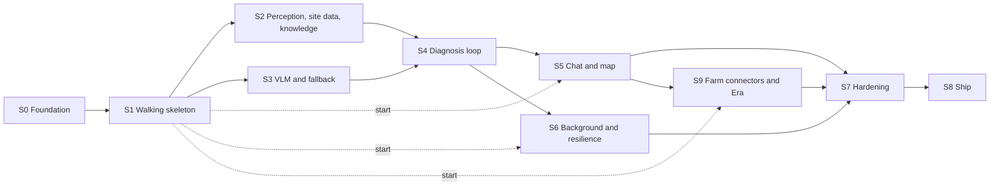

# PDM Backend Roadmap

> **Status:** Draft v0.19, 2026-10-23. v0.19: S2 ran on real models on the control plane: the seed loaded, the 3070's worker replaced the stub, the real-photo and knowledge exit checks passed, and species confirmation ran end to end, with three bugs found and fixed on branches and checked on the rig (masks never stored, a rerun on confirming the suggested species, a segfault on every stop of the CUDA worker) and false face blurs over foliage recorded. v0.18: S2's knowledge loading names the curation work behind its seed files (#46) and where it stands. v0.17: S2's weather and soil exit check passed on the control plane, which runs the migration runner and `seed-upload` from `feat/s2`. v0.16: S2 item 4 (live site data) is built: fresh fixtures, Soil Landscapes of Canada for SoilGrids' null Canadian points, and the time-zone label when reverse geocoding fails. v0.15: S2 work 1 and 2 ran on the rig: the 3070's perception worker loads every model on CUDA and the day-1 checks pass, and the real scans wait on a seed that matches the models. v0.14: gap 1 is built: `store` applies the numbered migrations and the loader's `knowledge.surql` after the schema, and `api` runs them at start (S2 work 6). v0.13: S1 is done: its laptop half ran on Oct 17 and its exit checks passed on the deployed control plane on the rig on Oct 20, both recorded in section 5; gap 9 (a stage the API never heard about stays open) and the six bugs found by running S1 are in section 13; gap 9 is fixed: `complete` sends the stage events the stream missed before the job's findings; a Score failure found on the rig (a plant whose species the knowledge base lacks) is fixed and recorded there too; after an audit of these fixes, a `guided` job's `complete` sends no catch-up stage events, the catch-up's wiring is tested through `api`'s fake store, gap 9 records its known limits, and a user's write that sets a species must name one the knowledge base holds (`400 invalid_request`). v0.12: aligns the slices with the app's roadmap ([frontend roadmap](../frontend/roadmap.md)): S4's exit check runs through the API's smoke script and the app's results screens join it on Oct 22, push waits on a paid Apple Developer account, S7's CORS follows app roadmap F8, and the `answer_block` and Insights contract changes are listed as gaps 7 and 8. v0.11: adds S9, farm connectors (Slack and Google Drive) tested on Era by Eon's simulators, with the agent evaluation ([docs/connectors](../connectors/README.md)); the gaps and tracking sections become 13 and 14. v0.10: S5 adds the Agent Memory mirror (work 7, exit check). v0.9: S1's hosting decision is made: the control plane runs on the rig behind Tailscale Funnel, with the ingress as a compose profile (section 5). v0.8: section 1 says the `images` job pushes to GHCR, now that its first run on `main` passed. v0.7: S0 is done; section 4 records its exit checks and the pull requests that closed it, and section 1 says what S0 added; section 13 says how S0 was tracked. v0.6: gap 6 adds that the perception worker reads its tensor names and thresholds from the manifest ([issue #12](https://github.com/aacruzgon/GreenLens/issues/12)). v0.5: S3's schema check is done: xgrammar enforces `anyOf` with `null`. v0.4: gap 6 is fixed: the loaders and `label_set_version` follow `ml/models/FORMATS.md`. v0.3: gap 6, found when PR #6 merged: the Rust loader doesn't read `ml/models/FORMATS.md`; section 1 says what `ml/` holds now. v0.2: every gap in section 12 now has a design, and the slices link to them: [infra](../infra/README.md) for CI, images and compose files, [database 1](../database/README.md#1-version-and-setup) for applying the migrations, [worker 15.1](worker.md#151-stub-vision) for stub vision, and [vision 6](../vision/README.md#delivering-model-files-to-the-backend) for model files; two bugs found on the way (the vector search's `k`, the bucket default) are fixed. v0.1: the backend's work for build week, as nine slices (S0–S8) from the code merged on Oct 16 to the final deploy. Each slice has its goal, its work, what it needs from the other tracks, its exit checks and the decisions it closes. Section 12 lists the gaps found while writing it.

Companion to the [backend architecture](README.md). Its [build plan](README.md#13-build-plan) and [architecture 14](../architecture/README.md#14-build-plan) say what is done on each date. This document says how the backend gets there: the order of the work, what each step depends on, and how we know a step is finished.

## Contents

1. [Where the backend stands](#1-where-the-backend-stands)
2. [How the slices work](#2-how-the-slices-work)
3. [The slices at a glance](#3-the-slices-at-a-glance)
4. [S0. Foundation](#4-s0-foundation)
5. [S1. Walking skeleton](#5-s1-walking-skeleton)
6. [S2. Perception, site data and knowledge](#6-s2-perception-site-data-and-knowledge)
7. [S3. VLM workers and the fallback](#7-s3-vlm-workers-and-the-fallback)
8. [S4. The diagnosis loop](#8-s4-the-diagnosis-loop)
9. [S5. Chat and the garden map](#9-s5-chat-and-the-garden-map)
10. [S6. Background work and resilience](#10-s6-background-work-and-resilience)
11. [S7. Hardening and S8. Ship](#11-s7-hardening-and-s8-ship)
12. [S9. Farm connectors and Era](#12-s9-farm-connectors-and-era)
13. [Gaps found while writing this roadmap](#13-gaps-found-while-writing-this-roadmap)
14. [Tracking](#14-tracking)

---

## 1. Where the backend stands

On Oct 16 the workspace in `backend/` holds every crate this design describes. Each crate is wired to its real adapters in `api`'s `wiring.rs` and the worker's `main.rs`. The tests run against fakes, mocks and the embedded SurrealDB engine.

| Crate | Source lines | Tests | Tested against |
|---|---|---|---|
| `domain` | 17,300 | 90 | Exact JSON of every contract shape |
| `store` | 10,600 | 33 | The embedded engine (`kv-mem`); 1 test needs a SurrealDB server |
| `blob` | 840 | 5 | An in-memory store; 1 test needs RustFS |
| `integrations` | 6,400 | 58 | Live fixtures recorded on Oct 15 and `wiremock` servers |
| `vision` | 7,600 | 54 | Synthetic images; no ONNX Runtime session is ever built |
| `knowledge` | 2,100 | 19 | Seed records in memory |
| `agent` | 7,900 | 60 | A scripted chat model |
| `pipeline` | 5,800 | 21 | Fake ports |
| `api` | 9,800 | 34 | The real router, driven with `oneshot`, over a mock store |
| `worker` | 4,800 | 34 | A fake broker on paused time and a scripted VLM backend |

What has **never run**:

- the binaries against a real SurrealDB, RustFS, Clerk, Anthropic, Open-Meteo or SoilGrids;
- an ONNX model, a VLM server or a GPU;
- the images on a host. S0 added CI (`.github/workflows/ci.yml`), the Dockerfile and `infra/dev.compose.yml`, so the code builds and runs its tests against the pinned SurrealDB and RustFS in CI, and every merge that changes the images pushes them to GHCR. No image has run on the control plane or the rig yet;
- any model file or knowledge seed on a host. `ml/` (PR #6) has the training and export code, the manifest's perception entries and the head formats, but no fetch step yet, and `api` and the worker both read `/models/manifest.toml` at start.

So the roadmap is mostly about **bringing the code up on real dependencies and proving it there**, plus filling the gaps in section 13. It isn't about writing the crates again.

---

## 2. How the slices work

- **A slice is vertical.** It takes one capability from the API to the database, the object store or a GPU, and ends in something we can watch work.
- **A slice is done when its exit checks pass on the deployed control plane or the rig**, not on fakes. Each check is concrete: a request, a command, a thing to kill.
- **The slices follow their dependencies.** S2 and S3 run in parallel on different GPUs. S5 and S6 can start once S1 is done, but each finishes only after S4.
- **Every change goes through a pull request to `main`** ([AGENTS.md, branches](../../AGENTS.md#branches-and-pull-requests)). Code and its documents change together. After a source change, run `backend/tools/docgen/regen_all.sh`; after a contract change, regenerate `backend/openapi.json`.
- **A slice closes its decisions.** Each open decision is assigned to the slice that has the evidence to settle it. When the slice ends, the decision is recorded in the document that owns it.

---

## 3. The slices at a glance

| Slice | Dates | Goal | Needs first | Other tracks |
|---|---|---|---|---|
| [S0](#4-s0-foundation) ✓ done | Oct 16 | CI, containers, local services | PR #8 merged | none |
| [S1](#5-s1-walking-skeleton) ✓ done | Oct 16–20 | A scan runs app → API → worker → SSE on the control plane, with stub vision. Its exit checks passed on the rig on Oct 20 (PR #40) | S0 | Clerk dev instance; the embedder and face-detector files (ml) |
| [S2](#6-s2-perception-site-data-and-knowledge) | Oct 18–19 | Real perception on the 3070, real weather and soil, the first knowledge loaded | S1 | Model manifest and ONNX files (ml); seed files (knowledge); the rig |
| [S3](#7-s3-vlm-workers-and-the-fallback) | Oct 18–21 | VLM jobs on the 5070 Ti and the 9070 XT, and the hosted fallback | S1 | VLM benchmark and choice (vision) |
| [S4](#8-s4-the-diagnosis-loop) | Oct 20–21 | Photo → diagnosis → plan with citations, on real models | S2, S3 | Reviewed profiles (knowledge); results UI (app, F3–F4, Oct 21–22) |
| [S5](#9-s5-chat-and-the-garden-map) | Oct 22 | Chat with tools, cards and memory; the garden map | S1 (start), S4 (finish) | Chat UI and map view (app) |
| [S6](#10-s6-background-work-and-resilience) | Oct 23 | Alerts, push, deletion cascades, the rig-failure test | S1 (start), S4 (finish) | Development build for push (app); a paid Apple Developer account |
| [S7](#11-s7-hardening-and-s8-ship) | Oct 24 | Security review, tuned limits and thresholds, evaluation run | S2–S6 | Evaluation set (vision) |
| [S8](#11-s7-hardening-and-s8-ship) | Oct 25 | Final deploy | S7 | Demo video, Devpost |
| [S9](#12-s9-farm-connectors-and-era) | Oct 21–23 | Farm connectors for Slack and Google Drive, tested on Era's simulators; the agent evaluation | S1 (start), S5 (finish) | Connectors screen (app); Slack app and Google OAuth client |

---

## 4. S0. Foundation

**Goal:** every later slice merges through a green pipeline and runs in containers.

**Work**

1. Merge PR #8, the workspace.
Designed in [infra](../infra/README.md): CI in section 2, images in section 3, compose files in section 4, with its own work items in [section 9](../infra/README.md#9-roadmap).

2. Add a CI workflow, `.github/workflows/ci.yml` (first named `backend.yml`), with these steps:
   - `cargo fmt --all --check`;
   - `cargo clippy --workspace --all-targets -- -D warnings`;
   - `cargo test --workspace`, with cargo-nextest 0.9.148;
   - `regen_all.sh` followed by `git diff --exit-code docs/backend`, then `check_fences.py` and `checklinks.py`;
   - `cargo check -p worker --features cuda` and `cargo check -p vision --features cuda,migraphx,webgpu`;
   - `python3 .claude/skills/rust/scripts/check_examples.py`.

   Then add the checks to the `main` ruleset. AGENTS.md says to add each check once its workflow exists.
3. Add a live job to the workflow. It starts SurrealDB `v3.3.4` and RustFS `1.0.1` as service containers, pinned by digest, and runs the two ignored tests (`cargo test -- --ignored`) and `check_examples.py --live`.
4. Add `backend/Dockerfile`, a multi-stage build that uses the release profile:
   - an `api` image;
   - a `worker` image for each execution provider, carrying the ONNX Runtime 1.31 library its `ORT_EP` needs ([worker 11](worker.md#11-multi-vendor-gpus)).

   Images are pushed to the registry and deployed by digest.
5. Add `infra/dev.compose.yml` with SurrealDB and RustFS for local work, and an `.env.example` with placeholder values only.

**Exit checks**

- A pull request with a deliberate Clippy warning fails CI.
- `docker compose -f infra/dev.compose.yml up`, then `cargo test --workspace -- --ignored`, passes on a laptop.
- `docker build` produces the `api` image and the CUDA `worker` image.

**Done on 2026-10-16,** in pull requests #17 (CI), #19 (images), #22 (dev compose and env files), #23 (CI disk) and #24 (CI in stages, with the `images` and `release` jobs). Each pull request had an independent review, and its findings were fixed before the merge.

- ✓ A pull request with a deliberate `clippy::len_zero` warning failed `lint` (#21, closed).
- ✓ `docker compose -f infra/dev.compose.yml up -d`, then `cargo nextest run --workspace --run-ignored only`, passed (2 of 2) on a laptop.
- ✓ `docker buildx bake` built `api`, `worker` and `worker-cuda` for linux/amd64 on a laptop. `api` exits with `CLERK_ISSUER is required`, as UID 10100.
- ✓ `live` passed on pushes to `main`, and the `main` ruleset requires the one check `ci` ([infra 2](../infra/README.md#required-checks)).

What S0 changed in the design, each found by running it:
- SurrealDB's named volume needs `surrealdb-volume` ([database 1](../database/README.md#1-version-and-setup)).
- The workflow is `ci.yml`, in stages, with one required check ([infra 2](../infra/README.md#2-ci)).
- `security` checks RustSec advisories with cargo-deny.
- The `images` job pushes on `main`, and a `v*` tag reuses `main`'s digests in a GitHub Release.
- `api` has its own `heic` feature.

---

## 5. S1. Walking skeleton

**Goal:** a scan travels from the app (or a script) through the API and the broker to a worker and back over SSE. It runs on the deployed control plane with stub vision. This is architecture 14's "end-to-end skeleton".

**Already in code:**
- Clerk auth and the account tombstone.
- Membership checks.
- Uploads with the CPU blur check.
- Submit and the scan state machine.
- The job broker with leases, heartbeats and requeue.
- Resumable SSE.
- The fallback worker.

**Work**

1. **Stub vision in the worker** ([worker 15.1](worker.md#151-stub-vision), work items ST1–ST7). It answers `perception` jobs with canned, marked results, so the loop runs without GPUs or model files. It must report the label versions the API queues (`STUB_LABEL_SET_VERSION`, `STUB_CLASSIFIER_LABELS_VERSION`), or submit answers `503`.
2. **The control plane** ([architecture 12](../architecture/README.md#12-deployment); the compose file, bootstrap and secrets in [infra 4–7](../infra/README.md#4-compose-files)):
   - `infra/control-plane.compose.yml` with `caddy`, `api`, `surrealdb`, `rustfs` and `fallback-worker`;
   - the Caddyfile and the ingress profiles: `tailscale` (Funnel) on the rig, `cloudflare` kept as the alternative ([infra 5](../infra/README.md#5-ingress));
   - the database users of [database 1](../database/README.md#1-version-and-setup): root to apply the schema, `api` as `EDITOR`;
   - the bucket and identities of [storage 2](../storage/README.md#2-bucket-keys-and-access);
   - secrets in env files that are never committed;
   - the `stop_grace_period` values from [README 12](README.md#12-builds-and-deployment).
3. **Clerk's development instance:** the issuer, the JWKS and the Svix webhook to `POST /webhooks/auth`. Never use the production instance without asking.
4. **The CPU models `api` loads:** the text embedder (`snowflake-arctic-embed-xs`, 384 dimensions, pinned by hash), its tokenizer and the face detector. The S1 manifest's three entries, with verified hashes, are in [vision 6](../vision/README.md#the-s1-manifest); the `model-fetch` step fills `/models` (work items M1–M4).
5. **A smoke script in `backend/tools/smoke/`.** It mints a Clerk session token through the Backend API (`POST /v1/sessions`, then `/v1/sessions/{id}/tokens`) with an `sk_test_` key and refuses any other key. A Clerk testing token only bypasses bot detection on the Frontend API, so it can't sign in. It creates a garden, uploads a photo, submits, and follows the stream. Then it drops the connection and resumes with `Last-Event-ID`.

**Exit checks**

- The smoke script passes against the deployed control plane.
- Killing the worker mid-job requeues the job once its lease runs out ([contracts 5](../architecture/contracts.md#5-worker-api-and-jobs)), and another worker finishes it.
- Restarting `api` during a scan, then resuming the stream, replays every missed event once and no event twice.
- The stored copy of a photo with a face has the face blurred, where [architecture 11](../architecture/README.md#11-security-privacy-and-safety) says it must, checked by eye with `smoke.py --face-photo`. A face doesn't get the photo refused. Only a blurry or badly exposed photo gets `422 image_quality` (`crates/vision/src/upload.rs`).

**Progress on 2026-10-17 (laptop),** against `infra/dev.compose.yml` with SurrealDB v3.3.4 and RustFS 1.0.1, on macOS arm64:

- ✓ `python3 -m ml.models.fetch --for api` into an empty directory fetched the three S1 files with matching hashes. A second run downloaded nothing, and a locally corrupted file was fetched again.
- ✓ `api` (release, `--features heic`) started in about 5 s with `MODELS_DIR` set to that directory and ONNX Runtime 1.31.0 on the CPU (osx-arm64). It checked the manifest hashes. ort 2.0.0-rc.14 logs that it was designed for ORT 1.29.
- ✓ Clerk development instance: `api` verified Backend-API session tokens against `{CLERK_ISSUER}/.well-known/jwks.json` and upserted the user on the first request. A bad token got `401`. The tokens carry no `azp` and live 60 s.
- ✓ Stub perception worker (`--caps perception --stub-vision`) with `STUB_LABEL_SET_VERSION=d4f0f0534fb74a8d` and an empty `STUB_CLASSIFIER_LABELS_VERSION`, the empty knowledge base's values: submit queued the perception job, all five perception stages streamed, and the scan went on to `context` (real Open-Meteo weather) and `retrieve`. The smoke script passed the full flow, then dropped the stream after 3 events and resumed with `Last-Event-ID` with no gaps and no repeats.
- ✓ Kill check: a stub with a 30 s stage delay was killed at the first `stage_started`, and a second stub started at the default 150 ms. The job showed `requeues: 1`, `status: done`, `worker: dev-stub-perception-2`. The stream showed `plant_check` started again after the requeue (seq 4, then 6) and completed (seq 9), with seq 1..19 and no gaps or repeats, in about 27 s end to end, most of it waiting for the killed stub's heartbeat to go stale. The smoke script now fails the check unless the stage starts again, because a fast stub can finish the stage before the kill lands.
- ✓ Face check: OpenCV's sample portrait (`samples/data/lena.jpg`) uploaded with `smoke.py --face-photo` was stored with its face found and blurred to a flat patch, checked by eye.
- ✓ API restart check: the stream was dropped after seq 5 and `api` restarted (healthy in 3–4 s). The resume replayed every stored event once and none twice.
- ✓ The control-plane compose file renders for the profiles none, `tailscale,stub,seed` and `cloudflare`. Both bootstrap scripts ran twice, and the second run changed nothing ([infra 7](../infra/README.md#first-time-bootstrap)).

**Exit checks on the rig, 2026-10-20: S1 is done.** The control plane ran on the 3070 host (Debian 13) from `infra/control-plane.compose.yml` with `COMPOSE_PROFILES=tailscale,stub`, behind Tailscale Funnel at `https://pdm-cp.<tailnet>.ts.net`. CI pushes images to GHCR only from `main`, so `api` and `worker` were built from the S1 branch, pushed to a registry on the host (`127.0.0.1:5000`) and deployed by digest with `infra/deploy.sh`. Once the branch merges, `main`'s GHCR digests replace them.

- ✓ Bootstrap: both scripts ran twice against the pinned images, and the second run changed nothing (users, policies and the bucket compared before and after). `api` is an `EDITOR` on the database.
- ✓ `model-fetch` fetched five files with a read-only `HF_TOKEN`, among them the BioCLIP labels and the disease head from the private `pdm-models` repository, and exited 0 before `api` started.
- ✓ Funnel: the node joined with a one-off key tagged `tag:pdm-cp` and got a Let's Encrypt certificate in about 35 s. `/healthz` answered 200 through public DNS.
- ✓ The smoke script against the public URL reached `planned`: 45 events, seq 1..45 with no gaps or repeats, the drop and `Last-Event-ID` resume, real Open-Meteo weather, and the fallback worker's VLM job (3.5 s) and plan (9.7 s).
- ✓ Kill check: a stub at `STUB_STAGE_DELAY_MS=10000` was killed at `plant_check` (seq 4). The job was requeued about 2 minutes later, and the replacement started the stage again (seq 6) and completed it (seq 9).
- ✓ Restart check: `api` restarted mid-perception, with the stub at 3 s a stage. The resume replayed every stored event once and none twice. `complete` sent the four lost `stage_completed` events (`duration_ms` 0) before the findings, so no stage stayed open (gap 9).
- ✓ Face check: OpenCV's sample portrait, uploaded through Funnel, was stored with its face blurred to a flat patch, checked by eye.
- ✓ `docker compose stop api` landed 2 s into a 7 MB upload. The upload finished with `201`, and `api` exited 0 after 31 s. Every stop takes the full 30 s drain (`SHUTDOWN_DRAIN_S`): `api` logs `background tasks still running at exit`, because the scheduler's tasks don't end on shutdown. That is within the 190 s budget; S6 can look at it.
- ✓ Clerk webhook: an endpoint on the development instance for `user.deleted`, at `/webhooks/auth`. Deleting the smoke user in Clerk gave a signed delivery and `204`, and the cascade removed the user, its gardens, scans and images, and every object in `pdm-images`. `deleted_user` holds the Clerk id.
- The run found one bug, now fixed: the Score step failed for a plant whose suggested species the knowledge base lacks ([section 13](#13-gaps-found-while-writing-this-roadmap)).

**Decided before it started (2026-10-16):** where the control plane runs ([architecture open decision 2](../architecture/README.md#15-open-decisions)): on the rig, behind Tailscale Funnel. Everything in S1 except the deployed exit checks runs on a laptop against `infra/dev.compose.yml`, because the worker uses stub vision and `api`'s models run on the CPU; the 3070 is first needed in S2.

---

## 6. S2. Perception, site data and knowledge

**Goal:** real perception results from the RTX 3070, real weather and soil for a garden, and the first knowledge records in the database.

**Already in code:**
- `vision`: the ONNX Runtime sessions, BioCLIP 2, the leaf detector, SAM, the disease head, face blurring, WebP and depth.
- The worker's perception path.
- `integrations` for Open-Meteo, SoilGrids and the geocoders.
- `knowledge`'s index and the `store` reads behind it.

**Work**

1. **The rig:**
   - the perception worker with its GPU pinned by UUID ([worker 12](worker.md#12-deployment)). Done: the 3070 is in the control-plane host, so the worker is in `control-plane.compose.yml` behind the `perception` profile ([infra 4](../infra/README.md#infracontrol-planecomposeyml), item 10);
   - ONNX Runtime 1.31 on CUDA 13. Done: `worker-cuda` from `main` at `6909aa7`;
   - the model manifest from `ml/models`, our files from the private Hugging Face repository `pdm-models`, fetched by `model-fetch` ([vision 6](../vision/README.md#delivering-model-files-to-the-backend), work items M5–M9). Done: the 10 files of `api`, `fallback` and `perception` fetched and hash-checked on the rig.
2. **The first real ONNX sessions.** This is the first time ONNX Runtime has ever run in this code. Check each model's input and output shapes against its manifest entry, then run the vision day-1 checks ([vision evaluation 7](../vision/evaluation.md#7-day-1-checks)). Done on 2026-10-20: the worker opened all five sessions on the 3070, and start-up checks each file's tensor names against the manifest. The day-1 script of [#114](https://github.com/aacruzgon/GreenLens/pull/114) passed: CUDA matches the CPU within 2e-7 at batches 1, 4 and 16, and every perception model opens and runs on CUDA. Its budget run fits the worker's default caps (detector 8, SAM encoder 2, decoder 16, BioCLIP 16): 4.6 GB at peak with the arena limits, 6 shots and 40 crops in 2.0 s. Twice those caps fail to allocate: past the detector session's 1 GiB arena limit, and on the card without the limits.
3. **Uploads on real models:** face blurring with the real detector, WebP at the stored sizes, and the depth upload path. The LiDAR day-1 results settle the camera conventions ([vision 15](vision.md#15-open-questions), item 6). On the rig (2026-10-20): face blurring with YuNet ran in S1. `smoke.py --depth-check` against the deployed `api` stored a 12 MP HEIC at 1200×1600 without depth and at 1536×2048 with a synthetic depth map. It also found that a HEIC's sensor frame is lost on decode, so a sensor-frame depth map sent with a HEIC is refused ([vision 15](vision.md#15-open-questions), item 7, with the proposed fix).
4. **Live site data:**
   - fresh fixtures for Open-Meteo, SoilGrids and the geocoders;
   - SoilGrids has no data in central Toronto, so decide its replacement there ([architecture open decision 10](../architecture/README.md#15-open-decisions));
   - a fallback label when reverse geocoding fails ([integrations 19](integrations.md#19-open-questions), item 4).

   **Built on 2026-10-20** (branch `feat/s2-site-data`): fixtures recorded again live, with Nominatim's and Zippopotam's answers added; the shapes hadn't changed since Oct 15 ([integrations 7–9](integrations.md#7-open-meteo-weather)). SoilGrids is still null across Toronto, Guelph and Ottawa, so Soil Landscapes of Canada v3.2 answers a null Canadian point before the probes, from a 0.9 MB lookup built by `tools/slc/build_slc.py`; open decision 10 holds the evidence, *proposed* for the team to confirm. A failed reverse lookup labels a GPS garden "Toronto time zone" and creates it. Left: the deployed exit check, and relabelling a fallback-labelled garden when Nominatim answers again.
5. **Species confirmation** end to end: the perception top 3, the card, and the confirmed species on the scan. Ran on the control plane (2026-10-23) with a whole-plant shot and a leaf close-up of a tomato with early blight ([PlantDoc](https://github.com/pratikkayal/PlantDoc-Dataset), CC BY 4.0): `species_suggested` gave tomato 0.967, potato 0.032 and pepper with `needs_confirmation`; confirming tomato set the plant `confirmed`; the close-up's top problem was `tomato_early_blight` (0.575); the scan asked the early-blight indicator ("dark rings inside them, like a target?"), and after a yes it reached `planned` with early blight as the primary (`uncertain`, a provisional plan of safe steps with citations). Confirming the species the run already worked with started a new run, against architecture 6.2 step 4: the scan's `working_species` was never set from the suggestion. Fixed on `fix/scan-working-species`, and checked on the rig: `species_confirmed` with `rerun: false`, the question kept.
6. **Knowledge loading:**
   - done: the migration runner applies the numbered files and the loader's `knowledge.surql` after the schema ([database 1](../database/README.md#1-version-and-setup), [store 4](store.md#4-connecting-and-the-schema)); M5 (reading `label_set_version` from `knowledge_meta`) and M7 (the live CI job) are open;
   - add the `seed-upload` one-shot container before `api`. Done: deployed with the `seed` profile on 2026-10-21; with `main`'s empty seed it listed `knowledge/species/` with PDMSEED01's keys and put nothing, and a wrong key exits 1. `api` started on the migration runner, which applied the schema with its `migration` table and found no numbered or knowledge file;
   - load the first species and organism files. They come from the curation in [#46](https://github.com/aacruzgon/GreenLens/issues/46) ([vision dev-roadmap 9](../vision/dev-roadmap.md#9-decisions-and-blockers), D5): the loader is merged (#48), the tomato slice is drafted in [#51](https://github.com/aacruzgon/GreenLens/pull/51) and loads once a teammate signs it, and the other crops follow the same scripts ([training 10](../vision/training.md#running-it)). Done on 2026-10-23: `main` at `2a54b9e` (#51, #131, #143) deployed, and `api` logged `migration applied file=knowledge.surql`: 20 species (tomato in full, 19 `label_only`), 5 organisms and 134 chunks, label set `edb29fe878952e7b`, classifier labels `disease-head-v3c-2026-10-20`. The seed names no reference photos yet, so `seed-upload` put none;
   - check vector search with the real chunks. A bound `k` failed to parse on 3.3.4; `search_chunks` now passes it as a literal, tested on the embedded engine ([store 22](store.md#22-open-questions), item 4). Done: the third exit check below.

**Needs:** the manifest, the ONNX exports, the label matrices and `classifier_labels.yaml` (ml); the seed files (knowledge); the rig set up as in [setup](../setup/README.md).

**Unblocked on 2026-10-23.** The seed loaded, `model-fetch` brought the seed's matrix and disease head v3c, and the control plane switched from the `stub` profile to `perception` with `main`'s `worker-cuda`. Its heartbeat names `ort_ep: cuda`, label sets `233482ce598f591b,edb29fe878952e7b` and classifier labels `disease-head-v3c-2026-10-20`. What follows was the state before.

**Blocked on the seed (2026-10-20).** A real scan needs a loaded knowledge base whose label set and classifier labels match the worker's models. Without one, `submit` answers `503 upstream_unavailable` (`LabelsNotLoaded`). Jobs aren't routed by label set, so the real worker and the stub can't both run. The stub keeps answering on the deployed control plane until then. The worker's provisional matrix `233482ce598f591b` has 20 species and no organisms. `disease-head-v1d-2026-10-16` names 14 species and 22 problems. The tomato seed ([#51](https://github.com/aacruzgon/GreenLens/pull/51)) has one species, five organisms and no `classifier_labels.yaml`. The seed and the M12 matrix built from it come first ([comment on #51](https://github.com/aacruzgon/GreenLens/pull/51#issuecomment-6303970259)). Then the first exit check runs.

**Exit checks**

- A real leaf photo gives the species top 3, leaf regions and masks, in a `perception` result the API accepts. ✓ On the control plane (2026-10-23): a tomato with early blight gave tomato 0.967, potato 0.032 and pepper, 6 leaf regions and a plant region, each with a mask, and the scan reached `planned` with 69 events. `api` accepted the masks but stored none (`mask` table empty, no `mask_url`): fixed on `fix/store-perception-masks`, and on the rig a second photo then stored 4 masks for its 4 leaves, each served as a PNG whose extent matched its box. The disease stage reads close-ups only, so a `whole_plant` upload like `smoke.py`'s skips it with `no_leaves_found`.
- `GET /gardens/{id}/weather` returns the summary from live Open-Meteo, and a new garden's `soil_profile_status` moves from `pending` to `ready`, or to `unavailable` where SoilGrids has no data. ✓ On the control plane (2026-10-21, `feat/s2` at `5c2bb95` from the local registry): `smoke.py --site-check` made a GPS garden in central Toronto, labelled "Toronto, ON", whose weather came from live Open-Meteo (10.3 °C, 68 % RH, a 14-day forecast), and whose `soil_profile_status` moved from `pending` to `ready` within seconds, from Soil Landscapes of Canada since SoilGrids has no data there (pH 7.4, 29 % clay at 0–5 cm). The same run's scan reached `planned` on stub vision with 45 events, no gaps or repeats.
- A knowledge search returns ranked chunks from the loaded seed. ✓ On the control plane (2026-10-23): queries embedded with the pinned text model and its query prefix, run through `store`'s `SEARCH_CHUNKS` with `k = 5` against the deployed database, returned ranked chunks; "how do I treat early blight on tomato leaves" gave OMAFA's and Iowa State's early blight and Septoria passages first (cosine 0.75 to 0.67).

**Found on real models (2026-10-23):**
- **The CUDA worker died with SIGSEGV on every stop** (exit 139, also on `main`'s image): its inference thread was detached, so `exit` unloaded the CUDA libraries while it released its sessions. Fixed on `fix/worker-cuda-shutdown`; on the rig the fixed image stops with exit 0 and logs `stopped`.
- **Face blurring blurs foliage.** YuNet at its 0.3 threshold put 6 boxes over leaves on one 5 MP garden photo and 3 on another, none on a leaf close-up, so perception and the VLM see those leaves blurred. The threshold is the vision track's to tune on plant photos ([vision models 9](../vision/models.md#9-face-detector)).
- **The demo beds:** with the seed loaded, `demo_garden.py` gave beds 1, 3 and 5 pepper, tomato and bean; kale and garlic aren't in the seed, and its squash is the genus *Cucurbita*, so zucchini (*Cucurbita pepo*) doesn't match ([EON E9.0](../EON/README.md#e9-the-demo-garden)).

**Decides:**
- the crops ([architecture open decision 3](../architecture/README.md#15-open-decisions));
- the knowledge sources (7);
- SoilGrids (10);
- the stored size of a photo without depth ([vision 15](vision.md#15-open-questions), item 2).

---

## 7. S3. VLM workers and the fallback

**Goal:** `vlm`, `verify` and `guided` jobs run on the RTX 5070 Ti and the RX 9070 XT, and on the hosted fallback when the rig is away.

**Already in code:** the VLM adapters, the per-call schemas and their decoding, the hosted profile with schema sanitising, and the fallback worker ([worker 8–10](worker.md#8-the-vlm-adapters)).

**Work**

1. **The VLM sidecar on the 5070 Ti:** vLLM with xgrammar, running the checkpoint chosen by the benchmark ([architecture open decision 4](../architecture/README.md#15-open-decisions)).
2. **The AMD day-1 check on the 9070 XT.** It decides between vLLM on ROCm and llama.cpp on Vulkan (open decision 19). If llama.cpp wins, check whether a dropped connection frees its slot ([worker 17](worker.md#17-open-questions), item 4).
3. **The schema check:** done on 2026-10-16: xgrammar 0.2.7 enforces `anyOf` with `null` ([contracts open question 31](../architecture/contracts.md#12-open-questions); [worker 17](worker.md#17-open-questions), item 3; [vision 15](vision.md#15-open-questions), item 4). Had it failed, the nullable shapes would have changed before S4.
4. **`VLM_SLOTS` for each card, from the benchmark** (open decision 15).
5. **The fallback:**
   - one live hosted call confirms the box format and the stripped schema keywords ([integrations 19](integrations.md#19-open-questions), item 6);
   - time a full 8,000-token call against the doubled `max_runtime` ([worker 17](worker.md#17-open-questions), item 2).

**Exit checks**

- A `vlm` job on each card returns findings that pass the schema and the API's checks.
- With every rig worker stopped, the fallback claims a queued job after 15 seconds and completes it.

**Decides:** open decisions 4, 15 and 19.

---

## 8. S4. The diagnosis loop

**Goal:** a photo becomes a diagnosis and an action plan with citations, on real models. The scripted early-blight scan runs end to end.

**Already in code:** knowledge ranking and scoring, the pipeline's steps with step claims and the sweep, questions and provisional plans, fusion, measurement, and the plan writer with validation and the dose check.

**Work**

1. Run the early-blight scan on the full stack: perception, VLM, retrieve, verify, score, plan.
2. **Step claims under failure.** Kill `api` in the middle of a step. On restart, the sweep must recover the claimed step, and the scan must finish with no step run twice ([flows](flows.md)).
3. **Questions:** an indicator question, its answer, a late answer and a re-plan, as [contracts 3](../architecture/contracts.md#scan-lifecycle) orders them.
4. **Measurement with LiDAR depth:** measurable indicators answered from a real depth map.
5. **The plan writer on the hosted LLM:** validation, citations and the dose check on every step.

**Needs:** reviewed profiles (knowledge). The results UI is not a dependency of the exit checks: the app builds it on Oct 21–22 (F3–F4 in the [app roadmap](../frontend/roadmap.md)), after S4 starts. S4's exit checks run through the API's smoke script, and the app's results screens join them on Oct 22.

**Exit checks**

- The early-blight scan reaches `planned` with a diagnosis, indicator evidence and a plan whose steps cite their sources.
- The `api` kill test passes.
- A late answer creates a new plan version and supersedes the old plan's tasks.

**Decides:**
- the confirmed margin ([knowledge 12](knowledge.md#12-open-questions), item 2);
- empty candidate sets (item 3);
- a plan-writer outage on a first plan ([pipeline 17](pipeline.md#17-open-questions-and-decisions), item 2);
- the verification-answer timeout ([architecture open decision 14](../architecture/README.md#15-open-decisions));
- the measurement thresholds (17), which are a first cut, finished in S7.

---

## 9. S5. Chat and the garden map

**Goal:** a user chats about a plant, the agent uses its tools, proposes changes as confirmation cards, and remembers what it should. The garden map works.

**Already in code:** chat turns, the tools, confirmation cards, memory, the dose check on every sentence, the LLM classifier, Jev's client, and the garden map endpoints with neighbour and spacing rules.

**Work**

1. **Chat turns on the hosted model,** checking how thinking blocks behave when the context is rebuilt every turn ([agent 18](agent.md#18-open-questions), item 2).
2. **Tools against real data:** `view_image`, `get_forecast`, `get_soil_profile`, `revise_plan` and the others. Then the card's confirm and refuse paths.
3. **Memory:** extraction, private until shared, and read by the plan writer only once shared.
4. **The text classifier:** use Jev if early access arrived ([architecture open decision 8](../architecture/README.md#15-open-decisions)); otherwise the LLM fallback.
5. **The garden map:** a mapping session, the neighbours and the spacing warnings.
6. **Local poison-control numbers** in the deployment's configuration ([agent 18](agent.md#18-open-questions), item 10).
7. **Agent Memory** ([database: Agent Memory](../database/agent-memory.md)): create the `pdm-dev` context and a key limited to `gardens/*`, set the three `AGENT_MEMORY_*` variables, and check that shared memories are recorded as beliefs, that a newer memory with the same topic supersedes the older one, that the chat context, the plan writer and `search_memory` read them, and that `GET /plants/{plant_id}/beliefs` and the deletion cascades work. Measure the cost on Studio's Usage page.

**Exit checks**

- A chat about the early-blight scan calls a tool, proposes a plan change as a card, and applies the change once confirmed.
- A sentence with an unsafe dose never reaches the stream.
- A memory saved in chat stays private until shared.
- A shared watering note and a newer one about the same plant leave one current belief and one superseded in `GET /plants/{plant_id}/beliefs`. A private chat memory never appears in Agent Memory. With the three variables unset, `available` is `false` and chat works. Deleting the plant leaves nothing under its scope within one sweep (10 s), and deleting a shared memory removes it from the beliefs while its plant's others stay.

**Decides:** open decisions 6 and 8.

---

## 10. S6. Background work and resilience

**Goal:** the scheduled work runs, deletions clean up everything they should, and the system survives losing the rig.

**Already in code:** the scheduler's eight tasks (`requeue`, `sweep` with question continuation, `idle`, `cleanup`, `weather` with forecast alerts and plan triggers, `soil`, push `receipts` and `orphans`), Expo push, the deletion runner with the account cascade, and the RustFS delete queue.

**Work**

1. **Forecast alerts** from live forecasts: each condition alerts once, and its tasks are created.
2. **Push** to a development build of the app.
3. **Deletions against real RustFS and Clerk's development instance:**
   - a plant, a garden and an account (`DELETE /me`), including the tombstone and the Clerk deletion;
   - a restart in the middle of a cascade resumes it.
4. **The orphan sweep** removes objects no record references. Resumed plant and scan deletions leave their objects to it ([api 23](api.md#23-open-questions), item 4).
5. **The rig-failure test:** kill the rig in the middle of a scan. The fallback must take over within about 45 seconds ([architecture 14](../architecture/README.md#14-build-plan)).

**Needs:** a development build for push (app). Push from a development build is blocked until the team buys a paid Apple Developer account, because a free Apple ID can't use APNs. Until then the alert inbox covers forecast alerts, and push is tested only up to Expo's push service (the sender and the receipts).

**Exit checks**

- A frost forecast gives one alert, not one per sweep.
- After `DELETE /me`, no record, object or Clerk user of that account remains, and the account's old session token gets `401`.
- The rig-failure test passes, and the scan finishes on the fallback.

---

## 11. S7. Hardening and S8. Ship

**S7 goal (Oct 24):** feature freeze, then make the running system safe and tuned.

1. **Security review against [architecture 11](../architecture/README.md#11-security-privacy-and-safety):**
   - auth on every route and `404` to non-members;
   - signed image URLs;
   - EXIF stripped and faces blurred;
   - no secrets, tokens, signed URLs or locations in logs;
   - CORS limited to the configured origins. [App roadmap F8](../frontend/roadmap.md) settles the web origin (a subdomain needs CORS, the same origin doesn't) and gives the app's request and body sizes before the Oct 24 review.
2. **Limits:** set the general rate limit and the JSON body limit from what the app actually sends (the sizes are in [app roadmap F8](../frontend/roadmap.md)). Both are placeholders today ([api 23](api.md#23-open-questions), item 2).
3. **Thresholds:** the weather and trigger thresholds and the measurement thresholds, from the evaluation set (open decisions 17 and 20; contracts open question 27).
4. **The evaluation run** with [vision evaluation](../vision/evaluation.md), with its numbers recorded.
5. **Operations:** SurrealDB backups as [database](../database/README.md) describes them, the JSON logs with request ids, and a short runbook for restarting each service.

**S7 exit check:** every review finding is fixed or recorded as accepted, and the evaluation numbers are in the vision documents.

**S8 goal (Oct 25):**
- deploy the final images by digest and tag the release;
- re-run the S1 smoke script and the S4 early-blight scan on production settings;
- freeze the deployment until Demo Day.

---

## 12. S9. Farm connectors and Era

**Goal:** a garden owner connects the farm's Slack and Google Drive, the chosen channels and folder sync into the garden, and the chat and the plan writer cite them. Every part is tested against Era by Eon's simulators, and the agent is scored on a synthetic farm ([docs/connectors](../connectors/README.md)).

**Already in code:** nothing. The scheduler, the text embedder, the vector search within a garden, the tool registry and the deletion runner it builds on are.

**Work**

1. **Contracts and schema** ([connectors 11](../connectors/README.md#11-changes-to-other-documents)): the `domain` types, the endpoints, `search_farm_records`, the deletion cascades, `connector` and `farm_record`, `backend/openapi.json` and contracts §8–9 in one pull request.
2. **Adapters in `integrations`:** `SlackClient` and `DriveClient` over `reqwest`, read methods only, with a configurable base URL; the OAuth exchanges and revocations; Tier 1 pacing and `Retry-After` ([connectors 6](../connectors/README.md#6-sync)).
3. **Tokens:** AES-256-GCM sealing under `CONNECTOR_KEY` with the connector id as associated data; the signed OAuth state and the device-bound `complete` step ([connectors 5](../connectors/README.md#5-connecting-and-tokens)).
4. **Sync:** the `connectors` scheduler task, the per-team Slack pacer, the `users.info` cache, permalinks built at sync, chunking, embedding by `text_hash`, the daily trailing window, `changes.list`, the 180-day cleanup.
5. **The agent:** the tool, the plan writer's farm-record hits, the `farm_citations` fields and their validation rule, and the dose rule for spray logs ([connectors 7](../connectors/README.md#7-the-agent)).
6. **Era in dev and CI:** the `era` compose profile with the pinned images; the Maple Row Farm fixture; the `era` CI job in `ci`'s `needs` with the client, fault, `day1` → `day2` and read-only tests ([connectors 9.1–9.2](../connectors/README.md#91-the-farm-fixture)).
7. **The agent evaluation:** `backend/tools/era-eval` over `answers.toml`, run on each candidate chat model ([connectors 9.3](../connectors/README.md#93-the-agent-evaluation)).
8. **The demo garden:** the `demo` profile's simulators on a private network with `SIMCORE_ADMIN_TOKEN`, and the `era` connectors seeded at start-up ([connectors 9.4](../connectors/README.md#94-the-demo)).
9. **Real accounts:** a Slack app with the five bot scopes, and a Google Cloud OAuth client in Testing with the team as test users; one real connect, sync and disconnect each.

**Needs:** the **Farm connectors** screen and the connect flow (app); the Slack app and the Google OAuth client (whoever holds the team's accounts).

**Exit checks**

- On the deployed control plane, a scan of bed 3 in the demo garden gives a plan that cites the spray log. A chat question about the crew's reports cites a `#field-reports` message, links to it, and repeats no rate.
- The `era` CI job passes, including a throttled sync that finishes on a later run and a `day2` sync that picks up the quarter's changes.
- The evaluation has run on at least two models, and its table is in connectors 9.3.
- A real Slack workspace and a real Drive folder connect, sync and disconnect. After disconnecting, the vendor's token is revoked and no `farm_record` of the connector remains.

**Decides:** architecture open decision 6, with the evaluation's numbers, and connectors open questions 1 and 5.

---

## 13. Gaps found while writing this roadmap

Gaps 2 to 5 have a design; gap 1 is built; gap 6 is fixed; gaps 7 and 8 have no slice yet; gap 9 is fixed. The designs are proposals until their slice builds them; each ends with numbered work items and exit checks.

| # | Gap | Slice | Designed in | Work items |
|---|---|---|---|---|
| 1 | Nothing applied the knowledge migration: `store` applied only `schema.surql`, and `api` only read the knowledge | S2 | **Built:** [database 1](../database/README.md#1-version-and-setup), with [store 4](store.md#4-connecting-and-the-schema) and [api 4](api.md#4-start-up-and-shutdown): numbered, hash-locked migrations plus the loader's regenerated `knowledge.surql`, each in its own transaction with a `migration` record; `api` applies them at start and checks its embedder against `knowledge_meta` | M1–M4 done; M5 and M7 open ([store 4](store.md#4-connecting-and-the-schema)) |
| 2 | The worker had no stub vision for the walking skeleton | S1 | [Worker 15.1](worker.md#151-stub-vision): `--stub-vision`, refused in a release build without `PDM_ALLOW_STUB_VISION=1`, canned results marked `stub` | ST1–ST7 |
| 3 | No CI, no containers, no `infra/` (S0's part done: CI, images, dev compose) | S0, S1, S2, S3, S8 | [Infra](../infra/README.md): CI, images, the three compose files, ingress, secrets, deploys by digest, backups | [Infra 9](../infra/README.md#9-roadmap) |
| 4 | Model files and seed data come from `ml/`, which had no delivery path | S1, S2, S3 | [Vision 6, delivering model files](../vision/README.md#delivering-model-files-to-the-backend): one manifest, our files in a private Hugging Face repository (the team's choice), `sources.toml` and `fetch.py` | [M1–M11](../vision/README.md#roadmap) |
| 5 | Pipeline open question 3 was out of date | none | Resolved: the run's evidence fields are in the schema ([pipeline 17](pipeline.md#17-open-questions-and-decisions)) | none |
| 6 | The Rust loader didn't read `ml/`'s file formats: a label matrix and the plant probe failed to load, every disease class would have loaded as `healthy`, and `store`'s `label_set_version` differed | S2 | **Fixed:** the loaders read [`ml/models/FORMATS.md`](../../ml/models/FORMATS.md), heads must name the manifest's `bioclip` export, and `label_set_version` passes the format's test vector ([vision 6](../vision/README.md#delivering-model-files-to-the-backend)). The perception worker takes its tensor names and thresholds from the manifest and refuses fp16 on the CPU ([issue #12](https://github.com/aacruzgon/GreenLens/issues/12)) | none |
| 7 | The app's chat answer blocks have no contract or slice: the `answer_block` SSE event, `Message.blocks`, `AnswerBlock` and the `show_block` tool ([design 5](../design/design.md#chat-answers-you-can-interact-with)) | none yet; S5 could take it | Proposed in design 5; no backend design yet | A `domain` type change with its exact-JSON test and `contracts.md` in one pull request; the app builds the blocks in F6 ([app roadmap](../frontend/roadmap.md)) |
| 8 | The app's Insights screen needs fields the API doesn't carry: `GET /plants/{id}/measurements` with every quantity and its band, `TimelineEntry` additions, `GET /gardens/{id}/timeline` and `/measurements`, `GET /tasks?plant_id=&plan_id=`, `spacing_cm` and `mature_height_cm` ([analytics 5](../design/analytics.md#5-buildable-now-and-backend-work)) | none yet | Proposed in analytics 5; no backend design yet | Contract change, schema where stored, `openapi.json`; the app builds Insights in F7 |
| 9 | While `api` is down, the worker's `POST /internal/jobs/{id}/events` calls fail. By design (`ApiProgress`) the worker drops them and goes on, because `complete` repeats every stage's output. `api` stores the findings from `complete` but emits no `stage_completed` for a stage it never heard about. Seen: `plant_check` started at seq 4, its `stage_completed` and every later perception stage event were lost, and `complete` gave findings at seq 6–9 and then `context`. An app following the scan shows `plant_check` running forever. The exit check as worded (every missed stored event replayed once) passes; the smoke script's open-stage check fails | S1 | **Fixed:** on `complete`, `pipeline` reads the run's `run_started` and stage events (`EventRepo::run_stage_events`) and folds them per stage. For each stage of the job's kind, a stage left started gets its `stage_completed` (no second `stage_started`, so a requeue's repeated start is closed too), and a stage with no event in the run gets `stage_started` and `stage_completed` when the result has output for it and, for a perception stage, the run lists it. They go out in one `emit` before the findings, with `duration_ms: 0` (`api` never timed the stage) and `skipped` only where the result shows it. A job whose events all arrived adds none. A `guided` job gets no catch-up: the `guided` stage is shared by the run's checks, so the fold can't tell which check left it open. Pipeline tests in `catch_up.rs`, `api`'s `tests/pipeline.rs` through the fake store, a store test on the embedded engine; [pipeline 10](pipeline.md#10-events), [contracts 5](../architecture/contracts.md#post-internaljobsidevents). The deployed restart check confirms it on the rig. **Known limits, not fixed:** the catch-up runs on `Done` only, so a `guided` job or a late `verify` that fails for good leaves its started stage open on a `planned` scan; and a worker's late `events` call can land after the catch-up and repeat a `stage_completed` (pipeline open questions 4 and 5) | S1, one work item |

**Bugs found running S1,** on a laptop unless noted, all fixed in the S1 branch:
- **`blur_faces` took 48 s per upload.** It used `imageops::blur`, a direct convolution whose cost grows with sigma (a quarter of the face box). A 12 MP photo with a large false-positive box took 48 s in release, 52 s for HEIC. It now uses `imageops::fast_blur`: 0.9 s.
- **The worker's `Cli::parse()` panicked in debug builds.** Flattened args gave duplicate clap ids. The VLM and fallback flags now have distinct ids and long names (`--vlm-*`, `--fallback-*`, and `--llm-api-key` for the fallback's key); the env names are unchanged.
- **Without `RUST_LOG` the worker logged only errors.** It now defaults to `info`, like `api`.
- **CI's compose-render step would have failed** on `control-plane.compose.yml`, which needs image variables and env files under `/srv/pdm/env`. It now splits `infra/env/.env.example` into a temporary `PDM_ENV`.
- **`CLERK_WEBHOOK_SECRET=whsec_yours` in `infra/dev/.env.example` isn't base64,** so `api` refused to start with it.
- **A worker token must be at least 32 bytes, and two worker ids can't share a token.** The stub worker setup needs this.
- **Score failed every time on a plant whose species the knowledge base doesn't hold** (found on the rig on 2026-10-20). With no seed loaded, the stub's BioCLIP pick made the plant `suggested` with `species:tomato`, a record that doesn't exist; `option<record<species>>` doesn't check that. The plant read projected `species.scientific_name`, which was `NONE`, so decoding failed with ``missing field `scientific_name` ``, and every snapshot, plant read and plant list of that plant failed. `api` logged only `store failed`. A species link to a missing record now reads as no species (a `store` test on the embedded engine runs the suggestion, the reads and the Score commit), and the follow-up and scheduled-task warnings log the whole error chain. So that the read fix hides no bad write, a user's write that sets a species (`POST /plants`, `POST /plants/{id}/species`, a new plant of `POST /scans` or of a map upload) must name one the knowledge base holds, checked in its transaction, or gets `400 invalid_request` ([contracts 9](../architecture/contracts.md#plants)); the pipeline's own suggestion stays unchecked.

**Bugs found while designing,** both fixed with a test:
- **The knowledge vector search could never run.** `SEARCH_CHUNKS` bound `k` into `<|k, 40|>`, which SurrealDB 3.3.4 refuses to parse. `search_chunks` now writes it as a literal, clamped to 1–40.
- **`api`'s bucket default was `pdm`,** but storage 2's bucket is `pdm-images`. The default now matches.

**Decisions still open from the designs,** for the team: which Hugging Face organisation owns `pdm-models` and who holds the hosts' tokens ([vision 11](../vision/README.md#11-open-decisions), items 11 and 14); the CI minutes budget or a self-hosted runner, who deploys, and the off-host backup remote ([infra 10](../infra/README.md#10-open-questions)); whether `api` should refuse stub results in production ([worker 17](worker.md#17-open-questions)); and how the app shows a removed knowledge record that user data still points to, and whether restoring the pre-deploy backup is an acceptable rollback ([store 4](store.md#4-connecting-and-the-schema), the migration runner's open questions).

---

## 14. Tracking

- Make one GitHub milestone per slice (`S0 Foundation`, `S1 Walking skeleton`, …).
- Make one issue per numbered work item, labelled `backend`, linking this section.
- A slice's milestone closes when its exit checks pass. Record the results in the pull request that closes the last issue.
- When a slice closes a decision, update the document that owns the decision in the same pull request. Then bump this document's status line and mark the slice done in [section 3](#3-the-slices-at-a-glance).
- S0 had no milestone or issues. Its pull requests (#17, #19, #22, #23, #24) tracked the work, and [section 4](#4-s0-foundation) holds the results.
