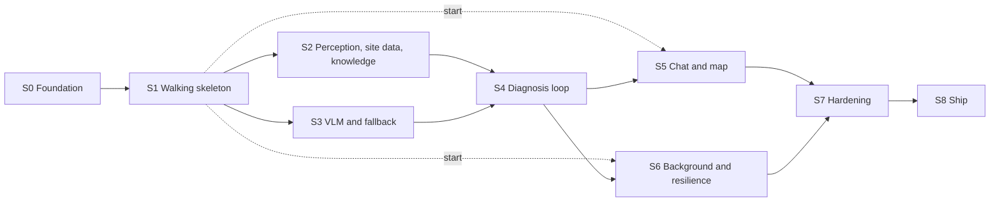

# PDM Backend Roadmap

> **Status:** Draft v0.4, 2026-10-16. v0.4: gap 6 is fixed: the loaders and `label_set_version` follow `ml/models/FORMATS.md`. v0.3: gap 6, found when PR #6 merged: the Rust loader doesn't read `ml/models/FORMATS.md`; section 1 says what `ml/` holds now. v0.2: every gap in section 12 now has a design, and the slices link to them: [infra](../infra/README.md) for CI, images and compose files, [database 1](../database/README.md#1-version-and-setup) for applying the migrations, [worker 15.1](worker.md#151-stub-vision) for stub vision, and [vision 6](../vision/README.md#delivering-model-files-to-the-backend) for model files; two bugs found on the way (the vector search's `k`, the bucket default) are fixed. v0.1: the backend's work for build week, as nine slices (S0–S8) from the code merged on Oct 16 to the final deploy. Each slice has its goal, its work, what it needs from the other tracks, its exit checks and the decisions it closes. Section 12 lists the gaps found while writing it.

Companion to the [backend architecture](README.md). Its [build plan](README.md#13-build-plan) and [architecture 14](../architecture/README.md#14-build-plan) say what is done on each date. This document says how the backend gets there: the order of the work, what each step depends on, and how we know a step is finished.

## Contents

1. [Where the backend stands](#1-where-the-backend-stands)
2. [How the slices work](#2-how-the-slices-work)
3. [The slices at a glance](#3-the-slices-at-a-glance)
4. [S0. Foundation](#4-s0-foundation)
5. [S1. Walking skeleton](#5-s1-walking-skeleton)
6. [S2. Perception, site data and knowledge](#6-s2-perception-site-data-and-knowledge)
7. [S3. VLM workers and the fallback](#7-s3-vlm-workers-and-the-fallback)
8. [S4. The diagnosis loop](#8-s4-the-diagnosis-loop)
9. [S5. Chat and the garden map](#9-s5-chat-and-the-garden-map)
10. [S6. Background work and resilience](#10-s6-background-work-and-resilience)
11. [S7. Hardening and S8. Ship](#11-s7-hardening-and-s8-ship)
12. [Gaps found while writing this roadmap](#12-gaps-found-while-writing-this-roadmap)
13. [Tracking](#13-tracking)

---

## 1. Where the backend stands

On Oct 16 the workspace in `backend/` holds every crate this design describes. Each crate is wired to its real adapters in `api`'s `wiring.rs` and the worker's `main.rs`. The tests run against fakes, mocks and the embedded SurrealDB engine.

| Crate | Source lines | Tests | Tested against |
|---|---|---|---|
| `domain` | 17,300 | 90 | Exact JSON of every contract shape |
| `store` | 10,600 | 33 | The embedded engine (`kv-mem`); 1 test needs a SurrealDB server |
| `blob` | 840 | 5 | An in-memory store; 1 test needs RustFS |
| `integrations` | 6,400 | 58 | Live fixtures recorded on Oct 15 and `wiremock` servers |
| `vision` | 7,600 | 54 | Synthetic images; no ONNX Runtime session is ever built |
| `knowledge` | 2,100 | 19 | Seed records in memory |
| `agent` | 7,900 | 60 | A scripted chat model |
| `pipeline` | 5,800 | 21 | Fake ports |
| `api` | 9,800 | 34 | The real router, driven with `oneshot`, over a mock store |
| `worker` | 4,800 | 34 | A fake broker on paused time and a scripted VLM backend |

What has **never run**:

- the binaries against a real SurrealDB, RustFS, Clerk, Anthropic, Open-Meteo or SoilGrids;
- an ONNX model, a VLM server or a GPU;
- a container. There are no Dockerfiles, no `infra/` and no CI workflow;
- any model file or knowledge seed on a host. `ml/` (PR #6) has the training and export code, the manifest's perception entries and the head formats, but no fetch step yet, and `api` and the worker both read `/models/manifest.toml` at start.

So the roadmap is mostly about **bringing the code up on real dependencies and proving it there**, plus filling the gaps in section 12. It isn't about writing the crates again.

---

## 2. How the slices work

- **A slice is vertical.** It takes one capability from the API to the database, the object store or a GPU, and ends in something we can watch work.
- **A slice is done when its exit checks pass on the deployed control plane or the rig**, not on fakes. Each check is concrete: a request, a command, a thing to kill.
- **The slices follow their dependencies.** S2 and S3 run in parallel on different GPUs. S5 and S6 can start once S1 is done, but each finishes only after S4.
- **Every change goes through a pull request to `main`** ([AGENTS.md, branches](../../AGENTS.md#branches-and-pull-requests)). Code and its documents change together. After a source change, run `backend/tools/docgen/regen_all.sh`; after a contract change, regenerate `backend/openapi.json`.
- **A slice closes its decisions.** Each open decision is assigned to the slice that has the evidence to settle it. When the slice ends, the decision is recorded in the document that owns it.

---

## 3. The slices at a glance

| Slice | Dates | Goal | Needs first | Other tracks |
|---|---|---|---|---|
| [S0](#4-s0-foundation) | Oct 16 | CI, containers, local services | PR #8 merged | none |
| [S1](#5-s1-walking-skeleton) | Oct 16–17 | A scan runs app → API → worker → SSE on the control plane, with stub vision | S0 | Clerk dev instance; the embedder and face-detector files (ml) |
| [S2](#6-s2-perception-site-data-and-knowledge) | Oct 18–19 | Real perception on the 3070, real weather and soil, the first knowledge loaded | S1 | Model manifest and ONNX files (ml); seed files (knowledge); the rig |
| [S3](#7-s3-vlm-workers-and-the-fallback) | Oct 18–21 | VLM jobs on the 5070 Ti and the 9070 XT, and the hosted fallback | S1 | VLM benchmark and choice (vision) |
| [S4](#8-s4-the-diagnosis-loop) | Oct 20–21 | Photo → diagnosis → plan with citations, on real models | S2, S3 | Reviewed profiles (knowledge); results UI (app) |
| [S5](#9-s5-chat-and-the-garden-map) | Oct 22 | Chat with tools, cards and memory; the garden map | S1 (start), S4 (finish) | Chat UI and map view (app) |
| [S6](#10-s6-background-work-and-resilience) | Oct 23 | Alerts, push, deletion cascades, the rig-failure test | S1 (start), S4 (finish) | Development build for push (app) |
| [S7](#11-s7-hardening-and-s8-ship) | Oct 24 | Security review, tuned limits and thresholds, evaluation run | S2–S6 | Evaluation set (vision) |
| [S8](#11-s7-hardening-and-s8-ship) | Oct 25 | Final deploy | S7 | Demo video, Devpost |

---

## 4. S0. Foundation

**Goal:** every later slice merges through a green pipeline and runs in containers.

**Work**

1. Merge PR #8, the workspace.
Designed in [infra](../infra/README.md): CI in section 2, images in section 3, compose files in section 4, with its own work items in [section 9](../infra/README.md#9-roadmap).

2. Add a CI workflow, `.github/workflows/backend.yml`, with these steps:
   - `cargo fmt --all --check`;
   - `cargo clippy --workspace --all-targets -- -D warnings`;
   - `cargo test --workspace`, with cargo-nextest 0.9.148;
   - `regen_all.sh` followed by `git diff --exit-code docs/backend`, then `check_fences.py` and `checklinks.py`;
   - `cargo check -p worker --features cuda` and `cargo check -p vision --features cuda,migraphx,webgpu`;
   - `python3 .claude/skills/rust/scripts/check_examples.py`.

   Then add the checks to the `main` ruleset. AGENTS.md says to add each check once its workflow exists.
3. Add a live job to the workflow. It starts SurrealDB `v3.3.4` and RustFS `1.0.1` as service containers, pinned by digest, and runs the two ignored tests (`cargo test -- --ignored`) and `check_examples.py --live`.
4. Add `backend/Dockerfile`, a multi-stage build that uses the release profile:
   - an `api` image;
   - a `worker` image for each execution provider, carrying the ONNX Runtime 1.31 library its `ORT_EP` needs ([worker 11](worker.md#11-multi-vendor-gpus)).

   Images are pushed to the registry and deployed by digest.
5. Add `infra/dev.compose.yml` with SurrealDB and RustFS for local work, and an `.env.example` with placeholder values only.

**Exit checks**

- A pull request with a deliberate Clippy warning fails CI.
- `docker compose -f infra/dev.compose.yml up`, then `cargo test --workspace -- --ignored`, passes on a laptop.
- `docker build` produces the `api` image and the CUDA `worker` image.

---

## 5. S1. Walking skeleton

**Goal:** a scan travels from the app (or a script) through the API and the broker to a worker and back over SSE. It runs on the deployed control plane with stub vision. This is architecture 14's "end-to-end skeleton".

**Already in code:**
- Clerk auth and the account tombstone.
- Membership checks.
- Uploads with the CPU blur check.
- Submit and the scan state machine.
- The job broker with leases, heartbeats and requeue.
- Resumable SSE.
- The fallback worker.

**Work**

1. **Stub vision in the worker** ([worker 15.1](worker.md#151-stub-vision), work items ST1–ST7). It answers `perception` jobs with canned, marked results, so the loop runs without GPUs or model files. It must report the label versions the API queues (`STUB_LABEL_SET_VERSION`, `STUB_CLASSIFIER_LABELS_VERSION`), or submit answers `503`.
2. **The control plane** ([architecture 12](../architecture/README.md#12-deployment); the compose file, bootstrap and secrets in [infra 4–7](../infra/README.md#4-compose-files)):
   - `infra/control-plane.compose.yml` with `caddy`, `api`, `surrealdb`, `rustfs` and `fallback-worker`;
   - the Caddyfile and the tunnel;
   - the database users of [database 1](../database/README.md#1-version-and-setup): root to apply the schema, `api` as `EDITOR`;
   - the bucket and identities of [storage 2](../storage/README.md#2-bucket-keys-and-access);
   - secrets in env files that are never committed;
   - the `stop_grace_period` values from [README 12](README.md#12-builds-and-deployment).
3. **Clerk's development instance:** the issuer, the JWKS and the Svix webhook to `POST /webhooks/auth`. Never use the production instance without asking.
4. **The CPU models `api` loads:** the text embedder (`snowflake-arctic-embed-xs`, 384 dimensions, pinned by hash), its tokenizer and the face detector. The S1 manifest's three entries, with verified hashes, are in [vision 6](../vision/README.md#the-s1-manifest); the `model-fetch` step fills `/models` (work items M1–M4).
5. **A smoke script in `backend/tools/smoke/`.** It signs in with a Clerk testing token, creates a garden, uploads a photo, submits, and follows the stream. Then it drops the connection and resumes with `Last-Event-ID`.

**Exit checks**

- The smoke script passes against the deployed control plane.
- Killing the worker mid-job requeues the job once its lease runs out ([contracts 5](../architecture/contracts.md#5-worker-api-and-jobs)), and another worker finishes it.
- Restarting `api` during a scan, then resuming the stream, replays every missed event once and no event twice.
- A photo with a face fails the blur check where [architecture 11](../architecture/README.md#11-security-privacy-and-safety) says it must.

**Decides:** where the control plane runs ([architecture open decision 2](../architecture/README.md#15-open-decisions)).

---

## 6. S2. Perception, site data and knowledge

**Goal:** real perception results from the RTX 3070, real weather and soil for a garden, and the first knowledge records in the database.

**Already in code:**
- `vision`: the ONNX Runtime sessions, BioCLIP 2, the leaf detector, SAM, the disease head, face blurring, WebP and depth.
- The worker's perception path.
- `integrations` for Open-Meteo, SoilGrids and the geocoders.
- `knowledge`'s index and the `store` reads behind it.

**Work**

1. **The rig:**
   - `infra/rig.compose.yml`, with GPUs pinned by UUID ([worker 12](worker.md#12-deployment));
   - ONNX Runtime 1.31 on CUDA 13;
   - the model manifest from `ml/models`, our files from the private Hugging Face repository `pdm-models`, fetched by `model-fetch` ([vision 6](../vision/README.md#delivering-model-files-to-the-backend), work items M5–M9).
2. **The first real ONNX sessions.** This is the first time ONNX Runtime has ever run in this code. Check each model's input and output shapes against its manifest entry, then run the vision day-1 checks ([vision evaluation 7](../vision/evaluation.md#7-day-1-checks)).
3. **Uploads on real models:** face blurring with the real detector, WebP at the stored sizes, and the depth upload path. The LiDAR day-1 results settle the camera conventions ([vision 15](vision.md#15-open-questions), item 6).
4. **Live site data:**
   - fresh fixtures for Open-Meteo, SoilGrids and the geocoders;
   - SoilGrids has no data in central Toronto, so decide its replacement there ([architecture open decision 10](../architecture/README.md#15-open-decisions));
   - a fallback label when reverse geocoding fails ([integrations 17](integrations.md#17-open-questions), item 4).
5. **Species confirmation** end to end: the perception top 3, the card, and the confirmed species on the scan.
6. **Knowledge loading:**
   - build the migration runner and apply the loader's `knowledge.surql` ([database 1](../database/README.md#1-version-and-setup), [store 4](store.md#4-connecting-and-the-schema));
   - add the `seed-upload` one-shot container before `api`;
   - load the first species and organism files;
   - check vector search with the real chunks. A bound `k` failed to parse on 3.3.4; `search_chunks` now passes it as a literal, tested on the embedded engine ([store 22](store.md#22-open-questions), item 4).

**Needs:** the manifest, the ONNX exports, the label matrices and `classifier_labels.yaml` (ml); the seed files (knowledge); the rig set up as in [setup](../setup/README.md).

**Exit checks**

- A real leaf photo gives the species top 3, leaf regions and masks, in a `perception` result the API accepts.
- `GET /gardens/{id}/weather` returns the summary from live Open-Meteo, and a new garden's `soil_profile_status` moves from `pending` to `ready`, or to `unavailable` where SoilGrids has no data.
- A knowledge search returns ranked chunks from the loaded seed.

**Decides:**
- the crops ([architecture open decision 3](../architecture/README.md#15-open-decisions));
- the knowledge sources (7);
- SoilGrids (10);
- the stored size of a photo without depth ([vision 15](vision.md#15-open-questions), item 2).

---

## 7. S3. VLM workers and the fallback

**Goal:** `vlm`, `verify` and `guided` jobs run on the RTX 5070 Ti and the RX 9070 XT, and on the hosted fallback when the rig is away.

**Already in code:** the VLM adapters, the per-call schemas and their decoding, the hosted profile with schema sanitising, and the fallback worker ([worker 8–10](worker.md#8-the-vlm-adapters)).

**Work**

1. **The VLM sidecar on the 5070 Ti:** vLLM with xgrammar, running the checkpoint chosen by the benchmark ([architecture open decision 4](../architecture/README.md#15-open-decisions)).
2. **The AMD day-1 check on the 9070 XT.** It decides between vLLM on ROCm and llama.cpp on Vulkan (open decision 19). If llama.cpp wins, check whether a dropped connection frees its slot ([worker 17](worker.md#17-open-questions), item 4).
3. **The schema check:** does xgrammar 0.2.7 accept `anyOf` with `null`? See [worker 17](worker.md#17-open-questions), item 3, and [vision 15](vision.md#15-open-questions), item 4. If it doesn't, change the nullable shapes before S4.
4. **`VLM_SLOTS` for each card, from the benchmark** (open decision 15).
5. **The fallback:**
   - one live hosted call confirms the box format and the stripped schema keywords ([integrations 17](integrations.md#17-open-questions), item 6);
   - time a full 8,000-token call against the doubled `max_runtime` ([worker 17](worker.md#17-open-questions), item 2).

**Exit checks**

- A `vlm` job on each card returns findings that pass the schema and the API's checks.
- With every rig worker stopped, the fallback claims a queued job after 15 seconds and completes it.

**Decides:** open decisions 4, 15 and 19.

---

## 8. S4. The diagnosis loop

**Goal:** a photo becomes a diagnosis and an action plan with citations, on real models. The scripted early-blight scan runs end to end.

**Already in code:** knowledge ranking and scoring, the pipeline's steps with step claims and the sweep, questions and provisional plans, fusion, measurement, and the plan writer with validation and the dose check.

**Work**

1. Run the early-blight scan on the full stack: perception, VLM, retrieve, verify, score, plan.
2. **Step claims under failure.** Kill `api` in the middle of a step. On restart, the sweep must recover the claimed step, and the scan must finish with no step run twice ([flows](flows.md)).
3. **Questions:** an indicator question, its answer, a late answer and a re-plan, as [contracts 3](../architecture/contracts.md#scan-lifecycle) orders them.
4. **Measurement with LiDAR depth:** measurable indicators answered from a real depth map.
5. **The plan writer on the hosted LLM:** validation, citations and the dose check on every step.

**Needs:** reviewed profiles (knowledge); the results UI to show it (app).

**Exit checks**

- The early-blight scan reaches `planned` with a diagnosis, indicator evidence and a plan whose steps cite their sources.
- The `api` kill test passes.
- A late answer creates a new plan version and supersedes the old plan's tasks.

**Decides:**
- the confirmed margin ([knowledge 12](knowledge.md#12-open-questions), item 2);
- empty candidate sets (item 3);
- a plan-writer outage on a first plan ([pipeline 17](pipeline.md#17-open-questions-and-decisions), item 2);
- the verification-answer timeout ([architecture open decision 14](../architecture/README.md#15-open-decisions));
- the measurement thresholds (17), which are a first cut, finished in S7.

---

## 9. S5. Chat and the garden map

**Goal:** a user chats about a plant, the agent uses its tools, proposes changes as confirmation cards, and remembers what it should. The garden map works.

**Already in code:** chat turns, the tools, confirmation cards, memory, the dose check on every sentence, the LLM classifier, Jev's client, and the garden map endpoints with neighbour and spacing rules.

**Work**

1. **Chat turns on the hosted model,** checking how thinking blocks behave when the context is rebuilt every turn ([agent 18](agent.md#18-open-questions), item 2).
2. **Tools against real data:** `view_image`, `get_forecast`, `get_soil_profile`, `revise_plan` and the others. Then the card's confirm and refuse paths.
3. **Memory:** extraction, private until shared, and read by the plan writer only once shared.
4. **The text classifier:** use Jev if early access arrived ([architecture open decision 8](../architecture/README.md#15-open-decisions)); otherwise the LLM fallback.
5. **The garden map:** a mapping session, the neighbours and the spacing warnings.
6. **Local poison-control numbers** in the deployment's configuration ([agent 18](agent.md#18-open-questions), item 10).

**Exit checks**

- A chat about the early-blight scan calls a tool, proposes a plan change as a card, and applies the change once confirmed.
- A sentence with an unsafe dose never reaches the stream.
- A memory saved in chat stays private until shared.

**Decides:** open decisions 6 and 8.

---

## 10. S6. Background work and resilience

**Goal:** the scheduled work runs, deletions clean up everything they should, and the system survives losing the rig.

**Already in code:** the scheduler's eight tasks (`requeue`, `sweep` with question continuation, `idle`, `cleanup`, `weather` with forecast alerts and plan triggers, `soil`, push `receipts` and `orphans`), Expo push, the deletion runner with the account cascade, and the RustFS delete queue.

**Work**

1. **Forecast alerts** from live forecasts: each condition alerts once, and its tasks are created.
2. **Push** to a development build of the app.
3. **Deletions against real RustFS and Clerk's development instance:**
   - a plant, a garden and an account (`DELETE /me`), including the tombstone and the Clerk deletion;
   - a restart in the middle of a cascade resumes it.
4. **The orphan sweep** removes objects no record references. Resumed plant and scan deletions leave their objects to it ([api 23](api.md#23-open-questions), item 4).
5. **The rig-failure test:** kill the rig in the middle of a scan. The fallback must take over within about 45 seconds ([architecture 14](../architecture/README.md#14-build-plan)).

**Needs:** a development build for push (app).

**Exit checks**

- A frost forecast gives one alert, not one per sweep.
- After `DELETE /me`, no record, object or Clerk user of that account remains, and the account's old session token gets `401`.
- The rig-failure test passes, and the scan finishes on the fallback.

---

## 11. S7. Hardening and S8. Ship

**S7 goal (Oct 24):** feature freeze, then make the running system safe and tuned.

1. **Security review against [architecture 11](../architecture/README.md#11-security-privacy-and-safety):**
   - auth on every route and `404` to non-members;
   - signed image URLs;
   - EXIF stripped and faces blurred;
   - no secrets, tokens, signed URLs or locations in logs;
   - CORS limited to the configured origins.
2. **Limits:** set the general rate limit and the JSON body limit from what the app actually sends. Both are placeholders today ([api 23](api.md#23-open-questions), item 2).
3. **Thresholds:** the weather and trigger thresholds and the measurement thresholds, from the evaluation set (open decisions 17 and 20; contracts open question 27).
4. **The evaluation run** with [vision evaluation](../vision/evaluation.md), with its numbers recorded.
5. **Operations:** SurrealDB backups as [database](../database/README.md) describes them, the JSON logs with request ids, and a short runbook for restarting each service.

**S7 exit check:** every review finding is fixed or recorded as accepted, and the evaluation numbers are in the vision documents.

**S8 goal (Oct 25):**
- deploy the final images by digest and tag the release;
- re-run the S1 smoke script and the S4 early-blight scan on production settings;
- freeze the deployment until Demo Day.

---

## 12. Gaps found while writing this roadmap

Gaps 1 to 5 have a design; gap 6 is fixed. The designs are proposals until their slice builds them; each ends with numbered work items and exit checks.

| # | Gap | Slice | Designed in | Work items |
|---|---|---|---|---|
| 1 | Nothing applied the knowledge migration: `store` applied only `schema.surql`, and `api` only read the knowledge | S2 | [Database 1](../database/README.md#1-version-and-setup) (v1.5), with [store 4](store.md#4-connecting-and-the-schema) and [api 4](api.md#4-start-up-and-shutdown): numbered, hash-locked migrations plus the loader's regenerated `knowledge.surql`, each in its own transaction with a `migration` record | Database 1's runner; `schema.surql` gains the `migration` and `knowledge_meta` tables when it's built |
| 2 | The worker had no stub vision for the walking skeleton | S1 | [Worker 15.1](worker.md#151-stub-vision): `--stub-vision`, refused in a release build without `PDM_ALLOW_STUB_VISION=1`, canned results marked `stub` | ST1–ST7 |
| 3 | No CI, no containers, no `infra/` | S0, S1, S2, S3, S8 | [Infra](../infra/README.md): CI, images, the three compose files, ingress, secrets, deploys by digest, backups | [Infra 9](../infra/README.md#9-roadmap) |
| 4 | Model files and seed data come from `ml/`, which had no delivery path | S1, S2, S3 | [Vision 6, delivering model files](../vision/README.md#delivering-model-files-to-the-backend): one manifest, our files in a private Hugging Face repository (the team's choice), `sources.toml` and `fetch.py` | [M1–M11](../vision/README.md#roadmap) |
| 5 | Pipeline open question 3 was out of date | none | Resolved: the run's evidence fields are in the schema ([pipeline 17](pipeline.md#17-open-questions-and-decisions)) | none |
| 6 | The Rust loader didn't read `ml/`'s file formats: a label matrix and the plant probe failed to load, every disease class would have loaded as `healthy`, and `store`'s `label_set_version` differed | S2 | **Fixed:** the loaders read [`ml/models/FORMATS.md`](../../ml/models/FORMATS.md), heads must name the manifest's `bioclip` export, and `label_set_version` passes the format's test vector ([vision 6](../vision/README.md#delivering-model-files-to-the-backend)) | none |

**Bugs found while designing,** both fixed with a test:
- **The knowledge vector search could never run.** `SEARCH_CHUNKS` bound `k` into `<|k, 40|>`, which SurrealDB 3.3.4 refuses to parse. `search_chunks` now writes it as a literal, clamped to 1–40.
- **`api`'s bucket default was `pdm`,** but storage 2's bucket is `pdm-images`. The default now matches.

**Decisions still open from the designs,** for the team: which Hugging Face organisation owns `pdm-models` and who holds the hosts' tokens ([vision 11](../vision/README.md#11-open-decisions), items 11 and 14); the CI minutes budget or a self-hosted runner, who deploys, and the off-host backup remote ([infra 10](../infra/README.md#10-open-questions)); whether `api` should refuse stub results in production ([worker 17](worker.md#17-open-questions)); and how the app shows a removed knowledge record that user data still points to, and whether restoring the pre-deploy backup is an acceptable rollback ([store 4](store.md#4-connecting-and-the-schema), the migration runner's open questions).

---

## 13. Tracking

- Make one GitHub milestone per slice (`S0 Foundation`, `S1 Walking skeleton`, …).
- Make one issue per numbered work item, labelled `backend`, linking this section.
- A slice's milestone closes when its exit checks pass. Record the results in the pull request that closes the last issue.
- When a slice closes a decision, update the document that owns the decision in the same pull request. Then bump this document's status line and mark the slice done in [section 3](#3-the-slices-at-a-glance).
