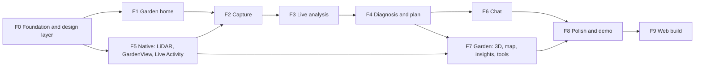

# PDM App Roadmap

> **Status:** Draft v0.3.16, 2026-10-24. v0.3.16: F7 as built on Oct 24 in mock mode (section 13): the garden screen with the 3D view and the 2D map, Insights and its chart composites, garden tools, members and invites, account deletion, the farm connectors screen and its connect flow, and Google and Apple sign-in; the four proposed shapes they add are in `app/src/domain/proposed.ts`; the exit checks ran on the iPhone 18 Pro simulator. v0.3.15: F6 after PR #151's review (section 12): the review's fixes, and the frost planner on the backend's S5 rules (its tasks through `POST /tasks` with no card, `frost_tender` optional); section 17's chat rows point at the backend pull requests that carry them, and F7 picks up the blocks' links into the garden and Insights. v0.3.14: F6 as built on Oct 23 (section 12): every item runs in mock mode, the answer blocks and an `era` record's text on proposed contracts held in `app/src/domain/proposed.ts`; sections 1, 17 and 19 follow, and section 17 lists the four contract changes chat waits on. v0.3.13: F5 after the second round of review: a black shot is refused, fatal camera and ARKit errors fall back or explain, labels rank the plants that need attention, the plants draw instanced on iOS 26, and the 3D garden screen stays F5's spike until F7 builds Conservatory's (section 11). v0.3.12: F5 after Alan's review of #148 and the second round on the iPhone 13 Pro Max: what changed, and what each item still waits on (section 11). v0.3.11: F5's first run on an iPhone 13 Pro Max with iOS 27, where the app adopts the scene life cycle and capture takes the largest preview, shows the 4:3 frame with the ultra-wide outside it and has Apple's segmented control on glass as its mode bar (section 11); the visual system's controls are Apple's own, never imitated glass (section 5). v0.3.10: F5 as built on Oct 23, waiting on the iPhone for its exit checks (section 11): D4 closed, the Live Activity's extension joins the project through `@bacons/apple-targets`; D5 built on RealityKit, closing on the device's frame time; sections 1, 17 and 19 follow. v0.3.9: D11 is decided: the VLM serves on the 5070 Ti beside its desktop, so the demo needs no headless step. v0.3.8: F4 as built (section 10): D9 closed with the tint on the phone, R1 closed with our own solid mini player; sections 17 and 19 follow. v0.3.7: F3's picture answers come from `Question.indicator_id` (section 9). v0.3.6: the local backend ran end to end on Oct 21, on Linux with an iPhone ([#98](https://github.com/aacruzgon/GreenLens/issues/98)). v0.3.5: section 16 brought up to Oct 21 after the review of [#115](https://github.com/aacruzgon/GreenLens/pull/115): weather is live, and sign-up completes with the token fix of [#118](https://github.com/aacruzgon/GreenLens/pull/118). v0.3.4: section 16 runs F0's and F1's live checks against the deployed S1 or a local backend ([#98](https://github.com/aacruzgon/GreenLens/issues/98)); section 14 adds the username at sign-up ([#97](https://github.com/aacruzgon/GreenLens/issues/97)); section 17 says S1 is deployed. v0.3.3: section 17's `openapi.json` and S1 rows brought up to Oct 20 ([#99](https://github.com/aacruzgon/GreenLens/issues/99)), and section 1 says where `app/` stands. v0.3.2: F0's second factor is a code by text to the phone given at sign-up; no authenticator app. v0.3: applies the review of #61: owners for both lanes and the photo spike; no mention of the closed scaffold PRs; section 18 linked to #63 and #64; the evaluation captures linked to #52; M17 in vision's Phase 4; the check spring and the entrance scale as tokens; the hotspot inside the finding's region; E1.6 still open. v0.2: aligns the plan with the backend, vision and EON roadmaps after three audits: S4's need for the results UI and its real depth maps, weather from S2, push blocked on the Apple account, the web origin settled before S7's CORS review; the LiDAR day-1 check as the app's own, the evaluation captures vision needs by Oct 21, live checks dated to the first full scan (J4) and the demo passed three times (J7); E3.4, the E10 tests and farm citations in plans; decisions numbered as in design 10; README 18 rewritten to these dates. v0.1: the app's build-week work in the Conservatory direction ([design 3.1](../design/design.md#31-conservatory)), as ten slices (F0–F9) from an empty `app/` on Oct 20 to the demo on Oct 24 and the web build on Oct 25. Each slice has its goal, its screens and composites, what it needs from the other tracks, its exit checks and the decisions it closes.

Companion to the [frontend architecture](README.md), its [flows](flows.md) and [screens](screens.md), and to the [design](../design/design.md). The architecture says how the app is structured, screens.md says what each screen contains, and the design says how it looks, moves and speaks. This document says in what order the app is built, what each step waits on, and how we know a step is finished. It mirrors the [backend roadmap](../backend/roadmap.md).

## Contents

1. [Where the app stands](#1-where-the-app-stands)
2. [Conservatory in one page](#2-conservatory-in-one-page)
3. [Devices, builds and lanes](#3-devices-builds-and-lanes)
4. [How the slices work](#4-how-the-slices-work)
5. [The slices at a glance](#5-the-slices-at-a-glance)
6. [F0. Foundation and the design layer](#6-f0-foundation-and-the-design-layer)
7. [F1. Garden home](#7-f1-garden-home)
8. [F2. Capture, after the Camera app](#8-f2-capture-after-the-camera-app)
9. [F3. The live analysis](#9-f3-the-live-analysis)
10. [F4. Diagnosis, plan and the plant](#10-f4-diagnosis-plan-and-the-plant)
11. [F5. The iPhone's native work](#11-f5-the-iphones-native-work)
12. [F6. Chat with answer blocks](#12-f6-chat-with-answer-blocks)
13. [F7. The garden: 3D, map, insights and tools](#13-f7-the-garden-3d-map-insights-and-tools)
14. [F8. Polish and the demo](#14-f8-polish-and-the-demo)
15. [F9. The web build](#15-f9-the-web-build)
16. [Going live, slice by slice](#16-going-live-slice-by-slice)
17. [What the app needs from other tracks](#17-what-the-app-needs-from-other-tracks)
18. [Documents to update](#18-documents-to-update)
19. [Decisions and when they close](#19-decisions-and-when-they-close)
20. [Tracking](#20-tracking)

---

## 1. Where the app stands

On Oct 19, `main` has no `app/`. (Since then: F0 merged in [#67](https://github.com/aacruzgon/GreenLens/pull/67) and [#74](https://github.com/aacruzgon/GreenLens/pull/74), F1 in [#75](https://github.com/aacruzgon/GreenLens/pull/75) on Oct 20; F5's native work was built on Oct 23 and waits on the iPhone, section 11; F6's chat was built the same day on mock data, waiting on the backend's answer blocks, section 12.) This roadmap starts from an empty project: F0 is built from the documents ([README](README.md), [flows](flows.md), [screens](screens.md), the [design](../design/design.md)) and the generated contract types.

What else is true on Oct 19:

- **The contracts exist as Rust types.** `backend/openapi.json` is committed, with 274 schemas, so the app's types are generated from day 1 ([README 9](README.md#generated-types)). It still references `AnchorType` and `TaskState` without defining them; [#65](https://github.com/aacruzgon/GreenLens/pull/65) registers them (section 17).
- **The backend has not run end to end.** S1, the walking skeleton, was due Oct 16–17 and is still a draft ([PR #40](https://github.com/aacruzgon/GreenLens/pull/40)), so S2–S4 slip with it. On the ML side, milestones MS1 and MS2 (Oct 17–18) slipped too, and the first full scan through every model (J4, MS3) is planned for Oct 21 ([vision dev-roadmap](../vision/dev-roadmap.md)). The app is built on mock data until each backend slice is deployed (section 16).
- **The LiDAR day-1 check hasn't run.** It was planned for Oct 16–17 and is owned by the app and backend ([evaluation](../vision/evaluation.md), LiDAR row), not by vision. It needs the module and a development build, so it is F5's first exit check.
- **The direction is chosen.** Conservatory, by the team on Oct 19, after the five directions in the [mockups](../design/mockups/index.html). Its camera-style capture, live analysis and 3D garden come with it ([design open decision 10](../design/design.md#10-open-decisions)).
- **The app is iPhone only.** Android is out of development. The web build is the last slice (F9) and the live link the judges open ([design 2](../design/design.md#2-what-apple-owns-and-what-we-own)).

## 2. Conservatory in one page

What every slice builds to. The full spec is [design 3.1](../design/design.md#31-conservatory) and the rules of [design 6](../design/design.md#6-rules-every-direction-follows); this is the checklist.

| Piece | Rule |
|---|---|
| **Palette** | F0's palette unchanged: leaf green `#2F6B47` (dark `#7CC59A`) on warm off-white `#F6F7F2`, with the four status colours. One addition, `wash`: `#E3EBDC` light, `#18231D` dark |
| **Green is for content** | The green marks the one prominent action per screen. Controls are neutral: white shutters, the chosen tab and view in the text colour on the system's own selection, and capture's chosen mode in the Camera app's yellow |
| **Type** | Urbanist 600 at −0.03 em for content heroes only, at 22 pt and above: the garden name at 54 pt, the diagnosis at 40 pt. Body, numbers and all chrome stay SF Pro |
| **Melt** | Every screen starts with the wash at the top. The home's photo fades into it; plant cards fade the plant into the card, with the name in ink below |
| **Pill** | One green pill per screen. With an icon, the icon sits in a white disc at the left end. Secondary buttons are pale surface pills |
| **Cards** | 28 pt radius; a two-layer warm shadow in light mode, a border in dark. Solid, never glass |
| **Hotspot** | A soft oval inside the finding's region, a white dot at its centre, a label below ("Early blight · 8–12 mm"). It settles in 520 ms, then breathes |
| **Camera screens** | Capture and the live analysis are always dark and full screen. Cards slide down from the top with a grabber. The mode bar is Apple's segmented control on glass, and the photo strip is a solid dark pill. The preview shows the 4:3 frame, with the ultra-wide outside it where the phone allows. No glass on the photo is tinted |
| **Photo tint** | The diagnosis fades its photo into a ground tinted from it: the photo's hue at OKLCH L 0.93 (light) or 0.24 (dark), chroma at most 0.03 |
| **Motion** | Screens enter on a critically damped spring (stiffness 170, damping 26) rising 24 pt. Stage ticks take 300 ms. Pushes and sheets use `bezier(0.32, 0.72, 0, 1)` over 420 ms. Reduced motion: fades, no breathing, no turntable |
| **Status** | A word, a colour and a shape: healthy ● circle, watch ▲ triangle, sick ◆ diamond, dead □ hollow square. The shapes carry the difference F0's colours don't (accent and healthy are nearly one green; watch and sick look alike to colour-blind users) |
| **Glass** | Only in the chrome, and always the system's: the tab bar, bar buttons, sheets, capture's mode bar, and the plan's mini player if it is the tab bar's bottom accessory. Never imitated with fills or hand-drawn pills ([design 6](../design/design.md#6-rules-every-direction-follows)) |
| **Haptics** | Real events only: a tick per stage, success on a checked task, a tick per scan date on the 3D scrubber |

## 3. Devices, builds and lanes

The team's test phone is an **iPhone 17 Pro Max**, with LiDAR. Nobody has a paid Apple Developer account yet.

| Build | Needs | Gives | Used for |
|---|---|---|---|
| Expo Go on the iOS simulator or the iPhone | Xcode for the simulator | Everything but native modules and push | F0–F4, F6, F7's screens: fast UI work on mock data, and their exit checks |
| Local development build (`npx expo run:ios --device`) | A Mac with Xcode and a free Apple ID; the app expires after 7 days | The LiDAR module, `GardenView`, the Live Activity extension | F5, and every check that needs depth, the 3D garden or the Lock Screen |
| EAS development or preview build | A paid Apple Developer account | Installs on teammates' phones; push through APNs | F7's push, if the team buys the account. Without it, the alert inbox covers forecast alerts |
| Web build | Nothing | The live link | F9 only |

The work runs in two lanes that meet in F5 and F7:

- **Lane A, TypeScript** (owner: Mark, [@marksmwl](https://github.com/marksmwl)): the project, the design layer, every screen, the api layer and mock mode. Built in Expo Go.
- **Lane B, Swift** (owner: Mark, [@marksmwl](https://github.com/marksmwl)): `app/modules/lidar`: `LidarCameraView` with depth, `GardenMappingView`, `GardenView` on RealityKit, and the Live Activity widget extension. Built in a development build. The [LiDAR module's JavaScript surface](README.md#the-lidar-modules-javascript-surface) and `GardenView`'s props are agreed on Oct 20, so Lane A builds against the fallbacks (`expo-camera`, the 2D map) meanwhile.

The biggest schedule risk is that one person owns both lanes. Lane B's Oct 20 alone holds the module, the day-1 check and the `GardenView` spike, beside F0, and the camera with depth, the mapping session, the 3D garden and the Live Activity all need the same Swift work ([garden-3d 7](../design/garden-3d.md#7-recommendation)). F5 orders that work so the demo's pieces come first, and Lane A's screens build against the fallbacks so they never wait on it. Ask Mark about either lane.

## 4. How the slices work

- **A slice is vertical.** It takes a screen from its pixels through its view-model hook and the api layer to the mock, and ends in something we can watch on the iPhone.
- **Mock first, then live.** Every screen is built against `api/mock` ([README 15](README.md#15-mock-mode)) with the demo story's data ([analytics 6](../design/analytics.md#seeded-data-for-mock-mode)), so no screen waits on the backend. Each slice switches to the live API when its backend slice is deployed (section 16).
- **Built to the design, not restyled after.** Each screen is built once, in Conservatory, from its mockup. The design layer comes first (F0) so no screen is built in a placeholder style.
- **Done when its exit checks pass on the iPhone**, in light and dark mode, with reduced motion on and off, and not only in Jest. Browser checks wait for F9.
- **Reviewed against Apple's guidelines** with the `/hig` skill and its page skills before the slice closes. The pages each slice needs are named in its section.
- **Every change goes through a pull request to `main`** ([AGENTS.md](../../AGENTS.md#branches-and-pull-requests)). After a backend contract change, run `npm run gen:api` and commit `src/api/generated/schema.ts` in the same pull request.

## 5. The slices at a glance

| Slice | Dates | Goal | Needs first | Other tracks |
|---|---|---|---|---|
| [F0](#6-f0-foundation-and-the-design-layer) | Oct 20 | The project, the layers, the api, mock mode with the demo story, Clerk, and Conservatory's design layer | none | none |
| [F1](#7-f1-garden-home) | Oct 20–21 | The garden home in Conservatory, the scan button, the new-scan sheet | F0 | none |
| [F2](#8-f2-capture-after-the-camera-app) | Oct 21 | Capture as a camera: the mode bar, the coverage dial, the instruction card | F1 | none on mock; S1 for uploads |
| [F3](#9-f3-the-live-analysis) | Oct 21–22 | The analysis over the photo just taken: the stage card, the hotspots, "Not sure yet" and the picture answers | F2 | none on mock; S1, S4 live |
| [F4](#10-f4-diagnosis-plan-and-the-plant) | Oct 22 | The tinted diagnosis, the plan with its mini player, step by step, the plant, tasks | F3 | S4 live |
| [F5](#11-f5-the-iphones-native-work) | Oct 20–23 | The LiDAR day-1 check, depth and distance on capture, evaluation captures, the 3D `GardenView`, the mapping session, the Live Activity | F0 (Lane B) | S2 depth upload; S4 measurement; vision's evaluation set |
| [F6](#12-f6-chat-with-answer-blocks) | Oct 22–23 | Chat with streaming, tool chips, cards, memories and answer blocks | F4 | `answer_block` contract change; S5 |
| [F7](#13-f7-the-garden-3d-map-insights-and-tools) | Oct 22–23 | The 3D garden and the 2D map, Insights, members and invites, farm connectors, Google and Apple sign-in, account | F4, F5 | S5 map; analytics' backend fields; S6; EON E3.4, E10, E11 |
| [F8](#14-f8-polish-and-the-demo) | Oct 24 | Freeze; every screen checked against the design and the guidelines; the web origin settled for S7; the demo rehearsed (J7) and recorded | F1–F7 | Demo video; vision J7 and D11 |
| [F9](#15-f9-the-web-build) | Oct 25 | The web build as the live link | F8 | S8 deploy; CORS from S7 |

F5 → F2 is a late edge: capture ships on `expo-camera` and swaps in `LidarCameraView` when F5's first item lands.

The demo path is F1 → F2 → F3 → F4, then the chat (F6), the 3D garden and insights (F7): the order of the [demo flow](../design/design.md#5-the-demo-screen-by-screen), about 65 seconds of the video.

## 6. F0. Foundation and the design layer

**Goal.** A project every later slice adds screens to without changing its structure, whose first pixels are already Conservatory's.

**Work.**

1. **The project.** `app/` on Expo SDK 57 (`expo@57.0.30`), React Native 0.86.3, Expo Router with typed routes, `@clerk/expo` 4.x, TypeScript strict ([README 3](README.md#3-stack-and-version-pins)). `app.config.ts` with the scheme `pdm` and the iPhone only (`supportsTablet: false`). `app/AGENTS.md` pointing here.
2. **Layers and lint.** The layout of [README 6](README.md#6-directory-layout); the import rules of [README 5](README.md#5-layers-and-import-rules) as `import/no-restricted-paths` errors; Clerk only in `features/auth`.
3. **Contract types.** `npm run gen:api` from `backend/openapi.json`, with a diff check, until the backend fixes its two schema gaps (section 17).
4. **The api layer** ([README 9–10](README.md#9-api-layer)): `openapi-fetch` over `expo/fetch`; the auth, idempotency and error middleware; the error table and retry policy; the SSE parser and reader; query keys and the client.
5. **Mock mode** ([README 15](README.md#15-mock-mode)), seeded with the demo story of [analytics 6](../design/analytics.md#seeded-data-for-mock-mode): the Back garden with 2 beds and a pot; Tomato 1, Tomato 2, Pepper, Basil, Lettuce and Kale with their scans from Sep 20 to Oct 17, heights, affected area and weather snapshots; Tomato 1's plan and its tasks; the frost alert. Dates are relative to the device's date. Scripted runs: Tomato 2's live scan (uncertain until the rings question, then early blight, with a ladybug larva), a healthy plant, `low_evidence`, a failed quality check. Plant photos are real photos of the plants, not drawings, so the melt and tint are judged on what users will take (decision D8).
6. **Clerk.** Email, phone and password at sign-up with their codes, two-step sign-in by a code by text, and the new-device email code (Device Trust), with custom screens; no authenticator app ([README 8](README.md#8-authentication-clerk)); a demo sign-in in mock mode with an empty Clerk key.
7. **Conservatory's design layer** ([design 9](../design/design.md#9-what-changes-in-the-app)):
   - **Tokens** in `src/ui/tokens.ts`: F0's colour roles plus `wash`; the 4-point spacing scale; radii (28 pt cards and photos); the two-layer warm shadow; the display sizes (hero 54, display 40, section 22); the motion values: the enter spring (stiffness 170, damping 26) rising 24 pt and scaling from 0.985, the check spring (stiffness 300, damping 30) for F1's task check, the 300 ms stage tick, the 520 ms hotspot settle and the sheet curve.
   - **Fonts:** Urbanist 600 with the `expo-font` config plugin; the system font stands in if it fails to load.
   - **Primitives:** `Text` with the iOS text styles and the display styles; `Button` as the pill (primary with its icon disc, secondary surface pill); `Card`; `Chip`; `Banner`; `Screen`, which starts with the wash and takes a full-bleed hero; `Sheet`; `TextField`; `ListItem`; `Skeleton`; `EmptyState`; `ErrorState`.
   - **Motion primitives:** `Enter` (the damped entrance) and `Fade`, both still under reduced motion.
   - **Composites:** `StatusShape` and `StatusChip` (word, colour, shape); `MeltPhoto`; `ConfidenceBadge` (findings and measurements only).
   - **Contrast check** as `npm run check:contrast`: every text and status pair, on the surface and on the wash, at 4.5:1 in both schemes.
8. **Tabs.** `NativeTabs` with SF Symbols (`expo-symbols`): Garden and Settings now, Tasks in F4 and Chat in F6, so no tab is ever empty. The chosen tab is in the text colour, not green.
9. **Sign-in and onboarding** in the design: the wash, the garden name field, location consent or a postal code ([screens 3.10](screens.md#310-sign-in-and-onboarding)).
10. **CI.** An `app` job in `.github/workflows/ci.yml` running `npm ci`, the `gen:api` diff, typecheck, lint, Jest, `check:contrast` and `npx expo install --check`, added to `ci`'s `needs` ([infra 2](../infra/README.md#2-ci)).
11. **Day-one spikes**, each recorded in the pull request that runs it:
    - **Bottom accessory.** Does `NativeTabs` on SDK 57 expose iOS 26's tab bar bottom accessory, for the plan's mini player? (R1)
    - **Scan button.** Can a round button sit beside the native tab bar without covering it, or does the scan action need its own tab? (D2)
    - **Glass over photos.** Is a glass bar button over a photo, and the selected tab over a dark screen, readable on the iPhone in sun? (D3)
    - **Real photos** (Sam, [@sam-michaels](https://github.com/sam-michaels), from the photos of [#52](https://github.com/aacruzgon/GreenLens/issues/52)). The melt and the photo tint on ten real photos of sick leaves taken in the garden, with the tint's contrast checked on each. (D8)

**Exit checks.**
- On the iPhone in Expo Go, light and dark: the demo sign-in leads to onboarding, then to an empty garden home on the wash with the Garden and Settings tabs.
- Sign-up and two-step sign-in by text with a real Clerk dev key, on a Clerk test number.
- `npm run typecheck`, `lint`, `test` and `check:contrast` are clean; `npx expo-doctor` passes; the `app` CI job is required through `ci`.
- Jest: the SSE parser at every chunk boundary; the 401 refresh shared by parallel requests; the role matrix; the wording of [screens 6](screens.md#6-wording-for-uncertain-results).

**Guidelines:** `/hig-foundations-color`, `/hig-foundations-typography`, `/hig-foundations-dark-mode`, `/hig-components-navigation-and-search-tab-bars`, `/hig-patterns-onboarding`, `/hig-patterns-managing-accounts`.

**Closes.** D2, D3, D8, R1; [README open decisions](README.md#19-open-decisions) 2 (styling: tokens and `StyleSheet`), 3 (custom Clerk screens) and 7 (the display name, sent from Clerk's profile with `PATCH /me`).

## 7. F1. Garden home

**Goal.** The first screen the judges see: the garden presented like a showroom, with the day's work in reach of the thumb.

**Work.** [screens 3.1](screens.md#31-garden-home), drawn as the Conservatory mockup's home:

1. **Hero:** a plant photo melts into the wash under the garden name at 54 pt, with a line on the weather. The status bar is light over the photo. The garden switcher sits in the navigation bar.
2. **Weather card:** now, the next six days with the frost day marked, and "Updated 10:00". "Weather unavailable" on a `503`.
3. **Frost alert:** a card for each open `forecast_alert` task, with a **Done** pill for editors and owners.
4. **Plants:** a carousel sorted by health, sick first. Each card's photo melts into the card, the name in Urbanist at 22 pt, the `StatusChip` below. "Scan not submitted" for a pending scan.
5. **Today:** today's and overdue tasks as `TaskRow`s with a round check that springs in, and a success haptic. The weekly check of Tomato 2 is among them, and it leads to the live scan.
6. **Garden notes**, with **+ Note** for editors and owners.
7. **The scan button:** a white round button beside the tab bar (or the scan tab, by D2). It opens the **new-scan sheet** (`scan/new`, a `formSheet`): which plant, or a new one by name, then `POST /scans` and capture. Hidden for viewers.
8. **Empty garden:** "Add your first plant by scanning it", with the scan button.

**Exit checks.** On the iPhone, light and dark: the home matches its mockup; the frost alert's **Done** removes it; checking a task springs the check and buzzes once; the sheet starts a scan; a viewer account sees no scan button, no **Done** and no check boxes. With reduced motion, nothing slides or springs.

**Guidelines:** `/hig-components-layout-and-organization-collections`, `/hig-components-presentation-sheets`, `/hig-foundations-layout`, `/hig-foundations-images`.

## 8. F2. Capture, after the Camera app

**Goal.** Photographing a plant feels like the Camera app, and the shots the analysis needs are obvious.

**Work.** [Design 3.1, capture](../design/design.md#31-conservatory); [screens 3.2](screens.md#32-capture) as it will be updated (section 18); [flows 4](flows.md#4-capture-and-submit-a-scan), [14](flows.md#14-capture-slot), [15](flows.md#15-capture-session).

1. **The capture model** in `features/capture/model`: the slot state machine, the kind limits, the persisted draft with each shot's exact file and idempotency key. Tested on its own.
2. **The screen:** always dark, the camera full screen (`expo-camera`; `LidarCameraView` once F5 item 1 lands). ✕ and **Discard** as bar buttons.
3. **The mode bar** (`ModeBar`): WHOLE PLANT · CLOSE-UP · UNDERSIDE · SOIL · FRUIT, as iOS 26's segmented control on interactive glass (`ModePickerView` in the LiDAR module, F5), the chosen one centred in the Camera app's yellow, a dot on each stored shot; a solid dark pill where the module is absent. FRUIT is the `flower_fruit` kind, and its instruction says "flower or fruit". It replaces the shot chips.
4. **The instruction card** (`DropCard`) dropping from the top with a grabber: the chosen shot's instruction ("Fill the frame with one affected leaf, about 30 cm away"), and the distance chip once depth exists ("32 cm · good distance"). Under it, the framing guide for the chosen shot ([design 5](../design/design.md#5-the-demo-screen-by-screen), capture row).
5. **The shutter and the coverage dial** (`CoverageDial`): a white shutter with one segment per needed shot around it. **Library** to its left, **Analyse** to its right, white on the black control area, enabled when the whole plant is stored and nothing is uploading.
6. **Uploads** as each shot is taken; the retake banner for `image_quality` with its hint icon; a re-encode and a new key for `upload_too_large` on a picked photo; replace and delete a shot.
7. **Question mode** (one slot, the question's `photo_hint`, **Send**) and **guided mode** (squeeze and jar tests, their instructions first), which stay as screens.md describes.

**Exit checks.** On the iPhone: five modes, the dial filling as shots are stored, **Analyse** enabled only when allowed; a failed quality check from the demo controls shows the banner and the retaken shot uploads; killing the app mid-capture and reopening resumes the draft; **Discard** asks first and deletes the scan. Jest: the capture machine.

**Guidelines:** `/hig-patterns-live-viewing-apps`, `/hig-components-selection-and-input-segmented-controls`, `/hig-foundations-privacy` (camera permission), `/hig-patterns-feedback`.

## 9. F3. The live analysis

**Goal.** The analysis is the show. The stages tick with what each found, on the user's own photo, and the app is honest when it isn't sure.

**Work.** [Design 3.1, the live analysis](../design/design.md#31-conservatory); [screens 3.3](screens.md#33-scan-results); [flows 5](flows.md#5-live-scan-progress), [6](flows.md#6-answering-a-question), [17](flows.md#17-scan-event-stream).

1. **`useScanEvents`:** the snapshot, the full replay, live events, reconnect with `Last-Event-ID` and backoff, the 45-second idle rule, closing in the background. The reducer `applyScanEvent` and `effectsOf` with their tests.
2. **The screen:** always dark; the photo just taken, held still, full screen (not a live feed); the three photos in a strip at the bottom, the one being read ringed in white.
3. **The stage card** (`DropCard` with `PhaseLine`): the running stage with its time and the next ("Checking telltale signs · 6 s · Next: weighing the evidence"), a tick per stage with its haptic. A tap opens the full run log under it, with each stage's time.
4. **Finding chips on the photo** (`Hotspot`): the oval and white dot inside the finding's region (the `finding` event's `Region` and its mask, contracts 1 and 4; the leaf detector's box is the whole leaf), "Leaf spots · 8–12 mm" below it, settling in 520 ms and then breathing. "Tomato · Change" for the species check, opening the species card or picker ([flows 7](flows.md#7-species-confirmation-and-reruns)). **Never a diagnosis chip:** the name waits for the result.
5. **The shutter as a glowing ring** while the analysis runs. It gives way to the green pill **See the diagnosis and plan** when `plan_ready` arrives.
6. **"Not sure yet"** drops under the stage card with both candidates as two equal plates (`CandidateCompare`). The question sits low and compact, with small picture answers (`PictureAnswer`: two reference crops as Yes and No, and **Not sure**), so the spots stay in view between the cards. Answers for editors and owners only. The pictures are drawn in the app per indicator and chosen by `Question.indicator_id`, added for this ([contracts v0.10.29](../architecture/contracts.md)); an indicator without a drawing gets text answers.
7. **Failed and low-evidence results:** the failure card with **Retry** or **New scan**; "We couldn't tell what's wrong from these photos" with **Take a closer photo**.

**Exit checks.** On the iPhone, mock mode: Tomato 2's run from Analyse to the pill, with every stage ticking, the hotspot on the photographed leaf, the ladybug larva's chip, "Not sure yet: early blight or Septoria leaf spot", **Yes** to the rings question, and the pill. **Not sure** leaves a provisional plan. A dropped connection (demo controls) resumes without repeating a stage. In a still frame with reduced motion, the stage state and the hotspot read. Jest: `useScanEvents` over a scripted stream with a dropped connection.

**Guidelines:** `/hig-components-status-progress-indicators`, `/hig-patterns-loading`, `/hig-technologies-machine-learning`, `/hig-foundations-motion`, `/hig-patterns-playing-haptics`.

## 10. F4. Diagnosis, plan and the plant

**Goal.** The answer, worded from the evidence, with a plan the user can follow step by step.

**Work.** [Design 3.1, the diagnosis](../design/design.md#31-conservatory); [screens 3.3–3.5, 3.7](screens.md#33-scan-results).

1. **Photo tint** (`PhotoTint`): the scan photo fades into a ground tinted from it, by the rule of section 2. Where the hue is computed is D9. *As built:* on the phone. `platform/imagePixels` cuts the photo to 32 px wide with `expo-image-manipulator` (a canvas on the web), `lib/png` decodes it with `fflate`, and `ui/tint.ts` takes the dominant hue (chroma-weighted 10° bins) to OKLCH L 0.93 or 0.24 at chroma 0.03. Every text and status colour passes 4.5:1 on every hue at 5° steps, on the ground and on the cards (lowest 4.69:1, `healthy` on a light card at hue 325; `ui/__tests__/tint.test.ts`). A grey photo, or one that can't be read, keeps the wash.
2. **The header:** the diagnosis centred over the photo's faded edge in Urbanist at 40 pt, worded by `domain/diagnosis.ts`, and its basis below ("Tomato 2 · from 3 photos, your answer and the weather"). **Back** and **In the garden** float over the photo as clear glass bar buttons.
3. **The sideways cards:** the risk of spread ("Crowded: 40 cm from Tomato 1") and "Also found: ladybug larva · leave it, it eats aphids", scrolling sideways with the next card peeking.
4. **The lists** on translucent solid cards over the tint, with no shadows: what matched (with "measured" on a LiDAR-answered indicator, and what was contradicted), the weather at the scan, soil, measurements with their bands, organisms, sources (`CitationList`).
5. **"Your plan ›"** (`PlanChecklist`): the steps with timing, category and citation, farm records among the citations (a vendor record opens Slack or Drive, an `era` record opens its text in a sheet; EON E10.3); the server's safety note on a chemical step, as sent; the provisional banner; "Updated after your answer" after `plan_superseded`. Checking a step completes its task. *As built:* `FarmCitation.system` is `slack` or `google_drive` in the contracts, so every farm record opens its link in that app; a sheet for an `era` record waits for a kind the contract doesn't have yet.
6. **The mini player** (`MiniPlayer`): "Up next · step 1 of 5: Remove the lowest infected leaves", with play (step by step) and Ask. The tab bar's bottom accessory if R1 allows it, otherwise our own solid bar above the tab bar. *As built:* `NativeTabs.BottomAccessory` exists on SDK 57, but the diagnosis is a stack screen pushed over the tabs, so there is no tab bar under it; the mini player is our own solid bar at the bottom of the diagnosis. Ask joins it with chat in F6.
7. **Step by step** (`StepMode`): one step per screen in large type, with when, why, how and its source, and the time phrase as named tasks ("Adds 5 tasks: Oct 20, 23, 26, 29, Nov 1").
8. **Plant detail** (`plants/[plantId]`): the melt hero, the status, the species with **Change**, the timeline of scans opening each one, notes, and **Scan** and **Ask**. The growth curve comes with Insights in F7.
9. **The Tasks tab** ([screens 3.7](screens.md#37-tasks-and-alert-inbox)): grouped by due date in the garden's time zone, the alert inbox, swipe to **Done**, **Dismiss** or **Delete** by source, and the task editor sheet.
10. **Feedback** for reviewers and up, once the scan is submitted (the sheet of [screens 3.11](screens.md#311-species-picker-and-scan-feedback)).

**Exit checks.** On the iPhone: the pill from F3 opens Tomato 2's diagnosis, tinted, with "Early blight" at 40 pt and no number anywhere; the five-step plan's tasks appear on the Tasks tab; checking one in step-by-step mode checks it everywhere; the `low_evidence` and provisional runs read as [screens 6](screens.md#6-wording-for-uncertain-results) says; the tint passes 4.5:1 for every text and status colour on the scripted photos.

**Guidelines:** `/hig-components-layout-and-organization-lists-and-tables`, `/hig-components-menus-and-actions-toolbars`, `/hig-foundations-materials`, `/hig-foundations-writing`.

**Closes.** D9.

## 11. F5. The iPhone's native work

**Goal.** Depth with each photo, the 3D garden on Metal and the scan on the Lock Screen, all in `app/modules/lidar` (Lane B).

**Work**, in this order, so the demo's pieces land first:

1. **`LidarCameraView` and depth** ([README 13](README.md#the-lidar-modules-javascript-surface), [architecture 6.7](../architecture/README.md#67-depth-and-measurement-lidar)): `getCapabilities()`; the camera view with distance events and the ranges per shot kind; the photo, the 16-bit depth PNG, the confidence map and `DepthMeta`; the fallback that reports no depth in Expo Go. Capture swaps it in on LiDAR phones. Its first exit check is the **LiDAR day-1 check**, owned by this lane on Oct 20: the checks of [architecture 10](../architecture/README.md#10-models-and-gpu-placement) and a scale card on a leaf at 30 cm measured within 3% ([evaluation](../vision/evaluation.md), LiDAR row), with the results recorded in architecture 10. It also settles the provisional 25 cm lower bound of the close-up and underside range.
2. **Evaluation captures, by Oct 21.** A development build the vision track can use to take its evaluation set's LiDAR cases: 20 cases, and 5 plants scanned 3 times each, every shot with its photo, depth PNG, confidence map and `DepthMeta`, exported off the phone ([evaluation](../vision/evaluation.md), the set and its files). They feed vision's M10 and the calibration in M16, and are tracked in [#52](https://github.com/aacruzgon/GreenLens/issues/52). Agree with Sam who takes them and on which phone: a free-Apple-ID build installs only from its owner's Mac and expires after 7 days. The day-1 check gets its own issue in section 20.
3. **The `GardenView` spike** ([garden-3d 7](../design/garden-3d.md#7-recommendation)), on Oct 20 beside the day-1 check: an `ARView` in `.nonAR` mode with the mock garden (2 beds, 6 plants), tap to select, orbit, UIKit labels, the three modes and the date; then 10 beds and 40 plants with the frame time measured in Xcode.
4. **`GardenView` built:** the showroom: a pale sage plinth over the off-white, plaster beds, terracotta soil and pots, plants in their species greens with a status ring under each, a warm key light with soft shadows, a 24° lens from 16.8 m, a slow turntable when idle, frost covers in Frost mode, no frames drawn while idle. Props: garden map, plants with heights, mode, date, selection; events: selection. A VoiceOver element per plant.
5. **`GardenMappingView`:** bed corners, plant pins with canopy radius, heading, the tracking state, `ARWorldMap` saved on the phone ([architecture 6.8](../architecture/README.md#68-garden-map-lidar), [flows 11](flows.md#11-garden-mapping-session)).
6. **The Live Activity:** an ActivityKit widget extension with the scan's stage, elapsed time, a nine-segment bar and what comes next, on the Lock Screen and in the Dynamic Island; it alerts only for the question and the result. How the extension joins the Expo project is D4.

**Needs.** A local development build; backend S2 for depth uploads and S4 for measuring from them (backend S4 work 4 measures from a real depth map, so a real depth capture must reach the API by Oct 21).

**Exit checks.** On the 17 Pro Max: the day-1 check passes and is recorded; capabilities true, and false in Expo Go; a close-up uploads with `depth.stored: true`, and the distance chip says "Move closer" outside the range the day-1 check sets (25–45 cm proposed), for the close-up and the underside; the evaluation captures export with their four files; `GardenView` draws 40 plants within the [performance budget](../design/garden-3d.md#3-performance-budget) and starts no AR session while mapping is closed; a mapped bed opens on the 2D map; the Live Activity follows a scripted scan.

**Guidelines:** `/hig-technologies-augmented-reality`, `/hig-components-system-experiences-live-activities`, `/hig-foundations-accessibility`.

**Closes.** D4, D5 (the RealityKit view, or the fallback: react-three-fiber on expo-gl with three below r163).

**State on Oct 23.** Every item is built and compiles for the device (`xcodebuild` for `generic/platform=iOS`, unsigned), with its logic under Jest. No exit check has passed yet.

The first run on a phone was an iPhone 13 Pro Max with iOS 27.0.1, signed with a free Apple ID (without the push and Sign in with Apple entitlements):
- The app launches only with the scene life cycle (`plugins/withSceneLifecycle.js`).
- Capture's preview was 640×480 until the format choice took the largest preview at the largest photo (1920×1440, still 12 MP photos and 320×240 depth).
- The preview shows the 4:3 frame with the ultra-wide outside it: a multi-camera session at hardware cost 0.64, with the photo's depth kept, the ultra-wide 1.82× wider.
- The mode bar is Apple's segmented control on glass.
- With the camera taken by a call or iPhone Mirroring, the shutter stored black photos with all-zero depth; the camera now reports interruptions and the shutter waits.
- The 3D garden's idle freeze never held: Metal System Trace showed 60 fps at rest, since taking the `ARView` out laid the view out again and woke it. It now wakes only on a new size. Its labels piled up at 40 plants and overlapped at 6, and the 6-plant garden ran off the right edge at the first framing.

Alan's review of [#148](https://github.com/aacruzgon/GreenLens/pull/148) is addressed in the same pull request: the 3D garden was the mapped garden's mirror image (map y is ARKit's −z); drafts are in Application Support and the Files app and the LiDAR tools need `EXPO_PUBLIC_DEV_TOOLS=1`; depth goes up only with intrinsics; a camera that can't start falls back to `expo-camera`; the mapping screen shows load errors, handles `400 unknown_plant`, offers Map again from the newer map after a `409` and asks about an open bed on Save; north is true north; world maps stay out of backups; the Live Activity goes stale 30 s after the app leaves; a return after the background grace reconnects the stream.

The second round ([review](https://github.com/aacruzgon/GreenLens/pull/148), Oct 23, with the flag on, through iPhone Mirroring) found:
- **Black photos.** iPhone Mirroring doesn't interrupt the capture session; it blanks the photo. The camera now refuses a shot whose photo is all black ("The photo came out black, so it wasn't kept"), and drops depth with no valid pixel (`no_valid_depth`), so neither becomes a draft or an upload.
- **Fatal errors.** ARKit's `cameraUnauthorized`, `sensorUnavailable`, `sensorFailed` and `unsupportedConfiguration` show the mapping screen's message instead of a black view; other session errors restart the session, three times at most. A capture runtime error other than a media-services reset falls back to `expo-camera`. The camera also watches its interruptions when it gets its window after configuring.
- **Labels** rank the plants that need attention before the nearest; a dot that would still overlap is hidden; a dot taps as 44 pt.
- **Draws.** The plants' shared parts draw through `MeshInstancesComponent` on iOS 26 (about a dozen draws at 40 plants), and the view freezes through the turntable's 3 s wait.
- The freeze held on the phone: about 2 ms/s of main thread at 40 plants, 55 s after the last touch.

| Item | Built | Waits on the iPhone for |
|---|---|---|
| 1 | `app/modules/lidar`: `LidarCameraView` on the LiDAR depth camera (largest photo format with depth, unfiltered depth, JPEG in the sensor frame with its EXIF orientation), the 16-bit depth PNG, `DepthMeta` with gravity from Core Motion, the distance at 5 Hz; capture swaps it in through `platform/capture`, shows the distance chip (`DistanceChip`) and uploads `depth` and `depth_meta` with each plant or soil shot. The distortion table stays on the phone until the day-1 check asks for it (`SEND_DISTORTION` in `features/capture/model/depth.ts`) | The day-1 check itself: Settings › LiDAR › Depth check shows each shot's sizes, accuracy, holes, distortion table and gravity, and a two-point ruler for the scale card at 30 cm. Record the results in architecture 10, then set the ranges in `distanceRanges.ts` and `SEND_DISTORTION` |
| 2 | Depth check › Save: the photo, depth PNG, `DepthMeta` and the module's report in `Documents/evaluation/<case_id>/`, with a `case.json` per case, shown in the Files app (no confidence map: AVFoundation's depth has none) | Sam taking the 20 cases and the 5 × 3 repeat scans ([#52](https://github.com/aacruzgon/GreenLens/issues/52)) |
| 3–4 | `GardenView`: a non-AR `ARView`, the showroom (plinth, plaster beds, terracotta soil and pots, procedural plants, status rings, key light, grounding shadows on iOS 18), orbit, tap to select, UIKit labels that are the VoiceOver elements and shrink to a status dot where they would overlap, the three modes, a turntable, and a snapshot shown in place of the view once nothing moves, so an idle garden draws no frames. The spike is Settings › LiDAR › 3D garden, with 6 or 40 plants and four dates. It is the renderer, not the garden screen: F7 item 1 builds Conservatory's garden screen (design 3.1: the scene full screen, the mode bar and legend card from the top, the selected plant as a pill, Insights, Scan and Ask, 3D or Map) on this view | A new Metal System Trace showing no frames at rest; the frame time at 40 plants; the draw count (3 to 5 per plant now that each plant's two canopy blobs are one mesh, about 160 at 40 plants against the 100 of [garden-3d 3](../design/garden-3d.md#3-performance-budget)); that the view starts no AR session |
| 5 | `GardenMappingView`: world tracking with scene reconstruction, bed corners on the ground, plant pins with a canopy radius from the mesh, north from the compass, the world map kept per garden in Application Support; the mapping screen (Settings › LiDAR › Map the garden, F7's Edit later) uploads `PUT /gardens/{id}/map` with its `base_version`, offers Replace, Keep theirs or Map again on `409`, drops the pins of deleted plants on `400 unknown_plant` and resends under a new key, edits after relocalising, waits through a camera interruption and restarts when tracking is lost | A mapped bed in `GET /gardens/{id}/map`, the session through a phone call, and the canopy radius on a raised bed; F7 draws it on the 2D map |
| 6 | The Live Activity: the SwiftUI extension in `app/targets/scan-activity` and the module `app/modules/live-activity`, started, updated and ended by the live analysis; alerts only for the question and the result; the scan's stream stays open 25 s in the background while it runs, and the activity goes stale 30 s after the app leaves ("Open PDM for the latest", no clock). Whether it or push alerts for a scan is [README open decision 11](README.md#19-open-decisions) | A scripted scan on the Lock Screen and in the Dynamic Island, and that a free Apple ID signs the extension (the app's own `aps-environment` and Sign in with Apple entitlements may not sign with one) |

## 12. F6. Chat with answer blocks

**Goal.** Answers the user can use, not only read, built from the agent's tool results.

**Work.** [Design 5, chat](../design/design.md#chat-answers-you-can-interact-with); [screens 3.6](screens.md#36-chat); [flows 9](flows.md#9-chat-turn), [10](flows.md#10-confirmation-cards-and-memories), [18](flows.md#18-chat-message), [19](flows.md#19-pending-action-card).

1. **The Chat tab** and the conversation list, grouped by anchor; **New chat**.
2. **The conversation:** the message reducer; streaming text over SSE; tool chips while it works; sources; message feedback; up to 3 photos in the composer; **Resend** for an interrupted message; "Ask about this result" from the diagnosis and the mini player.
3. **Cards:** `PendingActionCard` (confirm or reject, editors and owners) and `MemoryCard` (Undo, Share with garden).
4. **Answer blocks** (`AnswerBlock`, one composite per kind), after the `answer_block` contract change (section 17): the garden map snippet, weather hours, the frost cover planner (whose chosen plants become tasks through `POST /tasks`, S5's rule for a write the user starts in the app's own UI), the measurement trend, candidates compared. Interactions inside a block are local; anything else that writes goes through a card. Each block has a text summary for VoiceOver.
5. **Farm citations** (EON E10.3): a vendor record opens Slack or Drive; an `era` record opens its text in a sheet, labelled as Era's synthetic data.

**Exit checks.** A scripted turn streams in mock mode with a tool chip, a block and a card. Live against S9's demo garden, EON's exit-check scan (E9.3, T-E9.2): bed 3's plan cites the spray log, a chat answer cites a `#field-reports` message, and an `era` record opens its text in a sheet. Live against S5: "Should I cover anything this week?" answers with the frost cover planner, the chosen plants become a confirmed task, and the task is on the Tasks tab. A dropped stream offers **Resend**.

**Guidelines:** `/hig-technologies-generative-ai`, `/hig-components-selection-and-input-text-fields`, `/hig-components-selection-and-input-virtual-keyboards`.

**Closes.** [Design open decision](../design/design.md#10-open-decisions) 7, with the agent work in backend S5.

**State on Oct 23.** Every item is built on the contracts as they are, in `app/src/features/chat`, and runs in mock mode; the mock's exit checks pass in Jest (`features/chat/__tests__`) and were run by hand on the iPhone 18 Pro simulator (iOS 27) in a development build, in light and dark mode: the scripted turn with its chips, block and card; the frost planner to a confirmed task on the Tasks tab; Resend after a dropped stream; the budget message; each block; the `era` record sheet; a chat photo; Ask about this result; the rescan into capture; Undo and feedback. The run's fixes are in the app: the conversation scrolls to a new turn and lets the keyboard go on a drag, a confirmed card stays confirmed after a remount, Resend shows only on the last answer, the map snippet frames the plants it is about, and empty conversations stay out of the list. The live checks wait on the backend: the answer blocks and an `era` record's text are proposed contracts (section 17), and the API never sends them yet.

**State on Oct 24.** PR #151's review is in. Leaving mid-answer marks the conversation stale; a question shows once when the conversation refetches during a turn; a network retry backs off and `409 request_in_progress` is waited out on the same key; an `error` event's text stays; a stream with no bytes for 45 s is dropped, with Resend; the record sheet offers Open only for a known vendor connector; feedback rows are keyed by message; VoiceOver announces answers and errors; the rescan opens capture on the shot asked for; suggestion chips sit under the conversation, and "Ask about this result" is the primary button. The backend's S5 decisions on answer blocks are in too: the planner adds its tasks with `POST /tasks`, with no card and no Add for viewers, and shows a plant with no frost record as not known. Plan cards can be confirmed in mock mode. Each review case has a screen test that fails without its fix, and the run on the iPhone 18 Pro simulator was repeated. Left for F7: the map block opening the 3D garden, and the trend block opening Insights and drawing with its `LineChart` and `BandLine` composites, none of which exist yet.

| Item | Built | Waits on |
|---|---|---|
| 1 | The Chat tab between Tasks and Settings: the caller's conversations grouped by anchor, newest first; **New chat** anchored to the garden | A live check against S5 |
| 2 | The conversation: `messageReducer` over the stream (the event name from the SSE `event:` line), tool chips, sources, thumbs up and down with an optional note, up to 3 photos with Retry and Remove, a network error retried with the same key and the JSON replay taken as complete, **Resend** with a new key for an interrupted or errored answer, the budget message before the stream, `rescan_requested`'s **Take a new photo** for editors and owners; "Ask about this result" on the diagnosis and in its mini player | A live check against S5 |
| 3 | `PendingActionCard` (the task or the plan's changes, "This changes the plan for everyone in the garden", every `409` row of flows 10 with **Ask again**) and `MemoryCard` (**Undo**, **Share with garden** for editors and owners) | A live check against S5 |
| 4 | The five blocks (garden map, weather hours, frost cover planner, measurement trend, candidates compared), each with a VoiceOver summary; the planner's choice is local, a plant with no frost record shows "Not known", and **Add cover tasks** adds one task per chosen plant, due the first frost night, for editors and owners | The `answer_block` contract and `show_block` (section 17); until then only mock mode sends blocks |
| 5 | Farm citations: a vendor record opens Slack or Drive, an `era` record (its connector's `endpoint`, from the record id) opens a sheet labelled "Demo data from Era by Eon (synthetic)"; a record whose connector isn't known yet opens the sheet, so a simulator link is never opened | A record's text (section 17); without it the sheet says the text isn't available. S9's demo garden for EON's E9.3 |

## 13. F7. The garden: 3D, map, insights and tools

**Goal.** The garden over time, in the camera's language, and the rest of the product around it.

**Work.**

1. **The garden screen** ([design 3.1, the 3D garden](../design/design.md#31-conservatory); [screens 3.8](screens.md#38-garden-map)), full screen like a viewfinder, following the light or dark scheme:
   - the `GardenView` scene edge to edge on the iPhone; the 2D map in Expo Go and when the scene can't draw;
   - the mode bar HEALTH · GROWTH · FROST, Apple's segmented control on glass like capture's, the chosen mode in the text colour;
   - the top card saying what the mode shows ("Frost on Thursday night. Low of −1 °C. Cover the 4 tender plants by Thursday evening"), with the status legend;
   - plant labels as chips, the selected one outlined;
   - the selected plant as a pill ("Tomato 1 · ◆ Sick") that grows into its card (height, width, note, distance to the nearest plant, timeline to Thursday's forecast) and shrinks back;
   - the shutter row: **Insights**, a white **Scan** shutter, **Ask**, all for the selected plant;
   - the date scrubber from the first scan to one step past today, a tick per scan date; dragging to Thursday chooses Frost;
   - **3D / Map** at the top right.
   - chat's garden map block opens this screen on the plants it is about (F6 has no way in yet).
2. **The 2D map** (`GardenMapView`, SVG): beds with names and areas, a pin per plant in its status shape and colour, canopy rings, a 1 m scale bar and north, distances to the nearest 5 cm. It shares the selection, the date and the modes. **Edit** opens the mapping session (F5) for editors on LiDAR phones. VoiceOver reads the plant list.
3. **Insights** ([design 8](../design/design.md#8-insights), [analytics 2](../design/analytics.md#2-insights-per-plant), [6](../design/analytics.md#6-the-demos-analytics-moment)): Tomato 1's status strip (`StatusStrip`); spot cover 14% → 9% → 5% with range bars (`BandLine`) under the dates the plan steps were done (`StepLanes`); height with its noise band, taken from the API or a constant marked provisional until vision measures the repeat scans (the 2 cm or 5% floor is a proposal, [evaluation](../vision/evaluation.md)); humid hours before the diagnosis; Tomato 2, 40 cm away, "also found on", never "spread from". Trends only from 3 points over 14 days. Chat's measurement trend block then opens Insights for its plant, and draws with the same `LineChart` and `BandLine` composites instead of its own chart (F6 opens the plant).
4. **Garden tools:** garden create, edit and switch; members, roles and invites with the share sheet and `invite/[code]` ([screens 3.9](screens.md#39-settings-members-and-invites)); the **Farm connectors** screen and its connect flow with `openAuthSessionAsync` (EON E10.1–E10.2); Google and Apple sign-in through `useSSO` ([README 8](README.md#8-authentication-clerk)); account deletion; push in a development build if the team buys the Apple account.

**Exit checks.** On the 17 Pro Max: the scrubber runs from Sep 20 to today, Tomato 1 turns sick on Oct 11 and Tomato 2 after the live scan, one step on shows Thursday's frost with covers over the tender plants; the plant pill grows and shrinks; **Scan** from the shutter row starts a scan of the selected plant; **Map** shows the same selection and mode. In Expo Go the garden opens on the map. Insights draws the demo's two moments from the mock fixture. An invite accepted on a second account lands on the garden. The connectors screen's component tests (EON T-E10.1) pass on mock data; the connect flow on the iPhone against the real Slack and Google (T-E10.2) once E11's accounts exist.

**Needs.** Backend S5 for the map, S6 for alerts and deletion, EON E3.4 (the connect routes, planned for Oct 22) for the connect flow, and E11's Slack app and Google client for T-E10.2.

**Closes.** [README open decision](README.md#19-open-decisions) 4 (sign-in methods: email and password, Google and Apple).

**Guidelines:** `/hig-patterns-charting-data`, `/hig-components-content-charts`, `/hig-components-presentation-sheets`, `/hig-patterns-collaboration-and-sharing`.

**State on Oct 24.** Every item is built in mock mode; typecheck, lint, the contrast check and Jest (75 suites, 609 tests) pass. The exit checks ran by hand on the iPhone 18 Pro simulator (iOS 27) in a development build, in light and dark mode: the garden opens in 3D on the latest scan; the slider steps through the scan dates, with Tomato 1 first sick on the demo's fourth scan date; the step past today chooses Frost and covers the 4 tender plants; the pill grows into its card and shrinks back; **Scan** opens capture on the selected plant; **Ask** opens its conversation; **Map** keeps the selection and the mode; Insights draws the spot cover and the humid week; chat's trend block opens Insights and its map block opens the garden; an invite accepted by the demo's second account lands on the garden as its role; the connectors screen shows the `era` connectors and runs the mock connect flow to a chosen channel; Google sign-in opens Google's page (cancelled there). The run's fixes are in the app: the garden waited for every timeline before choosing its date (it opened on the second scan), the mock's latest scan carries the plant's own status, close pins put a label above, the bed names sit above the beds, the charts end their last date at the edge, the mode bar's glass is not interactive (interactive glass took its taps), and a sign-in method the Clerk instance hasn't turned on is said plainly. Still to do: the 17 Pro Max, reduced motion, and Sign in with Apple, which isn't enabled on the Clerk development instance.

| Item | Built | Waits on |
|---|---|---|
| 1 | `app/src/features/garden3d` (`GardenScreen`, route `garden`): `GardenView` edge to edge, the 2D map where it can't draw; HEALTH · GROWTH · FROST as SwiftUI's segmented control on glass; the top card with the legend; the plant's pill growing into its card (height, width, note, nearest plant, the timeline with the date scrubber, Apple's slider stepping by scan date); the shutter row (Insights, a white Scan shutter, Ask); 3D / Map. The scrubber runs from the first scan to the forecast's frost night, which chooses Frost. Ways in: the home's cube, the diagnosis's In the garden, and chat's map block (**Open the garden**). A plant's past status is the proposed `TimelineEntry.plant_status`, guessed from the primary problem without it; tenderness is the proposed `frost` on `Plant.species` (PR #188's `SpeciesSeed.frost`) | The 17 Pro Max; S5 for the map; both proposals |
| 2 | `GardenMapView` (SVG): beds with names and areas, status-shaped pins with label chips, canopy rings, Frost's tender plants ringed in the info colour, a 1 m scale bar, north from `north_deg`; **Edit** for editors on LiDAR phones; the pins are VoiceOver's plant list | Edit on a LiDAR phone |
| 3 | `app/src/features/insights` (route `plants/[plantId]/insights`) and the composites `StatusStrip`, `LineChart`, `BandLine`, `StepLanes`: Tomato 1's status strip, spot cover 14% → 9% → 5% with ranges and the done steps, height with a provisional band, humid hours before the diagnosis, and Tomato 2 "also found on". Chat's trend block draws with `LineChart` and opens Insights. The analytics fields are the proposed `RangePoint` and `InsightTimelineEntry`; live mode hides a section whose data is missing | Analytics' backend fields (design 8) |
| 4 | Settings per screens 3.9; `gardens/new`, `gardens/[gardenId]/edit` and `/members` (roles, remove, invites with the share sheet, leave); `invite/[code]` outside both guards, kept through sign-in; account deletion; the Farm connectors screen and connect flow (`features/connectors`, `openAuthSessionAsync`, the verifier on the device, `pdm://connectors`); Google and Apple through `useSSO` from `@clerk/expo/experimental`. The demo controls' **A second account, invited** accepts an invite as another user | T-E10.2 on E11's accounts; Apple enabled on the Clerk instance (Google is); push (no paid Apple account) |

## 14. F8. Polish and the demo

**Goal.** Feature freeze on Oct 24; every screen matches the design and holds up on the iPhone outdoors.

**Work.**
- Every screen checked against its mockup and the checklist of section 2.
- A `/hig` review of every screen ([hig skill](../../.claude/skills/hig/SKILL.md), its review steps); no **must** findings left.
- VoiceOver on the demo path; Dynamic Type at the largest size; reduced motion; light and dark; 44 pt targets; contrast in sun on the iPhone.
- The app icon and splash in the palette.
- Sign-up asks for a username, with Clerk's "taken" and format errors shown on the field, and the development and production instances require a username again ([#97](https://github.com/aacruzgon/GreenLens/issues/97), option 1). Production follows whichever setting the team ends on.
- The web origin settled (README open decision 5), with the app's request and body sizes handed to backend S7, whose CORS review and limits run on Oct 24.
- The demo flow rehearsed on the 17 Pro Max: home → capture → live analysis → diagnosis and plan → a checked step → chat with a block and a confirmed task → the 3D garden scrubbed into the forecast → insights. Recorded for the two-minute video.

**Exit checks.** The demo flow runs three times in a row on the iPhone against the rig, with the fallback tested, as vision's freeze (J7) requires, and on mock as the fallback when the rig is down. How the VLM runs for the demo is vision's decision D11. Every screen passes the device script ([README 16](README.md#16-testing-and-tooling)).

## 15. F9. The web build

**Goal.** The live link works on a judge's phone and laptop, last, after the iPhone app is finished.

**Work.** Streaming through the browser's `fetch` and CORS for the web origin (README open decision 5); the opaque header and tab bar of [design 2](../design/design.md#2-what-apple-owns-and-what-we-own) with headless tabs from `expo-router/ui`; capture with the system camera on phones and a file picker on desktops; the 2D map in place of the 3D garden; in-app browser detection, with the "Open in Safari or Chrome" banner and SSO hidden in embedded web views ([README 13](README.md#phone-browsers-and-in-app-browsers)); the web manifest; `npx expo export -p web --clear` deployed with `EXPO_PUBLIC_API_MODE=live`.

**Exit checks.** The live link works on a phone with a fresh account; a link opened from Instagram shows the banner and email sign-in only; a desktop browser runs a scan from a picked file.

**Closes.** README open decisions 9 and 10 (5 closes in F8).

## 16. Going live, slice by slice

Every slice is built on mock data. It switches to the live API when the backend slice it reads is deployed on the control plane, and its live check is added to its exit checks then. The backend dates below are the backend roadmap's; S1 has slipped from Oct 16–17, so every later slice may land later than its row says, and the app keeps working on mock data until it does.

| App slice | Live when | Live check |
|---|---|---|
| F0, F1 | S1 deployed ([backend roadmap 5](../backend/roadmap.md#5-s1-walking-skeleton)) for the garden; S2 for live weather, deployed Oct 21 | Sign up and create a garden on S1; its weather on the home |
| F2, F3 | S1 (stub vision); then vision's first full scan (J4, MS3), after the knowledge seed of [#51](https://github.com/aacruzgon/GreenLens/pull/51) | A scan on stub vision streams to a plan; after J4, a real photo of a sick tomato; run again after the final models (M17, Phase 4, Oct 22–23) |
| F4 | S4 ([backend roadmap 8](../backend/roadmap.md#8-s4-the-diagnosis-loop)) and J4 | A real diagnosis and plan with citations; tasks from the plan. Spot sizes in mm also wait on vision's spot colour thresholds (M15) |
| F5 | S2 depth upload, S4 measurement | A close-up with depth gives a measured spot size |
| F6 | S5 and the `answer_block` change | A turn with a tool, a block and a confirmed card |
| F7 | S5 map; analytics' fields (section 17); S6 alerts and deletion; S9 for connectors | A map upload, Insights from real measurements, an alert in the inbox |
| F9 | S8 | The live link against the final deploy |

Going live also needs: a Clerk dev key in `.env`; signed image URLs refetched on `invalid_signature`; the offline banner; and timing uploads on the phone (README open decision 6).

### The deployed API

The API has run on the control plane since Oct 20, with S2 ([#119](https://github.com/aacruzgon/GreenLens/pull/119)) since Oct 21: `https://pdm-cp.tailb3ce07.ts.net`, behind Tailscale Funnel, and the S1 exit checks passed on it ([backend roadmap 5](../backend/roadmap.md#5-s1-walking-skeleton)), the Clerk `user.deleted` webhook included. F0's and F1's live checks run against it. In `app/.env`:

- `EXPO_PUBLIC_API_MODE=live`
- `EXPO_PUBLIC_API_URL=https://pdm-cp.tailb3ce07.ts.net`
- `EXPO_PUBLIC_CLERK_PUBLISHABLE_KEY` set to the development instance's publishable key ([#97](https://github.com/aacruzgon/GreenLens/issues/97), "Testing it live", has the value).

Then run `npx expo start --ios --clear`. The URL is public, so a phone needs no LAN address.

What to expect:

- **Sign-up.** "Require username" is off in the development instance (option 2 on [#97](https://github.com/aacruzgon/GreenLens/issues/97)), and sign-up in the app with email, phone and password completes on an iPhone (Oct 21). Before [#118](https://github.com/aacruzgon/GreenLens/pull/118) (merged Oct 21), the app was signed out straight after: its token bridge sent the first requests with no token, so `GET /me` returned `401`. A hand-written sign-up through Clerk's Frontend API in browser mode stays `missing_requirements` on Clerk's `protect_check`; `@clerk/expo` signs up in native mode and isn't affected. The app asking for a username again is F8 work (section 14).
- **The display name, live only.** `api` gives a new user the display name `Gardener` (`backend/crates/store/src/repo/identity.rs:31`). The app sends the Clerk name, and onboarding shows its name step, only when `display_name` is empty (`useSessionGate.ts:27`, `OnboardingScreen.tsx:19`), so on the live API a new user stays "Gardener" and never sees the name step. Mock mode returns `""`, so it doesn't show there ([#117](https://github.com/aacruzgon/GreenLens/issues/117)).
- **Scans** run end to end on the stub perception worker and the fallback worker, and return stub results. The real perception worker on the RTX 3070 passes its GPU checks but waits for a knowledge seed that matches its models ([#51](https://github.com/aacruzgon/GreenLens/pull/51)); F2/F3's real photo of a sick tomato comes after that.
- **Weather** is live: `GET /gardens/{id}/weather` returns Open-Meteo's weather with the garden's soil, from SoilGrids or, where SoilGrids has no data as in Toronto, Soil Landscapes of Canada. S2's weather and soil exit check passed on the control plane ([backend roadmap 6](../backend/roadmap.md#6-s2-perception-site-data-and-knowledge)), so F1's weather check on the home can run.

### A local backend

For offline work, or to try a backend branch, run the API on your computer instead, a Mac or Linux ([#98](https://github.com/aacruzgon/GreenLens/issues/98)). Every route the app calls is on `main`, and the app has a live mode.

1. **Start SurrealDB and RustFS** from the repository root: `docker compose -f infra/dev.compose.yml up -d` ([infra 4](../infra/README.md#infradevcomposeyml)) ✓. On Linux, your user needs access to Docker's socket: the `docker` group takes effect at the next login.
2. **Install what the API loads at start-up.** It loads ONNX Runtime and the CPU models before it listens, and panics in the `models` step without them ("Failed to load ONNX Runtime dylib"):
   - ONNX Runtime 1.31.0, the CPU build, unpacked as [setup 4](../setup/README.md#4-backend-rust) says;
   - the API's models, from `backend/`: `python3 ../ml/models/fetch.py --for api --dest ./models` ✓. These three files are upstream, so no `HF_TOKEN` is needed. Git doesn't ignore `backend/models/`, so don't commit it.
3. **Fill in the env file.** Copy `infra/dev/.env.example` to `infra/dev/.env` (git ignores it) and set the values marked "yours": `ORT_DYLIB_PATH` to the unpacked `lib/libonnxruntime.dylib` (`.so` on Linux), `CLERK_ISSUER` and `CLERK_SECRET_KEY` from the Clerk development instance, and `LLM_API_KEY`. Sign-in only needs `CLERK_ISSUER`: the check below ran ✓ with the example's placeholders for the secret key and `LLM_API_KEY`. Account deletion needs the real secret key. Keep the example's `CLERK_WEBHOOK_SECRET`: the API refuses to start unless it is `whsec_` followed by base64, and a local API never receives Clerk's webhook, so the placeholder is enough.
4. **Start the API** from `backend/`: `set -a; . ../infra/dev/.env; set +a; cargo run -p api`. It listens on `127.0.0.1:8080` (`API_BIND`) and signs image URLs with `API_PUBLIC_BASE`. `cargo build -p api` builds `main` in about a minute ✓. At start-up it applies the migrations and loads ONNX Runtime on the CPU ✓.
5. **Start the app.** In `app/.env`, set `EXPO_PUBLIC_API_MODE=live`, `EXPO_PUBLIC_API_URL=http://127.0.0.1:8080` and the development instance's publishable key in `EXPO_PUBLIC_CLERK_PUBLISHABLE_KEY`, then run `npx expo start --ios --clear` ✓.

The simulator shares the Mac's `127.0.0.1`; a phone doesn't. On a phone, put the computer's LAN address in `API_BIND`, `API_PUBLIC_BASE` and `EXPO_PUBLIC_API_URL` ✓, and open the app with `exp://` and that address in Expo Go.

Scans need workers too. S1 ([#40](https://github.com/aacruzgon/GreenLens/pull/40), merged Oct 20) brought the fallback worker and a stub perception worker that answers with canned results, so a scan can run without GPUs or model files. Run each with `cargo run -p worker` in its own shell, using the worker sections of the same env file; the stub's token must also be in the API's `WORKER_TOKENS`. Without them, a scan stays `queued`.

**What ran on Oct 21** ✓, from `main` at `2da9df5` on Ubuntu 26.04, with the app in Expo Go on an iPhone over the LAN: steps 1–5, then a new account's sign-up, its first `GET /me` creating the user, a garden in Toronto, its weather on the home, and a scan with one uploaded photo. Every request carried a token: 18 answered `200`, 3 `201`, none `401`. Not run: the workers, so the scan stayed `queued`, and the simulator. SoilGrids answered `504` that evening, so the garden's soil was marked `unavailable`, for the scheduler to retry 15 minutes later. That is the designed fallback, not a local problem.

## 17. What the app needs from other tracks

| Need | From | For | State on Oct 19, unless dated |
|---|---|---|---|
| Register `AnchorType` and `TaskState` in `bins/api/src/openapi.rs`; no description-only `allOf` members | Backend | F0's `gen:api` without workarounds | Half done on Oct 20: both schemas are defined in `openapi.json`. One description-only member is left, `components/schemas/Observation`'s ``{"type": "object", "description": "`confidence` and its computed `confidence_band`."}``, and `app/scripts/gen-api.mjs` still drops it with a warning. The fix: drop that member (or give it a shape) in the `domain` type's utoipa attributes, regenerate `openapi.json`, then remove the workaround from `gen-api.mjs` |
| S1 deployed on the control plane | Backend | Going live (section 16) | Deployed on Oct 20 at `https://pdm-cp.tailb3ce07.ts.net`, from [PR #40](https://github.com/aacruzgon/GreenLens/pull/40)'s merge; it was due Oct 16–17. S2 ([#119](https://github.com/aacruzgon/GreenLens/pull/119)) has been deployed since Oct 21, with live weather and soil. Live checks run against it ([section 16](#the-deployed-api)); a local backend is the fallback |
| S4 (Oct 20–21) expects the results UI, which F3–F4 build on Oct 21–22 | Both | S4's exit check | S4's exit check runs through the API's smoke script; the app's results screens join it on Oct 22. The backend roadmap's S4 row should say so |
| A real depth capture reaching the API by Oct 21 | App (F5) | Backend S4 work 4, measuring from a real depth map | Built on Oct 23: capture uploads `depth` and `depth_meta`; not yet run on the iPhone |
| `answer_block` SSE event, `Message.blocks`, `AnswerBlock` as a tagged union, the `show_block` tool ([design 5](../design/design.md#chat-answers-you-can-interact-with)) | Backend (`domain`, `agent`, `api`), with contracts §8 | F6 | Oct 24: decided for S5 (work 8) and open as backend PR [#191](https://github.com/aacruzgon/GreenLens/pull/191); `app/src/domain/proposed.ts` matches it ([README 20](README.md#f6-what-chat-still-needs-oct-23), row 15) until `gen:api` brings it |
| `frost_tender` for the frost cover planner | Backend (`knowledge`, the block) | F6's planner | Oct 24: decided as a species field `frost: "tender" \| "hardy"` (S5 work 9, PR [#188](https://github.com/aacruzgon/GreenLens/pull/188)), so `frost_tender` is optional ([README 20](README.md#f6-what-chat-still-needs-oct-23), row 16) |
| A farm record's text: `text` on an `era` connector's `FarmCitation` | Backend, with contracts §9 (farm connectors) | F6's `era` record sheet (EON E10.3, E9.3) | Oct 24: decided (S5 work 10, PR [#189](https://github.com/aacruzgon/GreenLens/pull/189)), `era` records only; no `GET /farm-records/{id}`. Until it lands the sheet shows the record's title, author and time and says its text isn't available ([README 20](README.md#f6-what-chat-still-needs-oct-23), row 17) |
| `Message` and `MessageReplay` registered in `openapi.json`, with the replay as a second `200` content type of `POST /conversations/{id}/messages` | Backend (`api`'s utoipa attributes) | F6's types | Oct 24: S5 work 11, PR [#186](https://github.com/aacruzgon/GreenLens/pull/186). Until it lands the app names `Message` from `Page_Message` and reads the replay by hand ([README 20](README.md#f6-what-chat-still-needs-oct-23), row 18) |
| `GET /plants/{id}/measurements` for every quantity, points with `min`, `max`, `n`, `image_kind`; `TimelineEntry` with `low_evidence`, `primary.kind`, `primary.weather_fit`, `weather_7d`, `organisms`; `GET /gardens/{id}/timeline`; `GET /gardens/{id}/measurements`; `GET /tasks?plant_id=&plan_id=`; `spacing_cm` and `mature_height_cm` on the species care summary ([analytics 5](../design/analytics.md#5-buildable-now-and-backend-work)) | Backend | F7's Insights and the 3D scrubber | Proposed, and in no backend slice: they belong in S5 or backend roadmap §13. Without them, Insights runs on mock data and the 3D scrubber computes from per-plant calls |
| The photo's dominant hue, if D9 puts it on the API | Backend | F4's tint | Not needed: D9 computes it on the phone |
| The LiDAR day-1 check | App (Lane B), with backend | F5, and vision's LiDAR evaluation cases | Not run. The module and its Depth check screen were built on Oct 23; the check waits on a development build on the iPhone |
| The VLM's demo setup (D11) and the freeze rehearsal (J7) | Vision | F8 | D11 decided on Oct 22: Qwen3.5-9B AWQ serves on the 5070 Ti beside its desktop, with no headless step for the demo ([vision dev-roadmap 8](../vision/dev-roadmap.md#8-gpu-time-on-the-rig)); J7 open |
| Farm connectors' contracts and routes (E1), the connect routes (E3.4) and the real Slack app and Google client (E11) | Backend, team accounts | F7's connectors screen and connect flow, F4 and F6's farm citations | E1 merged except E1.6, the store ([#62](https://github.com/aacruzgon/GreenLens/pull/62), open); E3.4 not started, planned for Oct 22; E11 waiting on accounts ([EON](../EON/README.md)) |
| A paid Apple Developer account | Team | Push, and installs on teammates' phones | None yet. Backend S6 work 2 (push from a development build, Oct 23) is blocked until it is bought: a free Apple ID can't use APNs |
| The web origin, and the app's request and body sizes | App (F8) | Backend S7's CORS review and limits, Oct 24 | Open (README open decision 5) |

Each backend change lands as AGENTS.md requires: the `domain` type, its exact-JSON test, `contracts.md` and `openapi.json` in one pull request, then `npm run gen:api` in the app.

## 18. Documents to update

[#63](https://github.com/aacruzgon/GreenLens/issues/63) tracks the changes to documents this roadmap doesn't own, and [#64](https://github.com/aacruzgon/GreenLens/pull/64) makes them (it merges after this roadmap). The rest land in the pull request of the slice that makes each one true:

| Document | Change | Slice |
|---|---|---|
| [screens 3.2, 3.3, 3.8](screens.md#32-capture) | Capture with the mode bar and the coverage dial; the live analysis over the photo; the garden screen with its modes, pill and shutter row ([design open decision 10](../design/design.md#10-open-decisions)) | F2, F3, F7 |
| [screens 3.9](screens.md#39-settings-members-and-invites) | The Farm connectors screen (EON E10.1) | F7 |
| [README 3, 4, 6, 17, 19](README.md) | iPhone only; the libraries added (`expo-symbols`, `expo-glass-effect`, Urbanist, `fflate` for D9's tint); the module's `GardenView`, widget extension and evaluation export; decisions closed, and 19.1 saying the team stays on SDK 57 for build week although Clerk now allows 58 | F0 onward |
| [README 18](README.md#18-build-plan) | The build plan by this roadmap's dates | Done with this roadmap |
| [Architecture 14](../architecture/README.md#14-build-plan), [backend roadmap](../backend/roadmap.md), [design](../design/design.md), [EON](../EON/README.md) | Brought in line with this roadmap | [#64](https://github.com/aacruzgon/GreenLens/pull/64) |
| [AGENTS.md](../../AGENTS.md) | The app exists, its layout, and this roadmap in the topic index | F0 |

## 19. Decisions and when they close

| # | Decision | Owner document | Closes in |
|---|---|---|---|
| D2 | The scan action: a round button beside the native tab bar, or a tab of its own | [Design 10.2](../design/design.md#10-open-decisions) | F0 spike |
| D3 | Glass bar buttons and the selected tab over photos and dark screens, readable outdoors | Design 10.3 | F0 spike |
| D4 | How the Live Activity's widget extension joins the Expo project | Design 10.4 | Closed in F5: [`@bacons/apple-targets`](https://github.com/EvanBacon/expo-apple-targets) 5.0.0 adds `app/targets/scan-activity` to the Xcode project on prebuild; the app drives it through the local module `app/modules/live-activity` |
| D5 | `GardenView` on RealityKit, or the fallback on expo-gl | Design 10.5 | F5: built on RealityKit on Oct 23; closes when the 40-plant frame time is measured on the iPhone |
| D7 | Answer blocks in chat, with the agent work in backend S5 | Design 10.7 | F6: the app's five kinds are built on Oct 23 on the proposed contract; closes when the backend agrees the kinds and lands `answer_block` |
| D8 | The melt and the tint on real photos of sick leaves | Design 10.8 | F0 spike |
| D9 | The photo tint computed on the phone, or by the API at upload (a contract change) | Design 10.9 | Closed in F4: on the phone, in plain JS so Expo Go keeps working |
| R1 | The plan's mini player as the tab bar's bottom accessory (glass), or our own solid bar | Design 3.1 (the diagnosis) | Closed in F4: our own solid bar, since the diagnosis sits above the tabs |
| — | Expo SDK 58. `@clerk/expo` 4.13.0 declares `expo: ">=54 <59"` in its `peerDependencies` ([npm registry](https://registry.npmjs.org/@clerk/expo/4.13.0)), so Clerk now allows 58. Stay on 57 for build week: nothing here needs 58, and a move re-verifies every pin | [README 19.1](README.md#19-open-decisions) | Not in build week |
| — | Styling, Clerk screens, the display name | README 19.2, 19.3, 19.7 | F0 |
| — | Sign-in methods | README 19.4 | F7 |
| — | Upload progress | README 19.6 | Going live, after timing uploads |
| — | Abandoned scans: decided (Discard deletes the pending scan); whether to offer deleting the new plant too | README 19.8 | F2 |
| — | Web origin | README 19.5 | F8, before S7's CORS review |
| — | Browser capture, web push | README 19.9, 19.10 | F9 |
| — | How the app shows a removed knowledge record, and whether `api` refuses stub results in production (so the app never shows one as real) | [Backend roadmap 13](../backend/roadmap.md#13-gaps-found-while-writing-this-roadmap); worker 17 | F4, with the backend |

D*n* is design open decision 10.*n*. Decisions 1 (the direction) and 10 (camera-style capture) are taken: Conservatory, with its camera screens. Decision 6 (Fraunces) doesn't apply. R1 is this roadmap's own.

## 20. Tracking

- One GitHub milestone per slice (`F0 Foundation`, `F1 Garden home`, …), and one issue per numbered work item, labelled `app`, linking its section here and assigned to its lane's owner (section 3).
- The LiDAR day-1 check gets its own issue, assigned to Lane B and linked from vision's [#52](https://github.com/aacruzgon/GreenLens/issues/52), because no tracker holds it yet.
- A slice closes when its exit checks pass on the iPhone. Record the results, and what didn't run, in the pull request that closes its last issue.
- When a slice closes a decision, update the document that owns it in the same pull request, bump this document's status line, and mark the slice done in [section 5](#5-the-slices-at-a-glance).
