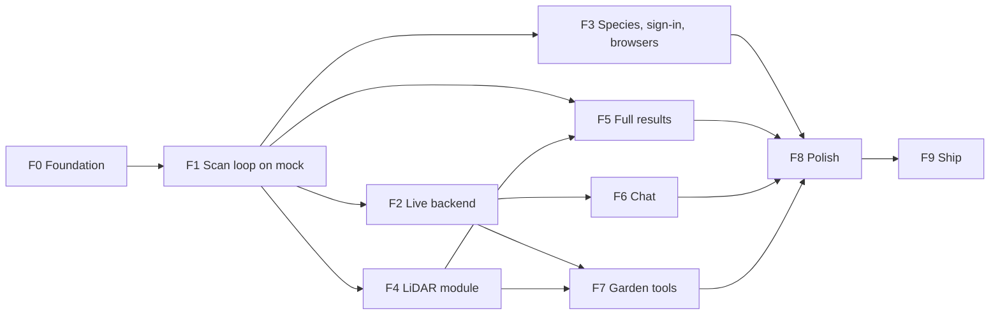

# PDM Frontend Roadmap

> **Status:** Draft v0.1, 2026-10-17. v0.1: the app's build-week work as ten slices (F0–F9), from the scaffold on `feat/app-scaffold` to the deployed web build. Each slice has its goal, its work, what it needs from the other tracks, its exit checks and the decisions it closes. Section 13 lists the gaps found while building F0.

Companion to the [frontend architecture](README.md), its [flows](flows.md) and [screens](screens.md). The [build plan](README.md#18-build-plan) and [architecture 14](../architecture/README.md#14-build-plan) say what is done on each date. This document says how the app gets there: the order of the work, what each step depends on, and how we know a step is finished. It mirrors the [backend roadmap](../backend/roadmap.md).

## Contents

1. [Where the app stands](#1-where-the-app-stands)
2. [Devices and builds](#2-devices-and-builds)
3. [How the slices work](#3-how-the-slices-work)
4. [The slices at a glance](#4-the-slices-at-a-glance)
5. [F0. Foundation](#5-f0-foundation)
6. [F1. The scan loop on mock data](#6-f1-the-scan-loop-on-mock-data)
7. [F2. Live backend](#7-f2-live-backend)
8. [F3. Species, sign-in methods and browsers](#8-f3-species-sign-in-methods-and-browsers)
9. [F4. The LiDAR module](#9-f4-the-lidar-module)
10. [F5. Full results](#10-f5-full-results)
11. [F6. Chat, F7. Garden tools, F8. Polish and F9. Ship](#11-f6-chat-f7-garden-tools-f8-polish-and-f9-ship)
12. [Decisions taken in F0](#12-decisions-taken-in-f0)
13. [Gaps found while building F0](#13-gaps-found-while-building-f0)
14. [Running the app](#14-running-the-app)

---

## 1. Where the app stands

On Oct 17, branch `feat/app-scaffold` holds the Expo project in `app/`: about 4,600 lines of TypeScript in 93 files, not counting the generated contract types. It follows the layout of [README 6](README.md#6-directory-layout) and runs on iOS, Android and the web.

| Layer | What exists | Tested by |
|---|---|---|
| Config | Expo SDK 57.0.30, React Native 0.86.3, Expo Router 57.0.28 with typed routes, `@clerk/expo` 4.13.0; `app.config.ts`; zod-validated `EXPO_PUBLIC_*` (`src/config/env.ts`) | `npx expo-doctor`: 21 of 21 checks pass; `npx expo install --check` |
| Lint | `eslint-config-expo` plus the layer rules of [README 5](README.md#5-layers-and-import-rules) as `import/no-restricted-paths` errors, deep feature imports blocked, Clerk only in `features/auth` | `npx expo lint`, clean |
| `domain` | Generated contract types re-exported by name (245 schemas), the role matrix, scan statuses, stages and the resting rule, kind limits, the wording of [screens 6](screens.md#6-wording-for-uncertain-results), regions, units and local dates | Jest: role matrix, resting rule, wording |
| `ui` | Tokens (the palette of section 12, a 4-point spacing scale, iOS text styles), light and dark themes; `Text`, `Button`, `IconButton`, `Card`, `Chip`, `Banner`, `TextField`, `ListItem`, `Skeleton`, `EmptyState`, `ErrorState`, `Screen`, `Section`; `StatusChip`, `ConfidenceBadge`, `StageProgress`, `PhotoWithRegions` | Contrast script: every text pair passes WCAG AA (4.5:1) in both schemes |
| `api` | `openapi-fetch` client with the auth middleware, the error table and retry policy of [README 9](README.md#9-api-layer), idempotency keys per user action, the SSE parser and reader, query keys, resources for `me`, gardens, weather, plants, timeline, tasks and scans (multipart upload and the event stream) | Jest: the SSE parser at every chunk boundary |
| `api/mock` | The fixture store (a garden, 4 plants, weather with a frost day, tasks and a forecast alert), every endpoint above, and three scripted scan runs streamed as SSE: the early-blight run of [contracts 4](../architecture/contracts.md#event-catalogue), a run that asks a question, and a healthy plant. Fault injection for a failed quality check | Jest: the garden home renders from it |
| `platform` | Photos (system camera, library, HEIC to JPEG), haptics, location with consent, persisted storage | Manual |
| Features | `auth` (Clerk email and password, sign-up code, TOTP and backup codes; a demo sign-in in mock mode without a Clerk key), `gardens` (session gate, onboarding, garden home with weather strip, alerts, today's tasks and plant cards), `account` (settings with demo controls), `shell` (the provider tree), `scans/model` (the event reducer and its effects) | Jest: the reducer against the contracts 4 run, replays with repeated `seq`, retractions, a species rerun, questions and late plans, failures |
| Routes | `(auth)/sign-in`, `sign-up`, `verify`; `(app)` behind the session gate; tabs Garden and Settings | `npx expo export -p web` bundles |

**Not built yet:** capture, the scan screen, the new-scan sheet, plant detail, tasks, chat, members, the map, push and the LiDAR module. Their entry points are hidden until they exist ([screens 4](screens.md#4-rules-every-screen-follows): never shown broken).

## 2. Devices and builds

The team's test phone is an **iPhone 17 Pro Max**, which has the LiDAR scanner, so depth capture and garden mapping ([architecture 6.7–6.8](../architecture/README.md)) can be built and checked on it. Nobody has a paid Apple Developer account yet.

| Build | Needs | Gives | Use it for |
|---|---|---|---|
| Expo Go | Nothing | Everything except native modules and push | F1 to F3, F5 to F7: fast UI work in mock mode |
| Web build | Nothing | The live link the judges open | Every slice; the target of F9 |
| Local development build (`npx expo run:ios --device`) | A Mac with Xcode, and a free Apple ID as a personal team | The LiDAR module on the 17 Pro Max. The app expires after 7 days and must be reinstalled | F4 and the LiDAR checks of F5 and F7 |
| EAS development or preview build | A paid Apple Developer account ($99 a year) | Installs over the air on teammates' phones, and push notifications through APNs | F7 push; nothing else needs it |

Push on iOS needs the paid account (APNs keys). Without it, the alert inbox covers forecast alerts in every build, as [README open decision 10](README.md#19-open-decisions) already says for browsers. Android development builds need no account.

## 3. How the slices work

- **A slice is vertical.** It takes one capability from the screen through the view-model hook and the api layer to the mock, and ends in something we can watch work on the 17 Pro Max and in a browser.
- **Mock first, then live.** Every screen is built against `api/mock` (README 15), so the app never waits on the backend. F2 switches the same screens to the live API.
- **A slice is done when its exit checks pass** on a device and on the web build, not only in Jest.
- **Every change goes through a pull request to `main`** ([AGENTS.md, branches](../../AGENTS.md#branches-and-pull-requests)). After a backend contract change, run `npm run gen:api` and commit `src/api/generated/schema.ts` with it.
- **Each screen is reviewed against the guidelines** with the `/hig` skill and its page skills before its slice closes.

## 4. The slices at a glance

| Slice | Dates | Goal | Needs first | Other tracks |
|---|---|---|---|---|
| [F0](#5-f0-foundation) ✓ built | Oct 17 | Scaffold, layers, tokens, api, mock, sign-in, onboarding, garden home | none | none |
| [F1](#6-f1-the-scan-loop-on-mock-data) | Oct 17–18 | Photograph a plant and watch the scripted scan to its plan | F0 | none |
| [F2](#7-f2-live-backend) | Oct 18–19 | The same screens on the live API, with Clerk | F1 | Backend S1 deployed; Clerk dev instance; CORS |
| [F3](#8-f3-species-sign-in-methods-and-browsers) | Oct 18–19 | Species card and picker, Google and Apple sign-in, in-app browsers | F1 | Clerk SSO settings |
| [F4](#9-f4-the-lidar-module) | Oct 18–20 | Depth capture with distance hints on the 17 Pro Max | F1 | Backend depth upload (S2); vision day-1 depth check |
| [F5](#10-f5-full-results) | Oct 20–21 | Masks, organisms, soil, measurements, question photos, guided soil checks | F1, F4 | Backend S4 |
| [F6](#11-f6-chat-f7-garden-tools-f8-polish-and-f9-ship) | Oct 22 | Chat with streaming, tools, citations, cards and memories | F2 | Backend S5 |
| [F7](#11-f6-chat-f7-garden-tools-f8-polish-and-f9-ship) | Oct 22–23 | Timeline and growth curve, tasks and alerts, members and invites, the garden map, account deletion | F2, F4 | Backend S5, S6 |
| [F8](#11-f6-chat-f7-garden-tools-f8-polish-and-f9-ship) | Oct 24 | Feature freeze, accessibility and guideline pass on every target | F1–F7 | none |
| [F9](#11-f6-chat-f7-garden-tools-f8-polish-and-f9-ship) | Oct 25 | Web build deployed as the live link; demo recorded | F8 | Backend S8; demo video, Devpost |



## 5. F0. Foundation

**Goal.** A project the rest of the build week can add screens to without changing its structure. Built on Oct 17 (section 1).

**Exit checks, all passing on Oct 17.**
- `npx tsc --noEmit`, `npx expo lint`, `npx jest` (19 tests) and `npx expo-doctor` are clean.
- `npx expo export -p web` bundles.
- In mock mode, the demo sign-in leads to the garden home, with the sample garden's weather, frost alert, today's tasks and 4 plants, in light and dark mode.

**Still to check on a device:** the app in Expo Go on the 17 Pro Max, and the sign-in and onboarding screens with a real Clerk key (F2).

## 6. F1. The scan loop on mock data

**Goal.** The demo's core: photograph a plant, watch each stage of the analysis live, and read the diagnosis and the plan. This is what the UI & Design criterion scores ([architecture 1](../architecture/README.md#1-goals-and-judging-criteria)).

**Work.**
1. **New-scan sheet** (`scan/new`, a `formSheet`): pick a plant or name a new one, then `POST /scans` and open capture. "Scan a plant" returns to the garden home.
2. **Capture** (`capture/[scanId]`, [screens 3.2](screens.md#32-capture), [flows 4](flows.md#4-capture-and-submit-a-scan), [14](flows.md#14-capture-slot), [15](flows.md#15-capture-session)): the slot state machine in `features/capture/model` with its tests; each shot uploads as it is taken; the retake banner for `image_quality` with its hint icon; replace and delete; the persisted draft with each shot's file and key; **Submit** and **Discard**. System camera first; an in-app `expo-camera` view with a framing guide replaces it on native once the rest works.
3. **Scan screen** (`scans/[scanId]`, [screens 3.3–3.4](screens.md#33-scan-results)): `useScanEvents` (snapshot, full replay, live events, reconnect with `Last-Event-ID` and backoff, the 45-second idle rule, closing in the background, [flows 17](flows.md#17-scan-event-stream)); `StageProgress`; the photo strip with region boxes; findings with their bands; the question card; the diagnosis card worded by `domain/diagnosis.ts`; the plan checklist with timing, citations and the provisional banner; the failure card with **Retry** or **New scan**.
4. **Plant detail** (`plants/[plantId]`): the timeline of scans, opening each one.
5. **Tasks tab**: open tasks by due date in the garden's time zone, the alert inbox, done and dismiss.

**Exit checks.**
- On the 17 Pro Max in Expo Go and in a desktop browser: the early-blight run from photo to plan, with the stages ticking, the box on the photographed leaf, "Early blight" with its matched indicators, the ladybug larva marked "leave it, it eats aphids", and a 5-step plan whose tasks appear on the Tasks tab.
- The question scenario: the card appears, **Yes** confirms the diagnosis, **I can't tell** leaves a provisional plan.
- A failed quality check (Settings, demo controls) shows the retake banner, and the retaken shot uploads.
- Killing the app mid-capture and reopening it resumes the draft.
- Jest: the capture machine, and `useScanEvents` over a scripted stream with a dropped connection.

## 7. F2. Live backend

**Goal.** The F1 screens on the real API, with real Clerk sessions.

**Work.** A Clerk dev instance key in `.env`; `EXPO_PUBLIC_API_MODE=live`; check the token refresh on `401`; streaming SSE through `expo/fetch` on the phone and `fetch` in the browser; the web build's origin allowed by CORS ([README 17](README.md#17-builds-environments-and-delivery)); signed image URLs refetched on `invalid_signature`; an offline banner.

**Needs.** Backend S1 on the control plane ([backend roadmap 5](../backend/roadmap.md#5-s1-walking-skeleton)).

**Exit checks.** Sign up, verify the email code, create a garden and run a scan on stub vision, from the phone and from a browser. An expired session signs out cleanly. `npm run gen:api` against the deployed spec leaves no type errors.

**Closes.** [README open decisions](README.md#19-open-decisions) 5 (web origin) and 6 (upload progress), after timing uploads on the phone.

## 8. F3. Species, sign-in methods and browsers

**Work.** The species card on the scan screen (one tap to confirm, or the top 3 and "Something else" with reference photos and their credits) and the species picker sheet ([flows 7](flows.md#7-species-confirmation-and-reruns)); Google and Apple through `useSSO` ([README 8](README.md#8-authentication-clerk)); detection of in-app browsers, with the "Open in Safari or Chrome" banner and SSO hidden in embedded web views ([README 13](README.md#13-platform-adapters-and-the-lidar-module)).

**Exit checks.** A species change reruns the scan and its stages reset. Google sign-in works on the phone and in Safari; a link opened from Instagram shows the banner and email sign-in only.

**Closes.** Open decisions 3 and 4 (Clerk screens, sign-in methods).

## 9. F4. The LiDAR module

**Goal.** Depth with each photo on the 17 Pro Max, so the backend can measure spots in millimetres.

**Work.** `app/modules/lidar` with the Expo Modules API in Swift ([README 13](README.md#13-platform-adapters-and-the-lidar-module), [architecture 6.7](../architecture/README.md)): `getCapabilities()`, the camera view with distance events and the ranges per shot kind, the photo, the 16-bit depth PNG, the confidence map and `DepthMeta`; the JavaScript fallback that reports no depth in Expo Go, on Android and on the web; the three extra upload parts.

**Needs.** A local development build (section 2) and the vision track's day-1 depth check.

**Exit checks.** The capability check is true on the 17 Pro Max and false in Expo Go; a leaf close-up uploads with `depth.stored: true`; the distance hint says "Move closer" outside 25–45 cm.

## 10. F5. Full results

**Work.** Masks drawn over region boxes; organisms by role, with "How to report" for invasive ones; soil findings as a list, never a score; measurements with units and bands, and the "measured" badge on indicators; question photos (`capture/[scanId]/question/[questionId]`); guided squeeze and jar tests, with the jar task ([flows 6](flows.md#6-answering-a-question)); "plan updated" notices for late work ([flows 8](flows.md#8-late-work-and-plan-updates)); scan feedback for reviewers and up.

**Exit checks.** Each scripted run of [README 15](README.md#15-mock-mode) renders, in mock mode and then live against backend S4; a jar test started on Monday opens the right scan from its task.

## 11. F6. Chat, F7. Garden tools, F8. Polish and F9. Ship

| Slice | Work | Exit checks |
|---|---|---|
| **F6. Chat** (Oct 22) | The Chat tab and conversation screen: the message reducer, streaming text, tool chips, citations, `PendingActionCard` with confirm and reject, remembered facts with Undo and Share, message feedback, photos in the composer, "Ask about this result" from a scan ([README 10](README.md#10-live-streams), [flows 9–10](flows.md#9-chat-turn)) | A scripted turn streams in mock mode; live, a "create a task" card confirms and the task appears; a dropped stream offers **Resend** |
| **F7. Garden tools** (Oct 22–23) | The growth curve on plant detail; members, roles and invites with the share sheet and `invite/[code]`; garden create, edit and switch; the garden map view (SVG) and the mapping session on the 17 Pro Max; account deletion; push in a development build if the team buys an Apple account; the web manifest | An invite link accepted on a second account; a map drawn on the phone opens each plant; deleting an account shows what was removed |
| **F8. Polish** (Oct 24) | Feature freeze. A `/hig` review of every screen; VoiceOver and Dynamic Type at the largest size; dark mode; Android back gestures; the web build on a phone, in Slack's and Instagram's in-app browsers, and on a desktop ([README 16, device checks](README.md#16-testing-and-tooling)); an app icon and splash in the palette | Every screen passes the device script; no **must** findings left in the review |
| **F9. Ship** (Oct 25) | `npx expo export -p web` deployed as the live link; screens recorded for the 2-minute demo video | The live link works on a judge's phone with a fresh account |

## 12. Decisions taken in F0

| Decision | What was chosen | Why |
|---|---|---|
| Palette | Leaf green accent (`#2F6B47` light, `#7CC59A` dark) on warm off-white, with status colours for healthy, watch, sick and dead, each with a soft background (`src/ui/tokens.ts`) | No palette existed. Every text and status pair passes WCAG AA (4.5:1) in both schemes, and status is always written as words too |
| Type | Apple's iOS text styles (34 to 12 points) in the system font, scaled with the system text size | [HIG typography](https://developer.apple.com/design/human-interface-guidelines/typography); no custom font to load |
| Styling (open decision 2) | Tokens with `StyleSheet`, as proposed | No compiler or native dependency |
| Clerk screens (open decision 3) | Custom screens with Clerk Core 3's `useSignIn` and `useSignUp` signals (`signIn.password`, `signIn.mfa.verifyTOTP`, `signUp.verifications.sendEmailCode`, `finalize`), checked against the installed 4.13.0 types | Matches the app and works on every target |
| Demo sign-in | Mock mode with no Clerk key signs in a local demo user. It can't run against the live API | The app can be shown with no backend and no account |
| Tabs | Expo Router's native tabs (`expo-router/unstable-native-tabs`), with SF Symbols on iOS and Material symbols on Android. Garden and Settings now; Tasks and Chat join in F1 and F6 | [HIG tab bars](https://developer.apple.com/design/human-interface-guidelines/tab-bars); a tab is never shown empty |
| App name | "PDM", scheme `pdm`, bundle `org.buildnorth.pdm` | As in the documents; change `app.config.ts` if the team picks another name |
| Camera | The system camera first (F1), then an in-app `expo-camera` view on native | Ships the loop sooner; the framing guide is polish on top |

## 13. Gaps found while building F0

1. **`backend/openapi.json` references two schemas it doesn't define:** `AnchorType` (the `anchor_type` query of `GET /conversations`) and `TaskState` (the `state` query of `GET /tasks`). Both enums exist in `domain` with `ToSchema`, but aren't registered in `bins/api/src/openapi.rs`. `openapi-typescript` fails on them, so `scripts/gen-api.mjs` replaces each with a string and prints a warning. **Fix in the backend:** add both to the `components(schemas(...))` list and regenerate the spec.
2. **utoipa emits description-only members inside `allOf`** (`{ "type": "object", "description": "…" }`, on `Observation`, `Region` and others). `openapi-typescript` renders each as `Record<string, never>`, which makes those types impossible to build. The gen script drops such members. A backend fix (no description-only `allOf` members) would remove the workaround.
3. **`@clerk/expo` 4.13.0 now declares `expo: ">=54 <59"`,** so it supports SDK 58. [README 3](README.md#3-stack-and-version-pins) still says 4.12 with `<58`. Open decision 1 (moving to SDK 58) can now be taken; the app stays on 57 until the team decides.
4. **`expo-asset` was a missing peer of `expo-font`.** It is installed now; without it, icons failed to load.
5. **TypeScript 6 no longer includes `@types` packages on its own,** so `tsconfig.json` lists `"types": ["jest"]`. `openapi-typescript` 7.13 declares `typescript ^5` as a peer; `package.json` overrides it to the project's TypeScript 6.
6. **CI has no app job.** Add one that runs `npm ci`, `npm run gen:api` with a diff check, `npm run typecheck`, `npm run lint`, `npm test` and `npx expo install --check` ([README 16](README.md#16-testing-and-tooling); [infra 2](../infra/README.md#2-ci)).

## 14. Running the app

```sh
cd app
npm install
cp .env.example .env          # leave the Clerk key empty to use the demo sign-in
npm start                     # then scan the QR code with Expo Go on the iPhone
npm run web                   # or open it in a browser
npm test && npm run typecheck && npm run lint
```

In mock mode, Settings has demo controls: the outcome of the next scan (early blight, a question, or a healthy plant), a failed quality check on the next upload, and a reset of the sample data.
