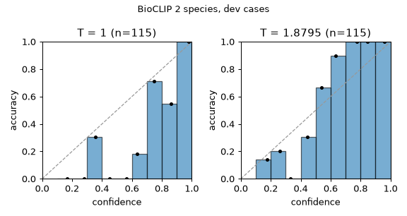
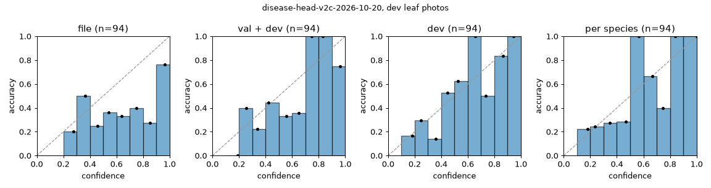
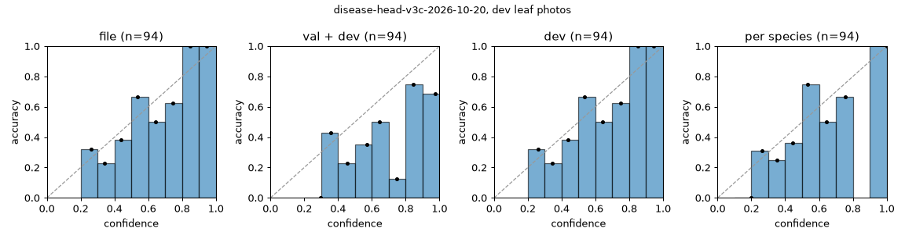

# Calibration on the dev cases: calibration-2026-10-20-garden

The offline part of evaluation 5 ([calibrate.py](../calibrate.py)). The values are proposals: the label matrix is the 20-species stand-in until M12, and the manifest's disease head is the one training 6 chose. Every fit on the dev cases is also scored **out of fold**: each case at a temperature fitted on the other 4 of 5 folds, the cases dealt into folds within each species (seed 0).

## Species: BioCLIP 2 zero-shot (`species_temperature`)

115 dev cases over the label matrix's 20 species.

| `species_temperature` | Top-1 | NLL | ECE (15 bins) | Cases at 0.8 or more | Their top-1 | Lowest threshold with 95% top-1 |
|---|---|---|---|---|---|---|
| 1.0 | 57% | 1.683 | 0.193 | 59 | 92% | 0.85 |
| 1.8795, fitted | 57% | 1.398 | 0.188 | 32 | 100% | 0.50 |
| fitted out of fold (1.738–1.9811) | 57% | 1.411 | 0.178 | 33 | 100% | 0.50 |

Per species at the fitted temperature: apple 80% of 15, corn 94% of 16, grape 91% of 11, squash 0% of 10, tomato 44% of 63.

Wrong top-1 at the fitted temperature: `corn-maize-bd-2026-corn-leaf-blight-img-649` → hosta (0.588); `tomato-tomato-bd-2025-early-blight-early-blight-73` → blueberry (0.445); `tomato-tomato-bd-2025-early-blight-early-blight-410` → apple (0.196); `tomato-tomato-bd-2025-early-blight-early-blight-487` → soybean (0.339); `tomato-tomato-bd-2025-early-blight-early-blight-173` → soybean (0.299); `tomato-tomato-bd-2025-early-blight-early-blight-474` → potato (0.408); `tomato-tomato-bd-2025-late-blight-late-blight-111` → peach (0.349); `tomato-tomato-bd-2025-late-blight-late-blight-30` → pepper (0.243); `tomato-tomato-bd-2025-late-blight-late-blight-7` → pepper (0.314); `tomato-tomato-bd-2025-late-blight-late-blight-98` → blueberry (0.256); `tomato-tomato-bd-2025-bacteiral-spot-bacteiral-spot-118` → pepper (0.3); `tomato-tomato-bd-2025-bacteiral-spot-bacteiral-spot-7` → potato (0.46); `tomato-tomato-bd-2025-yellow-leaf-curl-virus-curl-60` → bean (0.327); `tomato-tomato-bd-2025-yellow-leaf-curl-virus-curl-187` → potato (0.305); `tomato-tomato-bd-2025-yellow-leaf-curl-virus-curl-171` → potato (0.249); `tomato-tomato-bd-iphone-2025-early-blight-img-2705` → potato (0.28); `tomato-tomato-bd-iphone-2025-early-blight-img-2662` → bean (0.204); `tomato-tomato-bd-iphone-2025-early-blight-img-2647` → hosta (0.541); `tomato-tomato-bd-iphone-2025-late-blight-img-5576-02d` → pepper (0.338); `tomato-tomato-bd-iphone-2025-late-blight-img-5536-02d` → soybean (0.32); `tomato-tomato-bd-iphone-2025-late-blight-img-5629-02d` → pepper (0.239); `tomato-tomato-bd-iphone-2025-late-blight-img-5561-02d` → pepper (0.422); `tomato-tomato-bd-iphone-2025-late-blight-img-4135-02d` → pepper (0.39); `tomato-tomato-bd-iphone-2025-bacterial-spot-img-3717-02d` → pepper (0.243); `tomato-tomato-bd-iphone-2025-bacterial-spot-img-3652-02d` → potato (0.303); `tomato-ccmt-2023-septoria-leaf-spot-septoria-leaf-spot1143` → potato (0.416); `apple-inat-408169430` → peach (0.445); `apple-inat-386321336` → blueberry (0.188); `apple-inat-371778242` → blueberry (0.321); `grape-inat-401311005` → apple (0.336); `squash-inat-407881529` → bean (0.386); `squash-inat-407471919` → soybean (0.346); `squash-inat-405307409` → cucumber (0.293); `squash-inat-405307085` → cucumber (0.284); `squash-inat-402785468` → tomato (0.316); `squash-inat-401345730` → cucumber (0.449); `squash-inat-400031065` → grape (0.303); `squash-inat-362922124` → grape (0.478); `squash-inat-360057285` → grape (0.358); `squash-inat-359769884` → soybean (0.199); `tomato-inat-404337653` → grape (0.159); `tomato-inat-402407638` → hosta (0.307); `tomato-inat-400434286` → potato (0.194); `tomato-inat-394771244` → potato (0.359); `tomato-inat-394770049` → cucumber (0.25); `tomato-inat-394769945` → potato (0.261); `tomato-inat-388547158` → cucumber (0.317); `tomato-inat-387638491` → soybean (0.409); `tomato-inat-382214503` → cucumber (0.602); `tomato-inat-379206522` → onion (0.126).

## Disease head (`temperature`)

Leaf photos of the dev cases with exactly one crop, or none (then the whole close-up; an underside with no leaf box is dropped, as the worker drops it). Where this differs from a scan through the worker:

- **A one-photo case's photo is sent as a `leaf_closeup`,** as evaluation 8's bench sends it. As labelled (`whole_plant`), the worker wouldn't classify it (`no_leaves_found`). 82 of the 94 photos are such cases, 11 of the 11 healthy leaves among them.
- **The head is restricted to the case's true species.** The worker restricts it to the working species, BioCLIP's top 1 unless the user names one, so these numbers assume the species is right.
- **The healthy leaves are field-set photos,** 11 of them and none from iNaturalist.

### The top 3 (the temperature doesn't change it)

The worker sends each leaf's top 3 classes, `healthy` among them, and the API keeps the problems among them as the scan's classifier candidates (contracts 5). So on a photo with a problem, a hit is the true problem among the head's top 3, against guessing 3 of the species' k classes. **Top 3 problems** drops `healthy` first, against guessing 3 of k − 1: what the API would get if the worker sent 3 problems per leaf. **Where it can miss** leaves out the species whose classes (or problems) are 3 or fewer, where both always score 100%.

| Head | Classes | Photos with a problem | **Top 3 as sent** (guessing) | Where it can miss: photos, top 3 (guessing) | Top 3 problems (guessing) | Where it can miss | Top-1, every photo |
|---|---|---|---|---|---|---|---|
| `disease-head-v2c-2026-10-20` | 19 | 83 | **73%** (57%) | 64, 66% (45%) | 76% (64%) | 52, 62% (43%) | 40% of 94 |
| `disease-head-v3c-2026-10-20` | 19 | 83 | **84%** (57%) | 64, 80% (45%) | 86% (64%) | 52, 77% (43%) | 41% of 94 |

`disease-head-v2c-2026-10-20`, top 3 as sent (guessing) on the photos with a problem, and top-1 of every photo:

- Per species: apple (3 classes) 11 of 11 (guessing 100%), top-1 5 of 11; corn (4 classes) 12 of 12 (guessing 75%), top-1 11 of 15; grape (2 classes) 8 of 8 (guessing 100%), top-1 8 of 8; tomato (8 classes) 30 of 52 (guessing 38%), top-1 14 of 60.
- Per source: fieldsets/ccmt-2023 tomato 5 of 5 (guessing 38%), top-1 3 of 5; fieldsets/maize-bd-2026 corn 12 of 12 (guessing 75%), top-1 11 of 15; fieldsets/tomato-bd-2025 tomato 13 of 20 (guessing 38%), top-1 5 of 23; fieldsets/tomato-bd-iphone-2025 tomato 9 of 15 (guessing 38%), top-1 5 of 20; inat apple 11 of 11 (guessing 100%), top-1 5 of 11; inat grape 8 of 8 (guessing 100%), top-1 8 of 8; inat tomato 3 of 12 (guessing 38%), top-1 1 of 12.
- Top-1 answers per true class: **apple:** cedar apple rust (2) → cedar apple rust 1, scab 1; scab (9) → cedar apple rust 5, scab 4. **corn:** common rust (5) → common rust 3, northern leaf blight 2; gray leaf spot (2) → gray leaf spot 1, northern leaf blight 1; northern leaf blight (5) → northern leaf blight 5; healthy (3) → healthy 2, common rust 1. **grape:** black rot (8) → black rot 8. **tomato:** healthy (8) → leaf mold 3, bacterial spot 3, late blight 1, healthy 1; bacterial spot (10) → bacterial spot 4, septoria leaf spot 3, leaf mold 2, healthy 1; early blight (11) → early blight 3, bacterial spot 3, late blight 2, leaf mold 2, septoria leaf spot 1; late blight (9) → bacterial spot 3, late blight 2, septoria leaf spot 2, leaf mold 1, early blight 1; septoria leaf spot (5) → septoria leaf spot 3, bacterial spot 2; spider mites (12) → bacterial spot 5, leaf mold 4, late blight 3; yellow leaf curl virus (5) → leaf mold 2, yellow leaf curl virus 1, late blight 1, bacterial spot 1.
- Left out: 18 leaf photos with several crops, 2 no leaf shot, 10 species without head classes.

`disease-head-v3c-2026-10-20`, top 3 as sent (guessing) on the photos with a problem, and top-1 of every photo:

- Per species: apple (3 classes) 11 of 11 (guessing 100%), top-1 8 of 11; corn (4 classes) 11 of 12 (guessing 75%), top-1 7 of 15; grape (2 classes) 8 of 8 (guessing 100%), top-1 8 of 8; tomato (8 classes) 40 of 52 (guessing 38%), top-1 16 of 60.
- Per source: fieldsets/ccmt-2023 tomato 5 of 5 (guessing 38%), top-1 4 of 5; fieldsets/maize-bd-2026 corn 11 of 12 (guessing 75%), top-1 7 of 15; fieldsets/tomato-bd-2025 tomato 17 of 20 (guessing 38%), top-1 8 of 23; fieldsets/tomato-bd-iphone-2025 tomato 10 of 15 (guessing 38%), top-1 2 of 20; inat apple 11 of 11 (guessing 100%), top-1 8 of 11; inat grape 8 of 8 (guessing 100%), top-1 8 of 8; inat tomato 8 of 12 (guessing 38%), top-1 2 of 12.
- Top-1 answers per true class: **apple:** cedar apple rust (2) → cedar apple rust 2; scab (9) → scab 6, cedar apple rust 3. **corn:** common rust (5) → gray leaf spot 3, common rust 1, northern leaf blight 1; gray leaf spot (2) → gray leaf spot 2; northern leaf blight (5) → healthy 3, gray leaf spot 1, northern leaf blight 1; healthy (3) → healthy 3. **grape:** black rot (8) → black rot 8. **tomato:** healthy (8) → bacterial spot 5, leaf mold 2, healthy 1; bacterial spot (10) → septoria leaf spot 5, bacterial spot 4, leaf mold 1; early blight (11) → septoria leaf spot 3, bacterial spot 2, early blight 2, late blight 2, leaf mold 2; late blight (9) → early blight 3, septoria leaf spot 3, late blight 2, bacterial spot 1; septoria leaf spot (5) → septoria leaf spot 4, bacterial spot 1; spider mites (12) → leaf mold 5, late blight 4, bacterial spot 2, spider mites 1; yellow leaf curl virus (5) → yellow leaf curl virus 2, septoria leaf spot 2, leaf mold 1.
- Left out: 18 leaf photos with several crops, 2 no leaf shot, 10 species without head classes.

### What the temperature changes

At medium confidence (0.5) or more, a problem on top is shown as a possible problem when the indicators are unsure, and keeps a scan from `healthy`; `healthy` on top counts as positive evidence of health (contracts 7). One crop can't have two classes at 0.5 or more.

| Head | Temperature | Value | Problem at medium: photos (right) | Healthy leaves with `healthy` at medium | Healthy leaves blocked by a problem | Leaves with a problem given `healthy` at medium | Dev ECE | Val ECE |
|---|---|---|---|---|---|---|---|---|
| `disease-head-v2c-2026-10-20` | in the file (val) | 1.1474 | 61 (27) | 2 of 11 | 5 of 11 | 0 of 83 | 0.266 | 0.105 |
| `disease-head-v2c-2026-10-20` | fitted on val and dev | 2.0446 | 45 (22) | 2 of 11 | 3 of 11 | 0 of 83 | 0.156 | 0.054 |
| `disease-head-v2c-2026-10-20` | fitted on dev | 3.6646 | 18 (13) | 2 of 11 | 0 of 11 | 0 of 83 | 0.112 | 0.188 |
| `disease-head-v2c-2026-10-20` | per species, fitted on dev | apple 4.8695, corn 1.5662, grape 0.0675, tomato 4.6103 | 24 (19) | 2 of 11 | 0 of 11 | 0 of 83 | 0.126 | 0.149 |
| `disease-head-v3c-2026-10-20` | in the file (val) | 1.8206 | 24 (17) | 2 of 11 | 0 of 11 | 1 of 83 | 0.099 | 0.249 |
| `disease-head-v3c-2026-10-20` | fitted on val and dev | 0.8329 | 53 (25) | 3 of 11 | 3 of 11 | 1 of 83 | 0.242 | 0.045 |
| `disease-head-v3c-2026-10-20` | fitted on dev | 1.8206 | 24 (17) | 2 of 11 | 0 of 11 | 1 of 83 | 0.099 | 0.249 |
| `disease-head-v3c-2026-10-20` | per species, fitted on dev | apple 1.8031, corn 1.7893, grape 0.0547, tomato 1.9125 | 23 (17) | 2 of 11 | 0 of 11 | 1 of 83 | 0.106 | 0.251 |

Per species: problem at medium, photos (right), and the healthy leaves with `healthy` at medium.

| Head | Temperature | apple (11) | corn (15) | grape (8) | tomato (60) |
|---|---|---|---|---|---|
| `disease-head-v2c-2026-10-20` | in the file (val) | 11 (5) | 13 (9); healthy 2 of 3 | 8 (8) | 29 (5); healthy 0 of 8 |
| `disease-head-v2c-2026-10-20` | fitted on val and dev | 10 (4) | 11 (8); healthy 2 of 3 | 8 (8) | 16 (2); healthy 0 of 8 |
| `disease-head-v2c-2026-10-20` | fitted on dev | 8 (3) | 2 (2); healthy 2 of 3 | 8 (8) | 0 (0); healthy 0 of 8 |
| `disease-head-v2c-2026-10-20` | per species, fitted on dev | 5 (3) | 11 (8); healthy 2 of 3 | 8 (8) | 0 (0); healthy 0 of 8 |
| `disease-head-v3c-2026-10-20` | in the file (val) | 11 (8) | 1 (0); healthy 2 of 3 | 8 (8) | 4 (1); healthy 0 of 8 |
| `disease-head-v3c-2026-10-20` | fitted on val and dev | 11 (8) | 4 (2); healthy 3 of 3 | 8 (8) | 30 (7); healthy 0 of 8 |
| `disease-head-v3c-2026-10-20` | fitted on dev | 11 (8) | 1 (0); healthy 2 of 3 | 8 (8) | 4 (1); healthy 0 of 8 |
| `disease-head-v3c-2026-10-20` | per species, fitted on dev | 11 (8) | 1 (0); healthy 2 of 3 | 8 (8) | 3 (1); healthy 0 of 8 |

**Out of fold.** Each case at the temperature fitted without its fold; the file's value isn't fitted on dev, so it doesn't change.

| Head | Temperature | Values per fold | Problem at medium: photos (right) | apple | corn | grape | tomato | Healthy leaves with `healthy` at medium | Healthy leaves blocked | Dev ECE |
|---|---|---|---|---|---|---|---|---|---|---|
| `disease-head-v2c-2026-10-20` | fitted on val and dev | 1.9908–2.029 | 45 (22) | 10 (4) | 11 (8) | 8 (8) | 16 (2) | 2 of 11 | 3 of 11 | 0.154 |
| `disease-head-v2c-2026-10-20` | fitted on dev | 3.129–3.917 | 18 (13) | 8 (3) | 2 (2) | 8 (8) | 0 (0) | 1 of 11 | 0 of 11 | 0.090 |
| `disease-head-v2c-2026-10-20` | per species, fitted on dev | apple 2.7152–6.5018; corn 1.1752–1.7941; grape 0.0636–0.1017; tomato 3.5311–5.1462 | 25 (19) | 6 (3) | 11 (8) | 8 (8) | 0 (0) | 2 of 11 | 0 of 11 | 0.128 |
| `disease-head-v3c-2026-10-20` | fitted on val and dev | 0.804–0.8179 | 55 (25) | 11 (8) | 4 (2) | 8 (8) | 32 (7) | 3 of 11 | 4 of 11 | 0.245 |
| `disease-head-v3c-2026-10-20` | fitted on dev | 1.7322–1.901 | 23 (17) | 11 (8) | 1 (0) | 8 (8) | 3 (1) | 2 of 11 | 0 of 11 | 0.094 |
| `disease-head-v3c-2026-10-20` | per species, fitted on dev | apple 1.0607–2.4021; corn 1.2735–2.2627; grape 0.0501–0.0829; tomato 1.6827–2.1175 | 22 (16) | 10 (7) | 1 (0) | 8 (8) | 3 (1) | 2 of 11 | 0 of 11 | 0.108 |

A per-species fit runs towards the lower bound (0.05) for a species whose dev photos are all right, as grape's are: such a value says only that those few photos were easy.

