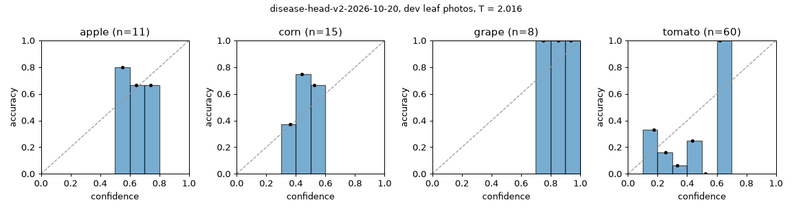
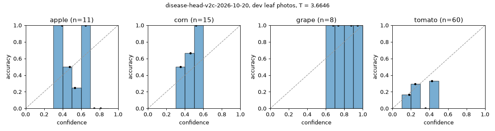

# Calibration on the dev cases: calibration-2026-10-20

The offline part of evaluation 5 ([calibrate.py](../calibrate.py)). The values are proposals: the label matrix is the 20-species stand-in until M12, and the disease head isn't chosen yet (#85).

## Species: BioCLIP 2 zero-shot (`species_temperature`)

115 dev cases over the label matrix's 20 species.

| `species_temperature` | Top-1 | NLL | ECE (15 bins) | Cases at 0.8 or more | Their top-1 | Lowest threshold with 95% top-1 |
|---|---|---|---|---|---|---|
| 1.0 | 57% | 1.683 | 0.193 | 59 | 92% | 0.85 |
| 1.8795 | 57% | 1.398 | 0.188 | 32 | 100% | 0.50 |

Per species at the fitted temperature: apple 80% of 15, corn 94% of 16, grape 91% of 11, squash 0% of 10, tomato 44% of 63.

Wrong top-1 at the fitted temperature: `corn-maize-bd-2026-corn-leaf-blight-img-649` → hosta (0.588); `tomato-tomato-bd-2025-early-blight-early-blight-73` → blueberry (0.445); `tomato-tomato-bd-2025-early-blight-early-blight-410` → apple (0.196); `tomato-tomato-bd-2025-early-blight-early-blight-487` → soybean (0.339); `tomato-tomato-bd-2025-early-blight-early-blight-173` → soybean (0.299); `tomato-tomato-bd-2025-early-blight-early-blight-474` → potato (0.408); `tomato-tomato-bd-2025-late-blight-late-blight-111` → peach (0.349); `tomato-tomato-bd-2025-late-blight-late-blight-30` → pepper (0.243); `tomato-tomato-bd-2025-late-blight-late-blight-7` → pepper (0.314); `tomato-tomato-bd-2025-late-blight-late-blight-98` → blueberry (0.256); `tomato-tomato-bd-2025-bacteiral-spot-bacteiral-spot-118` → pepper (0.3); `tomato-tomato-bd-2025-bacteiral-spot-bacteiral-spot-7` → potato (0.46); `tomato-tomato-bd-2025-yellow-leaf-curl-virus-curl-60` → bean (0.327); `tomato-tomato-bd-2025-yellow-leaf-curl-virus-curl-187` → potato (0.305); `tomato-tomato-bd-2025-yellow-leaf-curl-virus-curl-171` → potato (0.249); `tomato-tomato-bd-iphone-2025-early-blight-img-2705` → potato (0.28); `tomato-tomato-bd-iphone-2025-early-blight-img-2662` → bean (0.204); `tomato-tomato-bd-iphone-2025-early-blight-img-2647` → hosta (0.541); `tomato-tomato-bd-iphone-2025-late-blight-img-5576-02d` → pepper (0.338); `tomato-tomato-bd-iphone-2025-late-blight-img-5536-02d` → soybean (0.32); `tomato-tomato-bd-iphone-2025-late-blight-img-5629-02d` → pepper (0.239); `tomato-tomato-bd-iphone-2025-late-blight-img-5561-02d` → pepper (0.422); `tomato-tomato-bd-iphone-2025-late-blight-img-4135-02d` → pepper (0.39); `tomato-tomato-bd-iphone-2025-bacterial-spot-img-3717-02d` → pepper (0.243); `tomato-tomato-bd-iphone-2025-bacterial-spot-img-3652-02d` → potato (0.303); `tomato-ccmt-2023-septoria-leaf-spot-septoria-leaf-spot1143` → potato (0.416); `apple-inat-408169430` → peach (0.445); `apple-inat-386321336` → blueberry (0.188); `apple-inat-371778242` → blueberry (0.321); `grape-inat-401311005` → apple (0.336); `squash-inat-407881529` → bean (0.386); `squash-inat-407471919` → soybean (0.346); `squash-inat-405307409` → cucumber (0.293); `squash-inat-405307085` → cucumber (0.284); `squash-inat-402785468` → tomato (0.316); `squash-inat-401345730` → cucumber (0.449); `squash-inat-400031065` → grape (0.303); `squash-inat-362922124` → grape (0.478); `squash-inat-360057285` → grape (0.358); `squash-inat-359769884` → soybean (0.199); `tomato-inat-404337653` → grape (0.159); `tomato-inat-402407638` → hosta (0.307); `tomato-inat-400434286` → potato (0.194); `tomato-inat-394771244` → potato (0.359); `tomato-inat-394770049` → cucumber (0.25); `tomato-inat-394769945` → potato (0.261); `tomato-inat-388547158` → cucumber (0.317); `tomato-inat-387638491` → soybean (0.409); `tomato-inat-382214503` → cucumber (0.602); `tomato-inat-379206522` → onion (0.126).

## Disease head (`temperature`)

Leaf photos of the dev cases with exactly one crop (or none, so the whole photo), restricted to the case's species.

**The head's job is its top 3.** The API adds them to the candidates the VLM's questions decide between (architecture 6.3), so the measure is whether the true class is among them, against guessing 3 of the species' classes. The ranking doesn't depend on the temperature.

| Head | Classes | Dev photos | **Top-3** | Guessing, top-3 | Top-1 |
|---|---|---|---|---|---|
| `disease-head-v2-2026-10-20` | 21 | 94 | **72%** | 51% | 36% |
| `disease-head-v2c-2026-10-20` | 19 | 94 | **74%** | 56% | 40% |

**The temperature sets what the head's confidence does.** A problem at medium confidence (0.5) or more is shown as a possible problem when the indicators are unsure, and keeps a scan from `healthy` (contracts 7). The temperature should make those claims as right as they sound on photos like the app's; the proposed one is fitted on the dev cases.

| Head | Temperature | Value | Problem at medium or more: photos (right) | Healthy leaves blocked from `healthy` | Dev ECE | Val ECE |
|---|---|---|---|---|---|---|
| `disease-head-v2-2026-10-20` | in the file (val) | 0.8098 | 60 of 94 (42%) | 4 of 11 | 0.288 | 0.043 |
| `disease-head-v2-2026-10-20` | fitted on val and dev | 1.0485 | 48 of 94 (50%) | 3 of 11 | 0.243 | 0.068 |
| `disease-head-v2-2026-10-20` | **fitted on dev (proposed)** | 2.016 | 24 of 94 (75%) | 0 of 11 | 0.122 | 0.256 |
| `disease-head-v2c-2026-10-20` | in the file (val) | 1.1474 | 61 of 94 (44%) | 5 of 11 | 0.266 | 0.036 |
| `disease-head-v2c-2026-10-20` | fitted on val and dev | 1.6553 | 47 of 94 (49%) | 3 of 11 | 0.223 | 0.088 |
| `disease-head-v2c-2026-10-20` | **fitted on dev (proposed)** | 3.6646 | 18 of 94 (72%) | 0 of 11 | 0.112 | 0.305 |

`disease-head-v2-2026-10-20` per crop on dev, top-3 (guessing) and top-1: apple 100% (100%) and 73% of 11, corn 93% (60%) and 53% of 15, grape 100% (100%) and 100% of 8, tomato 58% (33%) and 17% of 60.
Per source: fieldsets/ccmt-2023 80% (33%) and 20% of 5, fieldsets/maize-bd-2026 93% (60%) and 53% of 15, fieldsets/tomato-bd-2025 65% (33%) and 26% of 23, fieldsets/tomato-bd-iphone-2025 60% (33%) and 15% of 20, inat 74% (74%) and 52% of 31.
Left out: 18 leaf photos with several crops, 2 no leaf shot, 10 species without head classes.

`disease-head-v2c-2026-10-20` per crop on dev, top-3 (guessing) and top-1: apple 100% (100%) and 45% of 11, corn 100% (75%) and 73% of 15, grape 100% (100%) and 100% of 8, tomato 60% (38%) and 23% of 60.
Per source: fieldsets/ccmt-2023 100% (38%) and 60% of 5, fieldsets/maize-bd-2026 100% (75%) and 73% of 15, fieldsets/tomato-bd-2025 65% (38%) and 22% of 23, fieldsets/tomato-bd-iphone-2025 65% (38%) and 25% of 20, inat 71% (76%) and 45% of 31.
Left out: 18 leaf photos with several crops, 2 no leaf shot, 10 species without head classes.

