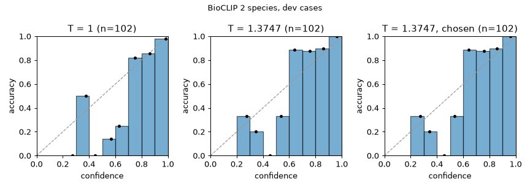
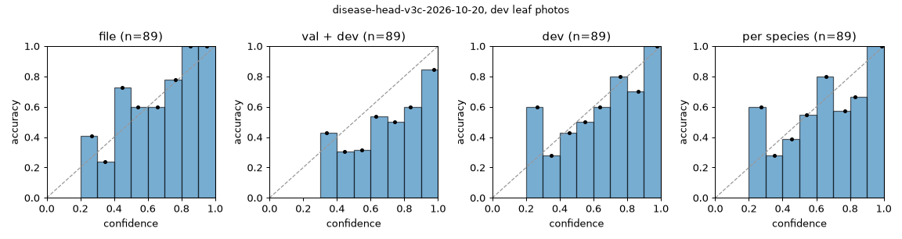

# Calibration on the dev cases: calibration-2026-10-22

The offline part of evaluation 5 ([calibrate.py](../calibrate.py)), on the label matrix the API asks for (`edb29fe878952e7b`) and the disease heads named. Every fit on the dev cases is also scored **out of fold**: each case at a temperature fitted on the other 4 of 5 folds, the cases dealt into folds within each species (seed 0).

## Species: BioCLIP 2 zero-shot (`species_temperature`)

102 dev cases over the label matrix's 20 species. Cases whose species the matrix can't name (none) are left out of the fit, which needs the true row, and counted as wrong at 0.8: a confident wrong species is what the one-tap rule must not offer. **Chosen** is the lowest temperature from the fitted one up at which the cases at 0.8 or more, those included, are 95% right.

| `species_temperature` | Top-1 | NLL | ECE (15 bins) | Cases at 0.8 or more | Their top-1 | With the 0 outside: at 0.8 or more | Their top-1 | Lowest threshold with 95% top-1 |
|---|---|---|---|---|---|---|---|---|
| 1.0 | 75% | 0.785 | 0.118 | 63 | 97% | 63 (0 outside) | 97% | 0.75 |
| 1.3747, fitted | 75% | 0.739 | 0.130 | 56 | 98% | 56 (0 outside) | 98% | 0.60 |
| fitted out of fold (1.2864–1.4393) | 75% | 0.745 | 0.129 | 56 | 98% | 56 (0 outside) | 98% | 0.60 |
| **1.3747, chosen** | 75% | 0.739 | 0.130 | 56 | 98% | 56 (0 outside) | 98% | 0.60 |
| chosen out of fold (1.2864–1.4393) | 75% | 0.745 | 0.129 | 56 | 98% | 56 (0 outside) | 98% | 0.60 |

Per species at 1.3747: apple 93% of 15, corn 89% of 18, grape 92% of 13, squash 0% of 1, tomato 62% of 55.

Wrong top-1 at 1.3747: `corn-maize-bd-2026-corn-leaf-blight-img-649` → hosta (0.71); `tomato-tomato-bd-2025-early-blight-early-blight-73` → blueberry (0.542); `tomato-tomato-bd-2025-early-blight-early-blight-410` → apple (0.234); `tomato-tomato-bd-2025-early-blight-early-blight-173` → soybean (0.386); `tomato-tomato-bd-2025-early-blight-early-blight-474` → potato (0.513); `tomato-tomato-bd-2025-late-blight-late-blight-111` → peach (0.485); `tomato-tomato-bd-2025-late-blight-late-blight-30` → pepper (0.308); `tomato-tomato-bd-2025-late-blight-late-blight-98` → blueberry (0.349); `tomato-tomato-bd-2025-bacteiral-spot-bacteiral-spot-118` → pepper (0.35); `tomato-tomato-bd-2025-bacteiral-spot-bacteiral-spot-7` → potato (0.584); `tomato-tomato-bd-2025-yellow-leaf-curl-virus-curl-60` → bean (0.443); `tomato-tomato-bd-2025-yellow-leaf-curl-virus-curl-187` → potato (0.433); `tomato-tomato-bd-2025-yellow-leaf-curl-virus-curl-171` → potato (0.314); `tomato-tomato-bd-iphone-2025-bacterial-spot-img-3717-02d` → pepper (0.289); `tomato-tomato-bd-iphone-2025-bacterial-spot-img-3652-02d` → potato (0.382); `tomato-ccmt-2023-septoria-leaf-spot-septoria-leaf-spot1143` → potato (0.507); `tomato-inat-401855015` → peach (0.467); `apple-inat-408169430` → peach (0.502); `grape-inat-401311005` → apple (0.403); `squash-inat-401345730` → cucumber (0.532); `tomato-inat-388547158` → squash (0.359); `corn-maize-bd-2026-healthy-leaf-img-100` → hosta (0.344); `tomato-tomato-bd-2025-early-blight-early-blight-258` → soybean (0.601); `tomato-tomato-bd-2025-early-blight-early-blight-368` → potato (0.808); `tomato-tomato-bd-2025-late-blight-late-blight-31` → soybean (0.5); `tomato-tomato-bd-2025-healthy-healthy-310` → bean (0.445).

The cases outside the matrix at 1.3747: none.

## Disease head (`temperature`)

Leaf photos of the dev cases with exactly one crop, or none (then the whole close-up; an underside with no leaf box is dropped, as the worker drops it). Where this differs from a scan through the worker:

- **A one-photo case's photo is sent as a `leaf_closeup`,** as evaluation 8's bench sends it. As labelled (`whole_plant`), the worker wouldn't classify it (`no_leaves_found`). 76 of the 89 photos are such cases, 17 of the 17 healthy leaves among them.
- **The head is restricted to the case's true species.** The worker restricts it to the working species, BioCLIP's top 1 unless the user names one, so these numbers assume the species is right.
- **The healthy leaves are field-set photos,** 17 of them and none from iNaturalist.

### The top 3 (the temperature doesn't change it)

The worker sends each leaf's top 3 classes, `healthy` among them, and the API keeps the problems among them as the scan's classifier candidates (contracts 5). So on a photo with a problem, a hit is the true problem among the head's top 3, against guessing 3 of the species' k classes. **Top 3 problems** drops `healthy` first, against guessing 3 of k − 1: what the API would get if the worker sent 3 problems per leaf. **Where it can miss** leaves out the species whose classes (or problems) are 3 or fewer, where both always score 100%.

| Head | Classes | Photos with a problem | **Top 3 as sent** (guessing) | Where it can miss: photos, top 3 (guessing) | Top 3 problems (guessing) | Where it can miss | Top-1, every photo |
|---|---|---|---|---|---|---|---|
| `disease-head-v3c-2026-10-20` | 19 | 72 | **93%** (62%) | 50, 90% (46%) | 94% (69%) | 39, 90% (43%) | 54% of 89 |

`disease-head-v3c-2026-10-20`, top 3 as sent (guessing) on the photos with a problem, and top-1 of every photo:

- Per species: apple (3 classes) 10 of 10 (guessing 100%), top-1 8 of 10; corn (4 classes) 10 of 11 (guessing 75%), top-1 9 of 17; grape (2 classes) 12 of 12 (guessing 100%), top-1 12 of 12; tomato (8 classes) 35 of 39 (guessing 38%), top-1 19 of 50.
- Per source: fieldsets/ccmt-2023 tomato 7 of 7 (guessing 38%), top-1 4 of 7; fieldsets/maize-bd-2026 corn 10 of 11 (guessing 75%), top-1 9 of 17; fieldsets/tomato-bd-2025 tomato 21 of 24 (guessing 38%), top-1 13 of 31; fieldsets/tomato-bd-iphone-2025 tomato 5 of 6 (guessing 38%), top-1 0 of 10; inat apple 10 of 10 (guessing 100%), top-1 8 of 10; inat grape 12 of 12 (guessing 100%), top-1 12 of 12; inat tomato 2 of 2 (guessing 38%), top-1 2 of 2.
- Top-1 answers per true class: **apple:** scab (10) → scab 8, cedar apple rust 2. **corn:** common rust (5) → gray leaf spot 3, common rust 1, northern leaf blight 1; gray leaf spot (1) → gray leaf spot 1; northern leaf blight (5) → healthy 3, gray leaf spot 1, northern leaf blight 1; healthy (6) → healthy 6. **grape:** black rot (12) → black rot 12. **tomato:** healthy (11) → bacterial spot 7, leaf mold 2, healthy 2; bacterial spot (11) → bacterial spot 5, septoria leaf spot 5, leaf mold 1; early blight (9) → bacterial spot 3, septoria leaf spot 3, early blight 3; late blight (6) → late blight 3, early blight 2, septoria leaf spot 1; leaf mold (1) → septoria leaf spot 1; septoria leaf spot (6) → septoria leaf spot 4, bacterial spot 2; spider mites (1) → leaf mold 1; yellow leaf curl virus (5) → yellow leaf curl virus 2, septoria leaf spot 2, leaf mold 1.
- Left out: 16 leaf photos with several crops, 4 no leaf shot, 1 species without head classes.

### What the temperature changes

At medium confidence (0.5) or more, a problem on top is shown as a possible problem when the indicators are unsure, and keeps a scan from `healthy`; `healthy` on top counts as positive evidence of health (contracts 7). One crop can't have two classes at 0.5 or more.

| Head | Temperature | Value | Problem at medium: photos (right) | Healthy leaves with `healthy` at medium | Healthy leaves blocked by a problem | Leaves with a problem given `healthy` at medium | Dev ECE | Val ECE |
|---|---|---|---|---|---|---|---|---|
| `disease-head-v3c-2026-10-20` | in the file (val) | 1.8206 | 26 (21) | 4 of 17 | 0 of 17 | 1 of 72 | 0.087 | 0.249 |
| `disease-head-v3c-2026-10-20` | fitted on val and dev | 0.7772 | 60 (33) | 8 of 17 | 6 of 17 | 1 of 72 | 0.166 | 0.038 |
| `disease-head-v3c-2026-10-20` | fitted on dev | 1.294 | 31 (23) | 6 of 17 | 0 of 17 | 1 of 72 | 0.134 | 0.144 |
| `disease-head-v3c-2026-10-20` | per species, fitted on dev | apple 1.7732, corn 1.4139, grape 0.0502, tomato 1.2453 | 34 (25) | 6 of 17 | 0 of 17 | 1 of 72 | 0.152 | 0.159 |

Per species: problem at medium, photos (right), and the healthy leaves with `healthy` at medium.

| Head | Temperature | apple (10) | corn (17) | grape (12) | tomato (50) |
|---|---|---|---|---|---|
| `disease-head-v3c-2026-10-20` | in the file (val) | 10 (8) | 1 (0); healthy 4 of 6 | 12 (12) | 3 (1); healthy 0 of 11 |
| `disease-head-v3c-2026-10-20` | fitted on val and dev | 10 (8) | 6 (2); healthy 6 of 6 | 12 (12) | 32 (11); healthy 2 of 11 |
| `disease-head-v3c-2026-10-20` | fitted on dev | 10 (8) | 2 (1); healthy 5 of 6 | 12 (12) | 7 (2); healthy 1 of 11 |
| `disease-head-v3c-2026-10-20` | per species, fitted on dev | 10 (8) | 2 (1); healthy 5 of 6 | 12 (12) | 10 (4); healthy 1 of 11 |

**Out of fold.** Each case at the temperature fitted without its fold; the file's value isn't fitted on dev, so it doesn't change.

| Head | Temperature | Values per fold | Problem at medium: photos (right) | apple | corn | grape | tomato | Healthy leaves with `healthy` at medium | Healthy leaves blocked | Dev ECE |
|---|---|---|---|---|---|---|---|---|---|---|
| `disease-head-v3c-2026-10-20` | fitted on val and dev | 0.7544–0.7733 | 60 (33) | 10 (8) | 6 (2) | 12 (12) | 32 (11) | 8 of 17 | 6 of 17 | 0.167 |
| `disease-head-v3c-2026-10-20` | fitted on dev | 1.1645–1.3957 | 33 (24) | 10 (8) | 2 (1) | 12 (12) | 9 (3) | 7 of 17 | 0 of 17 | 0.137 |
| `disease-head-v3c-2026-10-20` | per species, fitted on dev | apple 1.2741–2.116; corn 0.8799–1.8762; grape 0.0501–0.0763; tomato 1.1483–1.2865 | 35 (25) | 10 (8) | 2 (0) | 12 (12) | 11 (5) | 7 of 17 | 0 of 17 | 0.193 |

A per-species fit runs towards the lower bound (0.05) for a species whose dev photos are all right, as grape's are: such a value says only that those few photos were easy.

