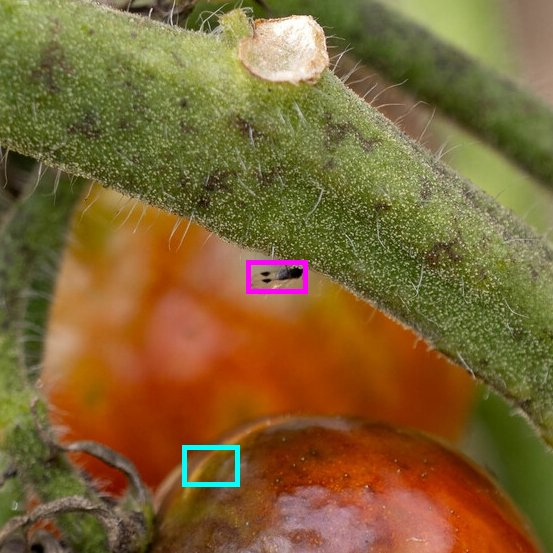

# P9's fallback run, 2026-10-23

This run backs [dev-roadmap P9](../../../../docs/vision/dev-roadmap.md), [vlm.md 12](../../../../docs/vision/vlm.md#12-the-fallback-worker) and [contracts open question 26](../../../../docs/architecture/contracts.md#12-open-questions). It settles the fallback worker's box format, whether its calls finish within its doubled `max_runtime`, and its cost per scan.

`p9-fallback-2026-10-23.jsonl` is the run: one line per case, with the decoded result and each call's time, finish, tokens, the size of each image as sent and the raw answer.

## Setup

- **Model:** `claude-opus-5-5`, effort low, through the worker's `AnthropicBackend`.
- **Adapter:** the fallback profile `main.rs` builds for `--caps fallback` with its defaults: `abs_px_prepared`, 1 px cells, at most 1,150,000 pixels and 1568 on the long side, `CallBudget::HOSTED` (8,000 output tokens a call), no retries, 300 s a call.
- **Driver:** the Rust test `bench_cases` with `VLM_BENCH_HOSTED_MODEL=claude-opus-5-5` and `VLM_BENCH_CONCURRENCY=4` (the default `FALLBACK_SLOTS`), built with `--release` from `feat/p9-fallback-bench`. Each case goes through the worker's own `analyse`: `system@2`, `findings@5`, `indicators@3`, the per-call schemas and the pipeline's image routing.
- **Cases:** 8 dev cases, every tomato case from iNaturalist (5) and one corn case per problem from the maize field set (3). Their photos were fetched again and match the manifest's SHA-256. The candidates and indicator questions are the worker's tomato and corn fixtures, 3 candidates and 9 questions each, as in the day-2 benchmark.
- **Time:** 13:50 EDT. The 8 cases took 28 s in all.

## Results

| Case | Shots | Job | Findings | Indicators | Cost |
|---|---|---|---|---|---|
| `corn-maize-bd-2026-common-rust-img-261` | 1 | 12.6 s | 6 s, 6,721 in, 146 out | 7 s, 5,816 in, 469 out | $0.062 |
| `corn-maize-bd-2026-corn-leaf-blight-img-649` | 1 | 10.0 s | 3 s, 6,721 in, 153 out | 7 s, 5,816 in, 453 out | $0.062 |
| `corn-maize-bd-2026-gray-leaf-spot-img-410` | 1 | 12.8 s | 3 s, 6,713 in, 143 out | 9 s, 5,800 in, 464 out | $0.062 |
| `tomato-inat-338400963` | 2 | 15.5 s | 6 s, 8,360 in, 189 out | 10 s, 5,816 in, 455 out | $0.070 |
| `tomato-inat-388547158` | 2 | 12.1 s | 6 s, 8,360 in, 311 out | 6 s, 5,816 in, 455 out | $0.072 |
| `tomato-inat-401228814` | 1 | 14.2 s | 5 s, 6,747 in, 150 out | 9 s, 5,816 in, 446 out | $0.062 |
| `tomato-inat-401855015` | 1 | 14.7 s | 8 s, 6,747 in, 342 out | 7 s, 5,816 in, 436 out | $0.066 |
| `tomato-inat-402177099` | 2 | 9.0 s | 3 s, 8,358 in, 203 out | 6 s, 5,816 in, 449 out | $0.070 |

- **Validity:** 8 of 8 jobs finished; all 16 calls ended `Complete` and decoded on the first answer, with no refusal, no `max_tokens` and no `400` for a schema keyword.
- **Time:** a job takes 12.7 s at p50 and 15.5 s at most, against the fallback's 585 s (the `vlm` kind's 5 minutes doubled, less the worker's 15 s stop). A call takes 5.3 s (findings) and 6.7 s (indicators) at p50, 9.6 s at most, against its 300 s deadline.
- **Tokens:** at most 469 output tokens a call, p50 389, against the 8,000 budget: at effort low the model thinks briefly. A prepared image costs about 1,600 input tokens; the indicators call's 9 questions are most of its 5,800.
- **Cost:** $0.066 a scan on average and $0.072 at most, at $4 and $20 per million input and output tokens; $0.53 for the run. A full scan (4 findings shots, 27 questions in 3 indicator calls of at most 12) scales to about 15–20 cents and stays under a minute *estimate*.

## The box format

The hosted model answers in pixels of the image as sent, so `abs_px_prepared` is right. The tomato images went at 928 × 1238 (the corn ones at 804 × 1429, 802 × 1432 and 1384 × 830, each just under 1,150,000 pixels), and every box is on a tomato image:

- two boxes reach past 1,000, which a 0–1000 answer can't: `[130, 0, 928, 1238]` (`tomato-inat-388547158`, damage) and `[130, 650, 890, 1020]` (`tomato-inat-401855015`, webbing);
- the one organism, a "small fly" at `[538, 470, 575, 490]` on `tomato-inat-402177099`'s fruit shot, frames the insect when read as pixels and misses it, on the fruit below, when read as 0–1000:

The photo is iNaturalist observation 402177099, CC0.

## Scores

Sam scored the run on [#155](https://github.com/aacruzgon/GreenLens/pull/155#pullrequestreview-5633100599), beside Qwen3.5's and FP8's runs of the same 8 cases on the same prompts from D1's re-check on Oct 22. All 8 cases are `probable`, so `vlm_bench.score_run`, which scores `sure` cases only, counts none of them; they are scored as probable here. The pick is the top candidate by share of "yes" answers, as `vlm_bench` picks it.

| Case | Truth | Opus 5.5 | Qwen3.5 | FP8 |
|---|---|---|---|---|
| `corn-…-common-rust-img-261` | common rust | ✓ | none | none |
| `corn-…-corn-leaf-blight-img-649` | northern leaf blight | ✗ gray leaf spot | none | ✗ gray leaf spot |
| `corn-…-gray-leaf-spot-img-410` | gray leaf spot | none (9 unsure) | none (NLB/GLS tie) | none |
| `tomato-inat-401228814` | early blight | ✓ | ✓ | ✓ |
| `tomato-inat-338400963` | late blight | none | ✗ early blight | ✗ early blight |
| `tomato-inat-401855015` | late blight (fruit only) | none (9 unsure) | none | ✗ septoria |
| `tomato-inat-402177099` | late blight | ✓ | none | ✗ early blight |
| **Right / wrong / none, 7 cases** | | **3 / 1 / 3** | 1 / 1 / 5 | 1 / 4 / 2 |
| `tomato-inat-388547158` | spider mites (not a candidate) | none, right | ✗ septoria | ✗ septoria |

- **Opus is the most accurate and the most careful:** 43 of its 72 answers (60%) are `unsure`, against 19% for Qwen3.5 and 26% for FP8, with reasons that hold up (only the fruit is shown; the specks are too small to judge). On poor photos the fallback gives no diagnosis rather than a wrong one.
- **Its one miss** (`649`) reads the lesions as streaks along the veins, not cigar shapes, so gray leaf spot, as FP8 does.
- **Species:** 8 of 8 right.
- **Too few cases to compare models on.** A run on the 72 dev cases of D1's re-check (about $5) would score the 7 `sure` cases directly; it is a follow-up, not part of P9.

## What else it showed

- **No `leaf_mines`,** but Opus reads disease as animal damage too: on `tomato-inat-401855015`'s fruit, late blight's spots come back as `other` damage, "Small dark pinhole punctures on fruit skin, possibly insect feeding marks" (low certainty), beside a `webbing` box on the strand of web across them. P11's structural fix applies to the fallback as well.
- **The spider-mite case is read right:** `tomato-inat-388547158` gets `webbing` on both shots with high certainty, and its notes say "small mites may be present but cannot be seen clearly".
- **Small cases.** These cases have 1–2 shots and 3 candidates. The full-scan numbers above are scaled, not run; J6's rig-failure test runs a real scan through the fallback.
